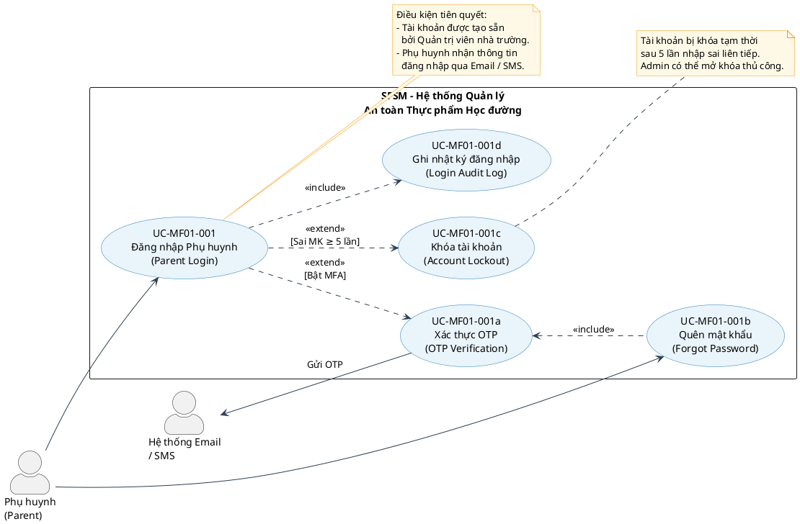

# UC-MF01-001 – Đăng nhập Phụ huynh (Parent Login)

---

## Thông tin tài liệu

| Trường | Nội dung |
|---|---|
| **Mã tài liệu** | SFSM-REQ-UC-MF01-001 |
| **Tên Use Case** | Đăng nhập Phụ huynh |
| **Tên tiếng Anh** | Parent Login |
| **Module** | MF01 – User Management & Access Control |
| **Phiên bản** | v1.0 |
| **Ngày tạo** | 04/06/2026 |
| **Người soạn** | SEP490 – G8 |
| **Trạng thái** | Draft |

---

## 1. Mô hình hóa Use Case (PlantUML)

---

## 2. Use Case Specification

### 2.1. Mô tả tổng quan

| Mục | Nội dung |
|---|---|
| **Use Case ID** | UC-MF01-001 |
| **Use Case Name** | Đăng nhập Phụ huynh (Parent Login) |
| **Actor chính** | Phụ huynh (Parent) |
| **Actor phụ** | Hệ thống Email / SMS (Notification System) |
| **Mức độ ưu tiên** | Cao (High) |
| **Mức độ rủi ro** | Trung bình (Medium) |
| **Điều kiện tiên quyết (Pre-condition)** | 1. Tài khoản phụ huynh đã được Quản trị viên nhà trường tạo và kích hoạt trong hệ thống SFSM.   2. Phụ huynh đã nhận được thông tin đăng nhập (username/email và mật khẩu tạm) qua Email hoặc SMS.   3. Phụ huynh có thiết bị kết nối Internet. |
| **Điều kiện sau – Thành công (Post-condition – Success)** | 1. Phụ huynh được xác thực thành công và được chuyển hướng vào **Parent Transparency Portal**.   2. Hệ thống ghi nhận nhật ký đăng nhập (thời gian, địa chỉ IP, thiết bị). |
| **Điều kiện sau – Thất bại (Post-condition – Failure)** | 1. Hệ thống hiển thị thông báo lỗi phù hợp.   2. Sau 5 lần thất bại liên tiếp, tài khoản bị khóa tạm thời và hệ thống gửi thông báo cho phụ huynh. |

---

### 2.2. Luồng sự kiện chính (Main Flow / Basic Flow)

> **Tiền đề:** Phụ huynh truy cập vào trang đăng nhập của hệ thống SFSM.

| Bước | Actor | Hành động |
|:---:|---|---|
| 1 | **Phụ huynh** | Truy cập vào trang đăng nhập (`/parent/login`). |
| 2 | **Hệ thống** | Hiển thị form đăng nhập gồm: ô nhập **Email / Tên đăng nhập** và **Mật khẩu**. |
| 3 | **Phụ huynh** | Nhập Email (hoặc tên đăng nhập) và mật khẩu, sau đó nhấn nút **"Đăng nhập"**. |
| 4 | **Hệ thống** | Xác thực định dạng đầu vào (kiểm tra trường không được để trống, email đúng cú pháp). |
| 5 | **Hệ thống** | Tra cứu tài khoản trong cơ sở dữ liệu, đối chiếu mật khẩu đã mã hóa (bcrypt). |
| 6 | **Hệ thống** | Kiểm tra trạng thái tài khoản (Active / Inactive / Locked). |
| 7 | **Hệ thống** | *(Nếu cấu hình MFA được bật)* Kích hoạt luồng con **UC-MF01-001a – Xác thực OTP**. |
| 8 | **Hệ thống** | Tạo phiên làm việc (Session / JWT Token) và ghi nhật ký đăng nhập thành công. |
| 9 | **Hệ thống** | Chuyển hướng phụ huynh vào **Parent Transparency Portal** (trang chủ dành cho phụ huynh). |

---

### 2.3. Luồng thay thế (Alternative Flows)

#### AF-01: Đăng nhập lần đầu – Yêu cầu đổi mật khẩu

| Bước | Actor | Hành động |
|:---:|---|---|
| 5a | **Hệ thống** | Phát hiện tài khoản đang dùng **mật khẩu tạm thời** (first-time login). |
| 5b | **Hệ thống** | Chuyển hướng phụ huynh đến trang **"Đổi mật khẩu lần đầu"** trước khi vào hệ thống. |
| 5c | **Phụ huynh** | Nhập mật khẩu mới (thoả mãn chính sách: ≥ 8 ký tự, có chữ hoa, số, ký tự đặc biệt) và xác nhận. |
| 5d | **Hệ thống** | Lưu mật khẩu mới, cập nhật trạng thái tài khoản và tiếp tục từ Bước 7 của luồng chính. |

#### AF-02: Quên mật khẩu

| Bước | Actor | Hành động |
|:---:|---|---|
| 3a | **Phụ huynh** | Nhấn liên kết **"Quên mật khẩu?"** trên trang đăng nhập. |
| 3b | **Hệ thống** | Hiển thị form yêu cầu nhập **Email đăng ký**. |
| 3c | **Phụ huynh** | Nhập email và nhấn **"Gửi yêu cầu"**. |
| 3d | **Hệ thống** | Tra cứu email trong hệ thống; nếu tồn tại, gửi **OTP hoặc link đặt lại mật khẩu** đến email (hiệu lực 15 phút). |
| 3e | **Phụ huynh** | Mở email, nhập OTP hoặc truy cập link để đặt lại mật khẩu mới. |
| 3f | **Hệ thống** | Xác thực OTP/token, cho phép phụ huynh tạo mật khẩu mới. Quay lại trang đăng nhập. |

---

### 2.4. Luồng ngoại lệ (Exception Flows)

#### EF-01: Thông tin đăng nhập sai

| Bước | Actor | Hành động |
|:---:|---|---|
| 5-EX | **Hệ thống** | Email / mật khẩu không khớp → hiển thị thông báo: *"Email hoặc mật khẩu không chính xác. Vui lòng thử lại."* |
| 5-EX | **Hệ thống** | Tăng bộ đếm số lần đăng nhập thất bại liên tiếp cho tài khoản này. |
| 5-EX | **Phụ huynh** | Có thể thử lại từ Bước 3, hoặc chọn "Quên mật khẩu". |

#### EF-02: Tài khoản bị khóa (Account Lockout)

| Bước | Actor | Hành động |
|:---:|---|---|
| 6-EX | **Hệ thống** | Đếm ≥ 5 lần nhập sai liên tiếp → **Khóa tài khoản tạm thời** (ví dụ: 15 phút hoặc đến khi Admin mở khóa). |
| 6-EX | **Hệ thống** | Hiển thị thông báo: *"Tài khoản đã bị khóa do đăng nhập sai quá nhiều lần. Vui lòng liên hệ nhà trường hoặc thử lại sau 15 phút."* |
| 6-EX | **Hệ thống** | Ghi nhật ký sự kiện khóa tài khoản. Gửi email thông báo đến phụ huynh. |

#### EF-03: Tài khoản bị vô hiệu hóa (Inactive)

| Bước | Actor | Hành động |
|:---:|---|---|
| 6-EX | **Hệ thống** | Tài khoản có trạng thái **Inactive** → Hiển thị thông báo: *"Tài khoản của bạn chưa được kích hoạt. Vui lòng liên hệ nhà trường để được hỗ trợ."* |

#### EF-04: OTP hết hạn hoặc sai (nếu MFA được bật)

| Bước | Actor | Hành động |
|:---:|---|---|
| 7-EX | **Hệ thống** | OTP sai hoặc hết hạn (> 5 phút) → Thông báo: *"Mã OTP không hợp lệ hoặc đã hết hạn. Vui lòng yêu cầu mã mới."* |
| 7-EX | **Phụ huynh** | Có thể nhấn **"Gửi lại OTP"** (giới hạn 3 lần/phiên). |

#### EF-05: Mất kết nối mạng

| Bước | Actor | Hành động |
|:---:|---|---|
| Any | **Hệ thống** | Phát hiện mất kết nối → Hiển thị thông báo: *"Không thể kết nối đến máy chủ. Vui lòng kiểm tra kết nối Internet và thử lại."* |

---

### 2.5. Quy tắc nghiệp vụ (Business Rules)

| Mã | Quy tắc |
|---|---|
| **BR-01** | Tài khoản phụ huynh **chỉ được Quản trị viên nhà trường** tạo và gán liên kết với học sinh cụ thể trong hệ thống. Phụ huynh **không tự đăng ký** tài khoản. |
| **BR-02** | Mật khẩu phải thỏa mãn chính sách: **tối thiểu 8 ký tự**, bao gồm ít nhất 1 chữ hoa, 1 chữ số và 1 ký tự đặc biệt. |
| **BR-03** | Sau **5 lần đăng nhập sai** liên tiếp, tài khoản bị khóa tạm thời tối thiểu **15 phút**. |
| **BR-04** | Phiên làm việc (Session) hết hạn sau **30 phút không hoạt động** hoặc sau **8 giờ** kể từ lần đăng nhập thành công. |
| **BR-05** | Hệ thống ghi nhật ký toàn bộ hoạt động đăng nhập (thành công và thất bại) bao gồm: thời gian, địa chỉ IP, loại thiết bị. |
| **BR-06** | MFA (OTP qua Email / SMS) là tùy chọn cấu hình cấp hệ thống. OTP có hiệu lực **5 phút** và chỉ được sử dụng **1 lần**. |
| **BR-07** | Phụ huynh chỉ được truy cập thông tin của **con em mình** (học sinh được gán liên kết với tài khoản). |

---

### 2.6. Yêu cầu phi chức năng liên quan (Non-Functional Requirements)

| Mã | Loại | Yêu cầu |
|---|---|---|
| **NFR-01** | Hiệu năng | Thời gian phản hồi xác thực phải ≤ **2 giây** trong điều kiện tải thông thường. |
| **NFR-02** | Bảo mật | Mật khẩu lưu trữ theo chuẩn **bcrypt** (không lưu plaintext). Truyền thông qua **HTTPS/TLS**. |
| **NFR-03** | Khả dụng | Trang đăng nhập phải hiển thị đúng trên cả **Web Browser** (PC & Mobile) và **Mobile App** (iOS, Android). |
| **NFR-04** | Khả năng tiếp cận | Giao diện hỗ trợ phụ huynh ít kinh nghiệm công nghệ: hướng dẫn rõ ràng, thông báo lỗi bằng **tiếng Việt**. |
| **NFR-05** | Tuân thủ | Tuân thủ các quy định bảo vệ dữ liệu cá nhân theo quy định pháp luật Việt Nam (Nghị định 13/2023/NĐ-CP). |

---

### 2.7. Giao diện liên quan (UI References)

| Màn hình | Mô tả |
|---|---|
| **SCR-PL-001** | Trang đăng nhập phụ huynh – form email + mật khẩu, nút "Đăng nhập", link "Quên mật khẩu". |
| **SCR-PL-002** | Trang nhập OTP – ô nhập 6 chữ số, đếm ngược thời gian, nút "Gửi lại OTP". |
| **SCR-PL-003** | Trang đổi mật khẩu lần đầu – form nhập mật khẩu mới và xác nhận. |
| **SCR-PL-004** | Trang quên mật khẩu – form nhập email đăng ký. |
| **SCR-PL-005** | Parent Transparency Portal (trang chủ phụ huynh) – điểm đến sau khi đăng nhập thành công. |

---

### 2.8. Use Case liên quan (Related Use Cases)

| Mã UC | Tên Use Case | Quan hệ |
|---|---|---|
| UC-MF01-002 | Đăng xuất Phụ huynh (Parent Logout) | Kế tiếp (Subsequent) |
| UC-MF01-003 | Quản lý hồ sơ Phụ huynh (Parent Profile Management) | Kế tiếp (Subsequent) |
| UC-MF09-001 | Xem thực đơn hàng ngày (View Daily Menu) | Kế tiếp (Subsequent) |
| UC-MF09-002 | Xem giấy chứng nhận an toàn (View Safety Certificates) | Kế tiếp (Subsequent) |
| UC-MF01-010 | Quản lý tài khoản người dùng (User Account Management - Admin) | Phụ thuộc (Depends on) |

---

## 3. Lịch sử thay đổi

| Ngày | Phiên bản | Người thực hiện | Mô tả thay đổi |
|---|---|---|---|
| 04/06/2026 | v1.0 | SEP490-G8 | Tạo tài liệu ban đầu |

---

*Tài liệu thuộc dự án: **SFSM – School Food Safety Management Support System***  
*Nhóm: **SEP490 – G8** | Trường Đại học FPT*
