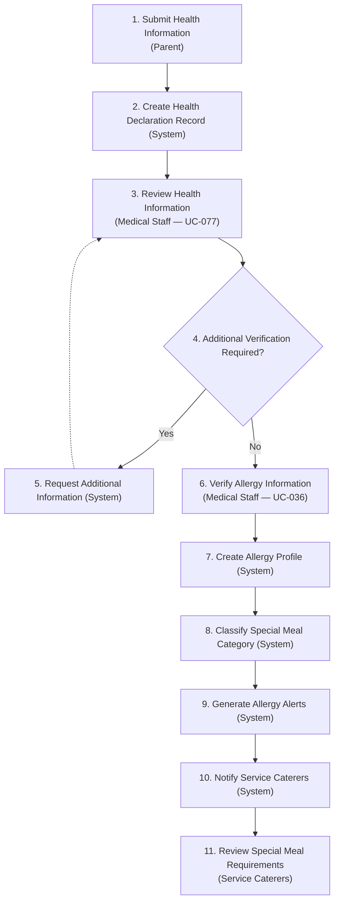
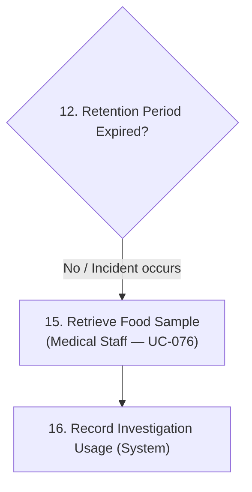
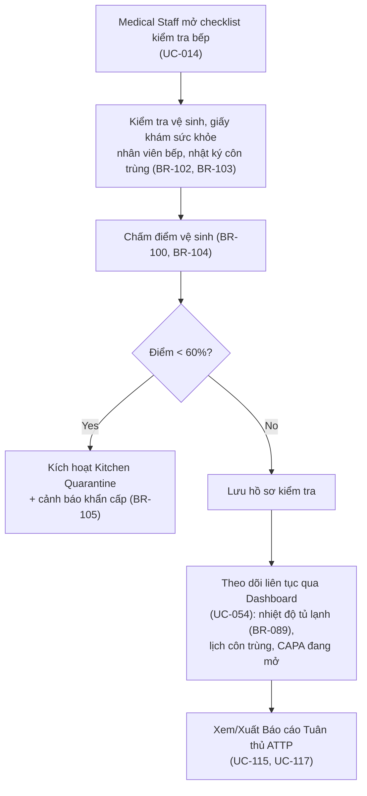
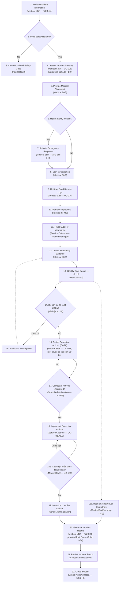
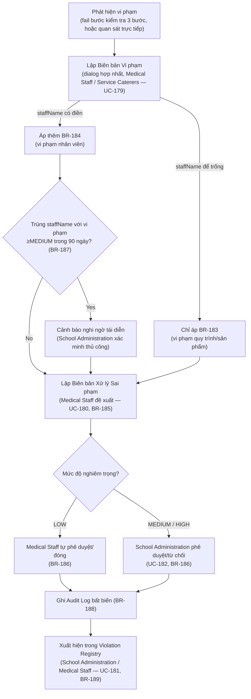

# Medical Staff — Vai trò, Trách nhiệm & Luồng nghiệp vụ

> **Nguồn tổng hợp**: `03_Design/03_Workflow/00_Business_Workflows.md` · `02_Requirements/00_BusinessRules/business_rules.md` · `02_Requirements/03_TraceabilityMatrix/traceability_matrix.md` · `02_Requirements/02_UseCases/MF03_Student_Parent_Management.md`, `MF07_Food_Safety_Inspection_Monitoring.md`, `MF08_Food_Sample_Retention.md`, `MF11_Incident_Emergency_Management.md` · `02_Requirements/Violation_Management_Proposal.md` · `00_Policies/13_2016_TTLT-BYT-BGDDT...md`, `00_Policies/1246_QD-BYT...md`.
> **Ngày biên soạn**: 04/07/2026
> **Mục đích**: Tài liệu này tổng hợp lại — không phát sinh yêu cầu mới — toàn bộ phạm vi trách nhiệm, Use Case, Business Rules và luồng quy trình mà vai trò **Medical Staff** tham gia trong SFMS, để phục vụ review thiết kế và đối chiếu tính nhất quán giữa Workflow ↔ SRS ↔ Traceability Matrix.
> **Quy ước**: Mọi mã UC/BR trích dẫn trong tài liệu này đều lấy nguyên trạng từ các file nguồn nêu trên. Các điểm chưa khớp giữa nguồn được đánh dấu rõ trong §7 (Khoảng trống & Điểm cần xác nhận) thay vì tự suy diễn.

---

## 1. Định nghĩa vai trò

Theo **BR-007** (RBAC), hệ thống định nghĩa 7 vai trò: *System Admin, School Administration, **Medical Staff**, Teacher, Parent, Raw Food Supplier, Service Caterers*. Medical Staff là nhân viên y tế học đường, chịu trách nhiệm chuyên môn về sức khỏe học sinh và giám sát an toàn thực phẩm (ATTP) tại bếp ăn trường học — vai trò này ánh xạ với "Nhân viên y tế trường học" quy định tại Điều 8, Thông tư liên tịch 13/2016/TTLT-BYT-BGDĐT (`00_Policies/13_2016_TTLT-BYT-BGDDT...md`).

Phạm vi truy cập dữ liệu của Medical Staff bị giới hạn theo trường (**BR-022**, **BR-176**): chỉ xem được chính sách, hồ sơ, và báo cáo của trường mà tài khoản thuộc về; mọi truy cập cross-school đều bị từ chối.

---

## 2. Tổng quan trách nhiệm (theo nhóm nghiệp vụ)

| Nhóm nghiệp vụ | Vai trò của Medical Staff |
| --- | --- |
| Sức khỏe & Dị ứng học sinh | Xét duyệt khai báo sức khỏe/dị ứng của phụ huynh, xác minh hồ sơ dị ứng, phân loại chế độ ăn đặc biệt, duy trì lịch sử sức khỏe học sinh |
| Giám sát An toàn Thực phẩm | Thực hiện kiểm tra vệ sinh ATTP định kỳ tại bếp (hàng tháng), giám sát nhiệt độ tủ lạnh, nhật ký côn trùng, giấy khám sức khỏe nhân viên bếp; xem (không thực hiện) hồ sơ kiểm tra ba bước |
| Lưu mẫu Thực phẩm | Thu hồi mẫu lưu để phục vụ điều tra khi có sự cố |
| Quản lý Sự cố & Khẩn cấp | Là actor chính xuyên suốt vòng đời sự cố ATTP: đánh giá mức độ nghiêm trọng, kích hoạt phản ứng khẩn cấp, điều tra nguyên nhân gốc rễ, định nghĩa CAPA, xác nhận hồi phục lâm sàng, tạo báo cáo sự cố chính thức |
| Quản lý Vi phạm (mở rộng 2026-07-01) | Lập biên bản vi phạm quy trình/nhân viên, tự phê duyệt xử lý sai phạm mức LOW, xem Violation Registry |
| Báo cáo & Phân tích | Xem Dashboard phân tích, báo cáo tuân thủ ATTP, xuất báo cáo sự cố |
| Chung (mọi vai trò) | Đăng nhập/đăng xuất, đổi mật khẩu, cập nhật hồ sơ cá nhân, nhận thông báo, chat với AI |

---

## 3. Danh sách Use Case liên quan đến Medical Staff

Trích từ `traceability_matrix.md` §1 — chỉ liệt kê UC có Medical Staff là Actor (chính hoặc đồng-actor).

### 3.1 Student & Parent Management

| UC ID | Tên Use Case | Actor | Business Rules |
| --- | --- | --- | --- |
| UC-077 | Review Health Information | Medical Staff | BR-031 |
| UC-078 | Review Special Meal Requests | Medical Staff | BR-031, BR-065 |
| UC-094 | Update Health Records | Medical Staff | BR-172 |
| UC-051 | View List Student Health Records | Medical Staff | BR-172 |
| UC-104 | View Allergy Information | Medical Staff / Parent | BR-030 |
| UC-146 | View Student Health History | Medical Staff | BR-172 |
| UC-036 | View List Allergy & Special Meals | Medical Staff | BR-030, BR-065 |

### 3.2 School & Class Management

| UC ID | Tên Use Case | Actor | Business Rules |
| --- | --- | --- | --- |
| UC-137 | View Policy Of School | Teacher / Medical Staff / Service Caterers | BR-022 |

### 3.3 Food Safety Inspection & Monitoring

| UC ID | Tên Use Case | Actor | Business Rules |
| --- | --- | --- | --- |
| UC-014 | Conduct Food Safety Inspection | Medical Staff | BR-100, BR-101, BR-102, BR-103, BR-104 |
| UC-054 | Monitor Food Safety | Medical Staff | BR-089, BR-100, BR-101, BR-102, BR-103, BR-104 |
| UC-112 | View Food Inspection Records | Medical Staff | BR-099 |
| UC-115 | View Food Safety Compliance Report | Medical Staff | BR-100, BR-101 |
| UC-117 | View Food Safety Reports | Medical Staff | — |
| ~~UC-178~~ | ~~Record Process Violation~~ (Deprecated 11/07/2026 — gộp vào UC-179, dialog hợp nhất) | Service Caterers, Medical Staff | BR-183 |

### 3.4 Food Sample Retention

| UC ID | Tên Use Case | Actor | Business Rules |
| --- | --- | --- | --- |
| UC-076 | Retrieve Food Sample Records | Medical Staff | BR-113, BR-114 |
| UC-118 | View Food Sample Records | Medical Staff / School Admin | BR-114 |

### 3.5 Incident & Emergency Management

| UC ID | Tên Use Case | Actor | Business Rules |
| --- | --- | --- | --- |
| UC-041 | Manage Food Safety Incidents | Medical Staff | BR-146, BR-147, BR-148, BR-149, BR-150, BR-151 |
| UC-009 | Assign Incident Severity | Medical Staff | BR-147, BR-148 |
| UC-168 | Record Corrective Actions Report | Medical Staff | BR-152, BR-154 |
| UC-033 | Generate Incident Report | Medical Staff | BR-154 |
| UC-031 | Export Incident Reports | School Administration, Medical Staff | BR-154 |
| UC-179 | Record Staff Violation | Medical Staff, Service Caterers | BR-184, BR-187, BR-190 |
| UC-180 | Record Violation Resolution | Medical Staff, School Administration | BR-185, BR-186 |
| UC-181 | View Violation Registry | School Administration, Medical Staff | BR-189 |

### 3.6 Reporting & Analytics

| UC ID | Tên Use Case | Actor | Business Rules |
| --- | --- | --- | --- |
| UC-171 | View Analytics Dashboard | School Administration / Medical Staff / System Admin | BR-175, BR-176, BR-180, BR-181, BR-182 |

### 3.7 Use Case chung (áp dụng cho mọi vai trò, bao gồm Medical Staff)

UC-034 (Login), UC-035 (Logout), UC-011 (Change Password), UC-032 (Forgot Password), UC-097 (Update Profile), UC-059 (Profile Manage), UC-138 (View Profile), UC-088 (Manage Notification Preferences), UC-058 (Receive Notification), UC-136 (View Notification History), UC-012 (Chat with AI), UC-119 (View History Chat).

---

## 4. Luồng nghiệp vụ (Workflows) có sự tham gia của Medical Staff

Các sơ đồ dưới đây trích và tô đậm lại phần **Medical Staff** từ 12 Workflow chính trong `00_Business_Workflows.md` — không tạo luồng mới ngoài các bước đã có trong tài liệu nguồn.

### 4.1 Luồng 9 — Xét duyệt Sức khỏe, Dị ứng & Bữa ăn Đặc biệt (trích đoạn Medical Staff)

**Nguồn**: `00_Business_Workflows.md` §9. **BR liên quan**: BR-031, BR-063, BR-065, BR-066.

Bước 3 và 6 là điểm quyết định: khai báo của phụ huynh **chỉ có hiệu lực** sau khi Medical Staff xác nhận (BR-031). UC-078 (Review Special Meal Requests) chạy song song, xử lý riêng phần yêu cầu chế độ ăn đặc biệt trước khi chuyển cho Service Caterers ở bước 11.

### 4.2 Luồng 8 — Thu hồi Mẫu lưu khi có Sự cố (trích đoạn Medical Staff)

**Nguồn**: `00_Business_Workflows.md` §8, nhánh 12/15–16. **BR liên quan**: BR-112, BR-113, BR-114.

Nhánh này bị kích hoạt từ Workflow 11 khi cần truy vết bằng mẫu lưu; BR-112 quy định hệ thống **chặn hủy mẫu** nếu mẫu đang liên kết với một sự cố đang mở.

### 4.3 Giám sát An toàn Thực phẩm định kỳ (UC-014, UC-054, UC-112/115/117)

Không có Mermaid riêng trong `00_Business_Workflows.md` cho hoạt động giám sát định kỳ (đây là hoạt động lặp lại, không nằm trong 12 workflow theo lô/sự kiện) — luồng dưới đây được dựng lại từ mô tả Normal Flow của UC-014 và UC-054 (`MF07_Food_Safety_Inspection_Monitoring.md`), không phải từ một sơ đồ đã có sẵn:

Medical Staff **chỉ xem** (không tự thực hiện) hồ sơ Kiểm tra Ba Bước do Service Caterers ghi nhận (BR-099, UC-112) — đây là ranh giới trách nhiệm cần giữ nhất quán khi thiết kế màn hình: Medical Staff không có quyền chỉnh sửa checklist ba bước.

### 4.4 Luồng 11 — Xử lý Sự cố An toàn Thực phẩm (đầy đủ, chú thích vai trò)

**Nguồn**: `00_Business_Workflows.md` §11 — đã đồng bộ theo bản cập nhật 19/07/2026 (sơ đồ gốc và bản trích đoạn này nay khớp nhau; xem changelog đầy đủ tại đầu §11 của file nguồn), chú thích thêm UC tương ứng cho từng bước Medical Staff.

Bước 18b nhánh "Chưa đạt" (trả việc về Service Caterers) là nghiệp vụ mới thống nhất 19/07/2026, chưa có mã UC/BR — xem §7 điểm 6.

### 4.5 Luồng Quản lý Vi phạm (Violation Management) — UC-179 (UC-178 Deprecated), UC-180 đến UC-183

> **Ghi chú quan trọng**: Luồng này **chưa có sơ đồ Mermaid chính thức** trong `00_Business_Workflows.md` (module được chính thức hoá 2026-07-01, sau khi 12 workflow gốc đã được dựng). Sơ đồ dưới đây được dựng **trực tiếp từ Business Rules BR-183–BR-190** và bảng UC trong `Violation_Management_Proposal.md` — cần review và bổ sung chính thức vào `00_Business_Workflows.md` để đồng bộ.
> **Cập nhật 11/07/2026**: UC-178 và UC-179 vốn là 2 màn hình/2 dialog riêng biệt tương ứng BR-183 (vi phạm quy trình) và BR-184 (vi phạm nhân viên). Đã **gộp thành 1 dialog duy nhất** (UC-179 là mã sống sót) — không còn bước "chọn loại vi phạm" thủ công (nút V2 cũ); hệ thống tự phân loại BR-183/BR-184 dựa trên việc field "Nhân viên liên quan" (`staffName`, tùy chọn) có được điền hay không. 2 entity dữ liệu `NonConformanceRecord`/`StaffViolationRecord` vẫn tách riêng ở tầng lưu trữ. Xem `business_rules.md` BR-183, BR-184, BR-211; `03_Design/05_ScreenSpecifications/Web/MedicalStaff/22_RecordStaffViolation.md`.

Cơ chế này **chạy song song**, không thay thế, luồng CAPA hiện có ở §4.4 (`ViolationResolutionRecord` khác `CorrectiveActionRequest`). Ngoài ra, `UC-183 — View Weekly Override Abuse Report` (School Administration, BR-190) tổng hợp hàng tuần các trường hợp `violationType = OVERRIDE_ABUSE` phát hiện qua UC-179.

---

## 5. Business Rules chi phối vai trò Medical Staff

| BR Code | Nội dung tóm tắt |
| --- | --- |
| BR-022 | Medical Staff chỉ xem được chính sách của trường mình |
| BR-031 | Thông tin sức khỏe/dị ứng do phụ huynh khai báo phải được Medical Staff xác nhận trước khi có hiệu lực |
| BR-065, BR-066 | Bắt buộc lập kế hoạch bữa ăn đặc biệt cho học sinh có dị ứng đã xác minh; danh mục chế độ ăn (Halal, Vegetarian, Gluten-Free, Nut-Free...) |
| ~~BR-089~~ | ~~Giám sát nhiệt độ tủ lạnh liên tục~~ (Deprecated 11/07/2026 — không có ngưỡng số cụ thể, không field nào hiện thực; xem BR-110 cho tủ lạnh lưu mẫu) |
| BR-099 | Medical Staff và School Administration có quyền xem toàn bộ hồ sơ Kiểm tra Ba Bước |
| BR-100–104 | Điểm số vệ sinh hàng ngày/tháng, nhật ký côn trùng, giấy khám sức khỏe nhân viên bếp — do Medical Staff theo dõi |
| BR-113 | Medical Staff có quyền thu hồi mẫu lưu khi có sự cố ATTP |
| BR-142 | Phát hiện từ khóa bệnh lý trong phản hồi phụ huynh → cảnh báo khẩn cấp cho Medical Staff |
| BR-146–151 | Cơ chế tự động kích hoạt điều tra sự cố (≥3 học sinh, 24h); Medical Staff phân loại mức độ nghiêm trọng, kích hoạt phản ứng khẩn cấp, phân tích nguyên nhân gốc rễ, biên soạn bản đồ truy xuất |
| BR-152, BR-154 | Medical Staff định nghĩa CAPA và tạo báo cáo sự cố chính thức |
| BR-155 | Đóng sự cố thuộc quyền School Administration, nhưng yêu cầu Medical Staff xác nhận hồi phục lâm sàng học sinh trước (UC-168) |
| BR-175, BR-176 | Medical Staff xem được báo cáo kiểm tra thực phẩm, sự cố y tế, tuân thủ ATTP — giới hạn theo trường |
| BR-183, BR-184 | Medical Staff (cùng Service Caterers) lập Biên bản Vi phạm Quy trình/Nhân viên |
| BR-186 | Medical Staff tự phê duyệt Xử lý Sai phạm mức LOW; mức MEDIUM/HIGH cần School Administration |
| BR-187 | Cảnh báo nghi ngờ tái diễn vi phạm (best-effort, 90 ngày) |
| BR-189 | Medical Staff xem được Violation Registry tổng hợp |

---

## 6. Độ phủ theo Module (tham chiếu `traceability_matrix.md` §4)

| Module | Số UC | Medical Staff là Actor trong |
| --- | --- | --- |
| Student & Parent Management | 15 | 7/15 UC |
| School & Class Management | 16 | 1/16 UC (đồng-actor) |
| Food Safety Inspection & Monitoring | 11 | 6/11 UC |
| Food Sample Retention | 5 | 2/5 UC |
| Incident & Emergency Management | 20 | 8/20 UC |
| Reporting & Analytics | 3 | 1/3 UC (đồng-actor) |

---

## 7. Khoảng trống & Điểm cần xác nhận

1. **Luồng Violation Management (§4.5) chưa có Mermaid chính thức** trong `00_Business_Workflows.md`. Sơ đồ ở §4.5 do tài liệu này dựng lại từ Business Rules — cần review và merge chính thức vào `00_Business_Workflows.md` để tránh hai nguồn không đồng bộ.
2. ~~Bước 18b (Record Corrective Actions Report — UC-168) không xuất hiện trong sơ đồ gốc của Workflow 11~~ — **Đã sửa 19/07/2026**: bổ sung bước 18b vào `00_Business_Workflows.md` §11 (đã có sẵn trong code Web từ trước, chỉ thiếu ở sơ đồ). Chi tiết: `08_FrontEnd/Web/review/medical_staff/review_medicalstaff_design_pattern.md` Vòng 7.
3. ~~Nhãn vai trò "Kitchen Manager" ở bước 11 Workflow 11~~ — **Đã sửa 19/07/2026** (chỉ trong Workflow 11, chưa đụng Workflow 10 — xem điểm 7 mới bên dưới): đổi thành "Service Caterers (Kitchen Manager)", giữ chú thích ngoặc để không mất ngữ cảnh nghiệp vụ, nhưng đúng 1 trong 7 vai trò canonical BR-007.
4. **Trùng mã UC-059**: `MF11_Incident_Emergency_Management.md` (dòng gốc) vẫn ghi "UC-059 – Record Corrective Actions Report" (Primary Actor: Medical Staff), trong khi `traceability_matrix.md` đã đổi số này thành **UC-168** để giải phóng UC-059 cho "Profile Manage" (User chung). Tài liệu MF11 gốc chưa được cập nhật theo đổi số này — đề nghị đồng bộ lại UC ID trong file MF11 cho khớp traceability matrix (nguồn chuẩn theo quyết định 2026-07-01). **Vẫn CHƯA sửa.**
5. **UC-137 (View Policy Of School)** chưa có Functional Specification chi tiết trong Report 3 — chỉ có trong bảng tổng hợp (ghi chú tại `traceability_matrix.md` §1.2).
6. **[Mới 19/07/2026]** Gate "Root Cause Confirmed?" (bước 14, cũ) chặn cứng việc Define CAPA (bước 16) mâu thuẫn với SLA 12h của CAPA (BR-152/UC-038) khi root cause cần xét nghiệm lab 48–87h (BR-149). **Đã sửa**: đổi bước 14 thành "Đủ căn cứ đề xuất CAPA? (kết luận sơ bộ)", tách bước 16b "Hoàn tất Root Cause Chính thức" chạy song song, chỉ bắt buộc trước bước 20 (Generate Incident Report) — khớp quyết định đã chốt ở review Web Mục 11.9.1 `review_medicalstaff_incidentmanagement.md`.
7. **[Mới 19/07/2026]** Bước 18b nay có nhánh "Chưa đạt" → quay lại bước 18 (Medical Staff yêu cầu Service Caterers thực hiện lại nếu kiểm tra thực địa cho thấy khắc phục chưa đạt, ngoài EX1 hiện có của UC-168 chỉ chặn theo tình trạng hồi phục học sinh). Đây là nghiệp vụ **mới**, thống nhất qua review Web (Vòng 7) nhưng **chưa có mã UC/BR chính thức** — cần đội dự án cấp mã và cập nhật UC-168 trong Report 3 chính thức.
8. **[Mới 19/07/2026]** "Kitchen Manager" vẫn còn dùng trần (không kèm "Service Caterers") ở Workflow 10 (`00_Business_Workflows.md` §10, bước MS1/MS5) và trong `Report 3.md`/`Report 1.md`/wireframes — **chưa sửa trong đợt này** (ngoài phạm vi review Medical Staff Incident Management), cần một đợt review riêng cho Workflow 10/Meal Serving để đồng bộ toàn bộ, không chỉ Workflow 11.

---

*Tài liệu này tổng hợp và trích dẫn lại nội dung đã có trong 03_Design/03_Workflow, 02_Requirements/00_BusinessRules, 02_Requirements/03_TraceabilityMatrix và 02_Requirements/02_UseCases — không bổ sung yêu cầu, business rule, hay use case nào ngoài các nguồn đã dẫn.*
