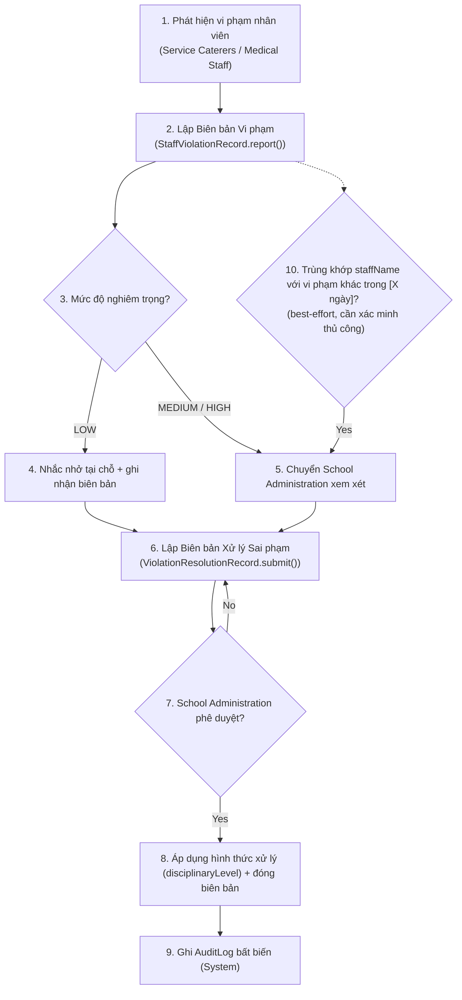

# Đề xuất bổ sung: Quản lý Vi phạm & Xử lý Sai phạm (Violation Management)

> **Trạng thái**: `PROPOSED` — toàn bộ nội dung trong file này là **đề xuất mới**, chưa phải trích xuất từ tài liệu chính thức hiện có. Mọi mã BR/UC dưới đây là **placeholder**, cần đối chiếu và đánh số lại khi merge vào `02_Requirements/00_BusinessRules/business_rules.md` và `02_Requirements/03_TraceabilityMatrix/traceability_matrix.md` chính thức.
> **Lý do đề xuất**: Phản hồi của Hội đồng đồ án — *"Nên khảo sát quy trình xử lý sai phạm và thực hiện quản lý/ghi nhận trên hệ thống."* Rà soát tài liệu hiện có cho thấy hệ thống mới có cơ chế **rời rạc** cho từng loại vi phạm (xem mục 0 bên dưới), chưa có quy trình thống nhất — đặc biệt **chưa có cơ chế nào cho vi phạm hành vi của nhân viên** (con người), khác với vi phạm quy trình/sản phẩm (đã có `NonConformanceRecord`).
> **Phạm vi đã chọn** (theo xác nhận của team): áp dụng **cả hai** — (A) hình thức hóa vi phạm quy trình/sản phẩm đã có sẵn thành "biên bản" đúng nghĩa, và (B) bổ sung entity hoàn toàn mới cho vi phạm hành vi nhân viên.

---

## 0. Hiện trạng trước khi đề xuất (tóm tắt, đã phân tích ở phần trước)

| Cơ chế đã có | Đối tượng | Nguồn |
| --- | --- | --- |
| `NonConformanceRecord` → `CorrectiveActionRequest` | Vi phạm 1 bước kiểm tra 3 bước | `03_Design/01_Diagrams/01_Class_Diagram/class_diagram_description.md` dòng 569–595 |
| `FoodSafetyIncident` → `IncidentInvestigation` → `CAPA` | Sự cố an toàn thực phẩm nghiêm trọng | cùng file, dòng 792–886 |
| Kitchen Quarantine tự động (BR-105) | Vi phạm vệ sinh nghiêm trọng (điểm <60%) | `Report 3.md` dòng 6331 |
| ComplianceDocument expiry + Performance Index | Vi phạm phía Supplier/Caterer | BR-047/048/052/053 |
| **Không có** | **Vi phạm hành vi cá nhân của nhân viên (Staff)** | — khoảng trống |
| **Không có** | Màn hình tổng hợp mọi loại vi phạm (registry thống nhất) | — khoảng trống |
| **Chưa hiện thực hoá** | Báo cáo tổng hợp lạm dụng manual override hàng tuần đã cam kết ở `ADR-002.md` (dòng 102) | — khoảng trống |

Đề xuất dưới đây nhằm lấp 3 khoảng trống cuối, đồng thời không phá vỡ 4 cơ chế đã có ở trên.

### 0.1. Phát hiện bổ sung — nhân viên nấu ăn không tồn tại như một entity/tài khoản trong hệ thống

Đối chiếu lại `class_diagram_description.md`, `Supplier` có quan hệ `Supplier "1" --> "0..*" DeliveryPerson : employs` — nhân viên giao hàng được model thành entity riêng (`deliveryPersonId`, `fullName`, `nationalId`...), **không cần tài khoản đăng nhập**, chỉ xác thực bằng khuôn mặt tại cổng (ADR-002). Ngược lại, **`ServiceCaterer` không có quan hệ tương đương nào** — không có entity nào đại diện cho từng nhân viên bếp/đầu bếp cụ thể, chỉ có 1 tài khoản `ServiceCaterer` ở cấp công ty (`catererId`, `companyName`...).

→ Hệ quả trực tiếp lên đề xuất này: `StaffViolationRecord.staffId` **không thể** tham chiếu `User.userId` như bản nháp trước, vì nhân viên nấu ăn không có `User`.

→ **Quyết định đơn giản hoá (theo yêu cầu)**: thay vì tạo entity `KitchenStaff` riêng (như pattern `DeliveryPerson`), dùng trực tiếp field tự do `staffName : String` (họ tên nhập tay) trên `StaffViolationRecord` — không cần bảng/entity mới, không cần luồng "tạo hồ sơ nhân viên trước khi lập biên bản". Đã cập nhật ở mục 3.2 bên dưới.

**Đánh đổi cần lưu ý**: vì `staffName` là text tự do (không phải khóa ngoại có ràng buộc), hệ thống **không thể join chính xác 100%** để phát hiện "vi phạm tái diễn của cùng một người" (BR-187) — hai bản ghi có tên viết khác nhau (có dấu/không dấu, viết tắt, trùng tên hai người khác nhau...) có thể bị tính nhầm là cùng một người hoặc khác người. BR-187 bên dưới đã được điều chỉnh thành "best-effort — so khớp theo tên, cần School Administration xác minh thủ công khi nghi ngờ trùng/lệch người", thay vì đảm bảo tuyệt đối như khi có ID.

→ **Hệ quả rộng hơn, ngoài phạm vi đề xuất này**: các field `InspectionStep.conductedBy`, `ReceivingRecord.receivedBy`, `FoodSampleRecord.collectedBy` (đều kiểu `UUID`, đã có sẵn trong `class_diagram_description.md`) hiện **không rõ tham chiếu tới entity nào** — nếu người thực hiện là nhân viên bếp (không có `User`), các trường này có thể đang ngầm định tham chiếu tới `ServiceCaterer.catererId` (cấp công ty) thay vì cá nhân thực hiện. Đây là một khoảng trống mô hình dữ liệu **có trước và độc lập với** đề xuất Violation Management — khuyến nghị nêu riêng với team/Hội đồng vì ảnh hưởng tới toàn bộ khả năng truy vết theo cá nhân (traceability) của module Food Safety Inspection, không chỉ vi phạm.

---

## 1. Business Rules đề xuất (PROPOSED — đánh số tiếp theo BR-182, đã xác nhận là mã cuối cùng trong `02_Requirements/00_BusinessRules/business_rules.md`)

> ⚠️ Số hiệu BR-183 trở đi chỉ là placeholder tạm thời để tham chiếu chéo trong file này — **chưa chính thức, cần team duyệt trước khi merge vào `business_rules.md`**.
> **Nguồn BR canonical đã được xác nhận**: `02_Requirements/00_BusinessRules/business_rules.md` (bản đã duyệt, chính xác). `Report 3.md` (Requirement Appendix → Business Rules) là **bản cũ, không chính xác** — không dùng làm căn cứ BR nữa (xem mục 2.4, `03_Design/00_UI_Design_Documentation_Plan.md`, đã cập nhật).

| BR (đề xuất) | Nội dung | Áp dụng cho |
| --- | --- | --- |
| BR-183 | Mọi vi phạm quy trình/sản phẩm phát hiện qua `NonConformanceRecord` phải được bổ sung thành **Biên bản Vi phạm** đầy đủ: người phát hiện (`reportedBy`), mô tả, ảnh bằng chứng, mức độ nghiêm trọng. Nếu mức độ ≥ MEDIUM, bắt buộc có nhân chứng (`witnessId`). ⚠️ **Đây là yêu cầu MỚI, không có căn cứ trong BR đã duyệt**: field `SampleDisposalRecord.witnessId` (`class_diagram_description.md` dòng 681) có khả năng bắt nguồn từ BR-113 **bản cũ của Report 3** (nay đã xác nhận không chính xác); BR-112/113 **bản đã duyệt** (`business_rules.md`) chỉ yêu cầu ghi "nhân viên chịu trách nhiệm", không yêu cầu nhân chứng. Vậy yêu cầu "bắt buộc nhân chứng khi mức ≥ MEDIUM" ở đây là **đề xuất mới của tôi**, không phải kế thừa từ pattern có sẵn — team cần cân nhắc có thực sự cần nhân chứng hay chỉ cần người xử lý (`handledBy`) là đủ. | Process/Product |
| BR-184 | Mọi hành vi vi phạm của nhân viên (bỏ qua quy trình bắt buộc, vi phạm vệ sinh cá nhân, lạm dụng manual override — xem Risk R3 tại `ADR-002.md`, hành động không được ủy quyền...) phải được lập **Biên bản Vi phạm Nhân viên** độc lập, ghi nhận họ tên nhân viên bằng text tự do (`staffName`) — không dùng chung entity với `NonConformanceRecord` (vốn gắn với kết quả kiểm tra, không phải hành vi cá nhân). **Lưu ý**: vì nhân viên bếp không có tài khoản `User` trong hệ thống (mục 0.1) và team đã chọn không tạo entity riêng, `staffName` chỉ là text nhập tay, không có ràng buộc khóa ngoại. | Staff conduct |
| BR-185 | **Biên bản Xử lý Sai phạm** phải ghi nhận: hành động xử lý (`actionTaken`), người xử lý (`handledBy`), và — với vi phạm nhân viên — mức độ hình thức xử lý (`disciplinaryLevel`: Nhắc nhở / Cảnh cáo bằng văn bản / Đình chỉ tạm thời / Đề xuất chấm dứt hợp đồng). | Cả hai track |
| BR-186 | Biên bản Xử lý Sai phạm mức độ MEDIUM/HIGH phải được School Administration phê duyệt trước khi đóng — theo đúng pattern hiện có ở `CorrectiveActionRequest.approve()` và `CAPA.approve()`. Mức LOW: **TODO — team xác nhận** có cho phép Medical Staff tự phê duyệt hay luôn cần School Administration. | Cả hai track |
| BR-187 | (Best-effort, không đảm bảo tuyệt đối) Khi phát hiện vi phạm mới có `staffName` trùng khớp (chính xác hoặc gần đúng) với một `StaffViolationRecord` khác cùng mức ≥ MEDIUM trong vòng **[TODO — team xác định số ngày/tháng]**, hệ thống hiển thị cảnh báo nghi ngờ tái diễn cho School Administration xác minh thủ công — **không tự động escalate** như bản nháp trước, vì `staffName` là text tự do nên không đủ tin cậy để tự động hoá hoàn toàn. | Staff conduct |
| BR-188 | Mọi Biên bản Vi phạm và Biên bản Xử lý Sai phạm phải ghi vào `audit_log` bất biến — áp dụng đúng thiết kế đã có ở `ADR-004.md` (partition theo tháng, REVOKE UPDATE/DELETE). | Cả hai track |
| BR-189 | School Administration phải có màn hình xem **danh sách tổng hợp mọi vi phạm** (quy trình + nhân viên + đối tác) theo actor, mức độ, trạng thái — lấp khoảng trống "không có registry thống nhất" đã nêu ở mục 0. | Cả hai track |
| BR-190 | Báo cáo tổng hợp lạm dụng manual override hàng tuần (đã cam kết tại `ADR-002.md` dòng 102 nhưng chưa có UC/màn hình) phải được hiện thực hoá như một dạng Biên bản Vi phạm Nhân viên có `violationType = OVERRIDE_ABUSE`, tự động tổng hợp theo tuần. | Staff conduct |

---

## 2. Use Case đề xuất (PROPOSED — đánh số tiếp theo UC-177, sau đề xuất Academic Year Management)

> ⚠️ **Đã đổi số 2026-07-01**: bản nháp trước dùng UC-164–169, nhưng các số này đã bị chiếm bởi UC thật (Meal Feedback, Classroom...) sau đợt reconciliation ID ngày 2026-07-01 (xem `UC_ID_Reconciliation_Report.md`). Đánh số lại thành UC-178–183, tiếp theo ngay sau đề xuất Academic Year Management (UC-174–177, xem `AcademicYear_Management_Proposal.md`) để tránh chồng số giữa 2 đề xuất đang chờ duyệt song song.

| UC (đề xuất) | Tên | Actor | BR liên quan | Ghi chú |
| --- | --- | --- | --- | --- |
| UC-178 | Record Process Violation (Lập Biên bản Vi phạm Quy trình) | Service Caterers, Medical Staff | BR-183 | Trigger: `InspectionStep.fail()` hoặc phát hiện qua audit độc lập (UC-014, UC-054) |
| UC-179 | Record Staff Violation (Lập Biên bản Vi phạm Nhân viên) | Medical Staff, Service Caterers (vai trò Kitchen Manager) | BR-184, BR-190 | Có thể tạo độc lập, không cần gắn với 1 InspectionStep cụ thể |
| UC-180 | Record Violation Resolution (Lập Biên bản Xử lý Sai phạm) | Medical Staff (đề xuất xử lý), School Administration (phê duyệt) | BR-185, BR-186 | Tương tự luồng `CorrectiveActionRequest.submit()` → `approve()` đã có |
| UC-181 | View Violation Registry (Xem Danh sách Vi phạm tổng hợp) | School Administration, Medical Staff | BR-189 | Dashboard tổng hợp — lọc theo actor/mức độ/trạng thái/loại (quy trình vs nhân viên vs đối tác) |
| UC-182 | Approve/Reject Violation Resolution | School Administration | BR-186 | Giữ nhất quán với UC-005 (Approval/Reject Corrective Action) đã có |
| UC-183 | View Weekly Override Abuse Report | School Administration | BR-190 | Hiện thực hoá cam kết còn thiếu ở `ADR-002.md` |

**Trả lời trực tiếp câu hỏi actor**: Medical Staff và Service Caterers đều dùng được — Service Caterers là người **tự phát hiện & lập biên bản** trong vận hành hàng ngày (UC-178, UC-179 khi phát hiện đồng nghiệp/nhân viên vi phạm); Medical Staff là người **phát hiện qua kiểm tra độc lập** (UC-014/UC-054) và **đề xuất phương án xử lý** (UC-180) trước khi chuyển School Administration phê duyệt (UC-182) — giữ đúng phân quyền 3 cấp đã có trong hệ thống (người vận hành → người giám sát y tế → người phê duyệt cuối).

---

## 3. Bổ sung Class Diagram (PlantUML — đề xuất thêm vào `class_diagram_description.md`)

### 3.1. Mở rộng entity đã có (Food Safety Inspection package)

```plantuml
class NonConformanceRecord {
  - recordId : UUID
  - stepId : UUID
  - sessionId : UUID
  - description : String
  - detectedAt : DateTime
  - resolvedAt : DateTime
  - status : NonConformanceStatus
  ' ─── Bổ sung theo đề xuất BR-183 ───
  - reportedBy : UUID
  - witnessId : UUID
  - evidencePhotos : List<String>
  - severityLevel : ViolationSeverity
  --
  + createCorrectiveAction() : CorrectiveActionRequest
}
```

### 3.2. Package mới: "Violation Management"

```plantuml
package "Violation Management" #FFE8E8 {

  enum ViolationType {
    HYGIENE_VIOLATION
    PROCEDURE_SKIP
    OVERRIDE_ABUSE
    UNAUTHORIZED_ACTION
    OTHER
  }

  enum ViolationSeverity {
    LOW
    MEDIUM
    HIGH
  }

  enum ViolationStatus {
    REPORTED
    UNDER_REVIEW
    RESOLVED
    ESCALATED
    CLOSED
  }

  enum DisciplinaryLevel {
    VERBAL_WARNING
    WRITTEN_WARNING
    SUSPENSION
    TERMINATION_RECOMMENDATION
  }

  class StaffViolationRecord {
    - violationId : UUID
    - staffName : String        <<nhập tay, KHÔNG phải khóa ngoại>>
    - staffPosition : String    <<tuỳ chọn, VD "Đầu bếp", "Phụ bếp">>
    - reportedBy : UUID
    - violationType : ViolationType
    - description : String
    - evidencePhotos : List<String>
    - witnessId : UUID
    - severityLevel : ViolationSeverity
    - occurredAt : DateTime
    - reportedAt : DateTime
    - status : ViolationStatus
    --
    + report() : void
    + escalate() : void
    + close() : void
  }

  class ViolationResolutionRecord {
    - resolutionId : UUID
    - violationId : UUID
    - violationSourceType : String   <<NonConformanceRecord | StaffViolationRecord>>
    - handledBy : UUID
    - actionTaken : String
    - disciplinaryLevel : DisciplinaryLevel
    - approvedBy : UUID
    - approvedAt : DateTime
    - status : String
    --
    + submit() : void
    + approve() : void
    + reject(reason) : void
  }

  StaffViolationRecord "1" --> "0..1" ViolationResolutionRecord : resolvedVia
  StaffViolationRecord ..> AuditLog : generates
  ViolationResolutionRecord ..> AuditLog : generates
  NonConformanceRecord "1" --> "0..1" ViolationResolutionRecord : "resolvedVia (thay thế hoặc song song CorrectiveActionRequest — TODO team quyết định)"
}
```

**Ghi chú thiết kế**: `ViolationResolutionRecord.violationSourceType` dùng polymorphic reference (giống pattern `ComplianceDocument.ownerType` đã có sẵn trong hệ thống — `class_diagram_description.md` dòng 277) để 1 entity xử lý được cả 2 nguồn vi phạm (quy trình lẫn nhân viên), tránh tạo 2 bảng xử lý riêng biệt.

---

## 4. Workflow đề xuất — Xử lý Vi phạm Nhân viên (theo style `03_Design/03_Workflow/00_Business_Workflows.md`)



---

## 5. Liên hệ với Kế hoạch UI (`03_Design/00_UI_Design_Documentation_Plan.md`)

Nếu đề xuất này được chấp thuận, cần bổ sung vào `08_ScreenSpecifications`:

| Màn hình mới | Actor | Nền tảng (theo mô hình hiện có) |
| --- | --- | --- |
| Record Violation (Process/Staff) | Service Caterers, Medical Staff | Mobile (Flutter) — khớp với việc cả 2 role hiện đã là Mobile-only |
| Violation Registry (danh sách tổng hợp) | School Administration | Web (Next.js) |
| Violation Resolution Review & Approve | School Administration | Web (Next.js) |
| Weekly Override Abuse Report | School Administration | Web (Next.js) |

Không phát sinh nền tảng mới — khớp hoàn toàn với ma trận actor↔platform đã lập ở mục 5 của kế hoạch UI.

---

## 6. Vấn đề cần team/Hội đồng xác nhận trước khi chính thức hoá

1. Số ngày/tháng để tính "nghi ngờ tái diễn" vi phạm (BR-187) — hiện là TODO, không tự đặt số.
2. Vi phạm mức LOW có cho phép Medical Staff tự phê duyệt hay luôn cần School Administration (BR-186).
3. `ViolationResolutionRecord` có **thay thế** `CorrectiveActionRequest` hiện có (rủi ro: phải sửa lại `03_Workflow/00_Business_Workflows.md` mục 7) hay **chạy song song** (rủi ro: hai luồng xử lý tương tự nhau, dễ gây nhầm lẫn nghiệp vụ) — mục 3.2 hiện để ngỏ, cần quyết định.
4. Đặt tên module: tận dụng số MF13 đã bị "dissolve vào MF12" (theo changelog `Report 1.md` dòng 94) hay coi đây là phần mở rộng của MF07 (Food Safety Inspection) + MF11 (Incident Management)?
5. Có áp dụng biên bản vi phạm nhân viên cho Teacher/Raw Food Supplier/Parent hay chỉ giới hạn Service Caterers/Medical Staff như đã trao đổi?
6. ~~Cần chọn 1 nguồn Business Rule canonical~~ — **ĐÃ CHỐT**: `business_rules.md` là bản đã duyệt/chính xác, `Report 3.md` Appendix là bản cũ/sai (xem mục 2.4 đã cập nhật trong `03_Design/00_UI_Design_Documentation_Plan.md`). Toàn bộ mã BR trong file này (BR-183 trở đi) đánh số tiếp theo BR-182 của `business_rules.md`.
7. Đã chấp nhận đánh đổi: `staffName` là text tự do, không định danh chính xác nhân viên qua nhiều lần vi phạm — nếu về sau team cần thống kê chính xác theo từng nhân viên (VD báo cáo "nhân viên vi phạm nhiều nhất"), sẽ cần quay lại bổ sung entity định danh (như `KitchenStaff` đã cân nhắc ở bản nháp đầu, hoặc field `nationalId` để phân biệt trùng tên).
8. Khoảng trống rộng hơn ở mục 0.1 (field `conductedBy`/`receivedBy`/`collectedBy` trong Food Safety Inspection hiện không rõ tham chiếu cá nhân hay công ty) **vẫn còn tồn tại độc lập** với quyết định dùng `staffName` ở đây — chưa được giải quyết, cần team lưu ý riêng.
9. **[MỚI]** Field `SampleDisposalRecord.witnessId` đã có sẵn trong `class_diagram_description.md` (dòng 681) nhiều khả năng bắt nguồn từ BR-113 bản cũ (Report 3), không có căn cứ trong BR-112/113 bản đã duyệt (`business_rules.md`) — team nên rà lại field này trong class diagram gốc, độc lập với đề xuất BR-183 ở đây.

---

*File này là đề xuất (PROPOSED) phục vụ phản hồi Hội đồng đồ án — chưa merge vào `business_rules.md`, `traceability_matrix.md`, hay `class_diagram_description.md` chính thức. Cần review và xác nhận các mục ở phần 6 trước khi chính thức hoá.*
