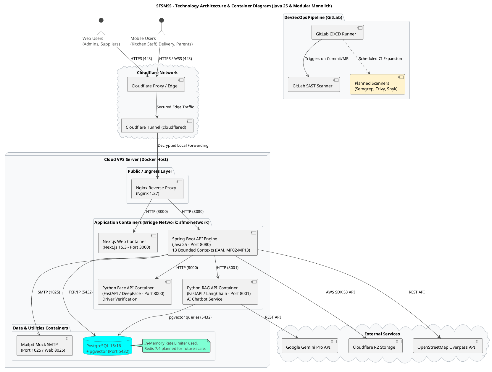
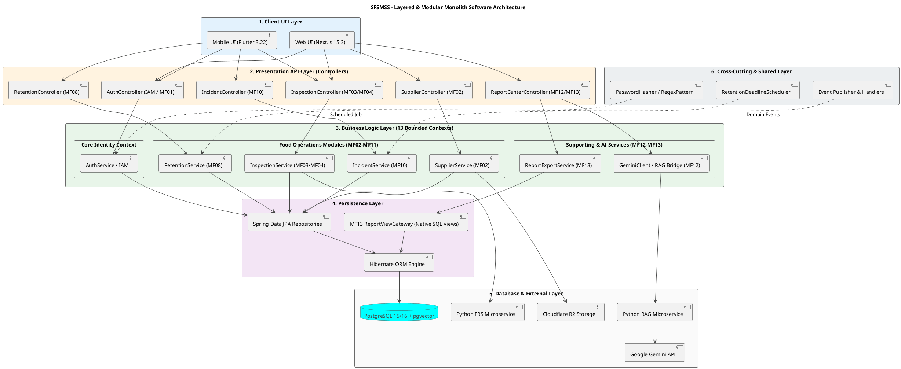
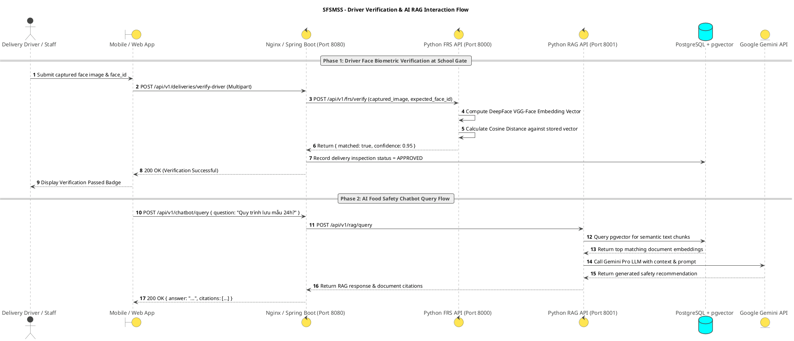

# SFSMSS — Technical & Software Architecture Specification
**School Food Safety Management Support System (SFSMSS)**
*Phiên bản: 2.0 (Cập nhật chuẩn hóa theo Codebase thực tế)*  
*Ngày cập nhật: 06/08/2026*

---

## 1. Technology Architecture

### 1.1. Overview & Architectural Principles
The **School Food Safety Management Support System (SFSMSS)** is a containerized, modular application designed to manage, monitor, and audit food safety operations across primary schools. The architecture supports food inspection workflows, driver biometric verification, AI-powered RAG chatbot services, automated notifications, and geospatial integrations.

Key architectural features:
* **Ingress & Security**: Client HTTP/HTTPS and WebSocket (WSS) traffic is routed via Cloudflare Proxy and securely passed through Cloudflare Tunnel (`cloudflared`) to an internal Nginx reverse proxy hosted on a Cloud VPS.
* **Isolated Container Network**: Backend, AI microservices, databases, and mail services run in isolated Docker containers communicating via a private bridge network (`sfms-network`).
* **DevSecOps**: Continuous integration via GitLab CI/CD with SAST (Static Application Security Testing). Future roadmap includes Semgrep, Aqua Trivy, and Snyk integration.

---

### 1.2. Technology Stack & Component Matrix

| Layer | Component / Tool | Technology & Version | Description & Purpose |
| :--- | :--- | :--- | :--- |
| **Client UI** | **Next.js Web** | Next.js 15.3 (React 19), TypeScript | Management portal for School Admins, Moderators, System Admins, and Suppliers. Built with Tailwind CSS (`^4.1.0`), Radix UI, TanStack Query/Table. |
| | **Flutter Mobile** | Flutter 3.22+, Dart SDK (`^3.11.4`) | Operational mobile application for Parents, Teachers, Kitchen Staff, Medical Staff, and Delivery Staff. Styled with Material 3 Theme. |
| **Proxy / Ingress** | **Cloudflare Tunnel** | `cloudflared` daemon | Establishes secure outbound encrypted tunnel to Cloudflare Edge without exposing open public ports. |
| | **Nginx** | Nginx 1.27 | Internal TLS reverse proxy and router for Next.js Frontend (Port 3000) and Spring Boot Backend (Port 8080). |
| **Backend API Engine** | **Spring Boot** | Spring Boot 4.1.x (Java 25 LTS) | Core API engine structured as a **Modular Monolith (13 Bounded Contexts: IAM, MF02–MF13)**. Leverages Virtual Threads (Project Loom), Spring Data JPA, Flyway, MapStruct, Spring Security JWT. |
| **AI Microservices** | **Python Face API** | Python 3.11, FastAPI 0.115+ | Microservice for **Driver / Delivery Staff biometric verification** at school gates during food delivery. Uses DeepFace engine (VGG-Face) with PDPD privacy compliance (Port 8000). |
| | **Python RAG API** | Python 3.11, FastAPI 0.115+ | Microservice for AI food safety chatbot and semantic document retrieval. Integrates LangChain, Gemini API, and PostgreSQL `pgvector` (Port 8001). |
| **Database & Storage** | **PostgreSQL** | PostgreSQL 15/16 + `pgvector` | Primary relational database storing transactional data and vector embeddings for semantic search. |
| | **Cloudflare R2** | Cloudflare Object Storage (S3-compatible via AWS SDK Java) | Secure cloud storage for food inspection photos, certificates, and incident evidence. |
| **In-Memory & Cache** | **In-Memory / Redis (Planned)** | In-Memory (Current) $\rightarrow$ Redis 7.4 (Future) | Session caching and rate-limiting currently managed in-memory, planned for Redis 7.4 multi-instance deployment. |
| **DevSecOps** | **GitLab CI/CD** | GitLab CI/CD, SAST *(Semgrep, Trivy, Snyk planned)* | Continuous testing and SAST security scanning. Semgrep, Aqua Trivy, and Snyk container scans are scheduled for future CI expansion. |
| **Mail & Testing** | **Mailpit / Mail Service** | Mailpit (Dev/Test) / SMTP Port 1025 & 8025 | Local SMTP mock server for testing activation emails, password resets, and notifications. |
| **External Integrations** | **Google Gemini API** | Gemini Pro Model | LLM integration for AI chatbot knowledge retrieval and response generation. |
| | **OpenStreetMap** | OSM Overpass API | Geocoding and geospatial verification for driver GPS locations and delivery routes. |

---

### 1.3. Communication Protocols & Port Assignments

| Protocol | Port | Source $\rightarrow$ Destination | Description |
| :--- | :--- | :--- | :--- |
| **HTTPS / WSS** | `443` | Web/Mobile Clients $\rightarrow$ Cloudflare Edge | End-to-end encrypted client traffic. |
| **HTTP** | `80 / 443` | Cloudflare Tunnel $\rightarrow$ Nginx Proxy | Decrypted edge traffic routed to VPS Nginx. |
| **HTTP** | `3000` | Nginx $\rightarrow$ Next.js Container | Reverse proxy routing to Web UI container. |
| **HTTP** | `8080` | Nginx $\rightarrow$ Spring Boot Container | Reverse proxy routing to Backend API container. |
| **HTTP** | `8000` | Spring Boot $\rightarrow$ Python Face API Container | Biometric driver verification request within Docker network. |
| **HTTP** | `8001` | Spring Boot $\rightarrow$ Python RAG API Container | AI chatbot query and document retrieval within Docker network. |
| **TCP/IP** | `5432` | Spring Boot / RAG API $\rightarrow$ PostgreSQL Container | Relational data persistence and vector similarity queries. |
| **TCP/IP** | `1025 / 8025` | Spring Boot $\rightarrow$ Mailpit Container | Development SMTP mail sending (1025) and Web inspection dashboard (8025). |

---

### 1.4. PlantUML Technology Architecture Diagram (Container Diagram)

---

## 2. Software Architecture

### 2.1. Architectural Layers Description

SFSMSS adopts a **Layered Architecture** combined with a **Modular Monolith** pattern in the Backend API Engine:

1. **Client UI Layer**:
   * **Next.js Web**: Management interfaces for System Admins, School Admins, Medical Staff, and Food Safety Board.
   * **Flutter Mobile**: Mobile app for operational staff (Food Receiving, Kitchen, Delivery), Teachers, and Parents.
2. **Presentation API Layer**:
   * Exposes RESTful HTTP/JSON endpoints via Spring Controllers mapped to **13 functional modules (IAM, MF02–MF13)**.
3. **Business Logic Layer (Modular Monolith)**:
   * Centralizes business rules and domain logic across 13 Bounded Contexts:
     * `com.sfms.iam`: IAM & User Management (MF01).
     * `com.sfms.mf02` – `com.sfms.mf13`: Ingredient Receiving, Food Sample Retention, 3-Step Inspection, Incident Tracking, Reporting & Analytics, etc.
4. **Persistence Layer**:
   * Spring Data JPA & Hibernate ORM abstract relational data operations.
   * Native SQL Views (`v_rpt_*`) owned by MF13 provide strict read-only analytical aggregations without direct domain entity coupling.
5. **Database & Caching Layer**:
   * PostgreSQL 15/16 with `pgvector` handles structured data and vector embeddings.
   * Local In-Memory caching (transitioning to Redis 7.4 in future releases).
6. **Cross-Cutting & Supporting Layer**:
   * Scheduled tasks (e.g., `RetentionDeadlineScheduler` running every 15 mins), event dispatchers, password hashing utilities, and external settings.

---

### 2.2. PlantUML Software Architecture Diagram (Layered & Modular Monolith)

---

### 2.3. PlantUML End-to-End Request & Microservice Interaction Sequence Diagram

---

## 3. Key Differences Summary & Migration Roadmap

### 3.1. Corrections Applied in Version 2.0
1. **Java Version**: Explicitly updated from Java 21 to **Java 25 LTS**.
2. **Next.js Version**: Corrected from Next.js 16 to **Next.js 15.3.0**.
3. **Face API Scope**: Clarified that Python FRS is used for **Driver/Delivery Staff Verification**, not student verification.
4. **RAG API Port**: Corrected destination port from 2201 to **8001**.
5. **Caching & Redis**: Documented current In-Memory status and marked Redis 7.4 as a planned future upgrade.
6. **Backend Structure**: Mapped out the 13 Modular Monolith contexts (`com.sfms.iam` & `com.sfms.mf02`–`mf13`).

### 3.2. Future DevSecOps Roadmap
* **Semgrep**: Static Application Security Testing (SAST) rule customization for Spring Boot and Next.js code.
* **Aqua Trivy**: Container vulnerability scanning for built Docker images during GitLab CI pipelines.
* **Snyk**: Automated dependency vulnerability scanning for Maven (`pom.xml`) and npm (`package.json`).
