# SFMS — Business Workflows (Main Workflows)

> **Nguồn**: Tổng hợp và trực quan hóa lại từ `06_Document\01_Report\Report 3.md` (mục "Main Workflows"), đối chiếu mã BR với `02_Requirements\00_BusinessRules\business_rules.md`.
> **Ghi chú quan trọng**: Các hình vẽ workflow gốc trong Report 3 là ảnh base64 không thể đọc/trích xuất được (placeholder ``). Toàn bộ sơ đồ Mermaid dưới đây được **dựng lại** từ bảng các bước (Step Table) đã có trong Report 3, không phải chụp lại hình gốc. Khi review, vui lòng đối chiếu lại với hình gốc (nếu có file nguồn) để xác nhận hướng mũi tên đúng ý đồ thiết kế ban đầu.
> **Liên kết kiến trúc**: Toàn bộ workflow vận hành trong phạm vi Modular Monolith đã quyết định tại [ADR-001](../02_ADR/ADR-001.md); các luồng có GPS/biometric tham chiếu [ADR-002](../02_ADR/ADR-002.md); luồng AI gợi ý thực đơn tham chiếu [ADR-003](../02_ADR/ADR-003.md); mọi ghi log "audit" trong các bước dưới đây đều ghi vào `audit_log` theo thiết kế [ADR-004](../02_ADR/ADR-004.md).

---

## Context Diagram (tóm tắt)

| External Entity | Input to System | Output from System |
| --- | --- | --- |
| System Admin | System Configuration, User Management Information | System Status, Audit Log Information |
| School Administration | Approval Decisions, School Policy, School Management Information | Dashboard Info, Food Safety Reports, Incident Reports |
| Service Caterers | Menu, Processing, Inspection Information | Approved Menu, Ingredient Information, Allergy Alerts |
| Medical Staff | Health, Allergy Verification, Incident Information | Health Alerts, Sample Information, Food Safety Reports |
| Teacher | Student Information, Health Update Information | Menu Information, Notification Information |
| Parent | Health Declaration, Allergy, Feedback Information | Menu/Nutrition Information, Notification Information |
| Raw Food Supplier | Supplier, Delivery, Certificate Information | Approval Information, Evaluation Information |
| GPS Service | Location Verification Result | Location Verification Request |
| Gmail | Email Delivery Status | Email Information |
| Firebase Cloud Messaging | Notification Delivery Status | Notification Information |
| Gemini AI Service | Menu Recommendation, Nutrition Analysis | Menu Requirement, Student Health Information |

## Danh sách 12 Workflow

| # | Workflow | Actor chính | Mục lục |
| --- | --- | --- | --- |
| 1 | Supplier Registration & Approval | Raw Food Supplier, School Administration | [§1](#1-supplier-registration--approval-workflow) |
| 2 | Ingredient Receiving | Raw Food Supplier, Service Caterers | [§2](#2-ingredient-receiving-workflow) |
| 3 | Ingredient Storage & Inventory Management | Service Caterers | [§3](#3-ingredient-storage--inventory-management-workflow) |
| 4 | Menu Planning & Approval | Service Caterers, Gemini AI, School Administration | [§4](#4-menu-planning--approval-workflow) |
| 5 | Ingredient Issue to Kitchen | Service Caterers | [§5](#5-ingredient-issue-to-kitchen-workflow) |
| 6 | Food Preparation | Service Caterers | [§6](#6-food-preparation-workflow) |
| 7 | Three-Step Food Inspection | Service Caterers | [§7](#7-three-step-food-inspection-workflow) |
| 8 | Food Sample Retention | Service Caterers, Medical Staff | [§8](#8-food-sample-retention-workflow) |
| 9 | Allergy & Special Meal Management | Parent, Medical Staff, Service Caterers | [§9](#9-allergy--special-meal-management-workflow) |
| 10 | Meal Serving | Service Caterers (Kitchen Manager), Teacher | [§10](#10-meal-serving-workflow) |
| 11 | Food Safety Incident Handling | Medical Staff, School Administration, Service Caterers | [§11](#11-food-safety-incident-handling-workflow) |
| 12 | Parent Meal Monitoring | Parent | [§12](#12-parent-meal-monitoring-workflow) |

Luồng nghiệp vụ tổng thể giữa các workflow:

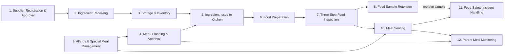

---

## 1. Supplier Registration & Approval Workflow

**BR References**: `BR-040`, `BR-041`, `BR-046`, `BR-047`, `BR-048`

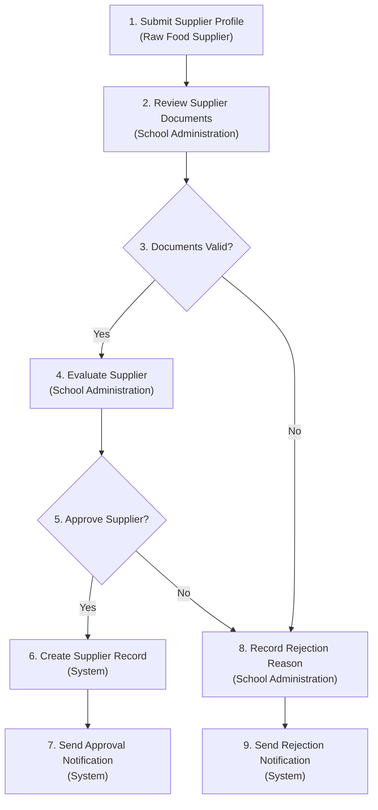

| Step | Tên bước | Role | Ghi chú |
| --- | --- | --- | --- |
| 1 | Submit Supplier Profile | Supplier | Start of flow |
| 2 | Review Supplier Documents | School Administration | Manual review |
| 3 | Documents Valid? | School Administration | Decision: Yes→4, No→8 |
| 4 | Evaluate Supplier | School Administration | Có thể cần verify thêm |
| 5 | Approve Supplier? | School Administration | Decision: Yes→6, No→8 |
| 6 | Create Supplier Record | System | Gán status Approved |
| 7 | Send Approval Notification | System | End — success |
| 8 | Record Rejection Reason | School Administration | Khi không approve |
| 9 | Send Rejection Notification | System | End — rejection |

---

## 2. Ingredient Receiving Workflow

**BR References**: `BR-070`, `BR-071`, `BR-072`, `BR-073`, `BR-074`, `BR-078`

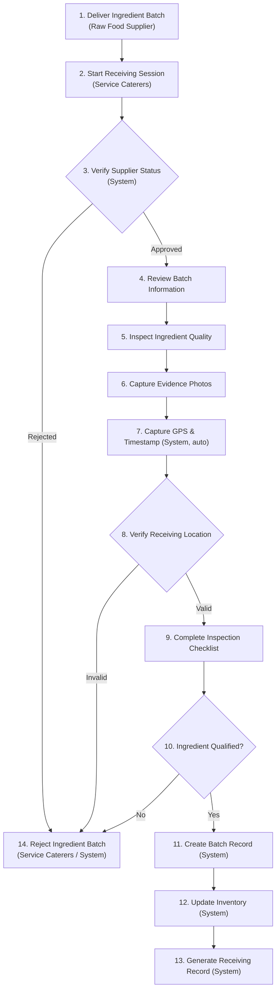

Bước 7–8 (GPS/timestamp tự động + xác minh vị trí) là cơ chế anti-fraud, liên kết trực tiếp với ràng buộc GPS trong [ADR-002](../02_ADR/ADR-002.md). Bước 13 sinh ra Receiving Record là input cho Workflow 3 (Storage & Inventory).

---

## 3. Ingredient Storage & Inventory Management Workflow

**BR References**: `BR-075` (FEFO), `BR-076` (Traceability), `BR-077` (Shortage Alert)

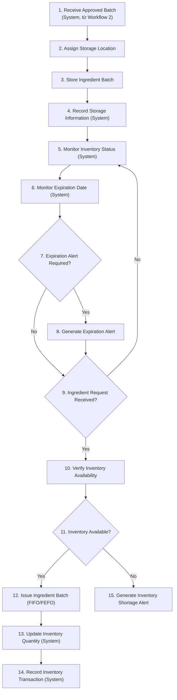

Vòng lặp 5→6→7→9→5 thể hiện giám sát liên tục (continuous monitoring), không có "kết thúc" workflow — chỉ kết thúc một lượt request tại bước 14 hoặc 15.

---

## 4. Menu Planning & Approval Workflow

**BR References**: `BR-061`, `BR-062`, `BR-063`, `BR-064`, `BR-065`, `BR-066`, `BR-067`, `BR-068`, `BR-069`, `BR-080`, `BR-082`, `BR-156` (AI menu suggestion — [ADR-003](../02_ADR/ADR-003.md)) — *(BR-081 "Món thay thế cho dị ứng phổ biến" đã xoá 2026-07-01, xem `business_rules.md` §7)*

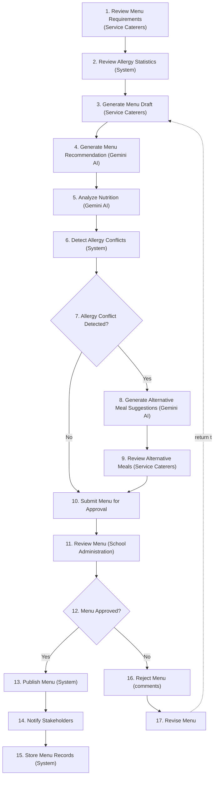

Bước 4–5–8 (Gemini AI) phải tuân theo pipeline RAG + hard-filter dị ứng quyết định tại [ADR-003](../02_ADR/ADR-003.md) — gợi ý AI không bao giờ được bỏ qua bước hard filter dị ứng ở bước 6.

---

## 5. Ingredient Issue to Kitchen Workflow

**BR References**: `BR-075` (FEFO), `BR-076` (Traceability), `BR-077` (Shortage Alert)

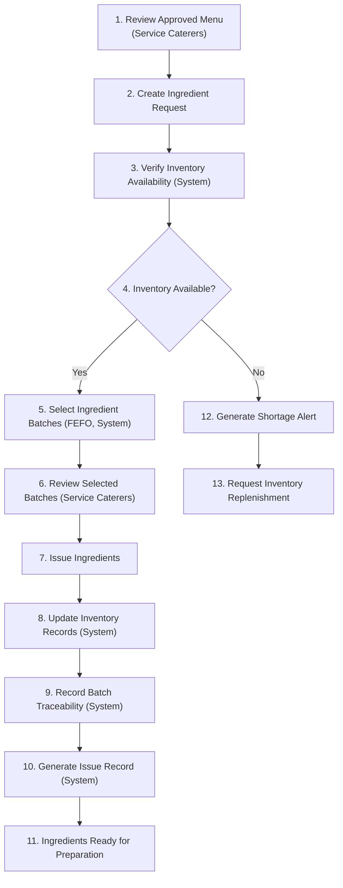

---

## 6. Food Preparation Workflow

**BR References**: `BR-069` (khai báo nguyên liệu đầy đủ), `BR-082` (chế biến riêng cho bữa ăn đặc biệt)

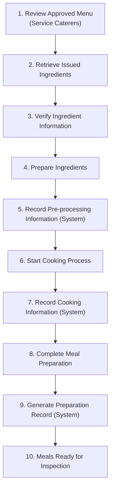

Bước 10 chuyển tiếp trực tiếp sang Workflow 7 (Three-Step Food Inspection).

---

## 7. Three-Step Food Inspection Workflow

**BR References**: `BR-079`, `BR-083`, `BR-090`, `BR-091`, `BR-092`, `BR-093`, `BR-094`, `BR-095`, `BR-096`, `BR-097`, `BR-098`, `BR-099`

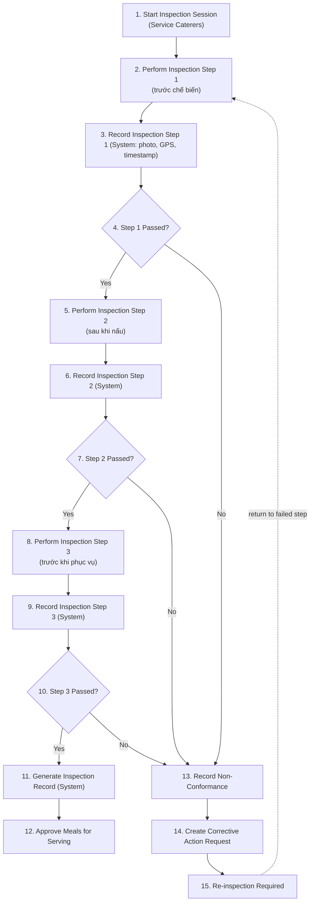

Mỗi bước inspection (2-1, 5-1, 8-1) đều ghi GPS + timestamp + ảnh bằng chứng (BR-083, BR-073-style anti-fraud) — đây là 3 lớp kiểm soát độc lập, không thể bỏ qua một bước để chuyển thẳng sang bước kế (BR-094: chặn phục vụ nếu kiểm tra thất bại).

---

## 8. Food Sample Retention Workflow

**BR References**: `BR-105`, `BR-106`, `BR-107`, `BR-108`, `BR-109`, `BR-110`, `BR-111`, `BR-112`, `BR-113`, `BR-114`

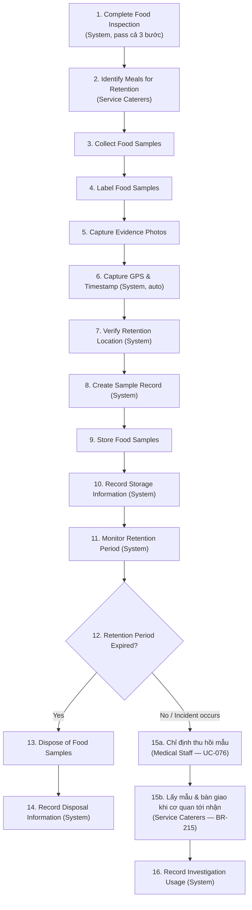

Nhánh 15a–16 là alternative flow được kích hoạt từ Workflow 11 (Food Safety Incident Handling) khi cần truy vết bằng mẫu lưu.

> **Cập nhật 22/07/2026** — tách bước 15 cũ ("Retrieve Food Sample — Medical Staff") thành 15a/15b cho khớp BR-113/BR-215 đã sửa từ 19/07/2026: Medical Staff **chỉ định** mẫu cần thu hồi + nơi tiếp nhận + chỉ tiêu; **Service Caterers** lấy mẫu tại tủ lưu và **bàn giao khi cán bộ của cơ quan tiếp nhận tới trường**, rồi tải biên bản bàn giao (BR-212) — bếp KHÔNG tự mang mẫu đi, không ai để bên bị điều tra tự vận chuyển vật chứng.

> **Đính chính 22/07/2026 (cùng ngày)** — bản đầu của mục này viết "bàn giao phòng kiểm nghiệm", vẫn hàm ý bếp mang mẫu đi; đã sửa. Nơi tiếp nhận cũng không chỉ là phòng kiểm nghiệm: công an hoặc thanh tra có thể tới **thu giữ** mẫu làm vật chứng — khi đó trường không đặt chỉ tiêu xét nghiệm và có thể không nhận được kết quả, chỉ giữ biên bản thu giữ (xem `ReceivingAuthority.type` trong mock). Sơ đồ trước đó vẫn ghi Medical Staff trực tiếp thực hiện — chỉ `business_rules.md` được sửa, tài liệu Workflow chưa theo (ghi nhận tại `review_medicalstaff_to_servicecaterers.md` Mục 4).

---

## 9. Allergy & Special Meal Management Workflow

**BR References**: `BR-031` (xét duyệt thông tin sức khỏe), `BR-063` (kiểm tra xung đột dị ứng), `BR-065`, `BR-066`, `BR-082`, `BR-123` — *(BR-081 "Món thay thế cho dị ứng phổ biến" đã xoá 2026-07-01, xem `business_rules.md` §7)*

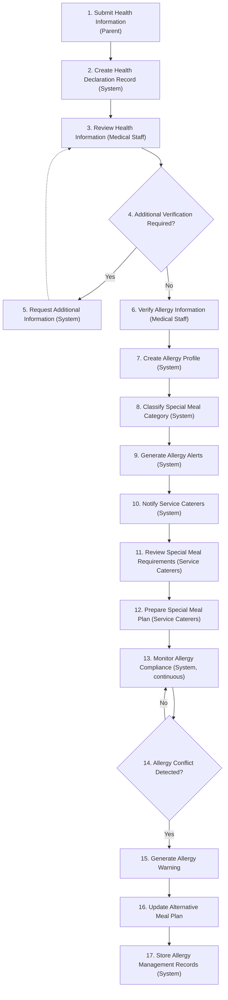

Workflow này là nguồn dữ liệu đầu vào (allergy profile, special meal category) cho Workflow 4 (Menu Planning), Workflow 10 (Meal Serving) và là một control xuyên suốt liên tục (bước 13 lặp vô hạn cho tới khi có conflict hoặc menu mới).

---

## 10. Meal Serving Workflow

**BR References**: `BR-120`, `BR-121`, `BR-123`, `BR-125`, `BR-130`, `BR-133`, `BR-135`

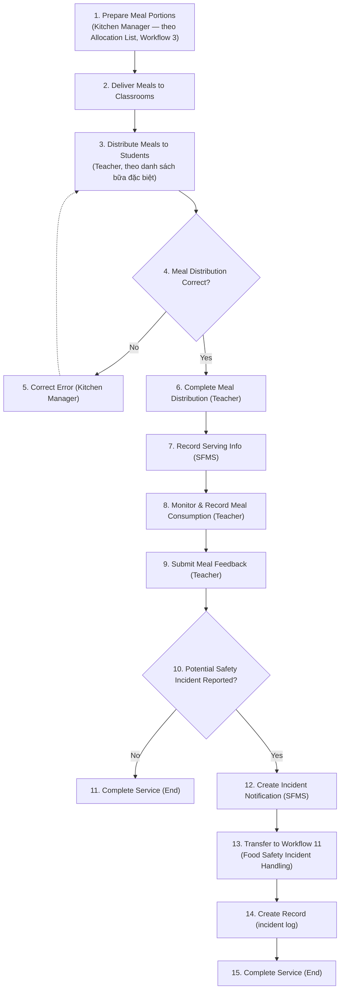

---

## 11. Food Safety Incident Handling Workflow

**BR References**: `BR-146`, `BR-147`, `BR-148`, `BR-149`, `BR-150`, `BR-151`, `BR-152` (CAPA), `BR-153`, `BR-154`, `BR-155`, `BR-216` (vòng đời CAPA)

> **Cập nhật 20/07/2026** — đồng bộ nhánh CAPA (bước 16-20) theo `BR-216` (mới), thống nhất qua nhiều vòng thảo luận thiết kế xuất phát từ 1 tình huống giả định (Medical Staff có thể lợi dụng quyền đề xuất CAPA để áp đặt yêu cầu quá đáng lên Service Caterers) — chi tiết đầy đủ xem `08_FrontEnd/Web/review/medical_staff/review_medicalstaff_incidentmanagement.md` Mục 16. Thay đổi cụ thể: (1) bước 18 đổi tên thành "Xem + Accept, sau đó Implement" — Service Caterers chỉ xem và xác nhận (accept) phương án đã được School Administration duyệt ở bước 17, không có nhánh từ chối trên hệ thống (việc bàn bạc tính khả thi diễn ra trực tiếp ngoài đời, trước bước 16); (2) **bỏ bước 19 "Monitor Corrective Actions (School Administration)"** — không có căn cứ trong `BR-216`, 2 điểm kiểm soát của School Administration là đủ (duyệt kế hoạch ở bước 17, rà soát toàn hồ sơ trước khi đóng ở bước 21), thêm 1 lớp giám sát giữa chừng là dư thừa; bước 18b "Đạt" nối thẳng sang bước 20; (3) ghi chú ở bước 18b (dưới sơ đồ) về việc "chưa có BR/UC chính thức" nay đã giải quyết — `UC-168` + `BR-216` đã chính thức hoá đầy đủ. Không đổi thứ tự 17 trước 18 (đã đúng từ trước, không phải điểm cần sửa — điểm sai nằm ở `Report 3.md` UC-005 mô tả ngược, đã sửa riêng 20/07/2026).

> **Cập nhật 19/07/2026** — đồng bộ lại 4 điểm lệch giữa sơ đồ và SRS, phát hiện qua review Web Medical Staff Incident Management (Vòng 7, chi tiết: `08_FrontEnd/Web/review/medical_staff/review_medicalstaff_design_pattern.md`): (1) đổi nhãn actor "Kitchen Manager" (không thuộc 7 vai trò canonical BR-007) → "Service Caterers (Kitchen Manager)" ở bước 11, và "Service Caterers" ở bước 18; (2) sửa actor bước 9 từ "(SFMS)" → "(Medical Staff — UC-076)" cho khớp Primary Actor thật của UC-076; (3) bổ sung bước 18b "Xác nhận khắc phục (UC-168)" — vốn đã bị `MedicalStaff_Role_and_Workflows.md` §7 điểm 2 flag là thiếu trong sơ đồ gốc, và đã được hiện thực trong code Web (Block A, Section D `26_IncidentDetail.md`) từ trước — nay thêm nhánh "Chưa đạt" quay lại bước 18 (bổ sung nghiệp vụ mới, chưa có mã UC/BR chính thức, cần đội dự án xác nhận/cấp mã sau); (4) đổi gate "Root Cause Confirmed?" (bước 14, chặn cứng CAPA) thành "Đủ căn cứ đề xuất CAPA? (kết luận sơ bộ)" — vì BR-152/UC-038 yêu cầu CAPA phải giao trong 12 giờ, trong khi BR-149 (bổ sung 15/07) ghi nhận một số tác nhân có thời gian ủ bệnh 62–87 giờ; gate cứng theo kết luận **chính thức** khiến SLA 12h bất khả thi với nhóm sự cố này — bước 16b (hoàn tất Root Cause chính thức) chạy song song, không chặn CAPA, nhưng vẫn là điều kiện bắt buộc trước bước 20 (đã chốt tại review Web, Mục 11.9.1 `review_medicalstaff_incidentmanagement.md`). Bước 21→22 **giữ nguyên, không thêm nhánh reject/version** — đã có 2 điểm kiểm soát của School Administration (duyệt CAPA ở bước 17/UC-005, và tự rà soát investigation summary + CAPA completion ở bước 21/UC-013 trước khi đóng), thêm cơ chế reject riêng cho báo cáo là dư thừa so với 2 điểm kiểm soát đã có.

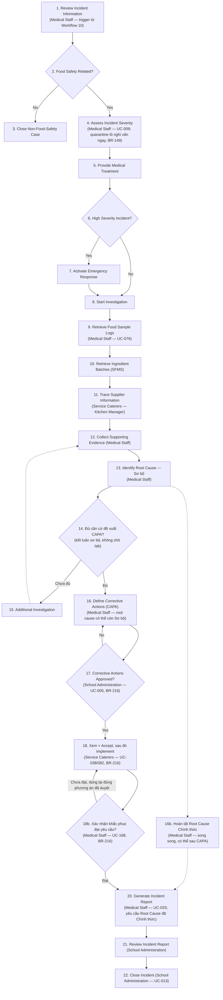

Bước 9 (Retrieve Food Sample Logs) liên kết trực tiếp với nhánh "Retrieve Food Sample" (bước 15-16) của Workflow 8.
Bước 18b (nhánh "Chưa đạt" quay lại 18) — thống nhất tại review 19/07/2026, **đã chính thức hoá 20/07/2026** qua `UC-168` (`Report 3.md`, đã viết lại nhánh AF1 "Implementation Not Satisfactory") và `BR-216` (mới, `business_rules.md`).

---

## 12. Parent Meal Monitoring Workflow

**BR References**: `BR-133`, `BR-139`, `BR-140`, `BR-141`, `BR-142`, `BR-143`, `BR-145`

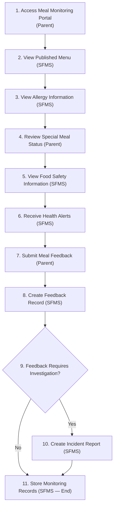

Bước 10 liên kết với Workflow 11 (Food Safety Incident Handling) tương tự bước 12-13 của Workflow 10.

---

*Tài liệu này tổng hợp lại nội dung Main Workflows từ `Report 3.md` dưới dạng Mermaid để dễ review/maintain trong markdown — không thay thế hình vẽ gốc nếu file nguồn (Visio/draw.io) còn tồn tại ở nơi khác.*
