# Screen Flow — System Admin

> Platform: Web (Next.js), theo [ADR-001](../02_ADR/ADR-001.md). Vào sau khi qua [Common Entry Flow](13_Guest_Common_Screen_Flow.md).
> **Độ tin cậy reconstruction (nâng cấp 2026-07-01)**: Cao — bản trước nhóm màn hình chỉ theo suy luận chức năng chung chung (Report 3 không có mục Mobile Screen field-by-field cho System Admin). Bản này đối chiếu trực tiếp **Normal Flow của từng UC** trong `Report 3.md` §3.2 (User Management & Access Control, School & Class Management, AI & Supporting Services) cho toàn bộ 18 UC liên quan, kết hợp bảng Screen Authorization (`Report 3.md` dòng 5057–5085) để đảm bảo đủ 27 màn hình. Các màn hình không tìm thấy UC riêng (Campus Config, Backup Management, Security Policies) được ghi chú rõ là suy luận/TODO.

## Danh sách màn hình (nguồn: Screen Authorization, cột "System Admin") — 27 màn hình

Login, Forgot Password, Reset Password, Verify OTP, Profile Management, Change Password, Notification Settings (5 màn dùng chung mọi actor — xem [13_Guest_Common_Screen_Flow.md](13_Guest_Common_Screen_Flow.md)), Audit Logs, System Administrator Dashboard, Manage User Screen/Dialog, User Account List, Manage Role Screen, Role List, Manage Permission List Screen, Active/Deactivate User Dialog, Active/Deactivate School Dialog, School List, School Detail, Update School Screen/Dialog, Campus Config, Backup Management, Security Policies, AI Settings, System Activity Monitoring, System Status Screen, Error Logs Screen, Usage Statistics Screen.

## Ánh xạ Màn hình ↔ UC (đối chiếu Normal Flow thật)

| Màn hình | UC | Tóm tắt Normal Flow (Report 3 §3.2) |
| --- | --- | --- |
| User Account List | UC-153 | Truy vấn toàn bộ tài khoản người dùng trên nền tảng, hiển thị bảng (tên/email/role/school/status), lọc/tìm/export. |
| Manage User Screen/Dialog (Create) | UC-026 | Nhập họ tên, email, role, SĐT (nếu role cấp trường phải chọn School); validate email/SĐT (BR-012); tạo tài khoản, gửi email xác minh (BR-010). |
| Active/Deactivate User Dialog | UC-003 | Toggle trạng thái; hệ thống kiểm tra không khoá tài khoản System Admin mặc định duy nhất; nếu deactivate → hủy toàn bộ session (BR-007), gửi email, ghi audit. |
| Role List | UC-130 | Truy vấn toàn bộ role (mặc định + tùy chỉnh), hiển thị Role Name/Description/User Count/Status. |
| Manage Role Screen (Create/Update/Delete) | UC-022, UC-098, UC-029 | Create: nhập tên/mô tả/permission, validate tên duy nhất. Update: sửa mô tả/permission, chỉ áp dụng role custom (BR-008). Delete: chỉ role custom, 0 user gán (BR-008). |
| Manage Permission List Screen | UC-129 | Danh sách permission có sẵn (Permission ID/Name/Module/Description) — **chỉ xem**, không có UC tạo/sửa permission (permission là danh mục cố định trong code, không phải dữ liệu admin nhập). |
| School List | UC-140 | Bảng toàn bộ trường (Name/Code/Tax ID/Status), lọc theo trạng thái, export. |
| School Detail | UC-122 | Hồ sơ đầy đủ của trường: Name/Address/Tax ID/Email/Coordinates/giờ hoạt động/liên hệ khẩn cấp/thống kê; có thể export PDF. |
| Update School Screen/Dialog | UC-095 | Sửa Name/Address/Coordinates/Tax ID/Email/tham số vận hành; nếu sửa tọa độ → validate + khóa `coordinateLocked` (BR-028). |
| Active/Deactivate School Dialog | UC-001 | Toggle trạng thái trường; validate không gây xung đột dữ liệu; deactivate → cascade tạm dừng Classroom/Staff/Student (BR-021). |
| Security Policies | UC-184 *(UC mới, bổ sung 2026-07-01 — audit A8, Report 3.md §3.2.12.13)* | Cấu hình chính sách mật khẩu (BR-006), lockout (BR-002), session timeout (BR-004), ghi audit trail (BR-170). Đây là màn duy nhất trong nhóm A8 (`00_TODO_GiaDinh_Master.md`) cần UC hoàn toàn mới. |
| AI Settings | UC-040 (một phần) | Nằm trong "External Integrations": System Admin cấu hình endpoint/OAuth2/API key cho Gemini AI (1 trong 4 dịch vụ), test connection (BR-163), lưu (mã hóa — BR-164). |
| Backup Management | UC-149 (một phần) | Không phải UC riêng: Normal Flow của UC-149 (View System Status) bước 4 nêu rõ "Load and display the configuration and operating status of the weekly backup scheduler (BR-160)" — Backup Management là 1 panel trong System Status, không phải luồng tạo backup thủ công. |
| System Activity Monitoring | UC-057 | Truy vấn API hiệu năng server (CPU/RAM/disk IO/session/DB pool), hiển thị chart, biên soạn báo cáo hàng tuần (BR-165). |
| System Status Screen | UC-149 | Health-check các service lõi, hiển thị dashboard kết nối + trạng thái backup scheduler (BR-160); AF: Export CSV/PDF. |
| Error Logs Screen | UC-111 | Log lỗi theo severity/timestamp; chọn 1 lỗi → xem stack trace, request metadata, session ảnh hưởng (BR-164). |
| Usage Statistics Screen | UC-150 | Dashboard active users theo ngày/tuần, top use case, dung lượng lưu trữ, API request count (BR-165); lọc theo ngày/role. |
| Audit Logs | UC-106 | Truy vấn `audit_log` bất biến (BR-162), hiển thị Timestamp/User/IP/Action/Resource/Status; lọc theo ngày/user/action/IP. |
| — | UC-171, UC-172, UC-173 | System Admin cũng là actor của Reporting & Analytics (Analytics Dashboard/Export/Schedule). UC-171/172 nay đã có Functional Spec đầy đủ (Report 3.md §3.2.13, bổ sung 2026-07-01 — audit A8); UC-173 vẫn là stub — xem ghi chú cuối bài. |

## Sơ đồ điều hướng

```mermaid
flowchart TD
    Dash["System Administrator Dashboard"]

    %% User & Role Management — UC-153, UC-026, UC-003
    Dash --> UAL["User Account List (UC-153)"]
    UAL -->|"Create User Account"| MUD["Manage User Screen/Dialog\n(Create — UC-026)"]
    UAL -->|"status toggle"| AUD["Active/Deactivate User Dialog (UC-003)"]

    %% Role & Permission Management — UC-130, UC-022, UC-098, UC-029, UC-129
    Dash --> RL["Role List (UC-130)"]
    RL -->|"Create New Role"| MRSCreate["Manage Role Screen\n(Create — UC-022)"]
    RL -->|"select role → Edit"| MRSUpdate["Manage Role Screen\n(Update — UC-098)"]
    RL -->|"Delete Role"| MRSDelete["Confirm Delete Dialog (UC-029)"]
    Dash --> MPL["Manage Permission List Screen (UC-129, read-only)"]

    %% School Management — UC-140, UC-122, UC-095, UC-001
    Dash --> SL["School List (UC-140)"]
    SL --> SD["School Detail (UC-122)"]
    SD -->|"Edit"| USD["Update School Screen/Dialog (UC-095)"]
    SL -->|"status toggle"| ASD["Active/Deactivate School Dialog (UC-001)"]

    %% System Configuration
    Dash --> SP["Security Policies\n(UC-184, mới)"]
    Dash --> AIS["AI Settings\n(1 phần của UC-040)"]

    %% Monitoring & Audit — UC-057, UC-149, UC-111, UC-150, UC-106
    Dash --> SAM["System Activity Monitoring (UC-057)"]
    Dash --> SSS["System Status Screen (UC-149)"]
    SSS --> BM["Backup Management panel\n(bundled trong UC-149, BR-160)"]
    SSS -->|"AF1: Export"| SSExport["Export System Status (CSV/PDF)"]
    Dash --> ELS["Error Logs Screen (UC-111)"]
    ELS -->|"select error"| ELDetail["Error Detail\n(stack trace, session info)"]
    Dash --> USS["Usage Statistics Screen (UC-150)"]
    Dash --> AL["Audit Logs (UC-106)"]

    %% Reporting & Analytics — cross-cutting, UC-171/172/173
    Dash --> Analytics["Analytics Dashboard (UC-171)"]
    Analytics --> ExportRpt["Export Report (UC-172)"]
    Analytics --> ScheduleRpt["Schedule Automated Report (UC-173)"]

    %% External Integrations — UC-040 (đầy đủ, AI Settings chỉ là 1 phần)
    Dash --> ExtInt["External Integrations\n(GPS/Gmail/Firebase/Gemini AI — UC-040)"]
    ExtInt --> AIS

    %% Profile (shared, see Guest & Common)
    Dash --> Prof["Profile Management\n(xem 13_Guest_Common_Screen_Flow.md)"]
```

## Ghi chú nghiệp vụ

- `Audit Logs` và `System Activity Monitoring` đều phục vụ truy vết — `Audit Logs` đọc trực tiếp từ bảng bất biến `audit_log` theo thiết kế [ADR-004](../02_ADR/ADR-004.md) (chỉ INSERT/SELECT, không UPDATE/DELETE).
- `Active/Deactivate School Dialog` kích hoạt cascade deactivation (vô hiệu hóa toàn bộ lớp, nhân viên, học sinh thuộc trường) theo BR-021 — đây là hành động có rủi ro cao, nên cần xác nhận hai bước (dialog), không phải điều hướng sang trang riêng.
- `AI Settings` **không phải** một UC độc lập — Normal Flow thật (UC-040 Manage External Integrations) gộp chung cấu hình GPS Service, Gmail SMTP, Firebase Cloud Messaging, và Gemini AI trong cùng 1 màn hình "External Integrations"; "AI Settings" trong Screen Authorization nhiều khả năng là 1 tab/filter của màn hình này, không phải trang riêng biệt. Liên quan pipeline RAG/Gemini đã quyết định ở [ADR-003](../02_ADR/ADR-003.md).
- `Backup Management` **không có UC riêng** — chỉ là 1 panel hiển thị trạng thái backup scheduler (BR-160) bên trong UC-149 (View System Status), không có luồng "tạo backup thủ công" nào được đặc tả.
- `Security Policies` **đã xử lý (2026-07-01, audit A8)** — UC-184 - Configure Security Policies được viết mới tại Report 3.md §3.2.12.13.
- `Campus Config` **đã bị loại bỏ hoàn toàn (2026-07-01)** — chủ dự án xác nhận hệ thống không quản lý campus. Field bán kính geofence (BR-028) đã được xác nhận thuộc về **School Administration** (`Web/SchoolAdministration/37_SchoolConfiguration.md`), không phải System Admin — nguyên văn BR-028: "School Administration có thể cấu hình bán kính này". System Admin chỉ còn giữ vai trò cấu hình tọa độ GPS + khoá/mở khoá tọa độ trong `Update School Screen/Dialog` (UC-095).
- `Manage Permission List Screen`: dù tên gọi có "Manage", Normal Flow UC-129 chỉ mô tả hành vi xem/lọc/export — không có UC tạo/sửa permission nào tồn tại (danh mục permission là cố định trong code theo RBAC, không phải dữ liệu do admin nhập).
- System Admin cũng có quyền truy cập **Reporting & Analytics** (UC-171/172/173, xem `business_rules.md` §16) với phạm vi toàn hệ thống (đa trường) theo BR-176 — khác School Administration chỉ xem trong phạm vi trường mình.
