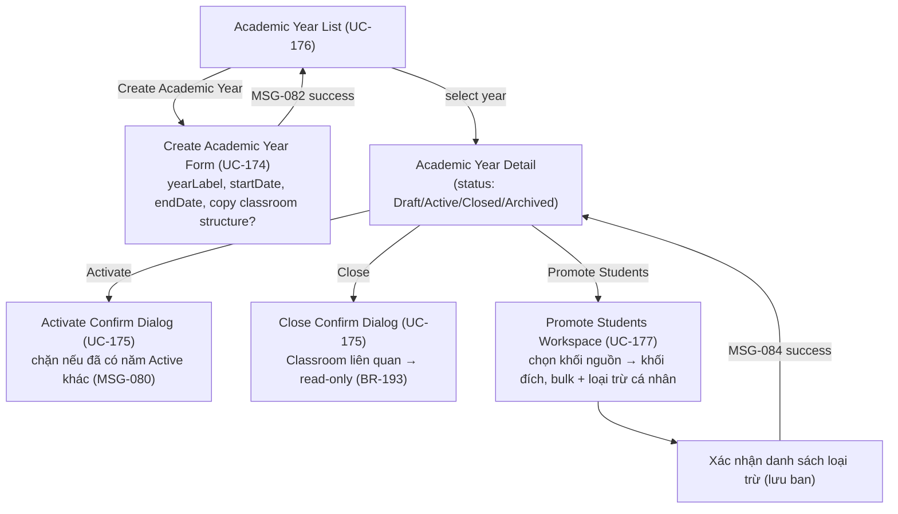
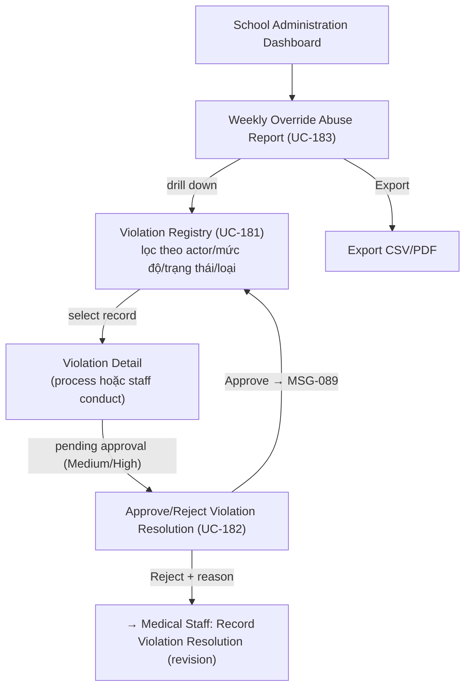

# Screen Flow — School Administration

> Platform: Web (Next.js), theo [ADR-001](../02_ADR/ADR-001.md). Vào sau khi qua [Common Entry Flow](13_Guest_Common_Screen_Flow.md).
> **Độ tin cậy reconstruction (nâng cấp 2026-07-01)**: Cao — đối chiếu trực tiếp Normal Flow của 33 UC thật trong `Report 3.md` §3.2 (thay vì chỉ nhóm theo chức năng nghiệp vụ như bản trước), cộng thêm 7 UC mới (UC-174–177 Academic Year, UC-181–183 Violation Management, chính thức hoá 2026-07-01). Vẫn còn một số màn hình trong Screen Authorization chưa tìm được UC gốc tương ứng — đánh dấu rõ TODO bên dưới.

## Danh sách màn hình (nguồn: Screen Authorization, cột "School Admin") — 38 màn hình gốc + 7 màn hình mới

38 màn hình gốc — xem đầy đủ trong `Report 3.md` mục Screen Authorization (dòng 5086–5124). Bổ sung 2026-07-01: 4 màn Academic Year Management (UC-174–177) + 3 màn Violation Management (UC-181–183). Nhóm theo 8 module chức năng dưới đây.

## Ánh xạ Màn hình ↔ UC (đối chiếu Normal Flow thật)

| Màn hình | UC | Tóm tắt Normal Flow / ghi chú |
| --- | --- | --- |
| Supplier Partnership Requests | UC-131 (lọc Pending) | Danh sách nhà cung cấp trạng thái Pending; chọn 1 → sang Supplier Detail. |
| Supplier Detail | UC-148, UC-007 | Hồ sơ đầy đủ (license, cert, performance index); Approve/Reject tại đây kèm lý do (UC-007). |
| Catering Partnership Requests | UC-127 (lọc Pending) | Tương tự Supplier nhưng cho Service Caterers. |
| Service Caterers Detail | UC-108, UC-004 | Hồ sơ + site inspection score; Approve/Reject (UC-004). |
| Verification Documents | *(bundled trong UC-007/UC-004)* | Xem license/chứng nhận ATTP/ngày hết hạn (BR-047) — hiển thị ngay trong Supplier/Service Caterers Detail, không phải màn hình điều hướng riêng theo Normal Flow thật. |
| Partnership Approval History | UC-106 *(xác nhận 2026-07-01 — audit A8)* | View Audit Logs, lọc theo Resource = Partnership/Supplier/Caterer. Không phải màn hình/UC riêng — Matrix xác nhận School Admin đã có quyền Audit Logs. |
| Partnership Reports | UC-171, UC-172 *(viết mới Functional Spec 2026-07-01 — Report 3.md §3.2.13, audit A8)* | View lọc theo danh mục "Partnership" trong Analytics Dashboard (UC-171), export dùng UC-172. |
| Menu Management | UC-128 | Danh sách menu theo tuần, trạng thái, lọc/tìm/export. |
| Menu Detail | UC-134, UC-006 | Chi tiết món/dinh dưỡng/dị ứng + lịch sử duyệt; Approve/Reject tại đây (UC-006). |
| Classroom Management | UC-037 / UC-166 | Danh sách lớp (tên/cấp/sức chứa/GVCN), lọc theo cấp. |
| Create Classroom | UC-018 | Nhập tên/cấp lớp (1-12, BR-024)/sức chứa (≤50, BR-025). |
| Classroom Detail | UC-165 | Chi tiết lớp + danh sách học sinh; **Assign Homeroom Teacher (UC-008) và Update Classroom (UC-090) là action ngay tại đây**, không phải màn hình Screen Authorization liệt kê riêng. |
| Student Profile Management | UC-147 | Danh sách học sinh (tên/school reg no/lớp/liên hệ PH); action Create (UC-025) mở form riêng. |
| Student Profile Detail | UC-099 (Update) | Sửa tên/DOB/lớp — validate sức chứa lớp mới (BR-025). |
| Bulk Import Student Profiles | UC-010 | Tải template, upload file, validate (BR-012, BR-032), xem báo cáo hợp lệ/lỗi. |
| Parent Account Detail / Link Parent Account / Linked Students List | *(bundled trong UC-025)* | Khi tạo học sinh, hệ thống tìm email PH: có sẵn → liên kết (BR-030, tối đa 5 học sinh/PH — BR-040 wording cũ, nay là giới hạn trong BR-030); chưa có → tạo mới. Đây là 1 bước trong UC-025, không phải 3 UC độc lập. |
| School Announcement Management | UC-125 | Danh sách thông báo, tìm/lọc, export (School Admin). |
| Create Announcement | UC-017 | Draft hoặc Published ngay; Published → gửi thông báo (MSG-072). |
| Update Announcement | UC-089 | Sửa tiêu đề/nội dung/trạng thái; ghi revision history (BR-144). |
| Announcement Detail | UC-105 | Chi tiết + lịch sử sửa đổi đầy đủ (chỉ School Admin thấy). |
| Staff Management | UC-144 | Danh sách nhân viên trường (tên/email/role/SĐT/trạng thái). |
| Upload Staff List | UC-024 (biến thể bulk) | Tạo tài khoản staff — role phải là Teacher/Medical Staff/Catering (không phải admin/external). |
| Invitation Status | *(bundled trong UC-024/UC-010)* | Theo dõi trạng thái xác minh email (BR-010) của tài khoản vừa tạo — không phải UC riêng. |
| Incident Dashboard | *(entry point tổng hợp)* | Điểm vào của UC-114/116/121/005/013/031. |
| Incident List | UC-114 | Danh sách sự cố ngộ độc thực phẩm, lọc severity/status. |
| Incident Detail | UC-116 | Chi tiết triệu chứng/học sinh bị ảnh hưởng/tình trạng điều tra. |
| Corrective Action Review | UC-005 | Duyệt CAPA: xem mô tả sự cố, yêu cầu CAPA, báo cáo thực hiện của Service Caterers + bằng chứng; Approve → cập nhật trạng thái. |
| Resolution Report | UC-013, UC-121 | Close Incident: xác nhận CAPA hoàn thành + học sinh hồi phục (BR-155), nhập closing statement; hoặc xem Incident Report đầy đủ (UC-121). |
| Compliance Dashboard | UC-027 | Trạng thái 3-bước kiểm tra hôm nay theo thời gian thực (BR-091) + điểm vệ sinh hàng ngày (BR-100/104); School Admin ký xác nhận. |
| Inspection Reports | UC-113 | Khớp trực tiếp UC-113. |
| Food Sample Retention Reports / Partnership Reports / Traceability Reports / System Usage Metrics | UC-171, UC-172 *(viết mới 2026-07-01 — Report 3.md §3.2.13, audit A8)* | Các view lọc khác nhau trong Analytics Dashboard (UC-171)/Export Report (UC-172), theo BR-175/176. Đã chốt xong, không còn TODO. |
| Receiving Reports | UC-123 *(xác nhận 2026-07-01 — audit A8)* | Khớp trực tiếp UC-123 (View Ingredient Receiving Records) — KHÔNG dùng UC-171/172 (khác 4 báo cáo còn lại vì đã có UC View Records sẵn). |
| Allergy Review | *(chưa có UC chính thức cho School Admin)* | School Admin có quyền xem (không phải approver — đó là Medical Staff, UC-078/UC-036) theo BR-175 (phân quyền xem báo cáo). |
| School Configuration | UC-095 *(xác nhận 2026-07-01 — audit A8)* | Update Information School, phần "School Administration (school-level)" theo Description UC-095. |
| Export Incident Reports | UC-031 | Lọc theo Date/Severity/Status/Caterer, xuất PDF/Excel (BR-178). |
| **Academic Year Management** *(mới 2026-07-01)* | UC-174, UC-175, UC-176, UC-177 | Xem mục riêng bên dưới. |
| **Violation Registry / Resolution Approval** *(mới 2026-07-01)* | UC-181, UC-182, UC-183 | Xem mục riêng bên dưới. |

## Sơ đồ điều hướng

```mermaid
flowchart TD
    Dash["School Administration Dashboard"]

    %% Partnership Management — Workflow 1
    Dash --> SPR["Supplier Partnership Requests\n(UC-131, lọc Pending)"]
    SPR --> SupD["Supplier Detail (UC-148)"]
    SupD -->|"Approve/Reject"| SupApprove["Approve/Reject Dialog (UC-007)"]
    Dash --> CPR["Catering Partnership Requests\n(UC-127, lọc Pending)"]
    CPR --> SCD["Service Caterers Detail (UC-108)"]
    SCD -->|"Approve/Reject"| SCApprove["Approve/Reject Dialog (UC-004)"]
    Dash --> PAH["Partnership Approval History\n(TODO: chưa có UC)"]
    Dash --> PR["Partnership Reports\n(→ UC-172 Export Report)"]

    %% Menu Oversight — Workflow 4
    Dash --> MM["Menu Management (UC-128)"]
    MM --> MD["Menu Detail (UC-134)"]
    MD -->|"Approve/Reject"| MApprove["Approve/Reject Menu (UC-006)"]

    %% Class & Student Management — bổ sung Academic Year
    Dash --> AYList["Academic Year List (UC-176)"]
    AYList -->|"Create"| AYCreate["Create Academic Year (UC-174)"]
    AYList -->|"select year"| AYActivate["Activate/Close Academic Year (UC-175)"]
    AYList -->|"Promote Students"| AYPromote["Promote Students to Next Year (UC-177)"]
    Dash --> CM["Classroom Management (UC-037/166)"]
    CM -->|"Create"| CC["Create Classroom (UC-018)"]
    CM --> CDt["Classroom Detail (UC-165)"]
    CDt -->|"Edit"| CDtUpdate["Update Classroom (UC-090)"]
    CDt -->|"Assign Teacher"| AssignTeacher["Assign Homeroom Teacher (UC-008)"]
    CC -.->|"cần năm học Active"| AYList
    Dash --> SPM["Student Profile Management (UC-147)"]
    SPM -->|"Create"| SPCreate["Create Student Profile (UC-025)\n→ tìm/link Parent Account"]
    SPM --> SPD["Student Profile Detail (UC-099)"]
    SPM --> BIS["Bulk Import Student Profiles (UC-010)"]

    %% Incident Management — Workflow 11 + Violation Management mới
    Dash --> ID["Incident Dashboard"]
    ID --> IL["Incident List (UC-114)"]
    IL --> IDt["Incident Detail (UC-116)"]
    IDt --> CAR["Corrective Action Review (UC-005)"]
    CAR --> RR["Resolution Report / Close Incident (UC-013)"]
    ID --> ExportInc["Export Incident Reports (UC-031)"]
    Dash --> ViolReg["Violation Registry (UC-181)"]
    ViolReg -->|"pending approval"| ViolApprove["Approve/Reject Violation Resolution (UC-182)"]
    Dash --> OverrideRpt["Weekly Override Abuse Report (UC-183)"]

    %% Reports & Compliance
    Dash --> CD["Compliance Dashboard (UC-027)"]
    Dash --> InsR["Inspection Reports (UC-113)"]
    Dash --> Analytics["Analytics Dashboard (UC-171)\n→ Food Sample/Receiving/Traceability/Usage Reports"]
    Analytics --> ExportRpt["Export Report (UC-172)"]
    Analytics --> ScheduleRpt["Schedule Automated Report (UC-173)"]
    Dash --> AR["Allergy Review\n(TODO: chưa có UC riêng)"]

    %% Announcement Management
    Dash --> SAM["School Announcement Management (UC-125)"]
    SAM -->|"Create"| CrA["Create Announcement (UC-017)"]
    SAM --> AD["Announcement Detail (UC-105)"]
    AD -->|"Edit"| UpA["Update Announcement (UC-089)"]

    %% Staff Management
    Dash --> StM["Staff Management (UC-144)"]
    StM -->|"Create/Upload"| USL["Upload Staff List (UC-024)"]
    USL --> IS["Invitation Status\n(bundled, theo dõi BR-010)"]

    %% System & Audit
    Dash --> SC["School Configuration\n(TODO: chưa có UC)"]
    Dash --> AL["Audit Logs"]
    Dash --> NCL["Notification Center/List"]
```

## Academic Year Management (mới 2026-07-01 — mở rộng School & Class Management)

**Ghi chú**: Đây là 4 màn hình hoàn toàn mới, chưa có trong bảng Screen Authorization gốc của Report 3 (vì UC-174–177 mới được chính thức hoá 2026-07-01, sau khi Report 3 gốc được viết) — tên màn hình do team tự đặt theo đúng tinh thần UC Description đã viết trong `Report 3.md` §3.2 (mục School & Class Management), cần Screen Specification xác nhận thêm khi tới bước `05_ScreenSpecifications`.

## Violation Registry & Resolution Approval (mới 2026-07-01 — mở rộng Incident & Emergency Management)

**Ghi chú**: `Violation Detail` hiển thị dữ liệu tổng hợp từ `NonConformanceRecord` (đã nâng cấp, BR-183) và `StaffViolationRecord` (BR-184) — xem `class_diagram_description.md` §2.13. Vẫn giữ tách 2 entity ở tầng dữ liệu dù UI nhập liệu đã gộp 1 dialog (UC-179, xem ghi chú dưới). Luồng lập biên bản gốc (Record Violation — dialog hợp nhất, UC-179; UC-178 Deprecated 11/07/2026, Record Violation Resolution) thuộc về Medical Staff/Service Caterers — xem [03_Medical_Staff_Screen_Flow.md](03_Medical_Staff_Screen_Flow.md) và [04_Service_Caterers_Screen_Flow.md](04_Service_Caterers_Screen_Flow.md).

## Ghi chú nghiệp vụ

- `Supplier Partnership Requests` / `Catering Partnership Requests` là điểm vào của Workflow 1 (Supplier Registration & Approval) — quyết định Approve/Reject tại `Supplier Detail`/`Service Caterers Detail` kích hoạt bước 6–9 của workflow đó.
- `Incident Dashboard → ... → Resolution Report` map trực tiếp với các bước 17–22 (Corrective Actions Approved? → Implement → Monitor → Generate Report → Review → Close) của Workflow 11.
- `Bulk Import Student Profiles` liên quan BR-032 (nhập hàng loạt học sinh/phụ huynh).
- `Allergy Review` là điểm review cấp trường, bổ sung cho vai trò xác minh chính của Medical Staff (Workflow 9) — School Administration có quyền xem nhưng không phải là approver chính của allergy profile; **chưa tìm được UC nền tảng chính thức cho màn hình này**.
- **`Assign Homeroom Teacher` (UC-008) và `Update Classroom` (UC-090) không phải màn hình riêng trong Screen Authorization** — Normal Flow thật cho thấy đây là 2 action (dialog/inline edit) thực hiện ngay tại `Classroom Detail`, đã sửa lại trong sơ đồ so với bản trước (bản trước vẽ chúng như node ngang hàng `Classroom Management`).
- **Khoảng trống đã xử lý (2026-07-01, audit A8)**: `Partnership Approval History` (→ UC-106), `Partnership Reports`/`Food Sample Retention Reports`/`Traceability Reports`/`System Usage Metrics` (→ UC-171/172 viết mới), `Receiving Reports` (→ UC-123), `School Configuration` (→ UC-095), `Security Policies` (→ **UC-184 mới**, xem file System Admin). **Còn mở**: `Campus Config` (chưa xác nhận, có thể bundled UC-095), `Allergy Review` (của School Admin, chưa có UC chính thức).
- `Academic Year Management` và `Violation Registry` là 2 khối hoàn toàn mới, chính thức hoá 2026-07-01 — xem `business_rules.md` §18–19 và `02_Requirements/AcademicYear_Management_Proposal.md` / `Violation_Management_Proposal.md` cho bối cảnh đầy đủ.
