# Screen Flow — Medical Staff (Mobile)

> Platform: Mobile (Flutter), theo [ADR-001](../02_ADR/ADR-001.md). Vào sau khi qua [Common Entry Flow](13_Guest_Common_Screen_Flow.md). Bản Web song song mới: [08_Medical_Staff_Screen_Flow_Web.md](08_Medical_Staff_Screen_Flow_Web.md).
> **Độ tin cậy reconstruction (nâng cấp 2026-07-01)**: Cao — dựng từ mục "Medical Staff Screens" (Report 3, field-by-field) vốn có ghi chú điều hướng rõ ràng theo từng button/card, đối chiếu bổ sung Normal Flow của 13 UC (UC-014, UC-054, UC-051, UC-146, UC-076, UC-118, UC-009, UC-041, UC-168, UC-033, UC-115, UC-117) để lấp đầy các màn hình còn thiếu so với Screen Authorization + bổ sung UC-179/180 (Violation Management, mới 2026-07-01).
> **⚠️ Lưu ý không khớp tên màn hình**: Report 3 dùng 2 hệ thống tên khác nhau cho cùng nhóm màn hình — bảng *Screen Authorization* (vd. "Student Health Record List", "Incident List", "Investigation Workspace") và mục *Mobile Screen* field-by-field (vd. "Health Record", "Incidents Records", "Investigation Space"). Sơ đồ dưới đây dùng tên từ Mobile Screen (có mô tả chi tiết) và ghi tên tương ứng trong Screen Authorization trong ngoặc — đề nghị team thống nhất lại một tên duy nhất khi review.

## Ánh xạ UC bổ sung (chưa có trong bản trước)

> **Cập nhật 05/07/2026**: đội dự án xác nhận nút "Food Compliance & Monitoring Board" (Monitor Food Safety Dashboard) đứng **trước** "Conduct Kitchen Inspection" trên Dashboard — khớp đúng thứ tự đã có sẵn trong sơ đồ mermaid bên dưới (dashboard tổng quan là điểm vào đầu tiên của nhóm). Đã đồng bộ thứ tự này sang bản Web (`08_Medical_Staff_Screen_Flow_Web.md`, sidebar `roles.ts`).
> **Cập nhật 05/07/2026 (đợt 2) — bổ sung UC-185**: theo quyết định US-09, bổ sung hành động "Gửi báo cáo tuân thủ" (Send Compliance Report Dialog, UC-185/BR-209) từ Compliance Dashboard (UC-054) — Medical Staff chủ động soạn/gửi báo cáo Daily/Weekly cho School Administration. Bổ sung ngoài `Report 3.md` gốc, không thay thế UC-027/UC-054.
> **Cập nhật 13/07/2026 — bổ sung UC-187–190 "ATTP Report Center"**: theo US-23, bổ sung màn hub "ATTP Report Center" (UC-187) gom Send Compliance Report Dialog (UC-185, giữ nguyên điểm vào cũ từ Compliance Dashboard, nay thêm điểm vào từ hub), Send Incident Summary Dialog (UC-188), Send Violation Summary Dialog (UC-189), Sent Reports History (UC-190). Bổ sung ngoài `Report 3.md` gốc. Xem `review/medical_staff/review_screen_medical_staff.md` Mục 17.
> **Cập nhật 15/07/2026 — thiết kế lại "Sự cố & Điều tra"**: bổ sung "Create Incident Record Dialog" (UC-114 mở rộng — biên bản sự cố thủ công, mới); gộp trình bày "Assign Incident Severity Dialog" (UC-009) vào thẳng "Incidents Records Detail"; gộp trình bày "Incident Validation Screen" (UC-168) + "Generate Incident Report Dialog" (UC-033) thành 1 điểm vào "Hoàn tất sự cố". Không đổi BR. Xem `review/medical_staff/review_medicalstaff_incidentmanagement.md` Mục 10.

| Màn hình | UC | Ghi chú |
| --- | --- | --- |
| Monitor Food Safety Dashboard | UC-054 | Widget thời gian thực: trạng thái 3-bước hôm nay (BR-091), nhiệt độ kho/tủ lưu mẫu (BR-089/110), điểm checklist (BR-100/101/110), corrective action đang mở (BR-097/098), cảnh báo tủ lạnh. |
| Conduct Food Safety Inspection Screen | UC-014 | Checklist vệ sinh bếp (BR-101, BR-104): đồng phục/vệ sinh nơi làm việc/bảo quản; xác minh chứng nhận kiểm soát côn trùng quý (BR-102) + khám sức khỏe nhân viên bếp năm (BR-103); upload ảnh; nộp → hệ thống tính điểm, ≥60% = Passed. |
| Health History Screen | UC-146 | Timeline toàn bộ sự kiện sức khỏe/dị ứng/khai báo của 1 học sinh, chỉ đọc (BR-172), có thể export. |
| Retrieve Food Sample Records Dialog | UC-076 | Tìm mẫu theo ngày/món/batch → chọn → nhập Incident ID + tên người ủy quyền + phòng lab đích (BR-114) → khóa mẫu (chuyển Under Investigation), in biên nhận. |
| Food Sample Records (view, Mẫu số 5) | UC-118 | Sổ lưu mẫu/hủy mẫu số hóa theo Mẫu số 5 (đủ cột 1-12), lọc theo ngày/bữa/món/trạng thái, export Excel/PDF cho thanh tra. |
| **Create Incident Record Dialog** *(mới, 15/07/2026)* | UC-114 (mở rộng) | Soạn "biên bản sự cố" thủ công từ các báo cáo thô `RPT-xxx` đã chọn, theo mẫu `specialreport2173_1.md`; nút "Lưu bản nháp"/"Hoàn tất biên bản". Sau "Hoàn tất" → sang danh sách "Biên bản chờ xử lý" (2 nút: Đóng/Mở phiên điều tra). Đảo ngược quyết định 09/07/2026 (Mục 7.8). |
| Assign Incident Severity Dialog *(gộp vào Incidents Records Detail, 15/07/2026)* | UC-009 | Tiêu chí severity (BR-147): Low/Medium/High; ghi kế hoạch hành động ban đầu. Không còn dialog riêng — hiển thị cùng lúc với "Tường trình ban đầu"/"Chọn món ăn nghi vấn" trên `Incidents Records Detail`. |
| Investigation Workspace (đầy đủ) | UC-041 | Đánh giá triệu chứng, phân loại severity, ghi root cause, định nghĩa CAPA — hệ thống biên soạn investigation report (BR-154), giao CAPA cho Service Caterers hạn 12h (BR-152). Bổ sung 15/07/2026: banner "đang chờ ai" (Kitchen Manager/School Administration). |
| Incident Validation Screen *(gộp trình bày với Generate Incident Report, 15/07/2026)* | UC-168 | Danh sách incident có CAPA đã Approved chờ xác nhận y tế; nhập ghi chú kiểm tra bếp + xác nhận học sinh hồi phục 100% (BR-155) → "Validated - Ready for Closure". Nay là Khối A của điểm vào chung "Hoàn tất sự cố". |
| Generate Incident Report Dialog *(gộp trình bày với Incident Validation, 15/07/2026)* | UC-033 | Auto-điền học sinh/triệu chứng/món nghi vấn/lô liên quan (BR-154); nhập clinical notes + kết quả xét nghiệm + root cause; lưu → gửi PDF cho School Admin. Nay là Khối B của điểm vào chung "Hoàn tất sự cố", mở khoá sau Khối A. |
| View Food Safety Compliance Report Screen | UC-115 | Tổng hợp audit hàng tháng (BR-101), pest control (BR-102), khám sức khỏe NV (BR-103), điểm vệ sinh hàng ngày (BR-100/104), cảnh báo tủ lạnh (BR-089). |
| View Food Safety Reports Screen | UC-117 | Chọn nhóm báo cáo: Monthly Kitchen Audits / Pest Control Log / Refrigerator Temperature Logs. |
| **Record Violation** *(mới, dialog hợp nhất 11/07/2026 — gộp UC-178+UC-179)* | UC-179 | Lập biên bản vi phạm (staffName tùy chọn — để trống = BR-183 vi phạm quy trình, có điền = BR-184 vi phạm nhân viên), violationType, severity — xem mục Violation bên dưới. |
| **Record Violation Resolution** *(mới)* | UC-180 | Đề xuất xử lý cho vi phạm quy trình/nhân viên, LOW tự duyệt, MEDIUM/HIGH chuyển School Admin (UC-182). |
| **Send Compliance Report Dialog** *(mới, 05/07/2026)* | UC-185 | Chủ động soạn/gửi báo cáo tuân thủ ATTP theo kỳ Daily/Weekly (điểm vệ sinh trung bình, phiên Failed, chứng nhận côn trùng, khám sức khỏe NV) cho School Administration — bổ sung theo US-09, không có trong `Report 3.md` gốc (BR-209). |
| **ATTP Report Center** *(mới, 13/07/2026)* | UC-187 | Màn hub gom 3 hành động chủ động gửi báo cáo (Compliance/Incident/Violation) + link tới lịch sử — bổ sung theo US-23, không có trong `Report 3.md` gốc (BR-175). |
| **Send Incident Summary Dialog** *(mới, 13/07/2026)* | UC-188 | Rollup số liệu sự cố theo kỳ (đếm theo trạng thái/mức độ, danh sách mã sự cố), KHÔNG lặp nội dung UC-033 — bổ sung theo US-23 (BR-213). |
| **Send Violation Summary Dialog** *(mới, 13/07/2026)* | UC-189 | Rollup số liệu vi phạm theo kỳ (đếm theo loại/mức độ, danh sách vi phạm), KHÔNG lặp nội dung biên bản đã ký (BR-211) — bổ sung theo US-23 (BR-214). |
| **Sent Reports History** *(mới, 13/07/2026)* | UC-190 | Xem lại lịch sử cả 3 loại báo cáo đã gửi, tải lại PDF — hiện thực hóa BR-177 đã có sẵn, không cấp BR mới. |

## Sơ đồ điều hướng

```mermaid
flowchart TD
    Dash["Medical Staff Dashboard"]

    Dash -->|""Health Profile"" button| HR["Health Record\n(≈ Student Health Record List)"]
    HR -->|"All students / Waiting for confirmation tabs"| HRCard["Student Profile Card"]
    HRCard --> HRDetail["Student Health Record Detail"]
    HRDetail --> UpdateHR["Update Health Record Screen"]
    HRDetail --> HealthHistory["Health History Screen"]

    Dash -->|""Student Allergy Review"" button| AllergyReview["Review Health Information Screen\n(allergy verification)"]
    AllergyReview --> HRDetail

    Dash -->|""Approve Special Meal"" button| SM["Special Meal\n(≈ Special Meal Request List)"]
    SM -->|"Awaiting approval / Approved tabs"| SMCard["Special Meal Card"]
    SMCard --> ApproveSM["Approve Special Meal Dialog"]
    SMCard --> RejectSM["Reject Special Meal Dialog"]

    Dash -->|""City Safety Incident"" button| IR["Incidents Records\n(≈ Incident List, 4 tab từ 15/07/2026)"]
    IR -->|"Chờ tiếp nhận tab"| CreateRecord["Create Incident Record Dialog\n(UC-114 mở rộng, mới 15/07/2026)"]
    CreateRecord -->|"Lưu bản nháp"| IR
    CreateRecord -->|"Hoàn tất biên bản"| DraftTab["Biên bản chờ xử lý\n(tab mới 15/07/2026)"]
    DraftTab -->|"Mở phiên điều tra"| IRCard["Incident Card"]
    DraftTab -->|"Đóng — Không liên quan ATTP"| IR
    IR -->|"Đang xử lý / Đã đóng tabs"| IRCard
    IRCard --> IRDetail["Incidents Records Detail\n(≈ Incident Detail — nay gộp sẵn severity + tường trình + chọn món ăn)"]

    IRDetail -->|"Lưu đánh giá & Bắt đầu điều tra\n(gộp severity 15/07/2026, ≈ Assign Incident Severity Dialog cũ)"| InvSpace["Investigation Space\n(≈ Investigation Workspace)"]
    IRDetail -->|"Hoàn tất sự cố\n(gộp Step 3 + Validate CAPA, 15/07/2026)"| ExportReport["Export To School Administration\n(≈ Generate Incident Report Dialog)"]

    InvSpace -->|"1. Extracting Stored Food Samples"| ExtractSample["Extraction of Stored Food Samples\n(≈ Retrieve Food Sample Records Dialog)"]
    InvSpace -->|"2. Gathering Evidence"| CollectEv["Collect Evidence"]
    InvSpace -->|"3. Identify the Root Cause"| RootCause["Root Cause documentation\n(within Investigation Space)"]
    InvSpace -->|"4. Proposed Remedial Measures"| Treatment["Treatment Measures\n(≈ Record Corrective Actions Report Screen)"]

    ExtractSample -->|"Submit for Testing"| ExportReport
    Treatment -->|"Establish Measures"| IRDetail
    ExportReport -->|"Export & Submit Incident Reports"| SchoolAdminIncident["→ School Administration:\nIncident Dashboard (web)"]

    Dash -->|""Food Compliance & Monitoring Board"" button| Compliance["Compliance Dashboard (UC-054)"]
    Compliance --> PolicyScreen["View School Policy Screen (UC-137)"]
    Compliance --> FSReports["View Food Safety Reports Screen (UC-117)"]
    Compliance --> ComplianceReport["View Food Safety Compliance Report (UC-115)"]
    Compliance -->|""Gửi báo cáo tuân thủ"" button| SendReport["Send Compliance Report Dialog (UC-185)"]
    SendReport -.->|"gửi báo cáo Daily/Weekly"| SchoolAdminReport["→ School Administration:\nnhận thông báo báo cáo tuân thủ"]

    Dash -->|""Báo cáo ATTP"" menu| ReportCenter["ATTP Report Center (UC-187 mới)"]
    ReportCenter --> SendReport
    ReportCenter --> SendIncSummary["Send Incident Summary Dialog (UC-188 mới)"]
    SendIncSummary -.->|"gửi báo cáo tổng hợp sự cố"| SchoolAdminIncSummary["→ School Administration:\nnhận thông báo báo cáo sự cố"]
    ReportCenter --> SendViolSummary["Send Violation Summary Dialog (UC-189 mới)"]
    SendViolSummary -.->|"gửi báo cáo tổng hợp vi phạm"| SchoolAdminViolSummary["→ School Administration:\nnhận thông báo báo cáo vi phạm"]
    ReportCenter --> ReportHistory["Sent Reports History (UC-190 mới)"]

    Dash -->|""Conduct Kitchen Inspection"" button| InspNew["Conduct Food Safety Inspection Screen (UC-014)\nchecklist vệ sinh + pest control + khám SK NV"]

    Dash -->|""View food inspection results in 3 steps"" button| InspRecords["Food Inspection Records\n(≈ View Inspection Records Log)"]

    %% "Hoàn tất sự cố" (ExportReport, 15/07/2026) gộp trình bày 2 khối tuần tự: Khối A = UC-168 (xác nhận hồi phục học sinh), Khối B = UC-033 (soạn báo cáo chính thức) — cùng 1 màn, không còn 2 node/nhánh riêng "Incident Validation Screen"/"Generate Incident Report Dialog"

    HRDetail --> HealthHistory2["Health History Screen (UC-146)"]
    ExtractSample --> RetrieveDialog["Retrieve Food Sample Records Dialog (UC-076)"]
    Dash -->|""Food Sample Register"" button| SampleRecords["Food Sample Records — Mẫu số 5 (UC-118)"]

    %% Violation Management — mới 2026-07-01, dialog hợp nhất 11/07/2026
    Dash -->|""Report Violation"" button| ViolForm["Record Violation Form (UC-179, dialog hợp nhất)\nstaffName TÙY CHỌN — trống=BR-183, có điền=BR-184; violationType, severity"]
    ViolForm -->|"MSG-088 nếu nghi tái diễn"| ViolForm
    IRDetail -.->|"phát hiện qua audit độc lập (staffName để trống)"| ViolForm
    ViolForm -->|"Record Resolution"| ViolResolution["Record Violation Resolution (UC-180)\nLOW: tự đóng — MEDIUM/HIGH: chuyển School Admin"]
    ViolResolution -.->|"pending approval"| SchoolAdminViol["→ School Administration:\nViolation Registry / Approve Resolution (web)"]
```

## Ghi chú nghiệp vụ

- Nhánh `Health Record → ... → Update Health Record Screen` thực hiện các bước 3, 4, 6, 7 của Workflow 9 (Allergy & Special Meal Management): review → verify → create/update Allergy Profile. `Health History Screen` (UC-146) là timeline chỉ đọc, tách biệt với `Update Health Record Screen`.
- Nhánh `Special Meal → Approve/Reject Dialog` thực hiện bước 6–8 của Workflow 9 (Verify Allergy Information → Create Allergy Profile → Classify Special Meal Category).
- Toàn bộ nhánh `Incidents Records → Investigation Space → Export To School Administration` map trực tiếp với các bước 1, 4, 8–17, 20 của Workflow 11 (Food Safety Incident Handling); `Extraction of Stored Food Samples` chính là nhánh "Retrieve Food Sample" (bước 15–16, UC-076) của Workflow 8 (Food Sample Retention) được gọi từ đây.
- Sau khi `Export & Submit Incident Reports`, báo cáo chuyển tới `Incident Dashboard` của School Administration (xem [02_School_Administration_Screen_Flow.md](02_School_Administration_Screen_Flow.md)) để thực hiện bước 17–22 (phê duyệt corrective action, đóng incident). Trước khi đóng, xác nhận y tế bắt buộc (CAPA đã Approved → Medical Staff xác nhận học sinh hồi phục 100%, BR-155, nguyên UC-168) vẫn là bước bắt buộc — nay là **Khối A** trong màn "Hoàn tất sự cố" hợp nhất (15/07/2026), không còn là node riêng `Incident Validation Screen`.
- **Thiết kế lại "Sự cố & Điều tra" (mới 15/07/2026, xem `review/medical_staff/review_medicalstaff_incidentmanagement.md` Mục 10)**: (1) bổ sung bước bắt buộc soạn "biên bản sự cố" thủ công (`Create Incident Record Dialog`, UC-114 mở rộng) giữa lúc chọn báo cáo thô và lúc mở phiên điều tra chính thức — đảo ngược quyết định 09/07/2026 (Mục 7.8, khi đó gộp làm 1 bước); có nút "Lưu bản nháp" độc lập với "Hoàn tất biên bản"; (2) `Assign Incident Severity Dialog` (UC-009) không còn là bước/dialog riêng — gộp trình bày ngay trong `Incidents Records Detail`, cùng lúc với Tường trình ban đầu + Chọn món ăn nghi vấn; (3) `Incident Validation Screen` (UC-168) + `Generate Incident Report Dialog` (UC-033) gộp trình bày thành 1 điểm vào "Hoàn tất sự cố"; (4) chọn món ăn nghi vấn (BR-149) nay mặc định lọc theo món chế biến trong 48 giờ, căn cứ Quyết định 39/2006/QĐ-BYT (`00_Policies/39_2006_QD-BYT_...md`), có nút mở rộng phạm vi thủ công. Không có UC/BR nào bị đổi số hiệu hay bị xoá — chỉ đổi cách trình bày màn hình và bổ sung 1 UC mở rộng (UC-114).
- **Violation Management (mới 2026-07-01, dialog hợp nhất 11/07/2026)**: UC-178 (Record Process Violation) đã **Deprecated** — gộp vào **1 dialog duy nhất** `Record Violation Form (UC-179)`, dùng chung bởi Medical Staff và Service Caterers (xem [04_Service_Caterers_Screen_Flow.md](04_Service_Caterers_Screen_Flow.md)). Field `staffName` **tùy chọn** quyết định phân loại tự động: để trống → chỉ áp BR-183 (vi phạm quy trình, thường phát hiện qua audit/kiểm thực 3 bước — UC-014/UC-054); có điền → kích hoạt thêm BR-184 (vi phạm nhân viên). Đề xuất xử lý (UC-180) chạy **song song** với luồng CAPA hiện có, không thay thế — xem `business_rules.md` §18, BR-183, BR-184, BR-211.
- **Send Compliance Report (mới, 05/07/2026)**: từ Compliance Dashboard (UC-054), Medical Staff có thể chủ động gửi báo cáo tuân thủ ATTP (UC-185/BR-209) cho School Administration thay vì chỉ chờ School Administration tự vào xem — kênh **push** bổ sung song song với mô hình **pull** hiện có (UC-027), không thay thế. Xem `MedicalStaff_UserStory.md` US-09.
- **ATTP Report Center (mới, 13/07/2026)**: hub gom 3 kênh push (Compliance/Incident/Violation) + màn lịch sử (UC-190). Send Incident Summary (UC-188) và Send Violation Summary (UC-189) chỉ **rollup số liệu** — không lặp lại nội dung đã có ở Generate Incident Report (UC-033) hay biên bản vi phạm đã ký (BR-211), tránh 2 nguồn dữ liệu mô tả cùng 1 sự việc. UC-190 không cấp BR mới — hiện thực hóa BR-177 (lưu trữ lịch sử báo cáo) đã có sẵn. Xem `MedicalStaff_UserStory.md` US-23, `review/medical_staff/review_screen_medical_staff.md` Mục 17.
