# Screen Flow — Service Caterers (Mobile)

> Platform: Mobile (Flutter), theo [ADR-001](../02_ADR/ADR-001.md). Vào sau khi qua [Common Entry Flow](13_Guest_Common_Screen_Flow.md). Bản Web song song mới: [09_Service_Caterers_Screen_Flow_Web.md](09_Service_Caterers_Screen_Flow_Web.md).
> **Độ tin cậy reconstruction**: Cao — dựng từ mục "Service Caterers Screens" (Report 3, field-by-field, có ghi chú "Navigate to..." trên từng action) kết hợp bảng Screen Authorization để bổ sung các màn hình không có field-by-step (Three-Step Inspection, Food Sample Retention, Meal Service, Corrective Actions). **Bổ sung 2026-07-01**: UC-178 (Record Process Violation, Violation Management) — **Deprecated 11/07/2026, gộp vào UC-179 (dialog hợp nhất, xem Ghi chú nghiệp vụ)**.

## Sơ đồ điều hướng

```mermaid
flowchart TD
    Dash["Service Caterers Dashboard\n(≈ Catering Dashboard)"]
    Dash --> Grid["Grid Menu Items"]

    %% Module 1: Receiving — Workflow 2
    Grid --> RecvDash["Receiving Management Dashboard\n(≈ Receiving Dashboard)"]
    RecvDash -->|"Start New Receiving"| RecvWS["Receive Ingredients Workspace\n(Start Receiving Session)"]
    RecvDash -->|"View History"| RecvHist["Receiving History & Reports"]
    RecvWS -->|"Verify Invoice"| VerifyPanel["Verify Supplier Delivery Panel"]
    RecvWS -->|"Inspect Quality"| InspectQ["Inspect Ingredient Quality"]
    RecvWS -->|"Capture Evidence"| CapEv["Capture Receiving Evidence Screen"]
    RecvWS -->|"Log Rejections"| RejForm["Reject Ingredient Batch Form"]
    RecvWS -->|"Send the Receipt of Goods"| RecordRecv["Record Ingredient Receiving"]
    RecordRecv --> StoreForm["Store Ingredients Form\n(Storage Assignment)"]

    %% Module 2: Inventory — Workflow 3
    Grid --> InvDash["Inventory Management Dashboard"]
    InvDash --> MonExp["Monitor Expiration Dates Panel\n(Expiration Alerts)"]
    InvDash --> IssueWS["Issue Ingredients Workspace"]
    IssueWS --> InvLog["Record Inventory Transactions Log"]
    InvDash -->|"low stock"| CreatePR["Create Purchase Request"]

    %% Module 3: Menu — Workflow 4
    Grid --> MenuDash["Menu Management Dashboard"]
    MenuDash --> CreateMenuWS["Create Menu Workspace"]
    CreateMenuWS --> AIPanel["View Menu Recommendations Panel\n(AI Integration)"]
    AIPanel -->|"Apply Option"| CreateMenuWS
    CreateMenuWS --> SubmitTrigger["Submit Menu For Approval Trigger"]
    SubmitTrigger -.-> SchoolAdminMenu["→ School Administration:\nMenu Management (web)"]
    MenuDash --> UpdateMenuScr["Update Menu Screen"]
    UpdateMenuScr --> SpecialMealCfg["Manage Special Meals Configuration"]

    %% Module 4: Food Preparation + Three-Step Inspection — Workflow 6 & 7
    Grid --> PrepIngr["Prepare Ingredients"]
    PrepIngr --> CookInfo["Record Cooking Information"]
    CookInfo --> InspDash["Three-Step Inspection Dashboard"]
    InspDash --> Step1["Inspect Ingredients Before Processing Screen (Step 1)"]
    Step1 --> Step2["Upload Image Cooked Food Screen (Step 2)"]
    Step2 --> Step3["Inspect Meals Before Serving Screen (Step 3)"]
    Step3 --> PrepLedger["View Preparation Records Ledger"]
    Step3 --> InspLog["View Inspection Records Log"]

    %% Module 5: Food Sample Retention — Workflow 8
    Grid --> SampleDash["Food Sample Retention Dashboard"]
    SampleDash --> SampleForm["Record Sample Information Form"]
    SampleForm --> SampleDetail["Food Sample Detail"]

    %% Module 6: Meal Service — Workflow 10
    Grid --> MealDash["Meal Service Management Dashboard"]
    MealDash --> DistList["View Meal Distribution List"]
    MealDash --> AllergyPanel["View Allergy Alerts Panel\n(Special Meal Monitoring)"]

    %% Module 7: Corrective Actions — Workflow 11
    Grid --> CorrDash["Corrective Actions Dashboard"]
    CorrDash --> CorrForm["Submit Corrective Action Results Form"]
    CorrDash --> IncidentInfo["View Incident Information Detail"]

    %% Module 8: Violation Management — mới 2026-07-01, dialog hợp nhất 11/07/2026
    Grid --> ViolDash["Violation Management"]
    InspDash -.->|"InspectionStep.fail()"| ProcessViol["Record Violation (UC-179, dialog hợp nhất)\nreportedBy, evidencePhotos, severityLevel; staffName TÙY CHỌN"]
    ViolDash --> ProcessViol
    ProcessViol -->|"MSG-086 success"| CorrDash
```

## Ghi chú nghiệp vụ

- Nhánh Receiving (`Receiving Management Dashboard → ... → Store Ingredients Form`) map đầy đủ với các bước 2–13 của Workflow 2 (Ingredient Receiving); `Reject Ingredient Batch Form` map với bước 14 (nhánh từ chối).
- Nhánh Inventory map với Workflow 3 (Storage & Inventory) và Workflow 5 (Issue to Kitchen): `Issue Ingredients Workspace` thực hiện FEFO selection (bước 5 Workflow 5).
- Nhánh Menu map với Workflow 4 (Menu Planning & Approval); `View Menu Recommendations Panel` gọi Gemini AI theo pipeline đã quyết định ở [ADR-003](../02_ADR/ADR-003.md) — kết quả AI luôn đi qua hard-filter dị ứng trước khi hiển thị Option Cards.
- Nhánh Three-Step Inspection (`Step 1 → Step 2 → Step 3`) map 1:1 với các bước 2, 5, 8 của Workflow 7 — mỗi bước đều bắt buộc capture GPS + timestamp + ảnh tự động (không thể hiện trên UI nhưng là background system action theo BR-073/BR-083).
- `Submit Menu For Approval Trigger` và `Submit Corrective Action Results Form` đều là điểm chuyển giao cross-actor sang School Administration (web) — xem [02_School_Administration_Screen_Flow.md](02_School_Administration_Screen_Flow.md).
- **Violation Management (mới 2026-07-01, dialog hợp nhất 11/07/2026)**: khi 1 bước kiểm tra 3-bước thất bại (`InspectionStep.fail()`) hoặc Service Caterers tự phát hiện bất thường ngoài luồng inspection, `Record Violation` (UC-179, dialog hợp nhất — UC-178 đã Deprecated) hình thức hóa `NonConformanceRecord` thành biên bản đầy đủ — **chạy song song, không thay thế** `Submit Corrective Action Results Form` (CorrectiveActionRequest) đã có. Field `staffName` để trống trong trường hợp phát hiện qua audit thuần túy (chỉ áp BR-183); nếu Service Caterers biết rõ nhân viên liên quan, có thể điền để kích hoạt thêm BR-184. Không còn field nhân chứng (witness) trong form — xem `business_rules.md` §18, BR-183, BR-184, BR-211.
