# Screen Flow — Parent (Mobile)

> Platform: Mobile (Flutter), theo [ADR-001](../02_ADR/ADR-001.md). Vào sau khi qua [Common Entry Flow](13_Guest_Common_Screen_Flow.md). Bản Web song song mới: [10_Parent_Screen_Flow_Web.md](10_Parent_Screen_Flow_Web.md).
> **Độ tin cậy reconstruction**: Cao — dựng từ mục "Parent Screens" (Report 3, field-by-field, có ghi chú "Tapping opens/navigates to..." trên từng field). Tên màn hình trong Mobile Screen spec và Screen Authorization không hoàn toàn khớp nhau ở vài chỗ (ghi chú "≈" bên dưới); đề nghị thống nhất tên khi review. Không có UC mới bổ sung cho actor này trong đợt merge 2026-07-01 (Academic Year/Violation Management không có actor Parent).

## Sơ đồ điều hướng

```mermaid
flowchart TD
    Dash["Parent Dashboard"]
    Dash --> ChildSel["Child Selector Dropdown\n→ Child Selection screen"]
    Dash -->|"Allergy Threat Alert Box"| ConflictAlert["Allergy Conflict Alert\n(≈ Special Meal Arrangements)"]
    Dash -->|"Today's Lunch Menu Card → 'view weekly details'"| WeeklyMenu["Weekly Menu"]
    Dash -->|"Health Hub tile"| HealthHub["Student Health Hub\n(≈ Student Health Information)"]
    Dash -->|"School Meals tile"| SchoolMeals["School Meals Dashboard"]
    Dash -->|"Meal Feedback tile"| FeedbackCenter["Feedback Center"]
    Dash -->|"Meal History tile"| MealHistLog["Meal History Log\n(≈ Meal History)"]
    Dash -->|"Report Urgent Safety Incident button"| ReportSafety["Report Safety Issue\n(≈ Report Food Safety Concern)"]
    Dash -->|"Notification Bell Icon"| Notif["Notifications\n(common Notification Center)"]

    HealthHub -->|"Manage Health Details"| UpdateHealth["Update Health\n(≈ Update/Submit Health Information)"]
    HealthHub -->|"Manage Allergy List"| AddEditAllergy["Add/Edit Allergy\n(≈ Submit/Update Allergy Information)"]

    WeeklyMenu -->|"day tab → dish card"| DishDetails["Dish Details\n(≈ Nutrition Detail)"]
    WeeklyMenu -->|"Allergy Alert Meal Card"| ConflictAlert
    WeeklyMenu -->|"View Nutrition Details"| NutritionHistory["Nutrition History"]
    DishDetails -->|"Give Feedback on this Dish"| MealFeedback["Meal Feedback\n(≈ Submit Meal Feedback)"]

    FeedbackCenter --> MealFeedback
    FeedbackCenter -->|"food quality"| FoodQualityFeedback["Submit Food Quality Feedback"]
    FeedbackCenter -->|"safety concern"| ReportSafety

    MealHistLog -->|"Weekly Charts"| WeeklyCharts["Weekly Charts\n(≈ Nutrition History)"]
    MealHistLog -->|"Special Meals History"| SpecialMealHist["Special Meals History\n(≈ Special Meal Records)"]
    MealHistLog -->|"select date"| MealHistDetail["Meal History Detail"]

    Notif -->|"Settings icon"| NotifSettings["Notification Settings\n(common)"]
```

## Ghi chú nghiệp vụ

- `Add/Edit Allergy → Save Allergy` ghi vào Health Declaration Record (bước 1–2 của Workflow 9 — Allergy & Special Meal Management), sau đó chuyển cho Medical Staff review (xem [03_Medical_Staff_Screen_Flow.md](03_Medical_Staff_Screen_Flow.md)).
- `Allergy Conflict Alert` được trigger từ cả Dashboard (banner) và Weekly Menu (card đỏ) — đây là kết quả của bước 14–15 (Allergy Conflict Detected? → Generate Allergy Warning) trong Workflow 9.
- `Report Safety Issue` ("Send Urgent Report") đi thẳng vào Workflow 11 (Food Safety Incident Handling) tại Medical Staff, không qua bước phê duyệt thông thường — phù hợp BR-138 (Critical Alert Bypass).
- `Meal History Log` map với Workflow 12 (Parent Meal Monitoring) bước 2–5; `Submit Meal Feedback`/`Submit Food Quality Feedback` map bước 7–9 (có thể dẫn tới Create Incident Report nếu phát hiện vấn đề).
