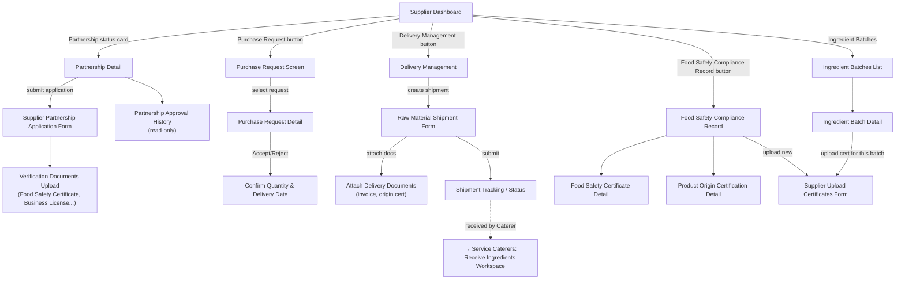

# Screen Flow — Raw Food Supplier (Mobile)

> Platform: Mobile (Flutter), theo [ADR-001](../02_ADR/ADR-001.md). Vào sau khi qua [Common Entry Flow](13_Guest_Common_Screen_Flow.md). Bản Web song song mới: [11_Raw_Food_Supplier_Screen_Flow_Web.md](11_Raw_Food_Supplier_Screen_Flow_Web.md).
> **Độ tin cậy reconstruction**: Cao — dựng từ mục "Raw Food Supplier Screens" (Report 3, field-by-field, có ghi chú điều hướng theo từng button trên Dashboard) kết hợp Screen Authorization để bổ sung các màn hình chứng nhận/hồ sơ. Không có UC mới bổ sung cho actor này trong đợt merge 2026-07-01.

## Sơ đồ điều hướng

## Ghi chú nghiệp vụ

- Nhánh `Partnership Detail → Supplier Partnership Application Form → Verification Documents Upload` map với bước 1–5 của Workflow 1 (Supplier Registration & Approval); kết quả Approve/Reject được School Administration xử lý ở `Supplier Partnership Requests` (xem [02_School_Administration_Screen_Flow.md](02_School_Administration_Screen_Flow.md)).
- Nhánh `Purchase Request Screen → Detail → Confirm Quantity & Delivery Date` map với bước phát hành/xác nhận đơn mua trong Workflow 2 (Ingredient Receiving), khởi đầu cho `Raw Material Shipment Form`.
- `Raw Material Shipment Form → Shipment Tracking` là điểm bàn giao cross-actor: khi Service Caterers bắt đầu `Receive Ingredients Workspace` (xem [04_Service_Caterers_Screen_Flow.md](04_Service_Caterers_Screen_Flow.md)), hệ thống đối chiếu dữ liệu shipment này để verify invoice (bước 3–4 Workflow 2).
- `Food Safety Certificate` / `Product Origin Certification` là điều kiện bắt buộc trước khi shipment được Caterer chấp nhận — liên quan BR liên quan đến hồ sơ chứng nhận nhà cung cấp trong nhóm Supplier Management của `business_rules.md`.
- `Supplier Upload Certificates Form` cho phép gắn chứng nhận theo từng `Ingredient Batch` cụ thể, hỗ trợ truy xuất nguồn gốc (traceability) — dữ liệu này được School Administration tham chiếu tại `Traceability Reports`.
