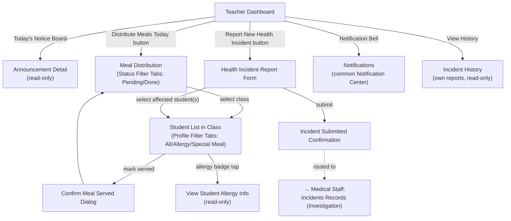

# Screen Flow — Teacher (Mobile)

> Platform: Mobile (Flutter), theo [ADR-001](../02_ADR/ADR-001.md). Vào sau khi qua [Common Entry Flow](13_Guest_Common_Screen_Flow.md). Bản Web song song mới: [12_Teacher_Screen_Flow_Web.md](12_Teacher_Screen_Flow_Web.md).
> **Độ tin cậy reconstruction**: Cao — dựng từ mục "Teacher Screens" (Report 3, field-by-field, có ghi chú điều hướng theo từng button trên Dashboard). Không có UC mới bổ sung cho actor này trong đợt merge 2026-07-01.

## Sơ đồ điều hướng

## Ghi chú nghiệp vụ

- `Meal Distribution → Student List in Class → Confirm Meal Served Dialog` map với bước phân phát/ghi nhận suất ăn của Workflow 10 (Meal Serving); badge dị ứng trong `Profile Filter Tabs` phản chiếu dữ liệu Allergy Profile được Medical Staff xác lập ở Workflow 9.
- `Health Incident Report Form` là điểm khởi phát (trigger) của Workflow 11 (Food Safety Incident Handling) từ phía giáo viên tại lớp học — sau khi `Submit`, báo cáo được chuyển tới Medical Staff để vào `Investigation Space` (xem [03_Medical_Staff_Screen_Flow.md](03_Medical_Staff_Screen_Flow.md)), tương tự nhánh `Report Safety Issue` của Parent nhưng do Teacher khởi tạo tại hiện trường.
- `Incident History` chỉ hiển thị các báo cáo do giáo viên đó tạo, không có quyền xem toàn bộ danh sách incident (khác với Medical Staff/School Administration).
