# Screen Flow — Medical Staff (Web) 🆕

> Platform: Web (Next.js) — bản mới bổ sung 2026-07-01 theo hướng "all web + Mobile song song" (`00_UI_Design_Documentation_Plan.md` mục 0, 5, 8b). Vào sau khi qua [Common Entry Flow](13_Guest_Common_Screen_Flow.md).
> **Nguyên tắc bắt buộc** (theo `Navigation_Guidelines.md` mục 1.1): bản Web này **dùng chung 100% business logic/field/BR/MSG** với [03_Medical_Staff_Screen_Flow.md](03_Medical_Staff_Screen_Flow.md) (Mobile) — không thêm UC/chức năng mới ngoài phạm vi Mobile đã có. Chỉ khác cách trình bày: sidebar 2 cấp + layout dashboard thay vì bottom-nav + card.
> **Độ tin cậy**: Trung bình-Cao — suy luận bố cục Web từ đúng UC Normal Flow đã dùng cho bản Mobile (không có đặc tả Web gốc trong Report 3 vì Medical Staff nguyên bản chỉ Mobile theo ADR-001).
> **Cập nhật 05/07/2026**: đội dự án quyết định đưa "Bảng giám sát tuân thủ" (Compliance/Monitor Dashboard) lên **đầu** nhóm "Kiểm tra & Giám sát ATTP" (trước đây "Conduct Food Safety Inspection" đứng đầu) — dashboard tổng quan nên là điểm vào đầu tiên của nhóm màn hình theo quy ước UX chung của dự án. Đã đồng bộ với `roles.ts` (sidebar Web) và bản Mobile (`03_Medical_Staff_Screen_Flow.md`).
> **Cập nhật 05/07/2026 (đợt 2) — bổ sung UC-185**: sau quyết định US-09 (`MedicalStaff_UserStory.md`), bổ sung hành động "Gửi báo cáo tuân thủ" (Send Compliance Report Dialog, UC-185/BR-209) — Medical Staff chủ động soạn/gửi báo cáo Daily/Weekly cho School Administration, khởi tạo từ Monitor Food Safety Dashboard. Đây là bổ sung ngoài `Report 3.md` gốc, không thay thế UC-027/UC-054.
> **Cập nhật 13/07/2026 — bổ sung UC-187–190 "ATTP Report Center"**: theo US-23 (`MedicalStaff_UserStory.md`), bổ sung màn hub "ATTP Report Center" (UC-187) gom 3 hành động chủ động gửi báo cáo cho School Administration: Send Compliance Report Dialog (UC-185, giữ nguyên điểm vào cũ từ Monitor Food Safety Dashboard, nay có thêm điểm vào từ hub), Send Incident Summary Dialog (UC-188 🆕), Send Violation Summary Dialog (UC-189 🆕); cộng màn Sent Reports History (UC-190 🆕). Không có trong `Report 3.md` gốc. Xem `review/medical_staff/review_screen_medical_staff.md` Mục 17.
> **Cập nhật 15/07/2026 — thiết kế lại "Sự cố & Điều tra"**: bổ sung "Create Incident Record Dialog" (UC-114 mở rộng — biên bản sự cố thủ công, tab mới "Biên bản chờ xử lý"); gộp trình bày "Assign Incident Severity" (UC-009) vào thẳng Incident Detail; gộp trình bày "Incident Validation" (UC-168) + "Generate Incident Report" (UC-033) thành "Hoàn tất sự cố"; khung 48h chọn món ăn nghi vấn (Quyết định 39/2006/QĐ-BYT). Không đổi BR. Xem `review/medical_staff/review_medicalstaff_incidentmanagement.md` Mục 10.

## Sidebar (2 cấp, theo Navigation_Guidelines.md)

| Nhóm | Màn hình con |
| --- | --- |
| Hồ sơ Sức khỏe & Dị ứng | Student Health Record List (UC-051), Student Health Record Detail, Update Health Record, Health History (UC-146), Special Meal Request List, Approve/Reject Special Meal |
| Kiểm tra & Giám sát ATTP | Monitor Food Safety Dashboard/Compliance Dashboard (UC-027/054) *(đã chuyển lên đầu mục 05/07/2026 — dashboard tổng quan nên là điểm vào đầu tiên của nhóm)*, ATTP Report Center (UC-187 🆕, bổ sung 13/07/2026 theo US-23 — hub gom Send Compliance Report Dialog UC-185, Send Incident Summary Dialog UC-188 🆕, Send Violation Summary Dialog UC-189 🆕, Sent Reports History UC-190 🆕), Conduct Food Safety Inspection (UC-014), Food Inspection Records, View Food Safety Compliance Report (UC-115), View Food Safety Reports (UC-117), View School Policy (UC-137) |
| Lưu mẫu Thực phẩm | Food Sample Records — Mẫu số 5 (UC-118), Retrieve Food Sample Records (UC-076) |
| Sự cố An toàn Thực phẩm | Incident List (4 tab từ 15/07/2026, gồm "Biên bản chờ xử lý"), Create Incident Record Dialog (UC-114 mở rộng, mới 15/07/2026), Investigation Workspace (UC-041), Incident Detail (nay gộp sẵn Assign Incident Severity/UC-009 + Hoàn tất sự cố = Incident Validation/UC-168 + Generate Incident Report/UC-033) |
| Quản lý Vi phạm 🆕 | Record Violation (UC-179, dialog hợp nhất — UC-178 Deprecated), Record Violation Resolution (UC-180) |
| Cá nhân | Profile, Notification Settings (xem [13_Guest_Common_Screen_Flow.md](13_Guest_Common_Screen_Flow.md)) |

## Sơ đồ điều hướng

```mermaid
flowchart TD
    Dash["Medical Staff Dashboard (Web)"]

    Dash --> HRList["Student Health Record List (UC-051)"]
    HRList --> HRDetail["Student Health Record Detail"]
    HRDetail --> UpdateHR["Update Health Record (bổ sung ghi chú, BR-172)"]
    HRDetail --> HealthHistory["Health History (UC-146, read-only)"]
    HRList -->|"tab Waiting for confirmation"| AllergyReview["Review Health/Allergy Information"]
    AllergyReview --> HRDetail

    Dash --> SMList["Special Meal Request List"]
    SMList --> SMApprove["Approve/Reject Special Meal Dialog"]

    Dash --> MonitorDash["Monitor Food Safety Dashboard (UC-054)"]
    MonitorDash --> SendReport["Send Compliance Report Dialog (UC-185)"]
    SendReport -.->|"gửi báo cáo Daily/Weekly"| SchoolAdminReport["→ School Administration:\nnhận thông báo báo cáo tuân thủ"]

    Dash --> ReportCenter["ATTP Report Center (UC-187 🆕)"]
    ReportCenter --> SendReport
    ReportCenter --> SendIncSummary["Send Incident Summary Dialog (UC-188 🆕)"]
    SendIncSummary -.->|"gửi báo cáo tổng hợp sự cố"| SchoolAdminIncSummary["→ School Administration:\nnhận thông báo báo cáo sự cố"]
    ReportCenter --> SendViolSummary["Send Violation Summary Dialog (UC-189 🆕)"]
    SendViolSummary -.->|"gửi báo cáo tổng hợp vi phạm"| SchoolAdminViolSummary["→ School Administration:\nnhận thông báo báo cáo vi phạm"]
    ReportCenter --> ReportHistory["Sent Reports History (UC-190 🆕)"]

    Dash --> InspNew["Conduct Food Safety Inspection (UC-014)"]
    Dash --> InspRecords["Food Inspection Records"]
    Dash --> ComplianceReport["View Food Safety Compliance Report (UC-115)"]
    Dash --> FSReports["View Food Safety Reports (UC-117)"]
    Dash --> Policy["View School Policy (UC-137)"]

    Dash --> SampleRegister["Food Sample Records — Mẫu số 5 (UC-118)"]
    SampleRegister --> RetrieveSample["Retrieve Food Sample Records Dialog (UC-076)"]

    Dash --> IncList["Incident List (4 tab, 15/07/2026)"]
    IncList -->|"Chờ tiếp nhận: Tạo báo cáo sự cố"| CreateRecord["Create Incident Record Dialog\n(UC-114 mở rộng, mới 15/07/2026)"]
    CreateRecord -->|"Lưu bản nháp"| IncList
    CreateRecord -->|"Hoàn tất biên bản"| DraftTab["Biên bản chờ xử lý (tab mới)"]
    DraftTab -->|"Mở phiên điều tra"| IncDetail
    DraftTab -->|"Đóng — Không liên quan ATTP"| IncList
    IncList -->|"Đang xử lý / Đã đóng"| IncDetail["Incident Detail\n(nay gộp sẵn severity/UC-009 + tường trình + chọn món ăn 48h)"]
    IncDetail -->|"Lưu đánh giá & Bắt đầu điều tra"| InvWorkspace["Investigation Workspace (UC-041)"]
    InvWorkspace --> RetrieveSample
    IncDetail -->|"Hoàn tất sự cố\n(gộp Incident Validation/UC-168 + Generate Report/UC-033, 15/07/2026)"| GenReport["Hoàn tất sự cố (UC-168 + UC-033)"]
    GenReport -.->|"gửi PDF"| SchoolAdminInc["→ School Administration:\nIncident Dashboard"]

    Dash --> ViolForm["Record Violation (UC-179, dialog hợp nhất)"]
    ViolForm --> ViolResolution["Record Violation Resolution (UC-180)"]
    ViolResolution -.->|"Medium/High → Pending Approval"| SchoolAdminViol["→ School Administration:\nApprove/Reject Violation Resolution"]

    Dash --> Prof["Profile Management\n(xem 13_Guest_Common_Screen_Flow.md)"]
```

## Khác biệt so với bản Mobile

- **Bố cục**: sidebar cố định bên trái (5 nhóm + Cá nhân) thay cho bottom-nav 1 hàng; các "Dialog" trên Mobile (Approve/Reject) trở thành modal hoặc panel bên phải trên Web, giữ nguyên field/validation. Riêng "Assign Severity" không còn là Dialog độc lập ở cả 2 nền tảng từ 15/07/2026 — đã gộp trình bày vào Incident Detail (xem Mục 10.4 `review_medicalstaff_incidentmanagement.md`).
- **GPS/Camera**: các bước đòi hỏi GPS+ảnh tự động (Conduct Food Safety Inspection, Retrieve Food Sample) — trên Web dùng upload file ảnh + nhập tọa độ thủ công hoặc dùng trình duyệt Geolocation API (độ chính xác thấp hơn Mobile); cần `00_Foundation/UI_Design_Guidelines.md` mục GPS/camera xác nhận hành vi fallback.
- **Offline**: không áp dụng — Web luôn yêu cầu kết nối (theo quyết định BR-196/197, mục 2.3 của `00_UI_Design_Documentation_Plan.md`), khác Mobile được phép ghi nhận bằng chứng offline có giới hạn.
- **Investigation Workspace**: trên Web có thể trình bày dạng nhiều panel song song (bằng chứng | root cause | CAPA) tận dụng màn hình rộng, thay vì các bước tuần tự như Mobile.

## Nguồn dữ liệu
- Business logic/UC/BR/MSG: dùng chung 100% với [03_Medical_Staff_Screen_Flow.md](03_Medical_Staff_Screen_Flow.md).
- Bố cục Web: `00_Foundation/Layout_Guidelines.md` (Dashboard sidebar+content), `00_Foundation/Navigation_Guidelines.md` mục 1.
