# Screen Flow — Service Caterers (Web) 🆕

> Platform: Web (Next.js) — bản mới bổ sung 2026-07-01 theo hướng "all web + Mobile song song" (`00_UI_Design_Documentation_Plan.md` mục 0, 5, 8b). Vào sau khi qua [Common Entry Flow](13_Guest_Common_Screen_Flow.md).
> **Nguyên tắc bắt buộc**: dùng chung 100% business logic/UC/BR/MSG với [04_Service_Caterers_Screen_Flow.md](04_Service_Caterers_Screen_Flow.md) (Mobile). Đây là actor có phạm vi UC lớn nhất hệ thống (~35 màn hình) — Web phù hợp cho các tác vụ bàn giấy (Menu Planning, Inventory review, Corrective Actions), trong khi các tác vụ hiện trường bắt buộc GPS/camera (Receiving, Three-Step Inspection, Sample Retention) **vẫn nên ưu tiên dùng Mobile trong thực tế vận hành** dù Web cũng hỗ trợ đủ field.
> **Độ tin cậy**: Trung bình-Cao.

## Sidebar (2 cấp)

| Nhóm | Màn hình con |
| --- | --- |
| Thực đơn | Menu Management Dashboard, Create Menu Workspace, AI Menu Recommendations, Update Menu, Submit For Approval |
| Nhận hàng & Kho | Receiving Management Dashboard, Receive Ingredients Workspace, Verify Supplier Delivery, Capture Receiving Evidence*, Store Ingredients, Reject Ingredient Batch, Receiving History & Reports, Inventory Management Dashboard, Issue Ingredients, Monitor Expiration Dates, Inventory Transactions Log |
| Kiểm tra 3 Bước | Three-Step Inspection Dashboard, Step 1/2/3*, Preparation Records Ledger, Inspection Records Log |
| Lưu mẫu Thực phẩm | Food Sample Retention Dashboard, Record Sample Information*, Food Sample Detail |
| Phục vụ Bữa ăn | Meal Service Management Dashboard, View Meal Distribution List, View Allergy Alerts, Manage Special Meals Configuration |
| Sự cố & Vi phạm | Corrective Actions Dashboard, Submit Corrective Action Results, View Incident Information, Record Violation (UC-179, dialog hợp nhất — UC-178 Deprecated) 🆕 |
| Cá nhân | Profile, Notification Settings |

\* Các bước đòi hỏi GPS + ảnh bắt buộc (BR-073/083) — trên Web chỉ hỗ trợ **upload ảnh + nhập/xác nhận tọa độ**, khuyến nghị vẫn thao tác qua Mobile tại hiện trường bếp.

## Sơ đồ điều hướng

```mermaid
flowchart TD
    Dash["Service Caterers Dashboard (Web)"]

    Dash --> MenuDash["Menu Management Dashboard"]
    MenuDash --> CreateMenu["Create Menu Workspace"]
    CreateMenu --> AIPanel["AI Menu Recommendations"]
    CreateMenu --> SubmitMenu["Submit Menu For Approval"]
    SubmitMenu -.-> SchoolAdminMenu["→ School Administration:\nMenu Management"]
    MenuDash --> UpdateMenu["Update Menu"]

    Dash --> RecvDash["Receiving Management Dashboard"]
    RecvDash --> RecvWS["Receive Ingredients Workspace\n(upload ảnh thay vì chụp trực tiếp)"]
    RecvWS --> VerifyPanel["Verify Supplier Delivery Panel"]
    RecvWS --> RejectForm["Reject Ingredient Batch Form"]
    RecvDash --> RecvHist["Receiving History & Reports"]

    Dash --> InvDash["Inventory Management Dashboard"]
    InvDash --> IssueWS["Issue Ingredients Workspace (FEFO)"]
    InvDash --> ExpiryPanel["Monitor Expiration Dates Panel"]
    InvDash --> InvLog["Record Inventory Transactions Log"]
    InvDash -->|"low stock"| CreatePR["Create Purchase Request"]

    Dash --> InspDash["Three-Step Inspection Dashboard\n(khuyến nghị dùng Mobile tại bếp)"]
    InspDash --> Step1["Step 1: Before Processing"]
    Step1 --> Step2["Step 2: After Cooking"]
    Step2 --> Step3["Step 3: Before Serving"]
    Step3 --> PrepLedger["View Preparation Records Ledger"]
    Step3 --> InspLog["View Inspection Records Log"]

    Dash --> SampleDash["Food Sample Retention Dashboard\n(khuyến nghị dùng Mobile tại bếp)"]
    SampleDash --> SampleForm["Record Sample Information Form"]
    SampleForm --> SampleDetail["Food Sample Detail"]

    Dash --> MealDash["Meal Service Management Dashboard"]
    MealDash --> DistList["View Meal Distribution List"]
    MealDash --> AllergyPanel["View Allergy Alerts Panel"]
    MealDash --> SpecialCfg["Manage Special Meals Configuration"]

    Dash --> CorrDash["Corrective Actions Dashboard"]
    CorrDash --> CorrForm["Submit Corrective Action Results Form"]
    CorrDash --> IncidentInfo["View Incident Information Detail"]
    InspDash -.->|"InspectionStep.fail()"| ProcessViol["Record Violation (UC-179, dialog hợp nhất)"]
    CorrDash --> ProcessViol

    Dash --> Prof["Profile Management"]
```

## Khác biệt so với bản Mobile

- **GPS/Camera bắt buộc** (Receiving Evidence, Inspection Step 1-3, Sample Registration): Web thay bằng upload file + xác nhận tọa độ thủ công/Geolocation API trình duyệt — độ tin cậy chống gian lận thấp hơn Mobile (không có camera trực tiếp), khuyến nghị ghi rõ trong Screen Specification là "secondary path", Mobile vẫn là kênh chính cho các bước này tại bếp.
- **Offline**: không áp dụng trên Web (BR-197 luôn yêu cầu kết nối), khác Mobile được ghi nhận offline có giới hạn cho evidence capture (BR-196).
- **Bố cục**: Menu/Inventory/Corrective Actions phù hợp Web hơn (bảng dữ liệu lớn, nhiều cột lọc) — nên ưu tiên thiết kế các màn hình này "Web-first" khi làm Wireframe, ngược lại Three-Step Inspection/Sample Retention nên giữ Mobile làm bản tham chiếu chính.

## Nguồn dữ liệu
- Business logic/UC/BR/MSG: dùng chung 100% với [04_Service_Caterers_Screen_Flow.md](04_Service_Caterers_Screen_Flow.md).
- Bố cục Web: `00_Foundation/Layout_Guidelines.md`, `00_Foundation/Navigation_Guidelines.md` mục 1.
