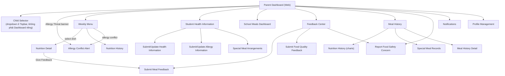

# Screen Flow — Parent (Web) 🆕

> Platform: Web (Next.js) — bản mới bổ sung 2026-07-01 theo hướng "all web + Mobile song song" (`00_UI_Design_Documentation_Plan.md` mục 0, 5, 8b). Vào sau khi qua [Common Entry Flow](13_Guest_Common_Screen_Flow.md).
> **Nguyên tắc bắt buộc**: dùng chung 100% business logic/UC/BR/MSG với [05_Parent_Screen_Flow.md](05_Parent_Screen_Flow.md) (Mobile) — không thêm chức năng mới.
> **Độ tin cậy**: Trung bình — Parent là actor phụ huynh, phần lớn thao tác (xem menu, phản hồi bữa ăn) vẫn ưu tiên trải nghiệm Mobile trong thực tế; bản Web phù hợp cho phụ huynh muốn xem trên máy tính (ít khẩn cấp hơn cảnh báo dị ứng thời gian thực).

## Sidebar (2 cấp, gọn — theo Navigation_Guidelines.md mục 1.1)

| Nhóm | Màn hình con |
| --- | --- |
| Thực đơn & Dinh dưỡng | Weekly Menu, Nutrition Detail, Nutrition History |
| Sức khỏe & Dị ứng | Student Health Information, Submit/Update Health Information, Submit/Update Allergy Information, Special Meal Arrangements, Special Meal Records |
| Bữa ăn của con | School Meals Dashboard, Meal History, Meal History Detail |
| Phản hồi & Sự cố | Feedback Center, Submit Meal Feedback, Submit Food Quality Feedback, Report Food Safety Concern |
| Cá nhân | Profile, Notification Settings |

## Sơ đồ điều hướng

## Khác biệt so với bản Mobile

- **Push notification thời gian thực** (cảnh báo dị ứng, thông báo khẩn) vẫn ưu tiên Mobile — bản Web chỉ hiển thị Notification Center khi phụ huynh chủ động đăng nhập, không có push background như app di động (giới hạn kỹ thuật trình duyệt/PWA, cần xác nhận với team nếu có ý định dùng Web Push API).
- **Report Food Safety Concern**: trên Mobile là nút khẩn cấp nổi bật (bypass duyệt theo BR-138); trên Web nên đặt cố định dễ thấy trong sidebar/topbar, không chỉ ẩn trong menu, để giữ đúng tính khẩn cấp.
- **Offline**: không áp dụng (Web luôn cần kết nối).

## Nguồn dữ liệu
- Business logic/UC/BR/MSG: dùng chung 100% với [05_Parent_Screen_Flow.md](05_Parent_Screen_Flow.md).
- Bố cục Web: `00_Foundation/Layout_Guidelines.md`, `00_Foundation/Navigation_Guidelines.md` mục 1.
