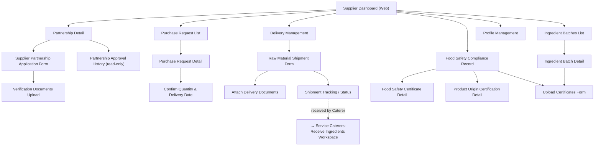

# Screen Flow — Raw Food Supplier (Web) 🆕

> Platform: Web (Next.js) — bản mới bổ sung 2026-07-01 theo hướng "all web + Mobile song song" (`00_UI_Design_Documentation_Plan.md` mục 0, 5, 8b). Vào sau khi qua [Common Entry Flow](13_Guest_Common_Screen_Flow.md).
> **Nguyên tắc bắt buộc**: dùng chung 100% business logic/UC/BR/MSG với [06_Raw_Food_Supplier_Screen_Flow.md](06_Raw_Food_Supplier_Screen_Flow.md) (Mobile).
> **Độ tin cậy**: Trung bình-Cao — phù hợp Web vì phần lớn thao tác của Supplier (hồ sơ, chứng nhận, purchase request, theo dõi lô hàng) là tác vụ bàn giấy, không đòi hỏi GPS/camera hiện trường như Service Caterers.

## Sidebar (2 cấp)

| Nhóm | Màn hình con |
| --- | --- |
| Hợp tác với Trường | Partnership Detail, Supplier Partnership Application Form, Verification Documents Upload, Partnership Approval History |
| Đơn Mua hàng | Purchase Request List, Purchase Request Detail, Confirm Quantity & Delivery Date |
| Giao hàng | Delivery Management, Raw Material Shipment Form, Attach Delivery Documents, Shipment Tracking |
| Tuân thủ & Chứng nhận | Food Safety Compliance Record, Food Safety Certificate Detail, Product Origin Certification, Upload Certificates |
| Lô Nguyên liệu | Ingredient Batches List, Ingredient Batch Detail |
| Cá nhân | Profile, Notification Settings |

## Sơ đồ điều hướng

## Khác biệt so với bản Mobile

- **Không có bước nào bắt buộc GPS/camera** cho actor này (khác Service Caterers/Delivery Person) — Web và Mobile có độ tương đương cao, không cần fallback đặc biệt.
- **Bảng dữ liệu lớn** (Purchase Request List, Ingredient Batches List, Shipment Tracking) phù hợp Web hơn — nên ưu tiên Web làm bản tham chiếu chính khi thiết kế Wireframe cho các màn hình này, Mobile giữ vai trò thao tác nhanh tại kho/xe giao hàng.
- **Offline**: không áp dụng trên Web.

## Nguồn dữ liệu
- Business logic/UC/BR/MSG: dùng chung 100% với [06_Raw_Food_Supplier_Screen_Flow.md](06_Raw_Food_Supplier_Screen_Flow.md).
- Bố cục Web: `00_Foundation/Layout_Guidelines.md`, `00_Foundation/Navigation_Guidelines.md` mục 1.
