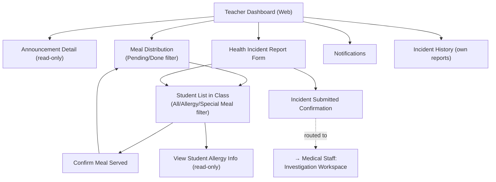

# Screen Flow — Teacher (Web) 🆕

> Platform: Web (Next.js) — bản mới bổ sung 2026-07-01 theo hướng "all web + Mobile song song" (`00_UI_Design_Documentation_Plan.md` mục 0, 5, 8b). Vào sau khi qua [Common Entry Flow](13_Guest_Common_Screen_Flow.md).
> **Nguyên tắc bắt buộc**: dùng chung 100% business logic/UC/BR/MSG với [07_Teacher_Screen_Flow.md](07_Teacher_Screen_Flow.md) (Mobile).
> **Độ tin cậy**: Trung bình — Teacher là actor gắn liền lớp học/hiện trường (điểm danh phân phát bữa ăn), Mobile vẫn là kênh chính thực tế; bản Web hữu ích khi giáo viên xử lý ở máy tính phòng giáo viên (xem lịch sử, báo cáo sự cố chi tiết hơn).

## Sidebar (gọn, 4 nhóm)

| Nhóm | Màn hình con |
| --- | --- |
| Bảng tin | Announcement Detail (read-only) |
| Phân phát Bữa ăn | Meal Distribution, Student List in Class, Confirm Meal Served, View Student Allergy Info |
| Sự cố Sức khỏe | Health Incident Report Form, Incident History |
| Cá nhân | Profile, Notification Settings |

## Sơ đồ điều hướng

## Khác biệt so với bản Mobile

- **Xác nhận phân phát bữa ăn tại lớp** (`Confirm Meal Served`) về bản chất là thao tác hiện trường theo thời gian thực khi đứng trước học sinh — Mobile vẫn là kênh chính; Web chỉ nên dùng cho xem lại/điều chỉnh sau giờ ăn, không thay thế thao tác trực tiếp.
- **Health Incident Report Form**: trên Web có thể trình bày form đầy đủ hơn (nhiều trường mô tả chi tiết hơn) do không giới hạn màn hình nhỏ, phù hợp khi giáo viên cần ghi chú dài sau sự việc.
- **Offline**: không áp dụng trên Web; Mobile được phép ghi nhận offline có giới hạn cho bằng chứng (không áp dụng cho cảnh báo dị ứng thời gian thực — BR-197).

## Nguồn dữ liệu
- Business logic/UC/BR/MSG: dùng chung 100% với [07_Teacher_Screen_Flow.md](07_Teacher_Screen_Flow.md).
- Bố cục Web: `00_Foundation/Layout_Guidelines.md`, `00_Foundation/Navigation_Guidelines.md` mục 1.
