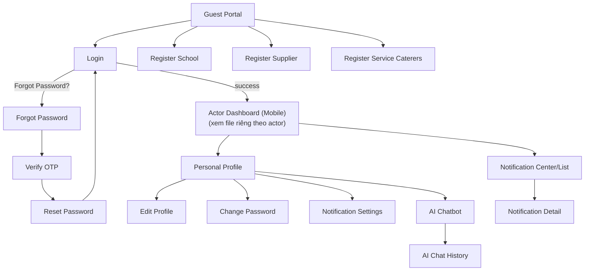
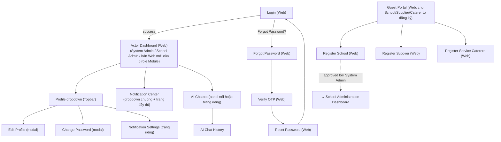

# Screen Flow — Guest & Common (Mobile + Web) 🆕 tách file riêng

> **Nguồn**: `Report 3.md` mục "Guest and Common Screen" (§3.3.2.1, 15 màn hình field-by-field, dòng 5305–5507) + bảng Screen Authorization (cột x ở mọi actor cho Login/Forgot Password/Reset Password/Verify OTP/Notification Settings, dòng 5057–5065).
> **Lý do tách file**: trước đây luồng này chỉ nằm rải rác trong [00_Screen_Flow_Overview.md](00_Screen_Flow_Overview.md) (mục "Common Entry Flow") mà không có mô tả field hay bản Web — gây ra khoảng trống đã ghi nhận ở `00_UI_Design_Documentation_Plan.md` mục 2.5: *"System Admin/School Admin cũng cần phiên bản Web của Login/Forgot Password/OTP/Reset — nhưng không có wireframe Web nào cho các màn hình này ở bất kỳ đâu"*. File này giải quyết khoảng trống đó bằng cách định nghĩa **cả 2 nền tảng** cho 15 màn hình dùng chung.
> **Độ tin cậy**: Cao cho nội dung field (lấy trực tiếp từ Report 3 field-by-field) — Trung bình cho phần bố cục Web (suy luận mới, chưa có đặc tả Web gốc).

## Danh sách 15 màn hình & field chính

| # | Màn hình | Field chính (theo Report 3 §3.3.2.1) | Dùng bởi |
| --- | --- | --- | --- |
| 1 | Guest Portal | Logo, Welcome Text, 3 nút Register (School/Supplier/Caterer), nút Login | Guest (chưa đăng nhập) |
| 2 | Register School | School Name, Address, Representative Name, Email, Phone, Submit/Cancel | Guest → School Administration tương lai |
| 3 | Register Supplier | Company Name, Business License No, Contact Person, Email, Phone, Submit/Cancel | Guest → Raw Food Supplier tương lai |
| 4 | Register Service Caterers | Caterer Name, Business Reg No, Office Address, Contact Person, Email, Phone, Submit/Cancel | Guest → Service Caterers tương lai |
| 5 | Login | Username/Email, Password, nút Login, "Forgot Password?", Register Options | **Mọi actor (x ở cả 7 cột)** |
| 6 | Forgot Password | Email Address, nút Send OTP | Mọi actor |
| 7 | Verify OTP | 6-digit OTP input, Verify Code, Countdown, Resend OTP | Mọi actor |
| 8 | Reset Password | New Password, Confirm New Password, Update Password | Mọi actor |
| 9 | Personal Profile | Avatar, Name, Role & School/Company, Settings, menu Edit/Change PW/Notif/AI Chatbot, Logout | Mọi actor (trừ trường không dùng bottom-tab trên Web) |
| 10 | Edit Profile | Avatar Upload, Full Name, Phone, Email (read-only) | Mọi actor |
| 11 | Change Password | Current/New/Confirm Password | Mọi actor có cột x (System Admin, School Admin, Medical Staff, Service Caterers — theo Screen Authorization dòng 5062; Teacher/Raw Food Supplier/Parent không có cột x, đổi mật khẩu qua Forgot Password) |
| 12 | Notification Settings | Push/Email toggle, Allergy Warnings, Food Safety Alerts, Save | Mọi actor (x ở cả 7 cột) |
| 13 | Notification History / Center | Notification List, Warning Badge (đỏ/vàng/xám theo mức độ), Sent Time | School Admin, Teacher, Service Caterers, Parent (theo Screen Authorization dòng 5063; System Admin/Medical Staff/Raw Food Supplier không có cột x — chỉ có Notification Settings, không có Center riêng) |
| 14 | AI Chatbot | Conversation pane, Send, Clear Chat, View Chat History | Actor có UC-012 (Chat with AI) — mọi actor theo BR-157, không giới hạn role cụ thể trong traceability_matrix |
| 15 | AI Chat History | Conversation List (topic + ngày) | Cùng phạm vi AI Chatbot |

## Sơ đồ điều hướng — Mobile (giữ nguyên từ bản gốc, đã có từ trước)

## Sơ đồ điều hướng — Web 🆕 (mới, lấp khoảng trống mục 2.5)

## Khác biệt bố cục Mobile ↔ Web

| Yếu tố | Mobile | Web |
| --- | --- | --- |
| Profile | Trang riêng, truy cập qua Bottom Tab Bar (Home/Meals/Health/Profile) | Dropdown menu ở góc phải Topbar, không chiếm trang riêng trừ khi mở "Edit Profile" |
| Edit Profile / Change Password | Trang riêng full-screen | Modal/Dialog nổi trên Dashboard hiện tại (theo `Component_Guidelines.md`) |
| Notification Center | Trang riêng full-screen, danh sách cuộn | Dropdown ngắn từ icon chuông (Topbar) + link "Xem tất cả" mở trang đầy đủ |
| AI Chatbot | Trang riêng, chat toàn màn hình | Panel nổi góc dưới phải (giống chat widget) hoặc trang riêng tùy độ ưu tiên — cần Screen Specification xác nhận |
| Register School/Supplier/Caterer | Không áp dụng — Report 3 gốc đặt các màn hình này trong nhóm Mobile Guest/Common (§3.3.2.1.2-4), nhưng School Administration/System Admin duyệt hồ sơ lại luôn ở Web (`02_School_Administration_Screen_Flow.md`, `01_System_Admin_Screen_Flow.md`) → **mâu thuẫn đã ghi nhận ở mục 2.5 của UI Plan**: đăng ký nên có cả 2 bản Web (máy tính) và Mobile (điện thoại) vì Guest chưa có tài khoản/thiết bị cố định, không thuộc actor Mobile-only hay Web-only nào. |

## Ghi chú nghiệp vụ

- **Change Password** không có cột `x` cho Teacher, Raw Food Supplier, Parent trong Screen Authorization gốc (dòng 5062) — 3 role này chỉ đổi mật khẩu qua luồng "Forgot Password → OTP → Reset", không có màn hình "Change Password" chủ động trong khi đã đăng nhập. Đây là **hành vi có chủ đích theo tài liệu gốc**, không phải thiếu sót khi dựng flow.
- **Notification Center/List** không có cho System Admin, Medical Staff, Raw Food Supplier (dòng 5063) — 3 role này chỉ có "Notification Settings" (cấu hình bật/tắt), nhận thông báo qua kênh khác (banner trong Dashboard/push) thay vì trang danh sách tập trung. Cần xác nhận với team đây có phải chủ đích hay khoảng trống khi làm Screen Specification.
- **AI Chatbot/History**: Screen Authorization không gán cột `x` rõ ràng cho actor cụ thể nào (xem ghi chú gốc trong bản Overview cũ) — theo BR-157 (lưu trữ trao đổi AI bắt buộc) và UC-012/UC-119 trong traceability_matrix (actor "User", tức dùng chung), suy luận: mọi actor đều truy cập được, không giới hạn riêng role nào.
- File này **không tạo thêm UC mới** — chỉ định danh rõ 15 màn hình dùng chung đã tồn tại trong Report 3, cả 2 nền tảng, để `01_System_Admin_Screen_Flow.md` … `12_Teacher_Screen_Flow_Web.md` có thể trỏ về 1 nguồn duy nhất thay vì lặp lại mô tả Common Entry Flow ở mỗi file (đã sửa toàn bộ 12 file kia trỏ về file này thay vì `00_Screen_Flow_Overview.md#common-entry-flow`).

## Nguồn dữ liệu
- `Report 3.md` §3.3.2.1 (field-by-field, dòng 5305–5507).
- `Report 3.md` mục Screen Authorization (dòng 5057–5065).
- `00_Foundation/Component_Guidelines.md` (quy ước Dialog/Modal Web), `00_Foundation/Layout_Guidelines.md` (Bottom Tab Bar Mobile).
