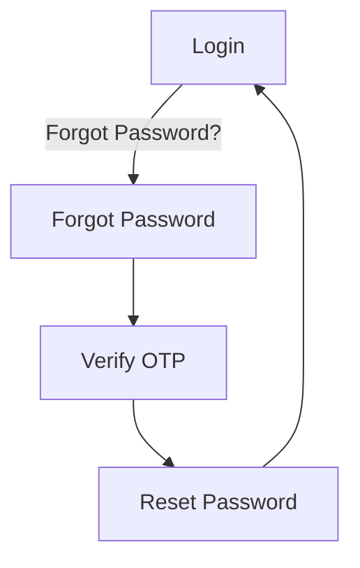

# Wireframe — Authentication (Guest & Common, Mobile)

**Nguồn**: `05_ScreenSpecifications/Mobile/GuestCommon/01_Login.md`, `02_ForgotPassword.md`, `03_ResetPassword.md`, `04_VerifyOTP.md`
**Công cụ sinh**: Thủ công (theo skill `wireframer`, `.skills/wireframer/SKILL.md`)
**File/Link**: `03_Design/06_Wireframes/Mobile/GuestCommon/01_Authentication.html`

> **Nguồn Draft**: 4 Screen Specification nguồn đều `Status: Draft`, chưa qua QA (mục 6, `05_ScreenSpecifications/00_Team_Work_Assignment_Plan.md`) — bám sát nguyên văn Draft hiện có.

## Phạm vi

SPA vanilla HTML/JS mô phỏng khung điện thoại (`390px`, khung bo góc) chứa 4 màn hình luồng Authentication Mobile, điều hướng bằng `showScreen(id)`, đúng `03_Design/04_ScreenFlow/13_Guest_Common_Screen_Flow.md` (sơ đồ Mobile gốc). Login/Reset Password không có AppBar (màn trước khi đăng nhập/sau OTP, theo đúng Screen Spec: "không AppBar"); Forgot Password/Verify OTP có AppBar với icon Back.

## Bảng 4 màn hình

| STT | Màn hình | `id` trong SPA | File Screen Spec nguồn |
| --- | --- | --- | --- |
| 1 | Login | `screen-login` | `05_ScreenSpecifications/Mobile/GuestCommon/01_Login.md` |
| 2 | Forgot Password | `screen-forgot` | `05_ScreenSpecifications/Mobile/GuestCommon/02_ForgotPassword.md` |
| 3 | Verify OTP | `screen-otp` | `05_ScreenSpecifications/Mobile/GuestCommon/04_VerifyOTP.md` |
| 4 | Reset Password | `screen-reset` | `05_ScreenSpecifications/Mobile/GuestCommon/03_ResetPassword.md` |

## Sơ đồ điều hướng đã hiện thực

Khớp nhánh Mobile của `13_Guest_Common_Screen_Flow.md`.

## Đối chiếu với Screen Specification

### 1. Login
- [x] TextField Username/Email, TextField Password (masked, icon toggle)
- [x] FilledButton "Login" full-width
- [x] TextButton "Forgot Password?", TextButton "Register Options"
- [x] Trạng thái loading/error (MSG-002/003/076)/success (MSG-026)
- [x] Không AppBar (đúng Platform Layout Mobile — màn trước khi đăng nhập)

### 2. Forgot Password
- [x] AppBar Back + tiêu đề, TextField Email, FilledButton "Send OTP" full-width
- [x] Trạng thái error/success

### 3. Verify OTP
- [x] AppBar Back, 6 ô OTP input ≥48dp (mô phỏng bằng ô 38×48px), Countdown Timer, FilledButton "Verify Code", TextButton "Resend OTP" (disabled khi countdown chạy)
- [x] Trạng thái error (mã sai/hết hạn)

### 4. Reset Password
- [x] TextField New/Confirm Password (masked), FilledButton "Update Password" full-width
- [x] Trạng thái error (token hết hạn — AF1), success (MSG-030)

Toàn bộ field khớp 1-1 bảng Business Logic — KHÔNG thêm field/nghiệp vụ ngoài Screen Spec nguồn ở cả 4 màn.

## Ghi chú kỹ thuật tuân thủ SKILL.md

- Vanilla HTML/JS 1 file, khung `.phone` mô phỏng viewport Mobile 390px, mỗi màn `
` bên trong.
- `wired-elements` qua CDN cho `wired-input`; nút dùng `.btn-primary` (sketchy border), không dùng `<wired-button>`.
- Icon SVG doodle inline, không emoji. Grayscale tuyệt đối.
- Bỏ qua bước Initialization Routine của SKILL.md theo tiền lệ nhóm.

## Vấn đề/thiếu sót phát hiện khi đối chiếu Screen Spec nguồn

1. **04_VerifyOTP.md** (Mobile) tự ghi nhận: thời lượng countdown cụ thể/số lần Resend tối đa **[Giả định — cần team xác nhận]** — giống bản Web, không có nguồn UC/BR cụ thể.
2. Không phát hiện khác biệt field đáng kể giữa bản Mobile và Web ở nhóm Authentication (chỉ khác cách trình bày AppBar/FilledButton theo nền tảng) — đã đối chiếu riêng cả 2 file khi build 2 wireframe song song.
