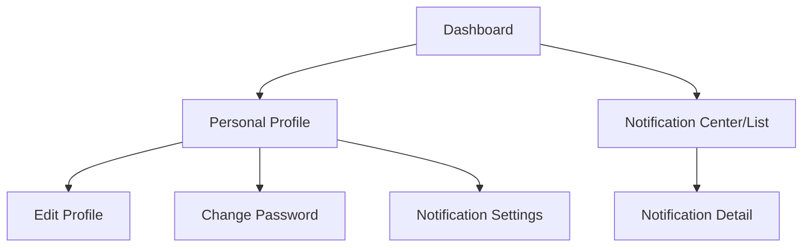

# Wireframe — Profile & Notification (Guest & Common, Mobile)

**Nguồn**: `05_ScreenSpecifications/Mobile/GuestCommon/05_ProfileManagement.md`, `06_ChangePassword.md`, `07_NotificationCenterList.md`, `08_NotificationDetail.md`, `09_NotificationSettings.md`
**Công cụ sinh**: Thủ công (theo skill `wireframer`, `.skills/wireframer/SKILL.md`)
**File/Link**: `03_Design/06_Wireframes/Mobile/GuestCommon/05_ProfileNotification.html`

> **Nguồn Draft**: 5 Screen Specification nguồn đều `Status: Draft`, chưa qua QA (mục 6, `05_ScreenSpecifications/00_Team_Work_Assignment_Plan.md`).

## Phạm vi

SPA vanilla HTML/JS trong khung điện thoại 390px, 6 sub-màn (5 Screen Spec + sub-màn Edit Profile của cùng file Profile Management), điều hướng `showScreen(id)`. Khác bản Web: Profile Management/Edit Profile/Change Password/Notification Settings đều là **trang riêng full-screen** (không phải dropdown/modal), đúng Platform Layout — Mobile của từng Screen Spec.

## Bảng màn hình

| STT | Màn hình | `id` trong SPA | File Screen Spec nguồn |
| --- | --- | --- | --- |
| 1 | Profile Management | `screen-profile` | `05_ScreenSpecifications/Mobile/GuestCommon/05_ProfileManagement.md` |
| 1b | Edit Profile | `screen-editprofile` | cùng file (khối "Edit mode", §3.3.2.1.10) |
| 2 | Change Password | `screen-changepw` | `05_ScreenSpecifications/Mobile/GuestCommon/06_ChangePassword.md` |
| 3 | Notification Center/List | `screen-notifcenter` | `05_ScreenSpecifications/Mobile/GuestCommon/07_NotificationCenterList.md` |
| 4 | Notification Detail | `screen-notifdetail` | `05_ScreenSpecifications/Mobile/GuestCommon/08_NotificationDetail.md` |
| 5 | Notification Settings | `screen-notifsettings` | `05_ScreenSpecifications/Mobile/GuestCommon/09_NotificationSettings.md` |

## Sơ đồ điều hướng đã hiện thực

Khớp nhánh Mobile của `13_Guest_Common_Screen_Flow.md`.

## Đối chiếu với Screen Specification

### 1. Profile Management
- [x] Avatar lớn, Name, Role & School/Company
- [x] ListTile: Edit Profile, Change Password, Notification Settings
- [x] Nút Logout (confirm dialog)
- [x] KHÔNG thêm "AI Chatbot" thành màn riêng (ngoài phạm vi giao việc, chỉ ghi nhận điểm điều hướng theo Screen Spec — không tạo mục ở đây)

### 1b. Edit Profile
- [x] Avatar Upload (image_picker, JPG/PNG ≤5MB), Full Name, Phone Number, Email (read-only)
- [x] Nút Save (AppBar Back đóng vai Cancel)

### 2. Change Password
- [x] AppBar Back, Current/New/Confirm Password (masked), FilledButton "Save Password"
- [x] Trạng thái error (MSG-002), success (MSG-030)

### 3. Notification Center/List
- [x] ListTile/Card danh sách, Warning Badge (đỏ/vàng/xám + icon/label), Sent Time
- [x] Pull-to-refresh (ghi chú trong note)
- [x] Tap → Notification Detail

### 4. Notification Detail
- [x] AppBar Back, Badge, tiêu đề, nội dung đầy đủ, Sent Time, nút hành động deep-link
- [x] Toàn bộ field giữ nguyên mức "[Giả định — cần team xác nhận]" như Screen Spec nguồn ghi nhận, không bổ sung thêm

### 5. Notification Settings
- [x] AppBar Back, SwitchListTile Push/Email/Allergy Warnings/Food Safety Alerts, TimePicker Quiet Hours, FilledButton "Save Settings"

Toàn bộ field khớp 1-1 — KHÔNG thêm field/nghiệp vụ ngoài Screen Spec nguồn.

## Ghi chú kỹ thuật tuân thủ SKILL.md

- Vanilla HTML/JS 1 file, khung `.phone` mô phỏng viewport Mobile.
- `wired-elements` (input/checkbox) qua CDN, nút `.btn-primary` (không `<wired-button>`), icon SVG doodle inline, grayscale tuyệt đối.
- Bỏ qua bước Initialization Routine theo tiền lệ nhóm.

## Vấn đề/thiếu sót phát hiện khi đối chiếu Screen Spec nguồn

1. **07_NotificationCenterList.md** (Mobile): actor không có Notification Center riêng (System Admin/Medical Staff/Raw Food Supplier) chỉ có Notification Settings — wireframe này build theo góc nhìn actor có đủ cả 2 (ScA/Teacher/SC/Parent), không áp dụng universal cho mọi actor; cần lưu ý khi actor khác dùng lại wireframe này làm tham chiếu.
2. Không phát hiện khác biệt field mới nào giữa bản Mobile và Web ngoài những gì đã ghi ở wireframe Web tương ứng (`Web/GuestCommon/05_ProfileNotification.md`).
