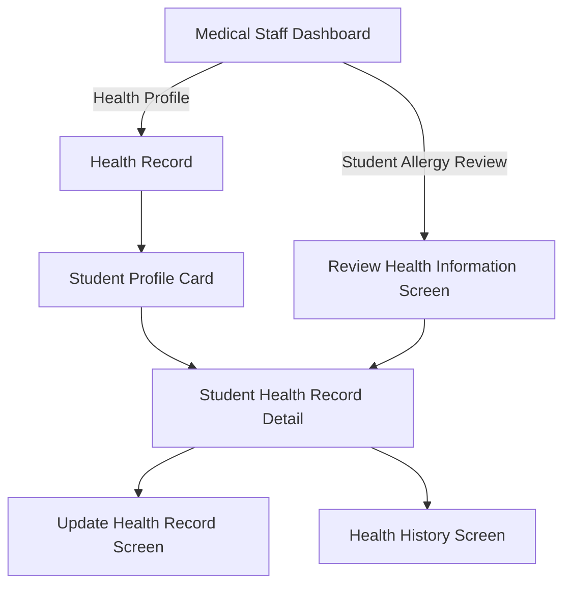

# Wireframe — Dashboard & Health Record (Medical Staff, Mobile)

**Nguồn**: `05_ScreenSpecifications/Mobile/MedicalStaff/01_MedicalStaffDashboard.md`, `02_ReviewHealthInformationScreen.md`, `03_StudentHealthRecordList.md`, `04_StudentHealthRecordDetail.md`, `05_UpdateHealthRecordScreen.md`, `06_HealthHistoryScreen.md`
**Công cụ sinh**: Thủ công (theo skill `wireframer`, `.skills/wireframer/SKILL.md`)
**File/Link**: `03_Design/06_Wireframes/Mobile/MedicalStaff/01_DashboardHealthRecord.html`

> **Nguồn Draft**: 6 Screen Specification nguồn đều `Status: Draft`, chưa qua QA.

## Phạm vi

SPA vanilla HTML/JS trong khung điện thoại 390px, 6 màn hình. Dashboard có AppBar (title + icon Add + icon Notification badge) + Bottom Navigation (Home/Health/Meals/Profile) theo đúng Report 3 §3.3.2.3.1; Review Health Information dùng danh sách Card + `showModalBottomSheet` cho chi tiết/Approve/Reject.

## Bảng 6 màn hình

| STT | Màn hình | `id` trong SPA | File Screen Spec nguồn |
| --- | --- | --- | --- |
| 1 | Medical Staff Dashboard | `screen-dashboard` | `01_MedicalStaffDashboard.md` |
| 2 | Review Health Information Screen | `screen-review` | `02_ReviewHealthInformationScreen.md` |
| 3 | Student Health Record List | `screen-list` | `03_StudentHealthRecordList.md` |
| 4 | Student Health Record Detail | `screen-detail` | `04_StudentHealthRecordDetail.md` |
| 5 | Update Health Record Screen | `screen-update` | `05_UpdateHealthRecordScreen.md` |
| 6 | Health History Screen | `screen-history` | `06_HealthHistoryScreen.md` |

## Sơ đồ điều hướng đã hiện thực

Khớp `03_Medical_Staff_Screen_Flow.md` (nhánh Health Record).

## Đối chiếu với Screen Specification

### 1. Medical Staff Dashboard
- [x] AppBar (Screen Title + icon Add + icon Notification badge đỏ), Welcome Banner
- [x] Lưới 2×2 Card thống kê, 6 nút hành động lớn (4 nút ngoài phạm vi nhóm ghi chú trỏ wireframe khác)
- [x] Bottom Navigation

### 2. Review Health Information Screen
- [x] Danh sách Card khai báo Pending (Student Name & Class, Allergy Type/Severity Badge)
- [x] `showModalBottomSheet` chi tiết: tài liệu đính kèm, nút Approve/Reject + textarea lý do

### 3. Student Health Record List
- [x] AppBar (Back/Home/Title), 2 Tab, Search Bar
- [x] Student Profile Card (Name&Class, Status Badge, Allergy Declaration Info, Log Footnote)

### 4. Student Health Record Detail
- [x] Trang riêng full-screen, block thông tin xếp dọc, 2 nút Update Record/Health History cố định

### 5. Update Health Record Screen
- [x] Form dọc: Clinical Annotation mới, Medications, Emergency Instructions
- [x] Khối lịch sử log đã xác minh (read-only, khóa sửa)
- [x] Nút Save/Cancel

### 6. Health History Screen
- [x] AppBar Back + icon Export, Timeline dọc chỉ đọc

Toàn bộ field khớp 1-1 bảng Business Logic của 6 Screen Spec — KHÔNG thêm field/nghiệp vụ ngoài nguồn.

## Ghi chú kỹ thuật tuân thủ SKILL.md

- Vanilla HTML/JS 1 file, khung `.phone` mô phỏng viewport Mobile, `wired-search-input` qua CDN.
- Bottom sheet dùng overlay `.bottom-sheet`/`.sheet-backdrop` mô phỏng `showModalBottomSheet`.
- Nút `.btn-primary/.btn-secondary`; icon SVG doodle inline; grayscale tuyệt đối.
- Bỏ qua bước Initialization Routine theo tiền lệ nhóm.

## Vấn đề/thiếu sót phát hiện khi đối chiếu Screen Spec nguồn

1. Không phát hiện khác biệt field mới nào so với bản Web tương ứng (`Web/MedicalStaff/01_DashboardHealthRecord.md`) ngoài cách trình bày (Card/BottomSheet thay vì Table/Sheet).
2. **04_StudentHealthRecordDetail.md** (Mobile) tự ghi nhận cùng khoảng trống dữ liệu như bản Web: không có UC-### riêng, field là **[Giả định — cần team xác nhận]**.
