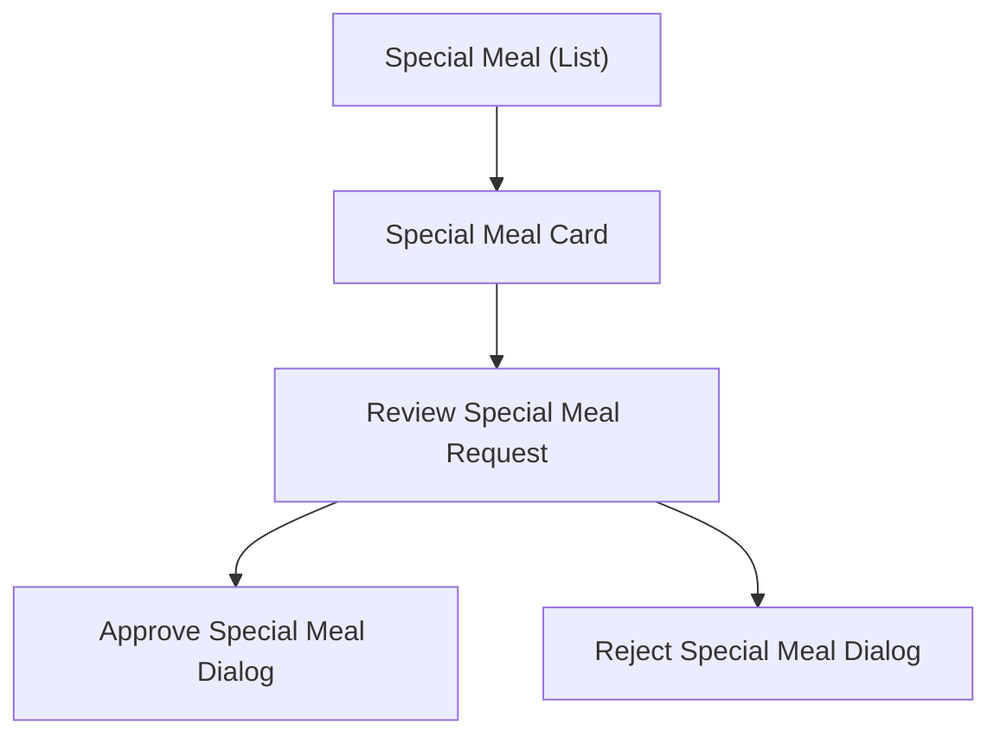

# Wireframe — Special Meal Approval (Medical Staff, Mobile)

**Nguồn**: `05_ScreenSpecifications/Mobile/MedicalStaff/07_ReviewSpecialMealRequestScreen.md`, `08_SpecialMealRequestList.md`, `09_ApproveSpecialMealDialog.md`, `10_RejectSpecialMealDialog.md`
**Công cụ sinh**: Thủ công (theo skill `wireframer`, `.skills/wireframer/SKILL.md`)
**File/Link**: `03_Design/06_Wireframes/Mobile/MedicalStaff/07_SpecialMealApproval.html`

> **Nguồn Draft**: 4 Screen Specification nguồn đều `Status: Draft`, chưa qua QA.

## Phạm vi

SPA vanilla HTML/JS trong khung điện thoại. List/Review là trang; Approve/Reject dùng `showModalBottomSheet` (bottom sheet trượt lên) đúng Platform Layout — Mobile của 2 dialog nguồn.

## Bảng 4 màn hình

| STT | Màn hình | id/phần tử | File Screen Spec nguồn |
| --- | --- | --- | --- |
| 1 | Special Meal Request List | `screen-list` | `08_SpecialMealRequestList.md` |
| 2 | Review Special Meal Request | `screen-review` | `07_ReviewSpecialMealRequestScreen.md` |
| 3 | Approve Special Meal Dialog | `modal-approve` (bottom sheet) | `09_ApproveSpecialMealDialog.md` |
| 4 | Reject Special Meal Dialog | `modal-reject` (bottom sheet) | `10_RejectSpecialMealDialog.md` |

## Sơ đồ điều hướng

Khớp `03_Medical_Staff_Screen_Flow.md` (nhánh Special Meal).

## Đối chiếu với Screen Specification

### 1. Special Meal Request List
- [x] AppBar Title, 2 Tab (Awaiting approval/Approved), Special Meal Card (Name&Class, Status Badge, Meal Type, Reason)

### 2. Review Special Meal Request
- [x] AppBar Back, block Dietary type/Duration/Medical justification, tài liệu minh chứng (placeholder), 2 nút Approve/Reject cố định

### 3. Approve Special Meal Dialog
- [x] `showModalBottomSheet`: tóm tắt, ghi chú xác nhận (tùy chọn), Confirm/Cancel

### 4. Reject Special Meal Dialog
- [x] `showModalBottomSheet`: lý do từ chối (bắt buộc, chặn submit rỗng), Confirm/Cancel

Toàn bộ field khớp 1-1 — KHÔNG thêm field/nghiệp vụ ngoài Screen Spec nguồn.

## Ghi chú kỹ thuật tuân thủ SKILL.md

- Vanilla HTML/JS 1 file, khung `.phone`; bottom sheet mô phỏng `showModalBottomSheet` bằng `.bottom-sheet`/`.sheet-backdrop`.
- Nút `.btn-primary/.btn-secondary`; icon SVG doodle inline; grayscale tuyệt đối.
- Bỏ qua bước Initialization Routine theo tiền lệ nhóm.

## Vấn đề/thiếu sót phát hiện khi đối chiếu Screen Spec nguồn

Không phát hiện khác biệt field mới nào so với bản Web tương ứng (`Web/MedicalStaff/07_SpecialMealApproval.md`) — chỉ khác cách trình bày Table/AlertDialog (Web) so với Card/BottomSheet (Mobile).
