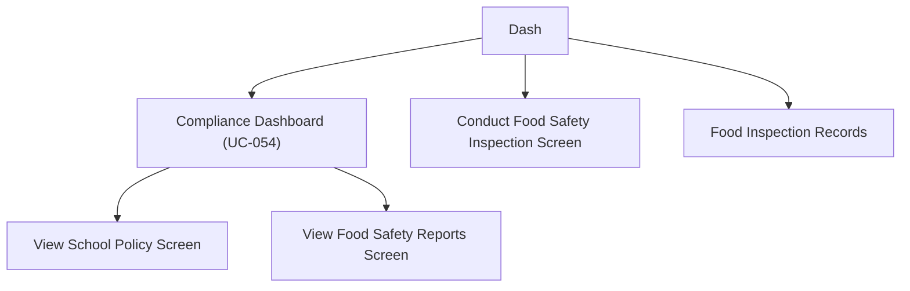

# Wireframe — Inspection & Compliance (Medical Staff, Mobile)

**Nguồn**: `05_ScreenSpecifications/Mobile/MedicalStaff/11_FoodInspectionRecords.md`, `12_ConductFoodSafetyInspectionScreen.md`, `15_ViewFoodSafetyReportsScreen.md`, `16_ViewSchoolPolicyScreen.md`, `23_ComplianceDashboard.md`
**Công cụ sinh**: Thủ công (theo skill `wireframer`, `.skills/wireframer/SKILL.md`)
**File/Link**: `03_Design/06_Wireframes/Mobile/MedicalStaff/11_InspectionCompliance.html`

> **Nguồn Draft**: 5 Screen Specification nguồn đều `Status: Draft`, chưa qua QA.

## Phạm vi

SPA vanilla HTML/JS trong khung điện thoại, 5 màn hình nhóm Inspection & Compliance, vào trực tiếp từ Dashboard; Compliance Dashboard có 2 nút điều hướng sang View School Policy/View Food Safety Reports.

## Bảng 5 màn hình

| STT | Màn hình | `id` | File Screen Spec nguồn |
| --- | --- | --- | --- |
| 1 | Compliance Dashboard | `screen-compliance` | `23_ComplianceDashboard.md` |
| 2 | Conduct Food Safety Inspection Screen | `screen-conduct` | `12_ConductFoodSafetyInspectionScreen.md` |
| 3 | Food Inspection Records | `screen-records` | `11_FoodInspectionRecords.md` |
| 4 | View Food Safety Reports Screen | `screen-reports` | `15_ViewFoodSafetyReportsScreen.md` |
| 5 | View School Policy Screen | `screen-policy` | `16_ViewSchoolPolicyScreen.md` |

## Sơ đồ điều hướng

Khớp `03_Medical_Staff_Screen_Flow.md`.

## Đối chiếu với Screen Specification

### 1. Compliance Dashboard
- [x] Widget trạng thái 3 bước, điểm checklist, ảnh xác minh, cảnh báo, banner Quarantine (MSG-024)

### 2. Conduct Food Safety Inspection Screen
- [x] Nút New Inspection, Stepper Flutter nhiều trang (mô phỏng bằng thanh step ngang), checklist vệ sinh + côn trùng + khám SK NV, upload ảnh, Submit Checklist

### 3. Food Inspection Records
- [x] Filter Chip/DropdownButton theo bước, danh sách Card (ngày, trạng thái Passed/Failed, nhân viên)

### 4. View Food Safety Reports Screen
- [x] Tab 3 nhóm báo cáo, chart placeholder (`fl_chart`), Compliance Summary section cuộn tới

### 5. View School Policy Screen
- [x] Danh sách Card/ListTile chính sách, chọn mục mở PDF viewer (toast mô phỏng)

Toàn bộ field khớp 1-1 — KHÔNG thêm field/nghiệp vụ ngoài Screen Spec nguồn.

## Ghi chú kỹ thuật tuân thủ SKILL.md

- Vanilla HTML/JS 1 file, khung `.phone`; `wired-checkbox`/`wired-combo` qua CDN.
- Ảnh/chart dùng Option B placeholder.
- Bỏ qua bước Initialization Routine theo tiền lệ nhóm.

## Vấn đề/thiếu sót phát hiện khi đối chiếu Screen Spec nguồn

Không phát hiện khác biệt field mới nào so với bản Web tương ứng (`Web/MedicalStaff/11_InspectionCompliance.md`) — đã ghi nhận cùng khoảng trống dữ liệu của `16_ViewSchoolPolicyScreen.md` (UC-137 không có Normal Flow đầy đủ) ở bản Web, không lặp lại chi tiết ở đây.
