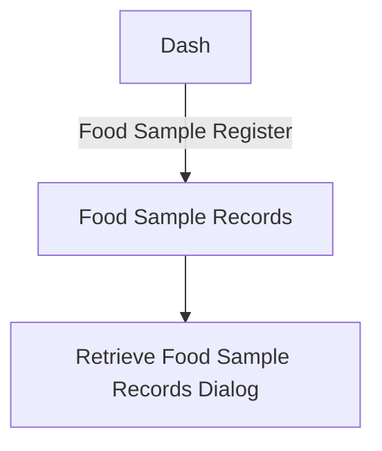

# Wireframe — Food Sample Retention (Medical Staff, Mobile)

**Nguồn**: `05_ScreenSpecifications/Mobile/MedicalStaff/13_FoodSampleRecords.md`, `14_RetrieveFoodSampleRecordsDialog.md`
**Công cụ sinh**: Thủ công (theo skill `wireframer`, `.skills/wireframer/SKILL.md`)
**File/Link**: `03_Design/06_Wireframes/Mobile/MedicalStaff/13_FoodSampleRetention.html`

> **Nguồn Draft**: 2 Screen Specification nguồn đều `Status: Draft`, chưa qua QA.

## Phạm vi

SPA vanilla HTML/JS trong khung điện thoại. Food Sample Records là trang chính (danh sách Card, không dùng Table dày đặc theo `Component_Guidelines.md`); Retrieve Food Sample Records Dialog dùng `showModalBottomSheet`.

## Bảng 2 màn hình

| STT | Màn hình | id/phần tử | File Screen Spec nguồn |
| --- | --- | --- | --- |
| 1 | Food Sample Records (Mẫu số 5) | `screen-records` | `13_FoodSampleRecords.md` |
| 2 | Retrieve Food Sample Records Dialog | `modal-retrieve` (bottom sheet) | `14_RetrieveFoodSampleRecordsDialog.md` |

## Sơ đồ điều hướng

Khớp `03_Medical_Staff_Screen_Flow.md`.

## Đối chiếu với Screen Specification

### 1. Food Sample Records
- [x] Filter Chip/DropdownButton theo trạng thái
- [x] Danh sách Card tóm tắt 12 cột Mẫu số 5 (ghi chú rõ trong note, không bớt field khi triển khai thật)
- [x] Status Badge Info/Warning/Secondary
- [x] Nút Export (AppBar)

### 2. Retrieve Food Sample Records Dialog
- [x] Tìm mẫu theo ngày/món/batch, danh sách mẫu khớp, nút Authorize Retrieval
- [x] Incident ID, tên người ủy quyền, phòng lab đích, nút Submit

Toàn bộ field khớp 1-1 — KHÔNG thêm field/nghiệp vụ ngoài Screen Spec nguồn.

## Ghi chú kỹ thuật tuân thủ SKILL.md

- Vanilla HTML/JS 1 file, khung `.phone`; `wired-input`/`wired-combo` qua CDN; bottom sheet mô phỏng `showModalBottomSheet`.
- Bỏ qua bước Initialization Routine theo tiền lệ nhóm.

## Vấn đề/thiếu sót phát hiện khi đối chiếu Screen Spec nguồn

Không phát hiện khác biệt field mới nào so với bản Web tương ứng (`Web/MedicalStaff/13_FoodSampleRetention.md`); ghi chú AF1 (mẫu Disposed → chỉ Link to Incident) vẫn chưa minh họa riêng ở cả 2 wireframe, đã ghi nhận ở bản Web.
