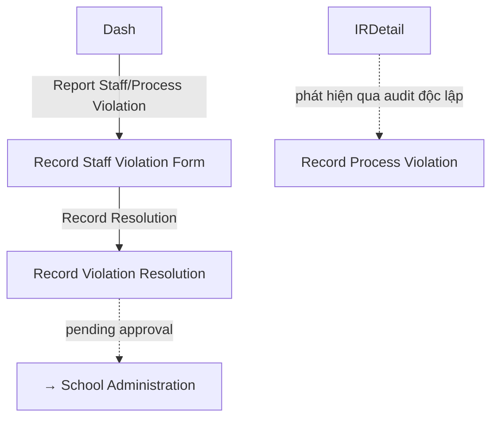

# Wireframe — Violation Management (Medical Staff, Mobile)

**Nguồn**: `05_ScreenSpecifications/Mobile/MedicalStaff/21_RecordProcessViolation.md`, `22_RecordStaffViolation.md`, `24_RecordViolationResolution.md`, `27_ViolationRegistry.md`
**Công cụ sinh**: Thủ công (theo skill `wireframer`, `.skills/wireframer/SKILL.md`)
**File/Link**: `03_Design/06_Wireframes/Mobile/MedicalStaff/21_ViolationManagement.html`

> **Nguồn Draft**: 4 Screen Specification nguồn đều `Status: Draft`, chưa qua QA. Cả 4 file tự ghi chú đã đính chính "chưa có UC" trước đây — wireframe dùng bản đã đính chính.

## Phạm vi

SPA vanilla HTML/JS trong khung điện thoại, 4 màn hình. Violation Registry có FAB "+" mở nhanh Record Staff Violation (theo nút "Report Staff/Process Violation" trên Dashboard mô tả trong `03_Medical_Staff_Screen_Flow.md`); mục Sidebar demo-nav vẫn cho phép vào trực tiếp cả 2 form Process/Staff.

## Bảng 4 màn hình

| STT | Màn hình | `id` | File Screen Spec nguồn |
| --- | --- | --- | --- |
| 1 | Violation Registry | `screen-registry` | `27_ViolationRegistry.md` |
| 2 | Record Process Violation | `screen-process` | `21_RecordProcessViolation.md` |
| 3 | Record Staff Violation | `screen-staff` | `22_RecordStaffViolation.md` |
| 4 | Record Violation Resolution | `screen-resolution` | `24_RecordViolationResolution.md` |

## Sơ đồ điều hướng

Khớp `03_Medical_Staff_Screen_Flow.md` (nhánh "Violation Management — mới 2026-07-01").

## Đối chiếu với Screen Specification

### 1. Violation Registry
- [x] Filter loại vi phạm, danh sách Card (loại/người liên quan/mức độ Badge/trạng thái/ngày lập)

### 2. Record Process Violation
- [x] Nguồn gốc vi phạm (tuỳ chọn), người phát hiện (auto), mô tả (bắt buộc), ảnh bằng chứng (camera, bắt buộc)
- [x] Mức độ nghiêm trọng, Nhân chứng (bắt buộc nếu ≥ MEDIUM)

### 3. Record Staff Violation
- [x] Tên nhân viên (text tự do), Chức vụ (tuỳ chọn), Loại vi phạm (gồm OVERRIDE_ABUSE), mô tả, ảnh bằng chứng
- [x] Mức độ nghiêm trọng, Ngày giờ xảy ra vi phạm, banner cảnh báo tái diễn (MSG-088)

### 4. Record Violation Resolution
- [x] Vi phạm gốc (tóm tắt), Hành động xử lý (bắt buộc), Người xử lý (auto), Mức kỷ luật, Badge trạng thái
- [x] Nút Đóng biên bản (LOW)/Gửi phê duyệt (MEDIUM/HIGH) — demo nhánh MEDIUM

Toàn bộ field khớp 1-1 — KHÔNG thêm field/nghiệp vụ ngoài Screen Spec nguồn.

## Ghi chú kỹ thuật tuân thủ SKILL.md

- Vanilla HTML/JS 1 file, khung `.phone`; FAB mô phỏng `wired-fab`/nút nổi theo Material 3.
- `wired-combo`/`wired-input` qua CDN; grayscale — badge phân biệt bằng viền liền/đứt/chấm.
- Bỏ qua bước Initialization Routine theo tiền lệ nhóm.

## Vấn đề/thiếu sót phát hiện khi đối chiếu Screen Spec nguồn

Không phát hiện khác biệt field mới nào so với bản Web tương ứng (`Web/MedicalStaff/21_ViolationManagement.md`); cùng ghi nhận khoảng trống ở `27_ViolationRegistry.md` về phạm vi dữ liệu Medical Staff được xem (BR-189 không nêu rõ), không lặp lại chi tiết ở đây.
