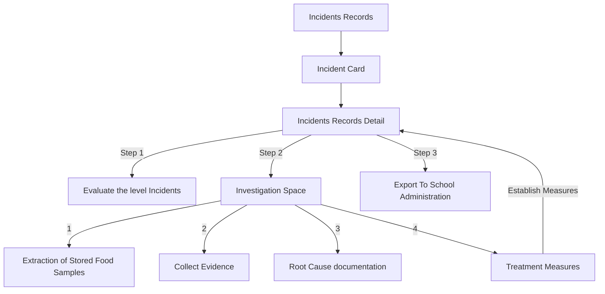

# Wireframe — Incident Handling (Medical Staff, Mobile)

**Nguồn**: `05_ScreenSpecifications/Mobile/MedicalStaff/25_IncidentList.md`, `26_IncidentDetail.md`, `18_AssignIncidentSeverityDialog.md`, `17_InvestigationWorkspace.md`, `19_RecordCorrectiveActionsReportScreen.md`, `20_GenerateIncidentReportDialog.md`
**Công cụ sinh**: Thủ công (theo skill `wireframer`, `.skills/wireframer/SKILL.md`)
**File/Link**: `03_Design/06_Wireframes/Mobile/MedicalStaff/25_IncidentHandling.html`

> **Nguồn Draft**: 6 Screen Specification nguồn đều `Status: Draft`, chưa qua QA.

## Phạm vi

SPA vanilla HTML/JS trong khung điện thoại, 6 màn hình luồng "Three-Step Investigation". List/Detail/Investigation Workspace là trang; Assign Severity/Validate CAPA/Generate Report/2 khối con Investigation (Gathering Evidence, Identify Root Cause, Treatment Measures) dùng `showModalBottomSheet`, đúng Platform Layout — Mobile (Investigation Workspace Mobile là **4 Card xếp dọc dẫn tới 4 khối con tuần tự**, khác Web dùng 3 panel song song).

## Bảng 6 màn hình (+ 3 khối con Investigation)

| STT | Màn hình | id/phần tử | File Screen Spec nguồn |
| --- | --- | --- | --- |
| 1 | Incident List | `screen-list` | `25_IncidentList.md` |
| 2 | Incident Detail | `screen-detail` | `26_IncidentDetail.md` |
| 3 | Assign Incident Severity Dialog | `modal-severity` | `18_AssignIncidentSeverityDialog.md` |
| 4 | Investigation Workspace (hub 4 card) | `screen-investigation` | `17_InvestigationWorkspace.md` |
| 4a | ↳ Gathering Evidence | `modal-evidence` | cùng file, khối con §3.3.2.3.10 |
| 4b | ↳ Identify the Root Cause | `modal-rootcause` | cùng file |
| 4c | ↳ Treatment Measures | `modal-treatment` | cùng file, khối con §3.3.2.3.11 |
| 5 | Record Corrective Actions Report (Validate CAPA) | `modal-capa` | `19_RecordCorrectiveActionsReportScreen.md` |
| 6 | Generate Incident Report Dialog | `modal-report` | `20_GenerateIncidentReportDialog.md` |

## Sơ đồ điều hướng

Khớp `03_Medical_Staff_Screen_Flow.md`.

## Đối chiếu với Screen Specification

### 1. Incident List
- [x] AppBar, 2 Tab (Processing/Resolved), Incident Card (Code&Title, Status Badge, Symptoms, Số HS, Reported Log)

### 2. Incident Detail
- [x] AppBar (Back/Home/"Return to list"), Section Header, block thông tin dọc, 3 nút Step + Validate + Export

### 3. Assign Incident Severity Dialog
- [x] Context đọc, RadioGroup Severity, Textarea Clinical Risk Assessment, nút Save — mô phỏng banner critical khi High

### 4. Investigation Workspace
- [x] 4 Card xếp dọc dẫn tới 4 khối con tuần tự (đúng Platform Layout Mobile, khác Web dùng panel song song)
- [x] Gathering Evidence: Type/Description/camera-upload/Save
- [x] Identify Root Cause: kết quả lab + kết luận
- [x] Treatment Measures: biện pháp + người phụ trách + Establish Measures

### 5. Record Corrective Actions Report Screen
- [x] Ghi chú kiểm tra bếp, checklist hồi phục 100% từng học sinh, Submit Validation (mô phỏng chặn EX1)

### 6. Generate Incident Report Dialog
- [x] Incident code/Severity (đọc), Clinical notes/Root cause (bắt buộc), Export & Submit

Toàn bộ field khớp 1-1 — KHÔNG thêm field/nghiệp vụ ngoài Screen Spec nguồn.

## Ghi chú kỹ thuật tuân thủ SKILL.md

- Vanilla HTML/JS 1 file, khung `.phone`; bottom sheet dùng chung 1 backdrop, chuyển nội dung theo `openSheet(id)`.
- Bản đồ truy xuất dùng Option B placeholder.
- Bỏ qua bước Initialization Routine theo tiền lệ nhóm.

## Vấn đề/thiếu sót phát hiện khi đối chiếu Screen Spec nguồn

Không phát hiện khác biệt field mới nào so với bản Web tương ứng (`Web/MedicalStaff/25_IncidentHandling.md`) — khác biệt duy nhất là bố cục Investigation Workspace (4 Card tuần tự Mobile vs 3 panel song song Web), đúng như `03_Medical_Staff_Screen_Flow.md` mô tả.
