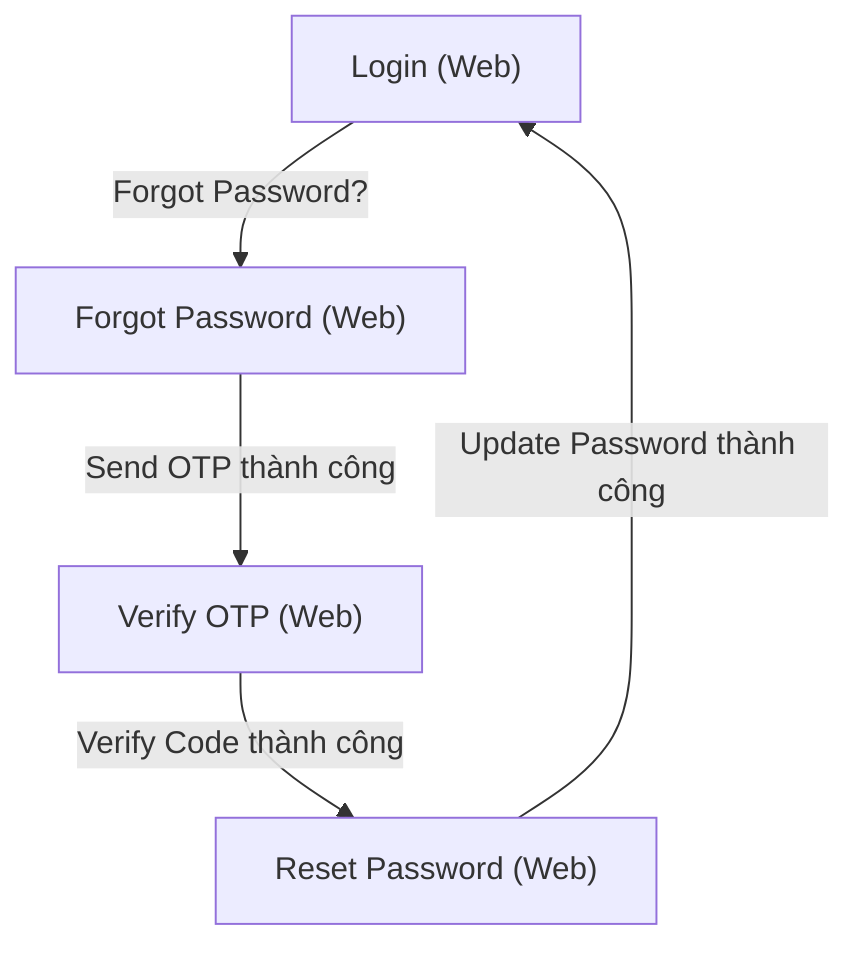

# Wireframe — Authentication (Guest & Common, Web)

**Nguồn**: `05_ScreenSpecifications/Web/GuestCommon/01_Login.md`, `02_ForgotPassword.md`, `03_ResetPassword.md`, `04_VerifyOTP.md`
**Công cụ sinh**: Thủ công (theo skill `wireframer`, `.skills/wireframer/SKILL.md`)
**File/Link**: `03_Design/06_Wireframes/Web/GuestCommon/01_Authentication.html`

> **Nguồn Draft**: 4 Screen Specification nguồn đều đang ở trạng thái `Status: Draft`, CHƯA qua bước QA của Nguyễn Phương Thảo (mục 6, `05_ScreenSpecifications/00_Team_Work_Assignment_Plan.md`). Wireframe này bám sát nguyên văn Draft hiện có — cần rà lại nếu Screen Spec đổi sau QA. (Ghi nhận theo đúng bước 3 của prompt khởi động ở `06_Wireframes/00_Team_Work_Assignment_Plan.md` mục 6 — đã kiểm tra, không có file nào đánh dấu "Confirmed"; tiếp tục dựng wireframe theo tiền lệ đã có ở `Web/SchoolAdministration/`, `Web/SystemAdmin/`.)

## Phạm vi

File HTML là 1 Single Page Application (SPA) vanilla HTML/JS, KHÔNG dùng React/router, mô phỏng 4 màn hình luồng "Authentication" (Common Entry Flow) dùng chung cho mọi actor, theo đúng `03_Design/04_ScreenFlow/13_Guest_Common_Screen_Flow.md` (sơ đồ Web). Điều hướng nội bộ qua hàm JS `showScreen(id)`, grayscale/mono hand-drawn Balsamiq (`wired-elements` + Patrick Hand + graph-paper), card căn giữa `max-width 420px`, không Sidebar/Topbar thật (chỉ có thanh demo-nav để test click qua 4 màn).

## Bảng 4 màn hình

| STT | Màn hình | `id` trong SPA | File Screen Spec nguồn |
| --- | --- | --- | --- |
| 1 | Login | `screen-login` | `05_ScreenSpecifications/Web/GuestCommon/01_Login.md` |
| 2 | Forgot Password | `screen-forgot` | `05_ScreenSpecifications/Web/GuestCommon/02_ForgotPassword.md` |
| 3 | Verify OTP | `screen-otp` | `05_ScreenSpecifications/Web/GuestCommon/04_VerifyOTP.md` |
| 4 | Reset Password | `screen-reset` | `05_ScreenSpecifications/Web/GuestCommon/03_ResetPassword.md` |

## Sơ đồ điều hướng đã hiện thực trong Wireframe

Khớp nguyên văn nhánh Web của `13_Guest_Common_Screen_Flow.md`.

## Đối chiếu với Screen Specification (checklist riêng từng màn)

### 1. Login
- [x] Username/Email (Input text, bắt buộc)
- [x] Password (Input masked, icon toggle hiện/ẩn)
- [x] Nút "Login" (primary, disabled khi thiếu field — mô phỏng bằng JS chặn khi rỗng)
- [x] Link "Forgot Password?"
- [x] Link "Register Options" (điều hướng ngoài phạm vi 9 màn — có alert ghi chú thay vì tạo màn thật, đúng ghi chú TODO trong Screen Spec nguồn)
- [x] Trạng thái loading (spinner nút), error (banner destructive MSG-002/003/076), success (toast MSG-026)
- [x] KHÔNG thêm field/nghiệp vụ ngoài bảng nguồn

### 2. Forgot Password
- [x] Nút Back → Login
- [x] Email Address (Input email, bắt buộc)
- [x] Nút "Send OTP" (primary)
- [x] Trạng thái loading, error (email sai định dạng/chưa đăng ký), success (chuyển Verify OTP)
- [x] KHÔNG thêm field/nghiệp vụ ngoài bảng nguồn

### 3. Verify OTP
- [x] Nút Back → Forgot Password
- [x] 6 ô OTP Input (6-digit)
- [x] Countdown Timer (text đọc)
- [x] Nút "Verify Code" (primary)
- [x] Nút "Resend OTP" (disabled trong lúc countdown — mô phỏng tĩnh disabled, ghi chú JS `doResend()` cho demo)
- [x] Trạng thái loading, error (mã sai — banner warning), success (chuyển Reset Password)
- [x] KHÔNG thêm field/nghiệp vụ ngoài bảng nguồn

### 4. Reset Password
- [x] New Password (Input masked)
- [x] Confirm New Password (Input masked, kiểm tra khớp)
- [x] Nút "Update Password" (primary)
- [x] Trạng thái loading, error (token hết hạn — banner destructive với action "Yêu cầu gửi lại link mới" quay lại Forgot Password; mật khẩu không khớp — cảnh báo inline), success (toast MSG-030, quay lại Login)
- [x] KHÔNG thêm field/nghiệp vụ ngoài bảng nguồn

## Ghi chú kỹ thuật tuân thủ SKILL.md

- Vanilla HTML/JS, 1 file duy nhất, mỗi màn `
`, điều hướng bằng `showScreen(id)` — không dùng router/framework.
- `wired-elements` nhúng qua CDN, dùng cho `wired-input`.
- Nút hành động dùng `<button class="btn-primary/btn-secondary">` (không dùng `<wired-button>`), sketchy border trick.
- Icon là SVG doodle line-art nhúng inline (`<symbol>` trong `<svg style="display:none">`), không dùng emoji.
- Grayscale/mono tuyệt đối — banner lỗi phân biệt bằng viền liền/đứt nét + icon cảnh báo, không dùng màu Design System thật.
- Đã bỏ qua bước "1. Initialization Routine" của SKILL.md (không tạo `agents.md`) theo tiền lệ đã áp dụng ở các wireframe trước đó của nhóm (School Administration/System Admin).
- Copy là dữ liệu mẫu hợp lý (không lorem ipsum), khớp field trong bảng Business Logic của từng Screen Spec.

## Vấn đề/thiếu sót phát hiện khi đối chiếu Screen Spec nguồn (không tự suy diễn, chỉ ghi nhận)

1. **01_Login.md** tự ghi nhận (ghi chú TODO cuối file): "Register Options" dẫn tới Guest Portal + 3 màn Register School/Supplier/Service Caterers, không có dòng riêng trong `14_Screen_Authorization_Matrix.md` khối 1 (ngoài phạm vi 9 màn GuestCommon được giao) — wireframe chỉ ghi nhận là điểm điều hướng thoát (alert), không tạo màn giả.
2. **04_VerifyOTP.md** tự ghi nhận: thời lượng countdown cụ thể và số lần Resend tối đa **[Giả định — cần team xác nhận]**, Report 3 không nêu số cụ thể — wireframe dùng giá trị mẫu minh họa (~5 phút), không phải giá trị chính thức.
3. **02_ForgotPassword.md** tự ghi nhận: nội dung cảnh báo rate-limit (1 yêu cầu/15 phút/email) và email không tồn tại/sai định dạng không có MSG code riêng trong `error_message.md` — wireframe dùng câu cảnh báo mẫu chung, cần team xác nhận nội dung chính xác trước khi khóa spec.
4. Không phát hiện mâu thuẫn field mới nào giữa 4 Screen Spec khi dựng wireframe; toàn bộ field trong bảng Business Logic của từng file đã ánh xạ đủ 1-1 vào HTML.
