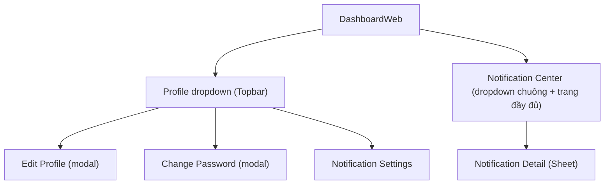

# Wireframe — Profile & Notification (Guest & Common, Web)

**Nguồn**: `05_ScreenSpecifications/Web/GuestCommon/05_ProfileManagement.md`, `06_ChangePassword.md`, `07_NotificationCenterList.md`, `08_NotificationDetail.md`, `09_NotificationSettings.md`
**Công cụ sinh**: Thủ công (theo skill `wireframer`, `.skills/wireframer/SKILL.md`)
**File/Link**: `03_Design/06_Wireframes/Web/GuestCommon/05_ProfileNotification.html`

> **Nguồn Draft**: 5 Screen Specification nguồn đều `Status: Draft`, chưa qua QA (mục 6, `05_ScreenSpecifications/00_Team_Work_Assignment_Plan.md`) — bám sát nguyên văn Draft hiện có, cần rà lại sau QA.

## Phạm vi

SPA vanilla HTML/JS, 7 sub-màn (5 Screen Spec, trong đó Profile Management tách 2 sub-màn View/Edit theo đúng cấu trúc 2 bảng field của chính Screen Spec đó), điều hướng bằng `showScreen(id)`, phong cách hand-drawn Balsamiq. Vì Screen Spec quy định Profile là **dropdown menu ở Topbar** và Change Password/Edit Profile là **modal/dialog nổi** (không phải trang riêng), wireframe thể hiện đúng bằng card neo góc phải (dropdown) và card căn giữa (modal) — có 1 màn "Dashboard placeholder" nền để mô phỏng ngữ cảnh Topbar thật.

## Bảng màn hình

| STT | Màn hình | `id` trong SPA | File Screen Spec nguồn |
| --- | --- | --- | --- |
| — | Dashboard placeholder (bối cảnh, không tính vào 5 file) | `screen-dashboard` | — |
| 1 | Profile Management (dropdown, view mode) | `screen-profile` | `05_ScreenSpecifications/Web/GuestCommon/05_ProfileManagement.md` |
| 1b | Edit Profile (modal, edit mode — cùng file Screen Spec) | `screen-editprofile` | `05_ScreenSpecifications/Web/GuestCommon/05_ProfileManagement.md` (khối "Edit mode") |
| 2 | Change Password (modal) | `screen-changepw` | `05_ScreenSpecifications/Web/GuestCommon/06_ChangePassword.md` |
| 3 | Notification Center/List | `screen-notifcenter` | `05_ScreenSpecifications/Web/GuestCommon/07_NotificationCenterList.md` |
| 4 | Notification Detail | `screen-notifdetail` | `05_ScreenSpecifications/Web/GuestCommon/08_NotificationDetail.md` |
| 5 | Notification Settings | `screen-notifsettings` | `05_ScreenSpecifications/Web/GuestCommon/09_NotificationSettings.md` |

## Sơ đồ điều hướng đã hiện thực

Khớp nhánh Web của `03_Design/04_ScreenFlow/13_Guest_Common_Screen_Flow.md`.

## Đối chiếu với Screen Specification

### 1. Profile Management (view)
- [x] Avatar, Name, Role & School/Company
- [x] Menu Edit Profile / Change Password / Notification Settings
- [x] Nút Logout (dialog xác nhận trước khi đăng xuất — `confirm()` JS)
- [x] KHÔNG thêm field ngoài bảng nguồn (không thêm "AI Chatbot" — ngoài phạm vi 9 màn giao, không tạo mục riêng)

### 1b. Edit Profile (edit mode)
- [x] Avatar Upload (JPG/JPEG/PNG, tối đa 5MB — ghi chú MSG-008/009 trong note)
- [x] Full Name, Phone Number, Email (read-only)
- [x] Nút Save / Cancel
- [x] Trạng thái success (MSG-029 toast)

### 2. Change Password
- [x] Current Password, New Password, Confirm New Password (đều masked)
- [x] Nút "Save Password"
- [x] Trạng thái error (MSG-002 Current Password sai), success (MSG-030 toast)
- [x] KHÔNG thêm field ngoài bảng nguồn

### 3. Notification Center/List
- [x] Danh sách thông báo (Table: Badge mức độ, nội dung tóm tắt, Sent Time)
- [x] Warning Badge đỏ/vàng/xám kèm icon + label (không chỉ dùng màu, theo `Accessibility.md`)
- [x] Filter theo mức độ
- [x] Row click → Notification Detail
- [x] Ghi chú Empty ("Chưa có thông báo nào") trong note cuối trang
- [x] KHÔNG thêm field ngoài bảng nguồn

### 4. Notification Detail
- [x] Nút Back → Notification Center
- [x] Warning Badge/loại thông báo, tiêu đề, nội dung đầy đủ, Sent Time
- [x] Nút hành động deep-link (VD "Xem hồ sơ dị ứng học sinh")
- [x] KHÔNG thêm field ngoài bảng nguồn — toàn bộ field ở đây được Screen Spec nguồn đánh dấu **[Giả định — cần team xác nhận]** (không có UC/field-by-field gốc), wireframe giữ nguyên mức độ giả định này, không bổ sung thêm

### 5. Notification Settings
- [x] Toggle Push/Email Notifications, Allergy Warnings, Food Safety Alerts
- [x] Quiet Hours time range (mặc định 22:00–06:00)
- [x] Nút "Save Settings"
- [x] KHÔNG thêm field ngoài bảng nguồn

## Ghi chú kỹ thuật tuân thủ SKILL.md

- Vanilla HTML/JS 1 file, mỗi màn `
`, điều hướng `showScreen(id)`.
- `wired-elements` qua CDN cho input/checkbox/combo; nút dùng `.btn-primary/.btn-secondary` (không dùng `<wired-button>`).
- Icon SVG doodle inline (`<symbol>`), không dùng emoji.
- Grayscale — badge phân biệt bằng kiểu viền (liền/đứt/chấm) + icon + chữ, không dùng màu Design System thật.
- Bỏ qua bước "Initialization Routine" của SKILL.md, theo tiền lệ nhóm.

## Vấn đề/thiếu sót phát hiện khi đối chiếu Screen Spec nguồn

1. **08_NotificationDetail.md** tự ghi nhận (ghi chú quan trọng cuối file): không có nguồn field-by-field trong Report 3 và không có UC-### ánh xạ — toàn bộ field là giả định. Wireframe giữ nguyên mức độ giả định, không "làm cho thật hơn" bằng field tự bịa.
2. **07_NotificationCenterList.md**: School Administration/Service Caterers **không có** Notification Detail riêng theo Matrix (mở rộng inline/panel thay vì điều hướng trang) — wireframe này build theo góc nhìn Teacher/Parent (có Detail riêng); cần 1 biến thể khác (mở rộng inline trong `Sheet`) nếu sau này làm wireframe riêng cho School Administration/Service Caterers, không lặp lại ở đây vì đã có ghi chú.
3. **05_ProfileManagement.md**: "AI Chatbot" xuất hiện trong Screen Spec như 1 điểm điều hướng nhưng ngoài phạm vi 9 màn GuestCommon được giao (không có cột `x` riêng trong Matrix) — wireframe không tạo mục/màn cho AI Chatbot, khớp đúng phạm vi giao việc mục 2 của `00_Team_Work_Assignment_Plan.md` (Wireframes).
4. Không phát hiện mâu thuẫn field mới nào khác giữa 5 Screen Spec khi dựng wireframe.
