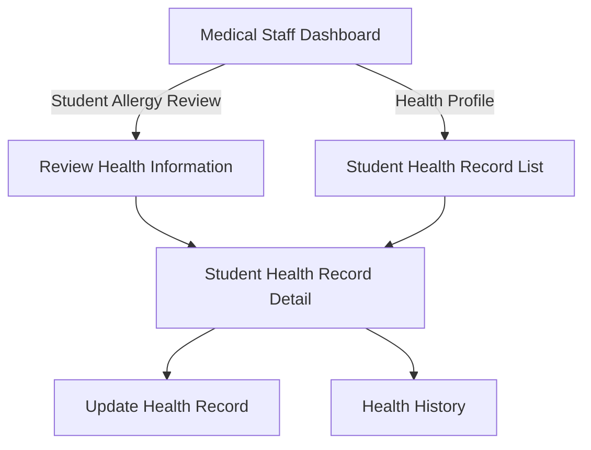

# Wireframe — Dashboard & Health Record (Medical Staff, Web)

**Nguồn**: `05_ScreenSpecifications/Web/MedicalStaff/01_MedicalStaffDashboard.md`, `02_ReviewHealthInformationScreen.md`, `03_StudentHealthRecordList.md`, `04_StudentHealthRecordDetail.md`, `05_UpdateHealthRecordScreen.md`, `06_HealthHistoryScreen.md`
**Công cụ sinh**: Thủ công (theo skill `wireframer`, `.skills/wireframer/SKILL.md`)
**File/Link**: `03_Design/06_Wireframes/Web/MedicalStaff/01_DashboardHealthRecord.html`

> **Nguồn Draft**: 6 Screen Specification nguồn đều `Status: Draft`, chưa qua QA (mục 6, `05_ScreenSpecifications/00_Team_Work_Assignment_Plan.md`) — theo tiền lệ đã áp dụng ở `Web/SchoolAdministration/`, `Web/SystemAdmin/` (Nguyễn Văn Nam), tiếp tục dựng Wireframe bám nguyên văn Draft, cần rà lại sau khi Nguyễn Phương Thảo hoàn tất QA.

## Phạm vi

SPA vanilla HTML/JS, 6 màn hình nhóm "Dashboard + Hồ sơ Sức khỏe & Dị ứng" của actor **Medical Staff**, điều hướng nội bộ `showScreen(id)`, phong cách hand-drawn Balsamiq. Sidebar bên trái liệt kê đủ 5 nhóm chức năng theo `08_Medical_Staff_Screen_Flow_Web.md`, nhưng chỉ nhóm "Hồ sơ Sức khỏe & Dị ứng" có mục click chuyển màn được — các nhóm khác hiển thị tĩnh kèm ghi chú "(xem wireframe nhóm khác)" trỏ đúng tên file wireframe dự kiến (`07_SpecialMealApproval`, `11_InspectionCompliance`, `13_FoodSampleRetention`, `25_IncidentHandling`, `21_ViolationManagement`).

## Bảng 6 màn hình

| STT | Màn hình | `id` trong SPA | File Screen Spec nguồn |
| --- | --- | --- | --- |
| 1 | Medical Staff Dashboard | `screen-dashboard` | `01_MedicalStaffDashboard.md` |
| 2 | Review Health Information Screen | `screen-review` | `02_ReviewHealthInformationScreen.md` |
| 3 | Student Health Record List | `screen-list` | `03_StudentHealthRecordList.md` |
| 4 | Student Health Record Detail | `screen-detail` | `04_StudentHealthRecordDetail.md` |
| 5 | Update Health Record Screen | `screen-update` | `05_UpdateHealthRecordScreen.md` |
| 6 | Health History Screen | `screen-history` | `06_HealthHistoryScreen.md` |

## Sơ đồ điều hướng đã hiện thực

Khớp `08_Medical_Staff_Screen_Flow_Web.md` (nhánh "Hồ sơ Sức khỏe & Dị ứng").

## Đối chiếu với Screen Specification

### 1. Medical Staff Dashboard
- [x] Welcome Banner (tên, phòng ban, ngày)
- [x] 4 Card thống kê (Allergy pending approval, Meal order needs approval, Issue being resolved, Compliance Points) — Compliance Points thể hiện trạng thái **loading (skeleton)**
- [x] 6 shortcut card (Health Profile, Student Allergy Review, Approve Special Meal, City Safety Incident, Food Compliance & Monitoring Board, View food inspection results in 3 steps) — 4 shortcut ngoài phạm vi nhóm này ghi chú trỏ sang wireframe khác, không tạo trùng nội dung
- [x] KHÔNG thêm field/nghiệp vụ ngoài bảng nguồn

### 2. Review Health Information Screen
- [x] Table danh sách khai báo Pending (Student Name & Class, Allergy Type/Severity Badge, ngày nộp)
- [x] Click dòng → Sheet phải: tài liệu y tế đính kèm (preview), nút Approve, nút Reject + textarea lý do (hiện khi bấm Reject)
- [x] Badge đỏ cho Severe
- [x] Trạng thái success (MSG-036 toast)

### 3. Student Health Record List
- [x] 2 Tab (All students / Waiting for confirmation kèm badge số lượng)
- [x] Search input
- [x] Table (Student Name & Class, Status Badge, Allergy Declaration Info, Log Footnote)
- [x] Badge warning "Awaiting Approval" / success "Confirmed"
- [x] Row click → Detail

### 4. Student Health Record Detail
- [x] 2 cột: thông tin cơ bản/y tế bên trái (col-span-8), tài liệu đính kèm bên phải (col-span-4)
- [x] Status Badge, Medical conditions, Medications, Emergency contacts, Allergy Declaration
- [x] Nút "Update Record", nút "Health History" ở page header

### 5. Update Health Record Screen
- [x] Student Name & Class (context, read-only)
- [x] Clinical Annotation mới (textarea, bắt buộc)
- [x] Medications, Emergency Instructions (chỉnh sửa)
- [x] Khối "Lịch sử log đã xác minh" — read-only, khóa sửa (BR-172), thể hiện bằng khối nền xám nét đứt
- [x] Nút Save/Cancel

### 6. Health History Screen
- [x] Timeline sự kiện sức khỏe/dị ứng/khai báo (chỉ đọc)
- [x] Nút "Export" ở page header

Toàn bộ field khớp 1-1 bảng Business Logic của 6 Screen Spec — KHÔNG thêm field/nghiệp vụ ngoài nguồn.

## Ghi chú kỹ thuật tuân thủ SKILL.md

- Vanilla HTML/JS 1 file, mỗi màn `
`, điều hướng `showScreen(id)`; Sheet của màn 2 dùng overlay + backdrop riêng (không đổi `.screen` chính, vì Sheet chỉ là panel phụ trong cùng màn theo đúng Platform Layout Web).
- `wired-elements` (search-input) qua CDN; nút `.btn-primary/.btn-secondary` (không `<wired-button>`).
- Icon SVG doodle inline, không emoji. Grayscale — badge phân biệt bằng viền liền/đứt + icon + chữ.
- Bỏ qua bước Initialization Routine theo tiền lệ nhóm (không tạo `agents.md`).

## Vấn đề/thiếu sót phát hiện khi đối chiếu Screen Spec nguồn

1. **04_StudentHealthRecordDetail.md** tự ghi nhận: không có UC-### hay field-by-field riêng cho màn Detail trong Report 3 (chỉ có mô tả "clinical file" trong UC-051 bước 4) — nội dung field là **[Giả định — cần team xác nhận]**. Wireframe giữ nguyên field đã liệt kê, không bổ sung thêm.
2. **02_ReviewHealthInformationScreen.md** ghi chú: Design_System.md trích dẫn "BR-123" cho quy tắc màu đỏ Severe nhưng BR-123 không tồn tại trong `business_rules.md` — wireframe vẫn dùng quy ước màu đỏ/badge như mô tả (không phụ thuộc số BR cụ thể để hiển thị đúng UI), chỉ ghi nhận lại sai lệch số hiệu BR để team xác nhận.
3. Không phát hiện mâu thuẫn field mới nào khác giữa 6 Screen Spec khi dựng wireframe.
