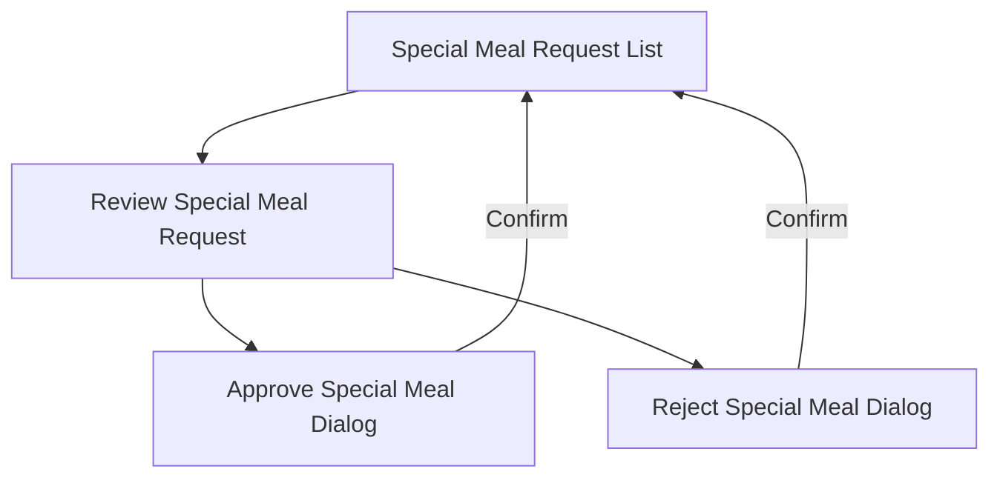

# Wireframe — Special Meal Approval (Medical Staff, Web)

**Nguồn**: `05_ScreenSpecifications/Web/MedicalStaff/07_ReviewSpecialMealRequestScreen.md`, `08_SpecialMealRequestList.md`, `09_ApproveSpecialMealDialog.md`, `10_RejectSpecialMealDialog.md`
**Công cụ sinh**: Thủ công (theo skill `wireframer`, `.skills/wireframer/SKILL.md`)
**File/Link**: `03_Design/06_Wireframes/Web/MedicalStaff/07_SpecialMealApproval.html`

> **Nguồn Draft**: 4 Screen Specification nguồn đều `Status: Draft`, chưa qua QA (mục 6, `05_ScreenSpecifications/00_Team_Work_Assignment_Plan.md`).

## Phạm vi

SPA vanilla HTML/JS, 4 màn hình luồng "Special Meal Approval". List/Review là 2 `.screen` chuyển trang; Approve/Reject là `AlertDialog` (modal thật, `.modal-backdrop`/`.modal`) nổi trên Review, đúng Platform Layout — Web của cả 2 Screen Spec dialog nguồn.

## Bảng 4 màn hình

| STT | Màn hình | `id`/phần tử trong SPA | File Screen Spec nguồn |
| --- | --- | --- | --- |
| 1 | Special Meal Request List | `screen-list` | `08_SpecialMealRequestList.md` |
| 2 | Review Special Meal Request | `screen-review` | `07_ReviewSpecialMealRequestScreen.md` |
| 3 | Approve Special Meal Dialog | `modal-approve` | `09_ApproveSpecialMealDialog.md` |
| 4 | Reject Special Meal Dialog | `modal-reject` | `10_RejectSpecialMealDialog.md` |

## Sơ đồ điều hướng đã hiện thực

Khớp `08_Medical_Staff_Screen_Flow_Web.md` (nhánh Special Meal).

## Đối chiếu với Screen Specification

### 1. Special Meal Request List
- [x] 2 Tab (Awaiting approval kèm số lượng / Approved)
- [x] Table (Student Name & Class, Status Badge "Needs Approval", Meal Type, Reason)
- [x] Row click → Review

### 2. Review Special Meal Request
- [x] Dietary type, Duration, Medical justification (đọc)
- [x] Tài liệu minh chứng (Option B placeholder, không có ảnh thật)
- [x] Nút Approve, nút Reject

### 3. Approve Special Meal Dialog
- [x] Tóm tắt yêu cầu (kế thừa), Ghi chú xác nhận (tùy chọn, không bắt buộc)
- [x] Nút "Confirm Approve" / "Cancel"
- [x] Success → routing thông báo Service Caterers (ghi trong toast)

### 4. Reject Special Meal Dialog
- [x] Tóm tắt yêu cầu, Lý do từ chối (bắt buộc — chặn submit nếu rỗng, hiện thực bằng JS `submitReject()`)
- [x] Nút "Confirm Reject" / "Cancel"

Toàn bộ field khớp 1-1 bảng Business Logic của 4 Screen Spec — KHÔNG thêm field/nghiệp vụ ngoài nguồn.

## Ghi chú kỹ thuật tuân thủ SKILL.md

- Vanilla HTML/JS 1 file; List/Review dùng `.screen` (showScreen), Approve/Reject dùng modal thật (`.modal-backdrop`) vì Screen Spec nguồn quy định rõ đây là `AlertDialog` nổi trên màn hiện tại, không phải trang riêng.
- Nút `.btn-primary/.btn-secondary` (không `<wired-button>`); icon SVG doodle inline; grayscale tuyệt đối.
- Bỏ qua bước Initialization Routine theo tiền lệ nhóm.

## Vấn đề/thiếu sót phát hiện khi đối chiếu Screen Spec nguồn

1. **08_SpecialMealRequestList.md** tự ghi nhận "Ghi chú lệch tên": UC-036 trong Report 3 mô tả là "View List Allergy & Special Meals" thay vì đúng tên màn — field-by-field thực tế lấy từ §3.3.2.3.3 (đáng tin cậy hơn), wireframe dùng đúng field theo §3.3.2.3.3, không theo tên UC gây nhầm lẫn.
2. Không phát hiện mâu thuẫn field mới nào khác giữa 4 Screen Spec khi dựng wireframe.
