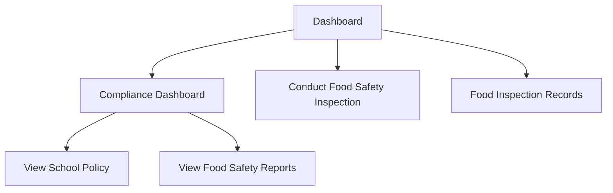

# Wireframe — Inspection & Compliance (Medical Staff, Web)

**Nguồn**: `05_ScreenSpecifications/Web/MedicalStaff/11_FoodInspectionRecords.md`, `12_ConductFoodSafetyInspectionScreen.md`, `15_ViewFoodSafetyReportsScreen.md`, `16_ViewSchoolPolicyScreen.md`, `23_ComplianceDashboard.md`
**Công cụ sinh**: Thủ công (theo skill `wireframer`, `.skills/wireframer/SKILL.md`)
**File/Link**: `03_Design/06_Wireframes/Web/MedicalStaff/11_InspectionCompliance.html`

> **Nguồn Draft**: 5 Screen Specification nguồn đều `Status: Draft`, chưa qua QA.

## Phạm vi

SPA vanilla HTML/JS, 5 màn hình nhóm "Kiểm tra & Giám sát ATTP" — tất cả đều vào trực tiếp từ Dashboard/Sidebar (không phải chuỗi tuần tự bắt buộc), riêng Compliance Dashboard có 2 nút điều hướng nội bộ sang View School Policy/View Food Safety Reports theo đúng mermaid gốc.

## Bảng 5 màn hình

| STT | Màn hình | `id` trong SPA | File Screen Spec nguồn |
| --- | --- | --- | --- |
| 1 | Compliance Dashboard | `screen-compliance` | `23_ComplianceDashboard.md` |
| 2 | Conduct Food Safety Inspection Screen | `screen-conduct` | `12_ConductFoodSafetyInspectionScreen.md` |
| 3 | Food Inspection Records | `screen-records` | `11_FoodInspectionRecords.md` |
| 4 | View Food Safety Reports Screen (gộp Compliance Report UC-115) | `screen-reports` | `15_ViewFoodSafetyReportsScreen.md` |
| 5 | View School Policy Screen | `screen-policy` | `16_ViewSchoolPolicyScreen.md` |

## Sơ đồ điều hướng đã hiện thực

Khớp `08_Medical_Staff_Screen_Flow_Web.md` (nhánh Compliance/Inspection).

## Đối chiếu với Screen Specification

### 1. Compliance Dashboard
- [x] Widget trạng thái 3 bước hôm nay, điểm checklist vệ sinh hàng ngày, ảnh xác minh
- [x] Cảnh báo bước kiểm tra thất bại/quá hạn + nút "Xem chi tiết cảnh báo"
- [x] Banner Kitchen Quarantine cố định (MSG-024) — thể hiện trạng thái không active mặc định, có thể bật qua demo Conduct Inspection Failed

### 2. Conduct Food Safety Inspection Screen
- [x] Nút "New Inspection", Stepper ngang
- [x] Kitchen Safety and Sanitation Checklist
- [x] Xác minh chứng nhận côn trùng (quý) + khám sức khỏe NV bếp (năm), kèm ngày hết hạn
- [x] Upload ảnh bằng chứng (bắt buộc ≥1)
- [x] Nút "Submit Checklist" → mô phỏng JS hiện banner MSG-024 (Quarantine) khi điểm <60%

### 3. Food Inspection Records
- [x] Filter (khoảng ngày, bước kiểm tra, thực đơn/món)
- [x] Table (ngày, trạng thái Passed/Failed, nhân viên phụ trách)

### 4. View Food Safety Reports Screen
- [x] 3 Tab nhóm báo cáo (Monthly Kitchen Audits/Pest Control Log/Refrigerator Temperature Logs)
- [x] Filter ngày, chart placeholder (Option B, không dùng ảnh thật)
- [x] Compliance Summary Dashboard (gộp UC-115): audit, pest control, khám SK NV
- [x] Nút Export

### 5. View School Policy Screen
- [x] Danh sách chính sách bên trái (tiêu đề + ngày ban hành), panel xem nội dung bên phải

Toàn bộ field khớp 1-1 bảng Business Logic của 5 Screen Spec — KHÔNG thêm field/nghiệp vụ ngoài nguồn.

## Ghi chú kỹ thuật tuân thủ SKILL.md

- Vanilla HTML/JS 1 file, `showScreen(id)`; `wired-checkbox`/`wired-combo`/`wired-input` qua CDN.
- Ảnh/placeholder dùng Option B (`[Image Placeholder]`/`[Chart Placeholder]`) vì không có công cụ sinh ảnh trong phiên này.
- Grayscale — badge Passed/Failed/Đạt/Sắp hết hạn phân biệt bằng kiểu viền, không dùng màu Design System thật.
- Bỏ qua bước Initialization Routine theo tiền lệ nhóm.

## Vấn đề/thiếu sót phát hiện khi đối chiếu Screen Spec nguồn

1. **16_ViewSchoolPolicyScreen.md** tự ghi nhận "khoảng trống dữ liệu quan trọng": UC-137 chỉ có 1 dòng mô tả tóm tắt trong Report 3, KHÔNG có bảng đặc tả Normal/Alternative/Exception Flow đầy đủ — toàn bộ field màn này là **[Giả định — cần team xác nhận]**. Wireframe giữ nguyên field đã liệt kê, không bổ sung thêm để "cho đủ".
2. **15_ViewFoodSafetyReportsScreen.md** gộp UC-115 + UC-117 theo đúng ghi chú Matrix — wireframe thể hiện đúng 1 màn duy nhất với 2 khối (báo cáo theo nhóm + Compliance Summary), không tách thành 2 màn.
3. Không phát hiện mâu thuẫn field mới nào khác giữa 5 Screen Spec khi dựng wireframe.
