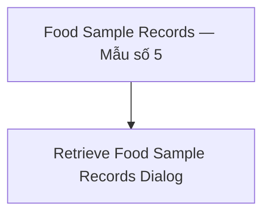

# Wireframe — Food Sample Retention (Medical Staff, Web)

**Nguồn**: `05_ScreenSpecifications/Web/MedicalStaff/13_FoodSampleRecords.md`, `14_RetrieveFoodSampleRecordsDialog.md`
**Công cụ sinh**: Thủ công (theo skill `wireframer`, `.skills/wireframer/SKILL.md`)
**File/Link**: `03_Design/06_Wireframes/Web/MedicalStaff/13_FoodSampleRetention.html`

> **Nguồn Draft**: 2 Screen Specification nguồn đều `Status: Draft`, chưa qua QA.

## Phạm vi

SPA vanilla HTML/JS, 2 màn hình: Food Sample Records là trang chính (`.screen`), Retrieve Food Sample Records Dialog là `Dialog` thật (modal) mở từ 1 dòng trong bảng.

## Bảng 2 màn hình

| STT | Màn hình | id/phần tử | File Screen Spec nguồn |
| --- | --- | --- | --- |
| 1 | Food Sample Records (Mẫu số 5) | `screen-records` | `13_FoodSampleRecords.md` |
| 2 | Retrieve Food Sample Records Dialog | `modal-retrieve` | `14_RetrieveFoodSampleRecordsDialog.md` |

## Sơ đồ điều hướng

Khớp `08_Medical_Staff_Screen_Flow_Web.md` (nhánh Lưu mẫu Thực phẩm); dialog này cũng được gọi lại từ Investigation Workspace (xem wireframe `25_IncidentHandling.html`, không lặp lại nội dung ở đây).

## Đối chiếu với Screen Specification

### 1. Food Sample Records
- [x] Filter (khoảng ngày/bữa/món/trạng thái)
- [x] Sổ lưu mẫu 12 cột (rút gọn hiển thị các cột trọng yếu trong wireframe demo, ghi chú rõ không bớt field khi triển khai thật)
- [x] Status Badge Info(Retained)/Warning(Retrieved)/Secondary(Disposed)
- [x] Nút Export
- [x] Row click (mẫu Retained) → mở Retrieve dialog

### 2. Retrieve Food Sample Records Dialog
- [x] Tìm mẫu theo ngày/món/batch, danh sách mẫu khớp (hiển thị thời gian lưu còn lại)
- [x] Nút "Authorize Retrieval" (chỉ khả dụng khi Retained)
- [x] Incident ID, tên người ủy quyền, phòng lab đích
- [x] Nút Submit → khóa mẫu, sinh biên nhận (toast mô phỏng)

Toàn bộ field khớp 1-1 bảng Business Logic của 2 Screen Spec — KHÔNG thêm field/nghiệp vụ ngoài nguồn.

## Ghi chú kỹ thuật tuân thủ SKILL.md

- Vanilla HTML/JS 1 file; `wired-input`/`wired-combo` qua CDN; nút `.btn-primary/.btn-secondary`.
- Grayscale — badge trạng thái phân biệt bằng kiểu viền (liền/đứt/chấm).
- Bỏ qua bước Initialization Routine theo tiền lệ nhóm.

## Vấn đề/thiếu sót phát hiện khi đối chiếu Screen Spec nguồn

1. **13_FoodSampleRecords.md** ghi rõ actor dùng chung với School Administration/Service Caterers — wireframe này chỉ build theo góc nhìn Medical Staff (không có hành động ghi riêng gì khác biệt được ghi nhận trong Screen Spec, chỉ khác quyền truy cập theo role ở tầng backend).
2. **14_RetrieveFoodSampleRecordsDialog.md**: nhánh mẫu "Disposed" chỉ cho phép "Link Disposed Sample to Incident" (AF1), không cho Authorize Retrieval vật lý — wireframe demo chỉ minh họa nhánh Retained (nút Authorize Retrieval), chưa minh họa riêng nhánh AF1 Disposed trong file này (đã ghi chú trong bảng field, không phải thiếu sót Screen Spec).
3. Không phát hiện mâu thuẫn field mới nào khác giữa 2 Screen Spec khi dựng wireframe.
