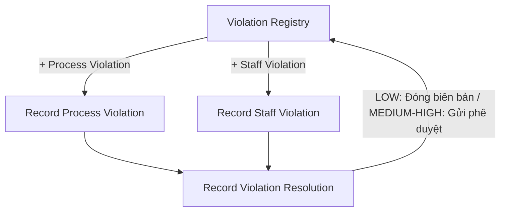

# Wireframe — Violation Management (Medical Staff, Web)

**Nguồn**: `05_ScreenSpecifications/Web/MedicalStaff/21_RecordProcessViolation.md`, `22_RecordStaffViolation.md`, `24_RecordViolationResolution.md`, `27_ViolationRegistry.md`
**Công cụ sinh**: Thủ công (theo skill `wireframer`, `.skills/wireframer/SKILL.md`)
**File/Link**: `03_Design/06_Wireframes/Web/MedicalStaff/21_ViolationManagement.html`

> **Nguồn Draft**: 4 Screen Specification nguồn đều `Status: Draft`, chưa qua QA. Cả 4 file đều tự ghi chú "đã tìm thấy bảng đặc tả đầy đủ khi review chéo, đính chính lại ghi chú 'chưa có UC' trước đây" — wireframe dùng đúng bản đã đính chính này.

## Phạm vi

SPA vanilla HTML/JS, 4 màn hình nhóm "Quản lý Vi phạm" (mới 2026-07-01). Violation Registry là màn tổng quan (entry từ Sidebar), có 2 nút "+" mở Record Process/Staff Violation (2 form riêng), cả 2 dẫn tiếp tới Record Violation Resolution.

## Bảng 4 màn hình

| STT | Màn hình | `id` trong SPA | File Screen Spec nguồn |
| --- | --- | --- | --- |
| 1 | Violation Registry | `screen-registry` | `27_ViolationRegistry.md` |
| 2 | Record Process Violation | `screen-process` | `21_RecordProcessViolation.md` |
| 3 | Record Staff Violation | `screen-staff` | `22_RecordStaffViolation.md` |
| 4 | Record Violation Resolution | `screen-resolution` | `24_RecordViolationResolution.md` |

## Sơ đồ điều hướng đã hiện thực

Khớp `08_Medical_Staff_Screen_Flow_Web.md` (nhánh "Quản lý Vi phạm 🆕").

## Đối chiếu với Screen Specification

### 1. Violation Registry
- [x] Filter loại vi phạm/mức độ/trạng thái
- [x] Table (loại, người/đối tượng, mức độ Badge, trạng thái, ngày lập)
- [x] Row click → xem chi tiết (demo điều hướng sang Resolution)

### 2. Record Process Violation
- [x] Nguồn gốc vi phạm (liên kết tùy chọn), người phát hiện (auto)
- [x] Mô tả (bắt buộc), ảnh bằng chứng (bắt buộc)
- [x] Mức độ nghiêm trọng (LOW/MEDIUM/HIGH), Nhân chứng (bắt buộc nếu ≥ MEDIUM — hiện/ẩn bằng JS theo lựa chọn)
- [x] Nút Save Violation

### 3. Record Staff Violation
- [x] Tên nhân viên (text tự do, bắt buộc), Chức vụ (tuỳ chọn), Loại vi phạm (gồm `OVERRIDE_ABUSE`)
- [x] Mô tả, ảnh bằng chứng, Mức độ nghiêm trọng, Ngày giờ xảy ra vi phạm
- [x] Banner cảnh báo nghi ngờ tái diễn (MSG-088, best-effort, không chặn lưu)
- [x] Nút Save Violation

### 4. Record Violation Resolution
- [x] Link vi phạm gốc, tóm tắt (kế thừa), Hành động xử lý (bắt buộc), Người xử lý (auto)
- [x] Mức độ hình thức kỷ luật (bắt buộc khi vi phạm nhân viên)
- [x] Badge trạng thái (Pending Approval/Approved/Closed)
- [x] Nút "Đóng biên bản" (LOW) hoặc "Gửi School Administration phê duyệt" (MEDIUM/HIGH) — demo hiện nhánh MEDIUM

Toàn bộ field khớp 1-1 bảng Business Logic của 4 Screen Spec — KHÔNG thêm field/nghiệp vụ ngoài nguồn.

## Ghi chú kỹ thuật tuân thủ SKILL.md

- Vanilla HTML/JS 1 file, `showScreen(id)`, `wired-combo`/`wired-input`/`wired-checkbox` qua CDN.
- Nút `.btn-primary/.btn-secondary`; icon SVG doodle inline; grayscale — badge severity phân biệt bằng viền liền/đứt/chấm.
- Bỏ qua bước Initialization Routine theo tiền lệ nhóm.

## Vấn đề/thiếu sót phát hiện khi đối chiếu Screen Spec nguồn

1. **27_ViolationRegistry.md** tự ghi nhận **[Giả định — cần team xác nhận]**: BR-189 không nêu rõ ràng buộc phạm vi dữ liệu Medical Staff được xem trong Registry (toàn bộ hay chỉ vi phạm tự lập) — wireframe demo hiển thị dữ liệu mẫu chung, không giả định phạm vi cụ thể.
2. **22_RecordStaffViolation.md** ghi chú "Đã hợp nhất" 3 field (staffPosition, occurredAt, banner tái diễn) đối chiếu với bản Service Caterers — wireframe giữ đủ cả 3 field bổ sung này.
3. Không phát hiện mâu thuẫn field mới nào khác giữa 4 Screen Spec khi dựng wireframe.
