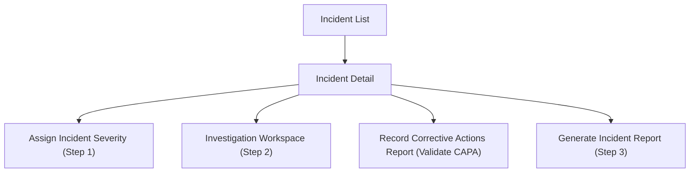

# Wireframe — Incident Handling (Medical Staff, Web)

**Nguồn**: `05_ScreenSpecifications/Web/MedicalStaff/25_IncidentList.md`, `26_IncidentDetail.md`, `18_AssignIncidentSeverityDialog.md`, `17_InvestigationWorkspace.md`, `19_RecordCorrectiveActionsReportScreen.md`, `20_GenerateIncidentReportDialog.md`
**Công cụ sinh**: Thủ công (theo skill `wireframer`, `.skills/wireframer/SKILL.md`)
**File/Link**: `03_Design/06_Wireframes/Web/MedicalStaff/25_IncidentHandling.html`

> **Nguồn Draft**: 6 Screen Specification nguồn đều `Status: Draft`, chưa qua QA.

## Phạm vi

SPA vanilla HTML/JS, 6 màn hình luồng "Three-Step Investigation" (Workflow 11). List/Detail/Investigation Workspace là trang (`.screen`); Assign Severity/Validate CAPA/Generate Report là `Dialog` thật (modal), đúng Platform Layout — Web của từng Screen Spec nguồn. Investigation Workspace trình bày 3 panel song song (Extract Sample+Evidence | Root Cause | Treatment Measures) theo đúng ghi chú "tận dụng màn hình rộng" ở `08_Medical_Staff_Screen_Flow_Web.md`.

## Bảng 6 màn hình

| STT | Màn hình | id/phần tử | File Screen Spec nguồn |
| --- | --- | --- | --- |
| 1 | Incident List | `screen-list` | `25_IncidentList.md` |
| 2 | Incident Detail | `screen-detail` | `26_IncidentDetail.md` |
| 3 | Assign Incident Severity Dialog | `modal-severity` | `18_AssignIncidentSeverityDialog.md` |
| 4 | Investigation Workspace | `screen-investigation` | `17_InvestigationWorkspace.md` |
| 5 | Record Corrective Actions Report Screen (Validate CAPA) | `modal-capa` | `19_RecordCorrectiveActionsReportScreen.md` |
| 6 | Generate Incident Report Dialog | `modal-report` | `20_GenerateIncidentReportDialog.md` |

## Sơ đồ điều hướng đã hiện thực

Khớp `08_Medical_Staff_Screen_Flow_Web.md` (nhánh Sự cố An toàn Thực phẩm).

## Đối chiếu với Screen Specification

### 1. Incident List
- [x] 2 Tab (Processing/Resolved) + filter Severity/Status
- [x] Table (Incident Code & Title, Status Badge, Symptoms, Number of students, Reported Log Footnote)
- [x] Nút Export

### 2. Incident Detail
- [x] 2 cột: thông tin sự cố (col-span-8) — Case code, Clinical symptoms, Affected students, Suspected food item, First aid, Bản đồ truy xuất (placeholder), Danh sách lô Quarantine
- [x] Action list bên phải (col-span-4): Step 1/2/3, Validate CAPA, Export

### 3. Assign Incident Severity Dialog
- [x] Context đọc (symptoms, affected count, suspected dish)
- [x] RadioGroup Severity (Low/Medium/High), Textarea Clinical Risk Assessment
- [x] Nút Save → mô phỏng banner critical khi chọn High (BR-148/149)

### 4. Investigation Workspace
- [x] 4 khối: Extract Sample (link sang `13_FoodSampleRetention.html`), Gathering Evidence (Type/Description/Upload/Save), Identify Root Cause (kết quả lab + kết luận), Treatment Measures (biện pháp + người phụ trách + Establish Measures)
- [x] Trình bày 3 panel song song đúng Platform Layout Web

### 5. Record Corrective Actions Report Screen
- [x] Ghi chú kiểm tra bếp (bắt buộc), checklist xác nhận hồi phục 100% từng học sinh
- [x] Nút Submit Validation → mô phỏng chặn khi còn học sinh chưa hồi phục (EX1, MSG-004)

### 6. Generate Incident Report Dialog
- [x] Incident code/Date created/Severity (auto-populate, đọc)
- [x] Food sample retained, Clinical notes (bắt buộc), Lab results, Root cause determination (bắt buộc)
- [x] Nút Export & Submit Incident Reports / Come back

Toàn bộ field khớp 1-1 bảng Business Logic của 6 Screen Spec — KHÔNG thêm field/nghiệp vụ ngoài nguồn.

## Ghi chú kỹ thuật tuân thủ SKILL.md

- Vanilla HTML/JS 1 file; List/Detail/Investigation dùng `.screen`, 3 dialog dùng modal thật.
- `wired-checkbox`/`wired-combo`/`wired-input` qua CDN; nút `.btn-primary/.btn-secondary`.
- Bản đồ truy xuất dùng Option B `[Image Placeholder]` (không có công cụ sinh ảnh).
- Grayscale — banner critical dùng viền đôi (`double`) để phân biệt mức nghiêm trọng nhất, không dùng màu tím Design System thật.
- Bỏ qua bước Initialization Routine theo tiền lệ nhóm.

## Vấn đề/thiếu sót phát hiện khi đối chiếu Screen Spec nguồn

1. **26_IncidentDetail.md** tự ghi nhận (mục 6, review 2026-07-01): đã hợp nhất field "Bản đồ truy xuất nguồn gốc" và "Danh sách lô hàng bị Quarantine" từ bản School Administration — wireframe giữ đúng 2 field bổ sung này, không phát hiện thêm khác biệt.
2. **17_InvestigationWorkspace.md** ghi chú: "Collect Evidence"/"Treatment Measures" không có dòng riêng trong `14_Screen_Authorization_Matrix.md` khối 6, gộp làm khối con trong cùng file — wireframe thể hiện đúng dạng khối con (không tách thành dialog/trang riêng).
3. **19_RecordCorrectiveActionsReportScreen.md**: "Chi tiết CAPA đã duyệt" (context) tồn tại trong Business Logic nhưng không có nội dung field-by-field cụ thể ngoài "log sự cố, chi tiết CAPA, student clinical tracking log" — wireframe minh họa bằng câu note mô tả, không tự thêm field con cụ thể ngoài mô tả nguồn.
4. Không phát hiện mâu thuẫn field mới nào khác giữa 6 Screen Spec khi dựng wireframe.
