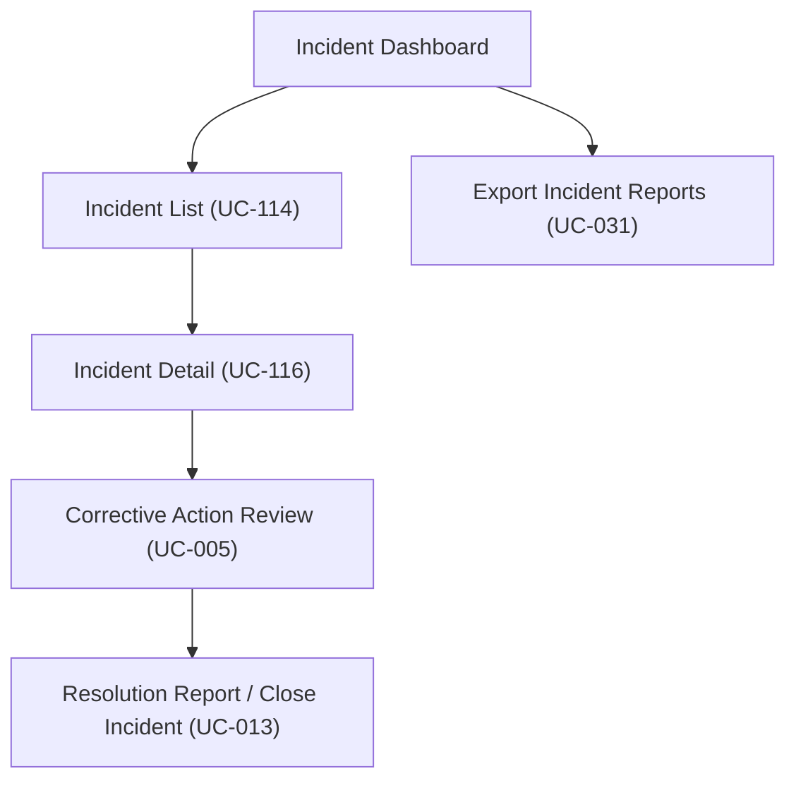

# Wireframe — Incident Management (School Administration)

**Nguồn**: `05_ScreenSpecifications/Web/SchoolAdministration/08_IncidentDashboard.md`, `09_IncidentList.md`, `10_IncidentDetail.md`, `11_CorrectiveActionReview.md`, `12_ResolutionReport.md`, `40_ExportIncidentReports.md`
**Công cụ sinh**: Thủ công (theo skill `wireframer`, `03_Design/06_Wireframes/.agents/skills/wireframer/SKILL.md`)
**File/Link**: `03_Design/06_Wireframes/Web/SchoolAdministration/08_IncidentManagement.html`

> **Nguồn Draft**: Toàn bộ Screen Specification nguồn đang ở trạng thái Draft, CHƯA qua bước QA của Nguyễn Phương Thảo (mục 6, `05_ScreenSpecifications/00_Team_Work_Assignment_Plan.md`) — Wireframe này bám sát nguyên văn Draft hiện có theo quyết định của Nguyễn Văn Nam (leader), cần rà lại nếu Screen Spec đổi sau QA.

## Phạm vi

File HTML là 1 Single Page Application (SPA) vanilla HTML/JS, KHÔNG dùng React/router, mô phỏng 6 màn hình thuộc nhóm "Incident Management" của actor **School Administration**, điều hướng nội bộ qua hàm JS `showScreen(id)` (ẩn/hiện `
`), grayscale/mono tuyệt đối theo phong cách hand-drawn Balsamiq (`wired-elements` + font Patrick Hand + nền graph-paper).

Sidebar bên trái liệt kê đầy đủ các nhóm chức năng của School Administration (theo `03_Design/00_Foundation/Navigation_Guidelines.md` + `03_Design/04_ScreenFlow/02_School_Administration_Screen_Flow.md`), nhưng **chỉ nhóm "Kiểm tra & Sự cố"** có 3 mục click chuyển màn được (Incident Dashboard, Incident List, Export Incident Reports) — Incident Detail/Corrective Action Review/Resolution Report được điều hướng theo luồng nghiệp vụ (row click, nút hành động), không đặt thành mục sidebar riêng, đúng sơ đồ điều hướng nguồn. Các nhóm menu khác (Quản lý Lớp/Học sinh, Quản lý Thực đơn, Quản lý Nhà cung cấp, Báo cáo, Khác) hiển thị dạng text tĩnh kèm ghi chú "(xem file wireframe nhóm khác)".

## Bảng 6 màn hình

| STT | Màn hình | `id` trong SPA | File Screen Spec nguồn |
| --- | --- | --- | --- |
| 1 | Incident Dashboard | `screen-dashboard` | `05_ScreenSpecifications/Web/SchoolAdministration/08_IncidentDashboard.md` |
| 2 | Incident List | `screen-list` | `05_ScreenSpecifications/Web/SchoolAdministration/09_IncidentList.md` |
| 3 | Incident Detail | `screen-detail` | `05_ScreenSpecifications/Web/SchoolAdministration/10_IncidentDetail.md` |
| 4 | Corrective Action Review | `screen-capa` | `05_ScreenSpecifications/Web/SchoolAdministration/11_CorrectiveActionReview.md` |
| 5 | Resolution Report | `screen-resolution` | `05_ScreenSpecifications/Web/SchoolAdministration/12_ResolutionReport.md` |
| 6 | Export Incident Reports | `screen-export` | `05_ScreenSpecifications/Web/SchoolAdministration/40_ExportIncidentReports.md` |

## Sơ đồ điều hướng đã hiện thực trong Wireframe

Khớp nguyên văn `03_Design/04_ScreenFlow/02_School_Administration_Screen_Flow.md` (đoạn "Incident Management — Workflow 11").

## Đối chiếu với Screen Specification (checklist riêng từng màn)

### 1. Incident Dashboard
- [x] Card tổng số sự cố đang mở theo severity (badge danger=High/warning=Medium/info=Low)
- [x] Card số CAPA đang chờ duyệt
- [x] Danh sách sự cố gần nhất (bảng rút gọn) — link sang Incident List (row click)
- [x] Nút "Xem toàn bộ danh sách sự cố" → mở Incident List
- [x] Nút "Export Incident Reports" → mở Export Incident Reports
- [x] Trạng thái Success thể hiện đầy đủ; ghi chú Empty ("Không có sự cố nào đang mở") có mặt dưới dạng card tổng quan
- [x] Đúng Design System grayscale (badge phân biệt bằng viền/icon, không dùng màu)
- [x] KHÔNG thêm field/nghiệp vụ ngoài bảng nguồn

### 2. Incident List
- [x] Filter Severity Level (Select/Combo)
- [x] Filter Status (Active/Under Investigation/Closed)
- [x] Thanh Search (Input search)
- [x] Bảng danh sách: Ngày báo cáo, Mô tả tóm tắt, Severity, Status, Số học sinh ảnh hưởng
- [x] Badge Severity (danger/warning/info)
- [x] Action xem chi tiết (row click) → mở Incident Detail
- [x] Nút "Export"
- [x] Trạng thái Success đầy đủ; ghi chú Empty ("Không có sự cố nào khớp bộ lọc")
- [x] KHÔNG thêm field/nghiệp vụ ngoài bảng nguồn

### 3. Incident Detail
- [x] Triệu chứng báo cáo (text hiển thị)
- [x] Danh sách học sinh bị ảnh hưởng (table) + ghi chú BR-146 (ngưỡng ≥3 HS/24h)
- [x] Suspected food item + meal time (món ăn nghi vấn + thời điểm ăn)
- [x] First aid administered (sơ cứu đã thực hiện)
- [x] Badge trạng thái điều tra (info=Investigating/danger=Active/success=Closed)
- [x] Bản đồ truy xuất nguồn gốc (panel, placeholder Option B "[Image Placeholder]")
- [x] Danh sách lô hàng bị Quarantine (bảng rút gọn)
- [x] Nút "Xem CAPA / Corrective Action Review" → mở Corrective Action Review
- [x] Nút "Export"
- [x] Trạng thái Success đầy đủ (Empty không áp dụng theo Screen Spec)
- [x] KHÔNG thêm field/nghiệp vụ ngoài bảng nguồn

### 4. Corrective Action Review
- [x] Mô tả sự cố liên quan (text hiển thị)
- [x] Yêu cầu CAPA đã giao (text/list hiển thị)
- [x] Báo cáo thực hiện của Service Caterers + gallery ảnh bằng chứng (placeholder Option B)
- [x] Textarea Ghi chú xác minh (bắt buộc khi Approve)
- [x] Nút "Approve" (primary)
- [x] Nút "Reject" + Textarea lý do bắt buộc — EX1 chặn submit nếu thiếu (đã hiện thực bằng JS `submitReject()` kiểm tra rỗng, hiện badge lỗi)
- [x] Trạng thái Error (thiếu lý do Reject) + Success (Approve/Reject) đều thể hiện
- [x] KHÔNG thêm field/nghiệp vụ ngoài bảng nguồn

### 5. Resolution Report
- [x] Tóm tắt điều tra (root cause) — text hiển thị
- [x] Trạng thái xác minh CAPA hoàn thành (badge success/warning) — thể hiện warning (còn CAPA chưa hoàn thành)
- [x] Trạng thái hồi phục học sinh (table/checklist) — thể hiện trạng thái hỗn hợp (Fully Recovered + Đang theo dõi)
- [x] Textarea Closing statement (bắt buộc khi Close)
- [x] Nút "Close Incident" — **disable rõ ràng** kèm chú thích lý do (BR-155: CAPA hoàn thành + học sinh hồi phục)
- [x] Báo cáo sự cố đầy đủ (Panel/Accordion: Clinical Notes, Lab Results, Root Cause) — chỉ xem
- [x] Trạng thái Error (còn CAPA chưa hoàn thành, chặn đóng) thể hiện qua checklist điều kiện đóng
- [x] KHÔNG thêm field/nghiệp vụ ngoài bảng nguồn

### 6. Export Incident Reports
- [x] Filter Date Range (DatePicker range)
- [x] Filter Severity Level (Select)
- [x] Filter Incident Status (Select)
- [x] Filter Suspected Service Caterers (Select)
- [x] Nút "Generate Preview"
- [x] Bảng Preview
- [x] RadioGroup chọn định dạng export (PDF/Excel)
- [x] Nút "Export" (primary)
- [x] Trạng thái Success đầy đủ; ghi chú Empty ("Không có sự cố nào khớp bộ lọc")
- [x] KHÔNG thêm field/nghiệp vụ ngoài bảng nguồn

## Ghi chú kỹ thuật tuân thủ SKILL.md (điều chỉnh theo yêu cầu riêng của nhiệm vụ này)

- Vanilla HTML/JS, 1 file duy nhất, mỗi màn là `
`, điều hướng bằng `showScreen(id)` — không dùng router/framework.
- `wired-elements` nhúng qua CDN (`<script type="module" src="https://unpkg.com/wired-elements?module">`), dùng cho input/search/combo/radio/textarea/card.
- Nút hành động dùng `<button class="btn-primary/btn-secondary">` (KHÔNG dùng `<wired-button>`), theo đúng sketchy border trick.
- Toàn bộ icon là SVG doodle line-art nhúng inline (`<symbol>` trong `<svg style="display:none">`), KHÔNG dùng emoji.
- Grayscale/mono tuyệt đối — badge trạng thái phân biệt bằng kiểu viền + icon + chữ (success = viền liền + tick doodle, warning = viền đứt nét + icon tam giác cảnh báo doodle, danger = viền đậm + icon X/tam giác doodle, info = viền mảnh không icon), không dùng màu Design System thật.
- Ảnh/placeholder chỉ dùng Option B: `<wired-card>` chứa "[Image Placeholder]" hoặc "X" (bản đồ truy xuất, gallery ảnh bằng chứng CAPA).
- Đã bỏ qua bước "1. Initialization Routine" (không tạo agents.md/CLAUDE.md) theo yêu cầu riêng của nhiệm vụ.
- Copy/text là dữ liệu mẫu thực tế hợp lý (không lorem ipsum), khớp đúng field trong bảng Business Logic của từng Screen Spec.

## Vấn đề/thiếu sót phát hiện khi đối chiếu Screen Spec nguồn (không tự suy diễn, chỉ ghi nhận)

1. **10_IncidentDetail.md** tự ghi nhận một khoảng trống nghiệp vụ (dòng 7): `14_Screen_Authorization_Matrix.md` đánh dấu Incident Detail dùng chung cho cả Teacher, nhưng Teacher thực tế không có file Incident Detail riêng trong phạm vi giao việc — cần team xác nhận bổ sung bản thu gọn cho Teacher hoặc coi `Mobile(Web)/Teacher/13_IncidentHistory.md` là đủ. Không ảnh hưởng tới nội dung wireframe School Administration này nhưng cần lưu ý khi làm wireframe cho Teacher sau.
2. **40_ExportIncidentReports.md** tự ghi nhận (dòng 7): màn hình này không có dòng gốc trong `14_Screen_Authorization_Matrix.md` khối 3, số thứ tự "40" là suy luận theo vị trí xuất hiện, cần team xác nhận lại cách đánh số.
3. **09_IncidentList.md** tự ghi nhận (dòng 7): đã đối chiếu hợp nhất với bản Medical Staff, chỉ khác cách trình bày filter (Select Status vs 2 Tab) — không phải khác biệt dữ liệu, không cần xử lý thêm ở wireframe này.
4. Không phát hiện mâu thuẫn field mới nào giữa 6 Screen Spec khi dựng wireframe; toàn bộ field trong bảng Business Logic của từng file đã được ánh xạ đủ 1-1 vào HTML, không thêm/bớt.
