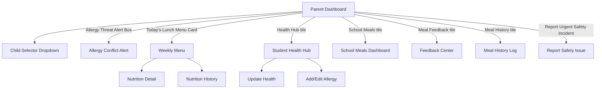

# Prototype — Mobile App (Parent)

**Link dự án trên Google Stitch**: [Mobile_Parent_SFMS](https://stitch.withgoogle.com/projects/17609732078295645287)
**Actor**: Phụ huynh (Parent)
**Nền tảng**: Mobile App (Flutter)
**Device Type**: MOBILE
**Design System**: Áp dụng Material Design 3, màu y tế #0E7490, font Be Vietnam Pro.

## Phạm vi màn hình đã khởi tạo
Dựa theo `03_Design/04_ScreenFlow/05_Parent_Screen_Flow.md` và 4 nhóm Wireframes Mobile gốc:
- Nhóm 01-04: Dashboard, Menu, Nutrition.
- Nhóm 05-10: Health, Allergy.
- Nhóm 11-14: Meals of Child.
- Nhóm 15-18: Feedback, Incident.

## Sơ đồ luồng điều hướng tổng quan (Navigation Flow)

> **Lưu ý đánh giá (Review Notes):**
> Giao diện tuân thủ tuyệt đối cấu trúc 1 cột của thiết bị di động (Mobile layout) và hiển thị thanh điều hướng bên dưới (Bottom Navigation). Các tính năng Alert, Warning đều được Highlight rõ bằng đường viền đỏ/nền đỏ nhạt.
