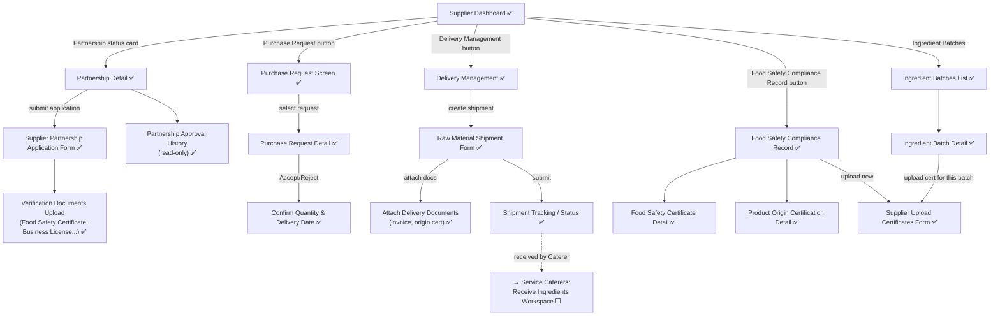

# Prototype — Mobile App — Raw Food Supplier

**Link công cụ**: [Stitch Mobile Project](https://stitch.withgoogle.com/projects/15299343906664661446)
**Phạm vi màn hình**:
- 01_SupplierDashboard
- 02_SelectSchoolWorkspace
- 03_SchoolPartnerships
- 04_ProductOriginDocuments
- 05_FoodSafetyCertificates
- 06_UploadSupplierCertificates
- 07_PartnershipApplication
- 08_ApplicationStatus
- 09_PurchaseRequests
- 10_PurchaseRequestList
- 11_PurchaseRequestDetail
- 12_IngredientBatches
- 13_BatchList
- 14_BatchDetail
- 15_SubmitBatchInformation
- 16_UploadBatchCertificates
- 17_ViewBatchHistory
- 18_Deliveries
- 19_DeliveryList
- 20_DeliveryDetail
- 21_SubmitDeliveryInformation
- 22_ConfirmDeliverySchedule
- 23_UpdateDeliveryStatus
- 24_ViewDeliveryBatchRecords
- 25_UpdateDocuments
- 26_ComplianceDocuments

**Ngày dựng**: 2026-07-02 | **Trạng thái**: Draft cho Review

## Luồng điều hướng đã hiện thực trong Prototype

Dưới đây là sơ đồ luồng điều hướng đã được cấu hình click-through hoàn chỉnh trong dự án Stitch:

## Ghi chú review
*(Sẽ cập nhật sau khi chạy qua checklist 00_Review_Checklist.md)*
