# Prototype — Mobile App — Service Caterers

**Link công cụ**: [projects/14961187756806525502](https://stitch.withgoogle.com/p/14961187756806525502) (ID dự án Google Stitch: `14961187756806525502`)
**Phạm vi màn hình**: 
- `01_ServiceCaterersDashboard`
- `02_MenuManagementDashboard`
- `03_CreateMenuWorkspace`
- `04_ViewMenuRecommendationsPanel`
- `05_SubmitMenuForApprovalTrigger`
- `06_UpdateMenuScreen`
- `07_ReceivingManagementDashboard`
- `08_ReceiveIngredientsWorkspace`
- `09_VerifySupplierDeliveryPanel`
- `10_CaptureReceivingEvidenceScreen`
- `11_StoreIngredientsForm`
- `12_RejectIngredientBatchForm`
- `13_RecordIngredientReceiving`
- `14_ReceivingHistoryAndReports`
- `15_ThreeStepInspectionDashboard`
- `16_InspectIngredientsBeforeProcessingScreen`
- `17_UploadImageCookedFoodScreen`
- `18_InspectMealsBeforeServingScreen`
- `19_RecordPreparationInformationForm`
- `20_ViewPreparationRecordsLedger`
- `21_RecordSampleInformationForm`
- `22_FoodSampleDetail`
- `23_FoodSampleRetentionDashboard`
- `24_MealServiceManagementDashboard`
- `25_ViewMealDistributionList`
- `26_ViewAllergyAlertsPanel`
- `27_ManageSpecialMealsConfiguration`
- `28_InventoryManagementDashboard`
- `29_IssueIngredientsWorkspace`
- `30_MonitorExpirationDatesPanel`
- `31_RecordInventoryTransactionsLog`
- `32_CorrectiveActionsDashboard`
- `33_SubmitCorrectiveActionResultsForm`
- `34_ViewInspectionRecordsLog`
- `35_ViewIncidentInformationDetail`
- `36_RecordProcessViolation`
- `37_RecordStaffViolation`
**Ngày dựng**: 2026-07-02 | **Trạng thái**: Draft cho Review

## Luồng điều hướng đã hiện thực trong Prototype

```mermaid
flowchart TD
    Dash["Service Caterers Dashboard\n(≈ Catering Dashboard)"]
    Dash -->|✅| Grid["Grid Menu Items"]

    %% Module 1: Receiving — Workflow 2
    Grid -->|✅| RecvDash["Receiving Management Dashboard\n(≈ Receiving Dashboard)"]
    RecvDash -->|"Start New Receiving"| RecvWS["Receive Ingredients Workspace\n(Start Receiving Session)"]
    RecvDash -->|"View History"| RecvHist["Receiving History & Reports"]
    RecvWS -->|"Verify Invoice"| VerifyPanel["Verify Supplier Delivery Panel"]
    RecvWS -->|"Inspect Quality"| InspectQ["Inspect Ingredient Quality"]
    RecvWS -->|"Capture Evidence"| CapEv["Capture Receiving Evidence Screen"]
    RecvWS -->|"Log Rejections"| RejForm["Reject Ingredient Batch Form"]
    RecvWS -->|"Send the Receipt of Goods"| RecordRecv["Record Ingredient Receiving"]
    RecordRecv --> StoreForm["Store Ingredients Form\n(Storage Assignment)"]

    %% Module 2: Inventory — Workflow 3
    Grid -->|✅| InvDash["Inventory Management Dashboard"]
    InvDash --> MonExp["Monitor Expiration Dates Panel\n(Expiration Alerts)"]
    InvDash --> IssueWS["Issue Ingredients Workspace"]
    IssueWS --> InvLog["Record Inventory Transactions Log"]

    %% Module 3: Menu — Workflow 4
    Grid -->|✅| MenuDash["Menu Management Dashboard"]
    MenuDash --> CreateMenuWS["Create Menu Workspace"]
    CreateMenuWS --> AIPanel["View Menu Recommendations Panel\n(AI Integration)"]
    AIPanel -->|"Apply Option"| CreateMenuWS
    CreateMenuWS --> SubmitTrigger["Submit Menu For Approval Trigger"]
    SubmitTrigger -.-> SchoolAdminMenu["→ School Administration:\nMenu Management (web)"]
    MenuDash --> UpdateMenuScr["Update Menu Screen"]
    UpdateMenuScr --> SpecialMealCfg["Manage Special Meals Configuration"]

    %% Module 4: Food Preparation + Three-Step Inspection — Workflow 6 & 7
    Grid -->|✅| InspDash["Three-Step Inspection Dashboard"]
    InspDash --> Step1["Inspect Ingredients Before Processing Screen (Step 1)"]
    Step1 --> Step2["Upload Image Cooked Food Screen (Step 2)"]
    Step2 --> Step3["Inspect Meals Before Serving Screen (Step 3)"]
    Step3 --> PrepLedger["View Preparation Records Ledger"]
    Step3 --> InspLog["View Inspection Records Log"]

    %% Module 5: Food Sample Retention — Workflow 8
    Grid -->|✅| SampleDash["Food Sample Retention Dashboard"]
    SampleDash --> SampleForm["Record Sample Information Form"]
    SampleForm --> SampleDetail["Food Sample Detail"]

    %% Module 6: Meal Service — Workflow 10
    Grid -->|✅| MealDash["Meal Service Management Dashboard"]
    MealDash --> DistList["View Meal Distribution List"]
    MealDash --> AllergyPanel["View Allergy Alerts Panel\n(Special Meal Monitoring)"]

    %% Module 7: Corrective Actions — Workflow 11
    Grid -->|✅| CorrDash["Corrective Actions Dashboard"]
    CorrDash --> CorrForm["Submit Corrective Action Results Form"]
    CorrDash --> IncidentInfo["View Incident Information Detail"]

    %% Module 8: Violation Management — mới 2026-07-01
    Grid -->|✅| ViolDash["Violation Management"]
    InspDash -.->|"InspectionStep.fail()"| ProcessViol["Record Violation (UC-179, dialog hợp nhất)\nreportedBy, evidencePhotos, severityLevel; staffName TÙY CHỌN"]
    ViolDash --> ProcessViol
    ProcessViol -->|"MSG-086 success"| CorrDash
```

## Ghi chú review
- Đã áp dụng Material Design 3 theme light dựa trên màu chủ đạo teal-blue `#0E7490` và font chữ Be Vietnam Pro.
- Mọi thao tác tại hiện trường (Nhận hàng, Kiểm thực 3 bước, Lưu mẫu thực phẩm) đều hỗ trợ chức năng giả lập chụp ảnh trực tiếp bằng Camera và tự động thu thập GPS/Thời gian thực tế nhằm đảm bảo tính trung thực.
- Các màn hình liên kết chặt chẽ theo sơ đồ luồng ứng dụng di động của Service Caterers.
