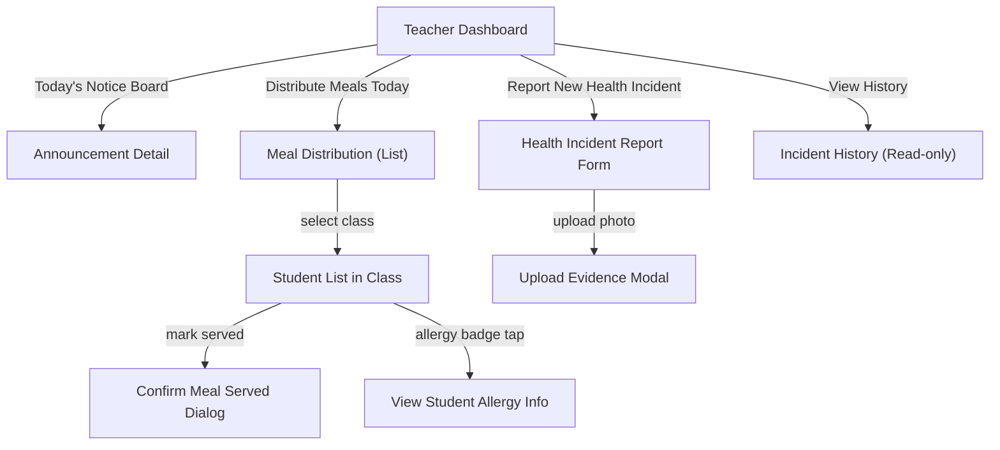

# Prototype — Mobile App (Teacher)

**Link dự án trên Google Stitch**: [Mobile_Teacher_SFMS](https://stitch.withgoogle.com/projects/18353555802221206202)
**Actor**: Giáo viên (Teacher)
**Nền tảng**: Mobile App (Flutter)
**Device Type**: MOBILE
**Design System**: Áp dụng Material Design 3, màu y tế #0E7490, font Be Vietnam Pro.

## Phạm vi màn hình đã khởi tạo
Dựa theo `03_Design/04_ScreenFlow/07_Teacher_Screen_Flow.md` và 3 nhóm Wireframes Mobile gốc:
- Nhóm 01-07: Home, Student Records.
- Nhóm 08-10: Meal Distribution (Phân phát phần ăn - **KHÔNG CÓ QR Code**).
- Nhóm 11-13: Health Incident (Báo cáo sự cố khẩn cấp tại lớp).

## Sơ đồ luồng điều hướng tổng quan (Navigation Flow)

> **Lưu ý đánh giá (Review Notes):**
> Giao diện tuân thủ quy tắc Mobile App 1 cột và Bottom Navigation. Nghiệp vụ điểm danh suất ăn (Meal Distribution) được hiển thị theo dạng danh sách chọn (List) thay vì dùng Camera QR Code như đợt làm nhầm trước. Báo cáo sự cố chỉ giới hạn ở mức Form tạo mới và Lịch sử đã báo cáo, không có tính năng theo dõi quy trình điều tra y tế.
