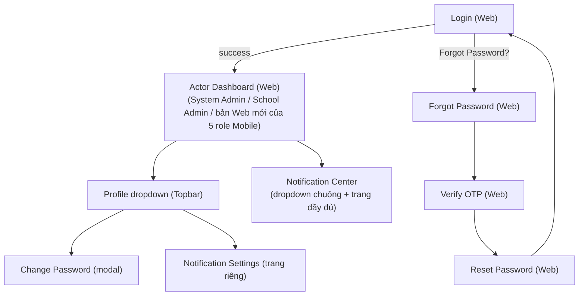

# Prototype — Web App — Guest & Common

**Link công cụ**: [Stitch Project Link](https://stitch.withgoogle.com/projects/8460166033796048457)
**Phạm vi màn hình**: 
- `01_Login.md`
- `02_ForgotPassword.md`
- `03_ResetPassword.md`
- `04_VerifyOTP.md`
- `05_ProfileManagement.md`
- `06_ChangePassword.md`
- `07_NotificationCenterList.md`
- `08_NotificationDetail.md`
- `09_NotificationSettings.md`

**Ngày dựng**: 2026-07-02 | **Trạng thái**: Draft cho Review

## Luồng điều hướng đã hiện thực trong Prototype

## Ghi chú review
*(Sẽ được điền sau khi hoàn thành UAT và rà soát chéo)*
