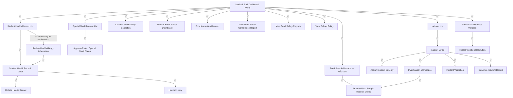

# Prototype — Web App — Medical Staff

**Link công cụ**: [Stitch Project Link](https://stitch.withgoogle.com/projects/9673917523813382749)
**Phạm vi màn hình**: 
- `01_MedicalStaffDashboard.md`
- `02_ReviewHealthInformationScreen.md`
- `03_StudentHealthRecordList.md`
- `04_StudentHealthRecordDetail.md`
- `05_UpdateHealthRecordScreen.md`
- `06_HealthHistoryScreen.md`
- `07_ReviewSpecialMealRequestScreen.md`
- `08_SpecialMealRequestList.md`
- `09_ApproveSpecialMealDialog.md`
- `10_RejectSpecialMealDialog.md`
- `11_FoodInspectionRecords.md`
- `12_ConductFoodSafetyInspectionScreen.md`
- `13_FoodSampleRecords.md`
- `14_RetrieveFoodSampleRecordsDialog.md`
- `15_ViewFoodSafetyReportsScreen.md`
- `16_ViewSchoolPolicyScreen.md`
- `17_InvestigationWorkspace.md`
- `18_AssignIncidentSeverityDialog.md`
- `19_RecordCorrectiveActionsReportScreen.md`
- `20_GenerateIncidentReportDialog.md`
- `21_RecordProcessViolation.md`
- `22_RecordStaffViolation.md`
- `23_ComplianceDashboard.md`
- `24_RecordViolationResolution.md`
- `25_IncidentList.md`
- `26_IncidentDetail.md`
- `27_ViolationRegistry.md`

**Ngày dựng**: 2026-07-02 | **Trạng thái**: Draft cho Review

## Luồng điều hiện thực trong Prototype

## Ghi chú review
*(Sẽ được điền sau khi hoàn thành UAT và rà soát chéo)*
