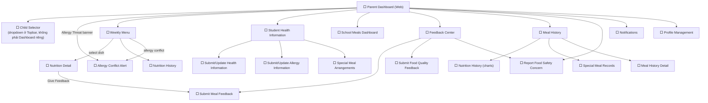

# Prototype — Web App — Parent

**Link công cụ**: https://stitch.withgoogle.com/projects/5917795740769680851
**Phạm vi màn hình**: Toàn bộ màn hình trong `06_Wireframes/Web/Parent/`
- Parent Dashboard
- Weekly Menu
- Nutrition Detail
- Nutrition History
- Submit Allergy Information
- Update Allergy Information
- Student Health Information
- Submit Health Information
- Update Health Information
- Special Meal Arrangements
- Daily Meal Details
- Meal Evaluation
- Meal History
- Dietary Summary
- Feedback and Safety Concern Dashboard
- Submit Safety Concern
- Feedback Detail
- School Safety Notifications

**Ngày dựng**: 2026-07-02 | **Trạng thái**: Draft cho Review

## Luồng điều hướng đã hiện thực trong Prototype

## Ghi chú review
(Sẽ cập nhật tại `07_Prototype/00_Review_Checklist.md`)
