# Prototype — Web App — School Administration

**Link công cụ**: [Stitch Project Link](https://stitch.withgoogle.com/projects/1289275934116759999)

**Phạm vi màn hình**:
- `01_DashboardPartnershipMenuOversight.md`
  - Tổng quan (School Administration Dashboard)
  - Yêu cầu Catering (Catering Partnership Requests - UC-127)
  - Yêu cầu Nhà cung cấp (Supplier Partnership Requests - UC-131)
  - Chi tiết đối tác (Service Caterers Detail - UC-108/UC-004)
  - Chi tiết Nhà cung cấp (Supplier Detail - UC-148/UC-007)
  - Quản lý thực đơn (Menu Management - UC-128)
  - Chi tiết thực đơn (Menu Detail - UC-134/UC-006)
- `08_IncidentManagement.md`
  - Tổng quan sự cố (Incident Dashboard)
  - Danh sách sự cố (Incident List - UC-114)
  - Chi tiết sự cố (Incident Detail - UC-116)
  - Sơ đồ truy xuất nguồn gốc chuỗi cung ứng (Traceability Map - graph diagram, không phải bản đồ địa lý)
  - Phê duyệt hành động khắc phục (Corrective Action Review - UC-005)
  - Báo cáo đóng sự cố (Resolution Report / Close Incident - UC-013)
  - Xuất báo cáo sự cố (Export Incident Reports - UC-031)
- `13_ReportsAndCompliance.md`
  - Dashboard tuân thủ (Compliance Dashboard - UC-027)
  - Báo cáo kiểm tra (Inspection Reports - UC-113)
  - Lịch sử duyệt đối tác (Partnership Approval History - UC-106)
  - Hồ sơ dị ứng học sinh (Allergy Review)
  - Báo cáo lưu mẫu (Food Sample Retention Reports - UC-171/172)
  - Báo cáo nhận hàng (Receiving Reports - UC-123)
  - Báo cáo truy xuất (Traceability Reports - UC-171/172)
  - Báo cáo đối tác (Partnership Reports - UC-171/172)
  - Thống kê sử dụng (System Usage Metrics - UC-171)
- `19_ClassroomStudentAcademicYear.md`
  - Quản lý lớp học (Classroom Management - UC-037/UC-166)
  - Chi tiết lớp học (Classroom Detail - UC-165, UC-090)
  - Phân công giáo viên (Assign Homeroom Teacher modal - UC-008)
  - Tạo lớp học (Create Classroom - UC-018)
  - Hồ sơ học sinh (Student Profile Management - UC-147)
  - Chi tiết học sinh (Student Profile Detail - UC-099)
  - Nhập danh sách học sinh (Bulk Import Student Profiles - UC-010, BR-032)
  - Chi tiết phụ huynh (Parent Account Detail - UC-025)
  - Liên kết tài khoản phụ huynh (Link Parent Account - UC-025)
  - Quản lý năm học (Academic Year List - UC-176)
  - Tạo năm học mới (Create Academic Year - UC-174)
  - Chi tiết năm học (Academic Year Detail - UC-175)
  - Xác nhận đóng năm học (Activate/Close Academic Year Dialog - UC-175)
  - Không gian lên lớp (Promote Students Workspace - UC-177)
- `28_AnnouncementStaffConfiguration.md`
  - Quản lý thông báo (School Announcement Management - UC-125)
  - Tạo thông báo (Create Announcement - UC-017)
  - Cập nhật thông báo (Update Announcement - UC-089)
  - Chi tiết thông báo (Announcement Detail - UC-105)
  - Quản lý nhân sự (Staff Management - UC-144)
  - Tải danh sách nhân viên (Upload Staff List - UC-024)
  - Trạng thái lời mời (Invitation Status - UC-024/010/154)
  - Cấu hình trường (School Configuration - UC-095)
- `46_ViolationManagement.md`
  - Nhật ký vi phạm (Violation Log List - UC-138)
  - Chi tiết vi phạm (Violation Detail Sheet - UC-139)
  - Tạo yêu cầu CAPA (Corrective Action Requests - UC-005)
  - Đóng vi phạm (Resolve Violation Dialog - UC-139)

**Ngày dựng**: 2026-07-02 | **Trạng thái**: Draft cho Review

## Luồng điều hướng đã hiện thực trong Prototype

```mermaid
flowchart TD
    Dash["✅ School Administration Dashboard"]

    %% Partnership Management — Workflow 1
    Dash --> SPR["✅ Supplier Partnership Requests\n(UC-131, lọc Pending)"]
    SPR --> SupD["✅ Supplier Detail (UC-148)"]
    SupD -->|"Approve/Reject"| SupApprove["✅ Approve/Reject Dialog (UC-007)"]
    Dash --> CPR["✅ Catering Partnership Requests\n(UC-127, lọc Pending)"]
    CPR --> SCD["✅ Service Caterers Detail (UC-108)"]
    SCD -->|"Approve/Reject"| SCApprove["✅ Approve/Reject Dialog (UC-004)"]
    Dash --> PAH["✅ Partnership Approval History\n(TODO: chưa có UC)"]
    Dash --> PR["✅ Partnership Reports\n(→ UC-172 Export Report)"]

    %% Menu Oversight — Workflow 4
    Dash --> MM["✅ Menu Management (UC-128)"]
    MM --> MD["✅ Menu Detail (UC-134)"]
    MD -->|"Approve/Reject"| MApprove["✅ Approve/Reject Menu (UC-006)"]

    %% Class & Student Management — bổ sung Academic Year
    Dash --> AYList["✅ Academic Year List (UC-176)"]
    AYList -->|"Create"| AYCreate["✅ Create Academic Year (UC-174)"]
    AYList -->|"select year"| AYActivate["✅ Activate/Close Academic Year (UC-175)"]
    AYList -->|"Promote Students"| AYPromote["✅ Promote Students to Next Year (UC-177)"]
    Dash --> CM["✅ Classroom Management (UC-037/166)"]
    CM -->|"Create"| CC["✅ Create Classroom (UC-018)"]
    CM --> CDt["✅ Classroom Detail (UC-165)"]
    CDt -->|"Edit"| CDtUpdate["✅ Update Classroom (UC-090)"]
    CDt -->|"Assign Teacher"| AssignTeacher["✅ Assign Homeroom Teacher (UC-008)"]
    CC -.->|"cần năm học Active"| AYList
    Dash --> SPM["✅ Student Profile Management (UC-147)"]
    SPM -->|"Create"| SPCreate["✅ Create Student Profile (UC-025)\n→ tìm/link Parent Account"]
    SPM --> SPD["✅ Student Profile Detail (UC-099)"]
    SPM --> BIS["✅ Bulk Import Student Profiles (UC-010)"]

    %% Incident Management — Workflow 11 + Violation Management mới
    Dash --> ID["✅ Incident Dashboard"]
    ID --> IL["✅ Incident List (UC-114)"]
    IL --> IDt["✅ Incident Detail (UC-116)"]
    IDt --> CAR["✅ Corrective Action Review (UC-005)"]
    CAR --> RR["✅ Resolution Report / Close Incident (UC-013)"]
    ID --> ExportInc["✅ Export Incident Reports (UC-031)"]
    Dash --> ViolReg["✅ Violation Registry (UC-181)"]
    ViolReg -->|"pending approval"| ViolApprove["✅ Approve/Reject Violation Resolution (UC-182)"]
    Dash --> OverrideRpt["⬜ Weekly Override Abuse Report (UC-183)"]

    %% Reports & Compliance
    Dash --> CD["✅ Compliance Dashboard (UC-027)"]
    Dash --> InsR["✅ Inspection Reports (UC-113)"]
    Dash --> Analytics["✅ Analytics Dashboard (UC-171)\n→ Food Sample/Receiving/Traceability/Usage Reports"]
    Analytics --> ExportRpt["✅ Export Report (UC-172)"]
    Analytics --> ScheduleRpt["⬜ Schedule Automated Report (UC-173)"]
    Dash --> AR["✅ Allergy Review\n(TODO: chưa có UC riêng)"]

    %% Announcement Management
    Dash --> SAM["✅ School Announcement Management (UC-125)"]
    SAM -->|"Create"| CrA["✅ Create Announcement (UC-017)"]
    SAM --> AD["✅ Announcement Detail (UC-105)"]
    AD -->|"Edit"| UpA["✅ Update Announcement (UC-089)"]

    %% Staff Management
    Dash --> StM["✅ Staff Management (UC-144)"]
    StM -->|"Create/Upload"| USL["✅ Upload Staff List (UC-024)"]
    USL --> IS["✅ Invitation Status\n(bundled, theo dõi BR-010)"]

    %% System & Audit
    Dash --> SC["✅ School Configuration\n(TODO: chưa có UC)"]
    Dash --> AL["⬜ Audit Logs"]
    Dash --> NCL["⬜ Notification Center/List"]
```

## Ghi chú review
[Đang chờ đánh giá từ QA của Nguyễn Phương Thảo theo tài liệu 00_Review_Checklist.md]
