# Prototype — Web App — Service Caterers

**Link công cụ**: [projects/12735072865870643091](https://stitch.withgoogle.com/p/12735072865870643091) (ID dự án Google Stitch: `12735072865870643091`)
**Phạm vi màn hình**: 
- `01_ServiceCaterersDashboard` (ID: `8bad6f1844174d1494436999d53ee00c`)
- `02_MenuManagementDashboard` (ID: `56e25163267d4d179a6fc4b76a4c97bc`)
- `03_CreateMenuWorkspace` (ID: `28285edb3415449aad9ab0ab2cd1a070`)
- `04_ViewMenuRecommendationsPanel` (ID: `812e0505ce384de489eb2dfbb8b2e840`)
- `05_SubmitMenuForApprovalTrigger` (ID: `cd0a63255f024f30ae7e9b93eb818201`)
- `06_UpdateMenuScreen` (ID: `f1f0397b70604b8789ee621296fc614a`)
- `07_ReceivingManagementDashboard` (ID: `22a38d7327f04c1991151e20003dd405`) [ĐÃ SỬA LỖI HÌNH]
- `08_ReceiveIngredientsWorkspace` (ID: `3f6d64d793bd4416a9fe6650ad26ff24`)
- `09_VerifySupplierDeliveryPanel` (ID: `8e8e26bdb1414be5a4839aa1e0e98580`)
- `10_CaptureReceivingEvidenceScreen` (ID: `cb74471c87ba46b99215cfbb7bc48547`)
- `11_StoreIngredientsForm` (ID: `e2374711f17043c192fe28189120bf58`)
- `12_RejectIngredientBatchForm` (ID: `a69eccc11e274795997bb8f3138752b5`)
- `13_RecordIngredientReceiving` (ID: `1d9661ca96be4681b912f1ef46cd2e5b`) [ĐÃ SỬA LỖI HÌNH]
- `14_ReceivingHistoryAndReports` (ID: `31e37746d1d3431080e77188be1abf9e`) [ĐÃ SỬA LỖI HÌNH]
- `15_ThreeStepInspectionDashboard` (ID: `286d16adb5d4475ab0e18e75d8ba4b75`)
- `16_InspectIngredientsBeforeProcessingScreen` (ID: `3f1785d37ef54e0f9d097462db7f9868`)
- `17_UploadImageCookedFoodScreen` (ID: `3988ea4133714f46a52177d02051f0e9`)
- `18_InspectMealsBeforeServingScreen` (ID: `4fd71b01dc3d4eebb9581bcb1ebd8e48`)
- `19_RecordPreparationInformationForm` (ID: `30bba4c0a085436ab7f494bf402d7168`)
- `20_ViewPreparationRecordsLedger` (ID: `4bd985299d0541f1a1faadb7f1b5f78d`)
- `21_RecordSampleInformationForm` (ID: `3eef3ec3745f4352b19403a7b6cf13f7`)
- `22_FoodSampleDetail` (ID: `06708d14d07d45d7a41edc912139e47f`)
- `23_FoodSampleRetentionDashboard` (ID: `0fe80bd7a53647a5a7551aff12c9a878`)
- `24_MealServiceManagementDashboard` (ID: `784ff9527bbf4cb09523f96360327a18`)
- `25_ViewMealDistributionList` (ID: `6866921de6174bb7aa0ad14d50395426`)
- `26_ViewAllergyAlertsPanel` (ID: `a35459f1abc94a7eac0f37a2d3c77c12`)
- `27_ManageSpecialMealsConfiguration` (ID: `11e8d94de01c44a1ac4e3a3235a617c7`)
- `28_InventoryManagementDashboard` (ID: `975886386bbc4c84aa011d4f02e47296`)
- `29_IssueIngredientsWorkspace` (ID: `28d893769e5945e3a3899658466dc770`)
- `30_MonitorExpirationDatesPanel` (ID: `8fb929e1335f454eb49a42c1acbb20e9`)
- `31_RecordInventoryTransactionsLog` (ID: `300be4ce7de24a819c7bc35f319c17c2`)
- `32_CorrectiveActionsDashboard` (ID: `44472ffe88894932a3d61db869dd6f63`)
- `33_SubmitCorrectiveActionResultsForm` (ID: `bb6b28d3397d46e5af3446364ea4b489`)
- `34_ViewInspectionRecordsLog` (ID: `401bf0401e9e4adca001bcb7584d44f8`)
- `35_ViewIncidentInformationDetail` (ID: `e2e80a0c92d3464db9c62ab57bbfeada`)
- `36_RecordProcessViolation` (ID: `cea66b39cdf3463aab9f951373cf6fec`)
- `37_RecordStaffViolation` (ID: `29f16c131fb148409791c1dddb4186ac`)
**Ngày dựng**: 2026-07-02 | **Trạng thái**: Draft cho Review

## Luồng điều hướng đã hiện thực trong Prototype

```mermaid
flowchart TD
    Dash["Service Caterers Dashboard (Web)"]

    Dash -->|✅| MenuDash["Menu Management Dashboard"]
    MenuDash -->|✅| CreateMenu["Create Menu Workspace"]
    CreateMenu -->|✅| AIPanel["AI Menu Recommendations"]
    CreateMenu -->|✅| SubmitMenu["Submit Menu For Approval"]
    SubmitMenu -.->|✅| SchoolAdminMenu["→ School Administration:\nMenu Management"]
    MenuDash -->|✅| UpdateMenu["Update Menu"]

    Dash -->|✅| RecvDash["Receiving Management Dashboard"]
    RecvDash -->|✅| RecvWS["Receive Ingredients Workspace\n(upload ảnh thay vì chụp trực tiếp)"]
    RecvWS -->|✅| VerifyPanel["Verify Supplier Delivery Panel"]
    RecvWS -->|✅| RejectForm["Reject Ingredient Batch Form"]
    RecvDash -->|✅| RecvHist["Receiving History & Reports"]

    Dash -->|✅| InvDash["Inventory Management Dashboard"]
    InvDash -->|✅| IssueWS["Issue Ingredients Workspace (FEFO)"]
    InvDash -->|✅| ExpiryPanel["Monitor Expiration Dates Panel"]
    InvDash -->|✅| InvLog["Record Inventory Transactions Log"]

    Dash -->|✅| InspDash["Three-Step Inspection Dashboard\n(khuyến nghị dùng Mobile tại bếp)"]
    InspDash -->|✅| Step1["Step 1: Before Processing"]
    Step1 -->|✅| Step2["Step 2: After Cooking"]
    Step2 -->|✅| Step3["Step 3: Before Serving"]
    Step3 -->|✅| PrepLedger["View Preparation Records Ledger"]
    Step3 -->|✅| InspLog["View Inspection Records Log"]

    Dash -->|✅| SampleDash["Food Sample Retention Dashboard\n(khuyến nghị dùng Mobile tại bếp)"]
    SampleDash -->|✅| SampleForm["Record Sample Information Form"]
    SampleForm -->|✅| SampleDetail["Food Sample Detail"]

    Dash -->|✅| MealDash["Meal Service Management Dashboard"]
    MealDash -->|✅| DistList["View Meal Distribution List"]
    MealDash -->|✅| AllergyPanel["View Allergy Alerts Panel"]
    MealDash -->|✅| SpecialCfg["Manage Special Meals Configuration"]

    Dash -->|✅| CorrDash["Corrective Actions Dashboard"]
    CorrDash -->|✅| CorrForm["Submit Corrective Action Results Form"]
    CorrDash -->|✅| IncidentInfo["View Incident Information Detail"]
    InspDash -.->|✅| ProcessViol["Record Violation (UC-179, dialog hợp nhất)"]
    CorrDash -->|✅| ProcessViol
```

## Ghi chú review
- Đã sửa lỗi Sidebar: Toàn bộ các màn hình chính trên Web đều có menu Sidebar chứa mục "Cá nhân" (gồm "Thông tin cá nhân" và "Cài đặt thông báo") được định dạng đồng bộ và nhất quán.
- Đã sửa lỗi hiển thị cho 3 màn hình: Receiving Management Dashboard (Màn 07), Record Ingredient Receiving (Màn 13), và Receiving History & Reports (Màn 14) hoạt động render tốt.
- Đã tuân thủ nghiêm ngặt bảng màu thương hiệu sfms (màu Teal-blue `#0E7490` chủ đạo) và font chữ Be Vietnam Pro hỗ trợ tốt tiếng Việt.
- Đã hiện thực cơ chế định vị GPS giả lập ở các màn hình hiện trường thông qua Web (nhập tọa độ).
- Phân tách rõ ràng giữa các nhóm màn hình và liên kết trực tiếp bằng luồng sự kiện click-through.
