# Prototype — Web App — System Admin

**Link công cụ**: [Stitch Project Link](https://stitch.withgoogle.com/projects/11238243390200007468)

**Phạm vi màn hình**:
- `01_MonitoringAndAudit.md`
  - Nhật ký hệ thống (Audit Logs - UC-106)
  - Giám sát hoạt động (System Activity Monitoring - UC-057)
  - Trạng thái & Sao lưu (System Status & Backup - UC-149, BR-160)
  - Nhật ký lỗi (Error Logs - UC-111)
  - Thống kê sử dụng (Usage Statistics - UC-150)
- `02_UserRolePermissionManagement.md`
  - Tổng quan hệ thống (System Administrator Dashboard)
  - Danh sách tài khoản (User Account List - UC-153)
  - Tạo tài khoản (Manage User Screen/Dialog - UC-026)
  - Khóa/Kích hoạt tài khoản (Active/Deactivate User Dialog - UC-003)
  - Vai trò hệ thống (Role List - UC-130)
  - Chỉnh sửa vai trò hệ thống (Manage Role Screen/Sheet - UC-022, UC-098, UC-029)
  - Danh mục quyền hạn (Manage Permission List Screen - UC-129)
- `09_SchoolManagementAndSystemConfig.md`
  - Danh sách trường học (School List - UC-140)
  - Chi tiết trường học (School Detail - UC-122)
  - Cập nhật thông tin trường (Update School Screen/Dialog - UC-095)
  - Xác nhận thay đổi trạng thái (Active/Deactivate School Dialog - UC-001)
  - Chính sách bảo mật (Security Policies - UC-184)
  - Tích hợp ngoại vi (AI Settings / External Integrations - UC-040)

**Ngày dựng**: 2026-07-02 | **Trạng thái**: Draft cho Review

## Luồng điều hướng đã hiện thực trong Prototype

```mermaid
flowchart TD
    Dash["✅ System Administrator Dashboard"]

    %% User & Role Management — UC-153, UC-026, UC-003
    Dash --> UAL["✅ User Account List (UC-153)"]
    UAL -->|"Create User Account"| MUD["✅ Manage User Screen/Dialog\n(Create — UC-026)"]
    UAL -->|"status toggle"| AUD["✅ Active/Deactivate User Dialog (UC-003)"]

    %% Role & Permission Management — UC-130, UC-022, UC-098, UC-029, UC-129
    Dash --> RL["✅ Role List (UC-130)"]
    RL -->|"Create New Role"| MRSCreate["✅ Manage Role Screen\n(Create — UC-022)"]
    RL -->|"select role → Edit"| MRSUpdate["✅ Manage Role Screen\n(Update — UC-098)"]
    RL -->|"Delete Role"| MRSDelete["✅ Confirm Delete Dialog (UC-029)"]
    Dash --> MPL["✅ Manage Permission List Screen (UC-129, read-only)"]

    %% School Management — UC-140, UC-122, UC-095, UC-001
    Dash --> SL["✅ School List (UC-140)"]
    SL --> SD["✅ School Detail (UC-122)"]
    SD -->|"Edit"| USD["✅ Update School Screen/Dialog (UC-095)"]
    SL -->|"status toggle"| ASD["✅ Active/Deactivate School Dialog (UC-001)"]

    %% System Configuration
    Dash --> SP["✅ Security Policies\n(UC-184, mới)"]
    Dash --> AIS["✅ AI Settings\n(1 phần của UC-040)"]

    %% Monitoring & Audit — UC-057, UC-149, UC-111, UC-150, UC-106
    Dash --> SAM["✅ System Activity Monitoring (UC-057)"]
    Dash --> SSS["✅ System Status Screen (UC-149)"]
    SSS --> BM["✅ Backup Management panel\n(bundled trong UC-149, BR-160)"]
    SSS -->|"AF1: Export"| SSExport["✅ Export System Status (CSV/PDF)"]
    Dash --> ELS["✅ Error Logs Screen (UC-111)"]
    ELS -->|"select error"| ELDetail["✅ Error Detail\n(stack trace, session info)"]
    Dash --> USS["✅ Usage Statistics Screen (UC-150)"]
    Dash --> AL["✅ Audit Logs (UC-106)"]

    %% Reporting & Analytics — cross-cutting, UC-171/172/173
    Dash --> Analytics["✅ Analytics Dashboard (UC-171)"]
    Analytics --> ExportRpt["✅ Export Report (UC-172)"]
    Analytics --> ScheduleRpt["⬜ Schedule Automated Report (UC-173)"]

    %% External Integrations — UC-040 (đầy đủ, AI Settings chỉ là 1 phần)
    Dash --> ExtInt["✅ External Integrations\n(GPS/Gmail/Firebase/Gemini AI — UC-040)"]
    ExtInt --> AIS

    %% Profile (shared, see Guest & Common)
    Dash --> Prof["⬜ Profile Management\n(xem 13_Guest_Common_Screen_Flow.md)"]
```

## Ghi chú review
[Đang chờ đánh giá từ QA của Nguyễn Phương Thảo theo tài liệu 00_Review_Checklist.md]
