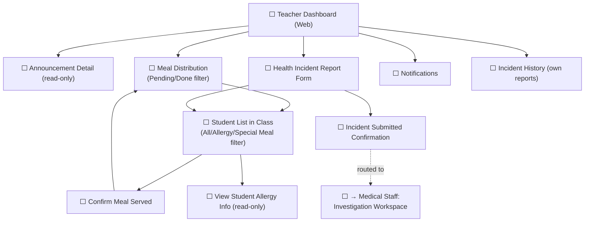

# Prototype — Web App — Teacher

**Link công cụ**: https://stitch.withgoogle.com/projects/5176157773085024518
**Phạm vi màn hình**: Toàn bộ màn hình trong `06_Wireframes/Web/Teacher/`
- Teacher Home
- Student List
- Student Detail
- Allergy Information
- Health Information
- Special Meal Requirements
- Meal Records
- Meal Distribution Dashboard
- Scan QR/Barcode for Meal
- Distribution Exception Handling
- Health Incident Reporting Dashboard
- Report New Health Incident
- Incident Detail & Follow-up

**Ngày dựng**: 2026-07-02 | **Trạng thái**: Draft cho Review

## Luồng điều hướng đã hiện thực trong Prototype

## Ghi chú review
(Sẽ cập nhật tại `07_Prototype/00_Review_Checklist.md`)
