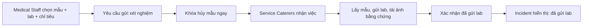

# Review — Thiết kế lại luồng Thu hồi Mẫu lưu phục vụ điều tra sự cố (Food Sample Retrieval) — Medical Staff ↔ Service Caterers

**Mục đích**: ghi lại các vấn đề đã verify trên code thật và các quyết định thiết kế lại đã xác nhận cho luồng thu hồi/gửi xét nghiệm mẫu lưu khi có sự cố ATTP. Phạm vi ghi nhận **cả 2 phía** Medical Staff và Service Caterers vì đây là luồng liên actor, nhưng **chỉ áp dụng code cho phía Medical Staff** — phần Service Caterers chỉ ghi nhận yêu cầu thay đổi, chưa đụng code (theo yêu cầu người dùng).

**Ngày biên soạn**: 19/07/2026.

**Nguồn đã đọc/tra cứu để biên soạn**:
- `02_Requirements/00_BusinessRules/business_rules.md` — BR-109, BR-111, BR-112, BR-113, BR-114, BR-150, BR-212
- `03_Design/05_ScreenSpecifications/Web/MedicalStaff/14_RetrieveFoodSampleRecordsDialog.md` (UC-076)
- `03_Design/08_FrontEnd/Web/src/app/(app)/medical-staff/samples/page.tsx`
- `03_Design/08_FrontEnd/Web/src/app/(app)/medical-staff/incidents/[id]/page.tsx` (Section B, Section C tab "Mẫu lưu", checklist "Việc cần hoàn tất")
- `03_Design/08_FrontEnd/Web/src/app/(app)/service-caterers/samples/[id]/page.tsx`
- `03_Design/08_FrontEnd/Web/src/lib/mock-data.ts` (`FoodSample`, `Incident.suspectedDishIds`)
- `00_Policies/14_2011_TT-BYT_lấy mẫu thực phẩm phục vụ thanh tra kiểm tra.md` (Điều 5 khoản 2, Phụ lục V)
- `00_Policies/1246_QD-BYT_345320_kiểm thực 3 bước_lưu mẫu.md` (Điều 7/8 — lưu mẫu, hủy mẫu)
- `00_Policies/39_2006_QD-BYT_quy_che_dieu_tra_ngo_doc_thuc_pham.md`

---

## 1. Bối cảnh

Người dùng đưa ra thiết kế lại luồng thu hồi mẫu lưu phục vụ điều tra, dựa trên nhận xét cùng nguyên tắc case-workspace đã dùng cho Incident/Violations: Medical Staff thao tác bao quát tại Incident, Sổ lưu mẫu là nguồn dữ liệu trung tâm dùng để tra cứu/ngoại lệ, không bắt buộc điều hướng cho luồng chính.

### 1.1. Vấn đề của thiết kế hiện tại (đã verify đúng với code)

| # | Vấn đề | Bằng chứng code |
| --- | --- | --- |
| 1 | Hành động thu hồi bị chia 2 nơi: Section B (nút cạnh món nghi vấn, trước khi chốt đánh giá) và Sổ lưu mẫu độc lập; sau khi chốt đánh giá, Section C chỉ còn log chỉ đọc, không thể thu hồi thêm | `incidents/[id]/page.tsx` dòng 1020-1033: tab "Mẫu lưu" tự ghi chú "LOG TỔNG HỢP CHỈ ĐỌC... thao tác thu hồi nằm ở Section B" |
| 2 | Lọc mẫu theo món nghi vấn chỉ so khớp theo **tên món**, không giới hạn theo ngày/bữa ăn nghi vấn — mẫu cùng tên món ở ngày khác có thể bị tick nhầm | `medical-staff/samples/page.tsx` dòng 89-90: `s.status === "RETAINED" && suspectedDishes.includes(s.dish)`, không có điều kiện ngày; `mock-data.ts` xác nhận "Thịt kho trứng cút" xuất hiện ở cả 02/07 và 29/06 |
| 3 | Checklist "Việc cần hoàn tất" liệt kê "Thu hồi mẫu cho món nghi vấn" như 1 mục cần làm, dù BR-113 dùng từ "có thể" (tùy chọn nghiệp vụ, không phải mọi sự cố cần xét nghiệm mẫu) | `incidents/[id]/page.tsx` dòng 1502: `{ done: retrievedSamples.length > 0, label: "Thu hồi mẫu cho món nghi vấn" }` — không chặn gì (`done` không gate nút khác) nhưng dễ gây hiểu nhầm là bắt buộc |
| 4 | Toàn bộ thao tác thu hồi hiện do **Medical Staff trực tiếp thực hiện** (tự chọn mẫu, tự ghi `labDestination`/`labRepresentative`, hệ thống tự sinh "biên bản bàn giao mẫu") — không khớp thực tế vận hành (Medical Staff chỉ chỉ định, Service Caterers là bên vật lý thao tác) | `incidents/[id]/page.tsx` dòng 457-478 (`submitRetrieve()`); `14_RetrieveFoodSampleRecordsDialog.md` field 3/5/7/9 |
| 5 | Khi Medical Staff thu hồi, mẫu chuyển `RETRIEVED` và Service Caterers bị khoá hủy — đúng nhưng nếu Incident đóng, thiết kế cũ có xu hướng "mở lại quyền hủy" — sai với thực tế mẫu đã bị bóc niêm phong gửi lab thì không thể hoàn tác | `service-caterers/samples/[id]/page.tsx` dòng 285: `disabled={!canDispose || linkedToIncident}` — khoá đúng theo `linkedToIncident`, nhưng chưa có trạng thái "kết thúc vĩnh viễn" tách khỏi `RETAINED`/`DISPOSED` |

### 1.2. Bằng chứng độc lập ủng hộ việc tách actor (không chỉ dựa lời người dùng)

`mock-data.ts` cho thấy `collectedBy` của mọi `FoodSample` đều là nhân sự bếp (Lê Thị Mai, Trần Văn Hùng — cùng tên dùng làm "inspector" phía Service Caterers ở kiểm thực 3 bước), và BR-109 quy định mẫu lưu tại "khu vực bếp hoặc kho được chỉ định". Tủ lưu mẫu vật lý vốn do Service Caterers quản lý — Medical Staff (làm việc tại phòng y tế) không thực sự có vị trí thuận tiện để tự tay vào bếp lấy mẫu. Đây là căn cứ độc lập (ngoài lý do người dùng đưa ra) ủng hộ việc tách vai trò chỉ định (Medical Staff) khỏi vai trò thực thi vật lý (Service Caterers).

---

## 2. Vòng 1 — Vòng đời mẫu sau khi gửi lab (bổ sung trạng thái không hoàn tác)

### 2.1. Quyết định

Mẫu đã bàn giao phòng lab để mở niêm phong/xét nghiệm là mẫu đã **rời khỏi vòng lưu mẫu của trường**, không được trả về trạng thái "đang lưu" và không được mở lại quyền hủy cho Service Caterers dù Incident đã đóng — theo đúng quy định thực tế bổ y tế (mẫu bị bóc niêm phong để xét nghiệm coi như đã hủy, không thể đóng gửi lại trường).

Vòng đời mẫu:
```
RETAINED — đang lưu tại bếp
  ├─ hết hạn, không liên quan Incident → DISPOSED
  └─ đã gửi lab (xem Vòng 2 — nay do Service Caterers xác nhận) → SENT_TO_LAB (trạng thái cuối tại trường, không đảo ngược)
```

`SENT_TO_LAB` (đổi tên từ đề xuất ban đầu `TRANSFERRED_TO_LAB` — thống nhất 1 tên xuyên suốt file này) hiển thị là: **"Đã gửi phòng kiểm nghiệm — không còn mẫu tại trường"**, không hiển thị đơn giản là "Đã thu hồi", vì Service Caterers cần hiểu mẫu đã rời khỏi tủ lưu, không phải đang bị khoá trong tủ.

### 2.2. Không cần thêm "biên bản bàn giao" do hệ thống sinh (điều chỉnh ngay sau, xem Vòng 2)

Đề xuất ban đầu (dialog Medical Staff tự thu hồi + hệ thống sinh biên bản bàn giao 2 bên ký) đã bị thay thế hoàn toàn ở Vòng 2 — không giữ trong thiết kế cuối. Ghi nhận tại đây để không bị đề xuất lại.

---

## 3. Vòng 2 — Tách vai trò: Medical Staff chỉ định, Service Caterers thực thi (thay đổi lớn nhất)

### 3.1. Bối cảnh quyết định

Theo thực tế vận hành người dùng nêu: Medical Staff chỉ **chỉ định** mẫu nào phải thu hồi và gửi xét nghiệm ở lab nào; Service Caterers là bên **thực hiện vật lý** (tự lấy mẫu, mang đến lab, chụp ảnh bằng chứng).

**Đã áp trực tiếp vào `business_rules.md` (19/07/2026)**, sau khi hỏi và chốt 2 điểm qua `AskUserQuestion`:
1. **Số hiệu BR**: tách 2 BR riêng theo actor (không giữ 1 BR-113 mô tả cả 2 vai trò) — khớp convention đã dùng ở BR-183/184, BR-152/153. BR-113 sửa lại thành "Chỉ định thu hồi mẫu" (Medical Staff); **BR-215** (số mới, tiếp theo BR-214 — số cao nhất đang dùng) là "Thực hiện thu hồi & gửi xét nghiệm mẫu" (Service Caterers).
2. **Trích dẫn pháp lý BR-212**: giữ căn cứ Thông tư 14/2011/TT-BYT nhưng chuyển từ Phụ lục V ("Biên bản bàn giao mẫu") sang Điều 5 khoản 2 ("bàn giao ngay, sớm nhất") — đúng bản chất mới: hệ thống không tự sinh văn bản song phương, chỉ yêu cầu ảnh/scan phiếu nhận của chính phòng lab làm bằng chứng.

Đây là đảo ngược trực tiếp nội dung gốc của BR-113 ("Medical Staff có thể thu hồi mẫu... hệ thống ghi nhận việc thu hồi") và BR-212 (toàn bộ field của UC-076 trước đây giả định Medical Staff trực tiếp thao tác) — đã sửa xong tại nguồn, không còn là việc cần làm riêng.

### 3.2. Đổi tên thao tác

**"Thu hồi mẫu"** → **"Yêu cầu thu hồi & gửi xét nghiệm"** (phía Medical Staff, chỉ tạo yêu cầu, không tự thực hiện).

### 3.3. Luồng chuẩn



### 3.4. Phân quyền, trạng thái, và field theo từng bước

| Bước | Medical Staff | Service Caterers | Trạng thái mẫu |
| --- | --- | --- | --- |
| Chỉ định | Chọn mẫu, lab, chỉ tiêu xét nghiệm | Nhận yêu cầu | `RETRIEVAL_REQUESTED` |
| Thực hiện | Theo dõi | Lấy mẫu, gửi lab, tải ảnh/scan bằng chứng | `PENDING_LAB_DELIVERY` |
| Xác nhận gửi | Xem bằng chứng | Xác nhận đã gửi | `SENT_TO_LAB` |
| Sau đó | Ghi nhận/đối chiếu kết quả lab trong Incident | Không được hủy | `SENT_TO_LAB` (trạng thái cuối tại trường, giữ nguyên kể cả khi Incident đóng — nối tiếp Vòng 1) |

Ngay khi Medical Staff tạo yêu cầu (`RETRIEVAL_REQUESTED`), Service Caterers đã bị chặn hủy mẫu — không chờ đến khi có bằng chứng gửi lab. Hệ thống không được ghi "đã gửi lab" trước khi Service Caterers tải bằng chứng và xác nhận.

**Form chỉ định (Medical Staff) — chỉ giữ**: mẫu được chọn; Incident liên quan (tự gắn); phòng lab đích; chỉ tiêu xét nghiệm; người chỉ định (tự động = Medical Staff đăng nhập); thời điểm chỉ định (tự động).

**Bỏ khỏi form Medical Staff**: "Đại diện phòng lab nhận mẫu" (chuyển sang phía Service Caterers, ghi tại lúc họ xác nhận gửi); cơ chế sinh "Biên bản bàn giao mẫu" do hệ thống tự tạo; toast "đã thu hồi/bàn giao" ngay khi Medical Staff bấm Submit (vì thao tác thật chưa xảy ra).

**Chuyển sang phía Service Caterers (chỉ ghi nhận yêu cầu, không sửa code)**: người thực hiện; thời điểm gửi lab; ảnh/scan bằng chứng bàn giao hoặc **phiếu nhận mẫu do chính phòng lab cấp** (bắt buộc — thay cho "biên bản bàn giao do hệ thống sinh", vì phòng lab thật luôn tự cấp phiếu nhận riêng, phù hợp thực tế và vẫn đáp ứng tinh thần Thông tư 14/2011/TT-BYT Điều 5.2 mà không cần hệ thống tự dựng văn bản song phương); nút "Xác nhận đã gửi xét nghiệm". Bằng chứng này chỉ chứng minh việc bàn giao, không phải kết quả xét nghiệm — kết quả lab vẫn là dữ liệu riêng nhập tại Incident (field "Lab Result" hiện có).

### 3.5. Dữ liệu

Nên có 1 entity `SampleLabRequest` (task giao việc, KHÔNG phải văn bản pháp lý) liên kết 1 Incident, 1 lab, và nhiều `FoodSample` — tránh lặp lab/chỉ tiêu/ảnh bằng chứng cho từng mẫu riêng lẻ, thể hiện đúng trách nhiệm ở từng bước (ai chịu trách nhiệm bước nào).

---

## 4. Vòng 3 — Cảnh báo mềm thay SLA cứng (không có căn cứ luật cho số giờ cụ thể)

### 4.1. Đối chiếu căn cứ pháp lý

Đã tra cứu kỹ: Thông tư 14/2011/TT-BYT Điều 5 khoản 2 chỉ quy định định tính "mẫu kiểm nghiệm phải được bàn giao **ngay** cho đơn vị kiểm nghiệm trong **thời gian sớm nhất**" — không có con số giờ cụ thể. QĐ 1246/QĐ-BYT chỉ quy định mốc lưu mẫu tối thiểu 24 giờ, không nói về hạn giao mẫu đi lab. Đề xuất ban đầu "4-6 giờ" **không có căn cứ pháp lý** — bị rút lại.

### 4.2. Quyết định

Không đặt SLA cứng theo giờ tuỳ ý. Dùng lại **`retentionDeadline`** đã có sẵn trên mỗi `FoodSample` (tính theo BR-111, 72 giờ tối thiểu kể từ lúc lưu mẫu) làm mốc cảnh báo mềm — không cần thêm field/hằng số mới:
- Còn hạn: hiển thị "Đã yêu cầu lúc [giờ] — còn Xh trong hạn lưu tối thiểu".
- Đã quá `retentionDeadline` mà Service Caterers chưa xác nhận gửi lab: đổi thành cảnh báo màu warning "Đã quá mốc lưu mẫu tối thiểu (BR-111) — chưa có xác nhận gửi lab".
- **Không chặn gì** — BR-112 đã tự chặn hủy mẫu ngay khi có `incidentId` gắn vào, không phụ thuộc mốc 72h; cảnh báo này thuần tuý nhắc nhở, không phải gate nghiệp vụ mới.
- Nếu Medical Staff tạo yêu cầu sau khi `retentionDeadline` đã trôi qua, cảnh báo hiện ngay lập tức (đúng bản chất mẫu đã cũ), không chờ thêm.

---

## 5. Vòng 4 — UX tại Incident: giữ thao tác tại chỗ, Sổ lưu mẫu là drill-down

### 5.1. Quyết định

Dùng phương án lai: **Incident là nơi thao tác và theo dõi theo từng case; Sổ lưu mẫu là nơi tra cứu toàn bộ, lịch sử và ngoại lệ.** Không bắt Medical Staff điều hướng sang Sổ lưu mẫu cho luồng bình thường — nhất quán với pattern case-workspace đã áp dụng cho Incident (Mục 12, `review_medicalstaff_incidentmanagement.md`) và Violations (`review_medicalstaff_violations.md` Mục 2.6).

### 5.2. Section B — 2 lớp rõ ràng

```text
1. Món nghi vấn & khóa lô
   ☑ Thịt kho trứng cút · 1 lô nguyên liệu đã khóa
2. Mẫu phục vụ xét nghiệm
   SMP-20260702-01 · Thịt kho trứng cút · còn 68h · Đang lưu
   [Chọn gửi xét nghiệm]
   [Yêu cầu thu hồi & gửi xét nghiệm (1 mẫu)]
```

Không để nút nằm riêng cạnh từng món (vì thao tác thật là tạo 1 yêu cầu chung cho Service Caterers: chọn lab, chỉ tiêu, nhiều mẫu nếu cần). Nút chính: **"Yêu cầu thu hồi & gửi xét nghiệm (n mẫu)"**, mở 1 sheet nhỏ trong Incident với: danh sách mã mẫu đã chọn, phòng lab đích, chỉ tiêu xét nghiệm, người chỉ định (tự động), nút "Gửi yêu cầu đến Service Caterers".

**Sửa bug tick nhầm (Mục 1.1 #2)**: ưu tiên đúng `sampleId` thuộc bữa/ngày nghi vấn đã chọn; chỉ cho "Tìm mẫu khác trong phạm vi điều tra 48/72h" khi Medical Staff chủ động mở rộng — không tự động tick toàn bộ mẫu trùng tên món khác ngày.

### 5.3. Section C1 — đổi từ log chỉ đọc thành "Mẫu phục vụ điều tra"

Sau khi chốt đánh giá, C1 không còn chỉ là log — vẫn cho phép:
- Xem toàn bộ yêu cầu/mẫu theo Incident, kèm bảng trạng thái theo trách nhiệm:

| Mẫu | Trạng thái | Hành động |
| --- | --- | --- |
| SMP-… | Chờ Service Caterers gửi lab | Xem yêu cầu |
| SMP-… | Đã gửi lab · có ảnh chứng cứ | Xem chứng cứ |
| SMP-… | Đã hủy trước Incident | Chỉ liên kết metadata |

- CTA **"+ Yêu cầu thêm mẫu"** khi Incident còn mở (bằng chứng mới trong điều tra có thể cần lấy thêm mẫu).
- Chỉ khoá tạo yêu cầu mới khi Incident đã đóng/export chính thức.

### 5.4. Checklist "Việc cần hoàn tất"

Đổi "Thu hồi mẫu cho món nghi vấn" (ngụ ý bắt buộc, sai BR-113 dùng từ "có thể") thành trạng thái có trách nhiệm rõ ràng, không bắt buộc:
- "Chưa chỉ định xét nghiệm mẫu" (không bắt buộc).
- "Đã chỉ định 1 mẫu — chờ Service Caterers gửi lab".
- "1 mẫu đã gửi lab — có bằng chứng".

### 5.5. Component thu hồi dùng chung

1 sheet/dialog dùng tại 3 điểm vào: nút nhanh Section B, "+ Yêu cầu thêm mẫu" ở C1, và Sổ lưu mẫu độc lập — cùng field, cùng quy tắc chọn mẫu/lab/chỉ tiêu, tránh 2 UI khác nhau cho 1 nghiệp vụ. Sổ lưu mẫu vẫn giữ điều hướng phụ "Xem sổ lưu mẫu đã lọc theo Incident" cho tra cứu/export/ngoại lệ, không phải bước bắt buộc của luồng chính.

---

## 6. Việc cần ghi nhận riêng cho Service Caterers (CHỈ NOTE — KHÔNG SỬA CODE)

> Toàn bộ mục này chỉ ghi lại yêu cầu thay đổi để tham khảo khi có lượt review riêng cho Service Caterers. Không thực hiện sửa code `service-caterers/*` trong phạm vi review này.

1. Nhận yêu cầu mới ở trạng thái `RETRIEVAL_REQUESTED` — cần 1 danh sách/thông báo hiển thị các yêu cầu thu hồi đang chờ, kèm Incident liên quan, phòng lab đích, chỉ tiêu xét nghiệm (chỉ đọc — không được sửa nội dung Medical Staff đã chỉ định).
2. Thao tác thực hiện: cập nhật trạng thái `PENDING_LAB_DELIVERY` khi bắt đầu xử lý; nhập người thực hiện, thời điểm gửi lab; tải ảnh/scan bằng chứng bàn giao **hoặc phiếu nhận mẫu do phòng lab cấp** (bắt buộc); nút "Xác nhận đã gửi xét nghiệm" chuyển mẫu sang `SENT_TO_LAB`.
3. Đổi hiển thị trạng thái mẫu: "Đã gửi phòng kiểm nghiệm — INC-xxx" (không hiển thị đơn giản "Đã thu hồi", để Service Caterers hiểu mẫu đã rời khỏi tủ lưu chứ không phải đang bị khoá tại chỗ).
4. Nút hủy mẫu: giữ nguyên cơ chế disable hiện có khi `linkedToIncident` (đã đúng), nhưng bổ sung hiển thị lý do + link/view mã Incident ngay cạnh nút bị khoá.
5. Sau khi mẫu đạt `SENT_TO_LAB`: trạng thái này là cuối cùng tại trường, **không** tự mở lại quyền hủy dù Incident đã đóng (nối Vòng 1/Vòng 2 — khác thiết kế cũ có xu hướng giải phóng khi Incident đóng).
6. Card cảnh báo mềm theo `retentionDeadline` (Vòng 3) nên hiển thị cả ở phía Service Caterers, không chỉ phía Medical Staff, để họ chủ động biết mẫu nào cần gửi lab gấp.

---

## 7. Checklist thay đổi cần áp dụng theo file

| File / Component | Thay đổi cần áp dụng | Phạm vi |
| --- | --- | --- |
| `business_rules.md` — BR-113 | Đổi từ "Medical Staff có thể thu hồi mẫu..." thành "Medical Staff chỉ định mẫu cần thu hồi và gửi xét nghiệm; Service Caterers là bên thực hiện lấy mẫu, gửi lab, tải bằng chứng" | **ĐÃ ÁP 19/07/2026** |
| `business_rules.md` — BR-215 (mới) | Thêm BR mới: Service Caterers thực hiện thu hồi & gửi xét nghiệm, khoá hủy ngay khi có chỉ định, trạng thái cuối không hoàn tác kể cả khi Incident đóng | **ĐÃ ÁP 19/07/2026** |
| `business_rules.md` — BR-212 | Bỏ phần "hệ thống sinh Biên bản bàn giao mẫu"; thay bằng yêu cầu ảnh/scan phiếu nhận mẫu do phòng lab cấp; field "Đại diện phòng lab nhận mẫu" chuyển sang do Service Caterers nhập khi xác nhận; trích dẫn đổi từ Phụ lục V sang Điều 5 khoản 2 | **ĐÃ ÁP 19/07/2026** |
| `14_RetrieveFoodSampleRecordsDialog.md` (UC-076) | Tách 2 phần: form "Yêu cầu thu hồi & gửi xét nghiệm" (Medical Staff — chỉ mẫu/lab/chỉ tiêu/Incident) và phần xác nhận (Service Caterers — người thực hiện/thời điểm/ảnh bằng chứng/nút xác nhận); bỏ field "Đại diện phòng lab nhận mẫu" khỏi form Medical Staff | CHƯA áp (Screen Spec) |
| `17_InvestigationWorkspace.md` / `26_IncidentDetail.md` | Section B: đổi tên nút "Thu hồi mẫu" → "Yêu cầu thu hồi & gửi xét nghiệm (n mẫu)", bố cục 2 lớp (Mục 5.2); Section C1: đổi từ log chỉ đọc thành "Mẫu phục vụ điều tra" (bảng trạng thái + CTA "+ Yêu cầu thêm mẫu"); checklist "Việc cần hoàn tất" đổi theo Mục 5.4 | CHƯA áp (Screen Spec + code) |
| `medical-staff/samples/page.tsx` | Sửa bug lọc theo dish name không giới hạn ngày (dòng 89-90) — ưu tiên đúng `sampleId` thuộc bữa/ngày nghi vấn, thêm nút "Tìm mẫu khác trong phạm vi điều tra" cho mở rộng chủ động | CHƯA áp |
| `medical-staff/incidents/[id]/page.tsx` | Đổi `submitRetrieve()` thành tạo `SampleLabRequest` (trạng thái `RETRIEVAL_REQUESTED`) thay vì tự set `RETRIEVED` + sinh biên bản; tab "Mẫu lưu" (dòng 1020) đổi thành bảng trạng thái có CTA; checklist dòng 1502 đổi theo Mục 5.4; thêm cảnh báo mềm theo `retentionDeadline` (Mục 4.2) | CHƯA áp |
| `mock-data.ts` | Thêm trạng thái `RETRIEVAL_REQUESTED`, `PENDING_LAB_DELIVERY`, `SENT_TO_LAB` cho `FoodSample.status` (thay `RETRIEVED` cũ); thêm entity `SampleLabRequest` (incidentId, lab, testCriteria, requestedBy, requestedAt, sampleIds[]) | CHƯA áp |
| `service-caterers/samples/[id]/page.tsx`, `13_FoodSampleRecords.md`, `22_FoodSampleDetail.md` | Theo Mục 6 — **chỉ note, không sửa code trong review này** | CHƯA áp — ngoài phạm vi đợt này |

**Trạng thái chung**: toàn bộ quyết định ở Mục 2-6 đã chốt qua trao đổi trực tiếp — ~~chưa áp file nào~~ → **ĐÃ ÁP CODE phía Medical Staff 19/07/2026, xem Mục 8**; Screen Spec (`14`/`17`/`26`) và toàn bộ phần Service Caterers (Mục 6) vẫn CHƯA áp, đúng phạm vi đã ghi.

---

## 8. Trạng thái áp dụng — ĐÃ ÁP CODE (Medical Staff) 19/07/2026 (`tsc --noEmit` sạch)

| Vòng / Mục | File code | Chi tiết đã áp |
| --- | --- | --- |
| Vòng 1 + 2 — vòng đời & tách vai trò | `mock-data.ts`, `api/db.ts` | `STATUS_BADGE` thêm `RETRIEVAL_REQUESTED` ("Chờ bếp lấy & gửi lab") · `PENDING_LAB_DELIVERY` ("Đang mang tới lab") · `SENT_TO_LAB` ("Đã gửi phòng kiểm nghiệm"); `RETRIEVED` đánh dấu `@deprecated` (chỉ để đọc dữ liệu cũ). Thêm entity **`SampleLabRequest`** (incidentId · sampleIds[] · lab · chỉ tiêu · người/thời điểm chỉ định · trạng thái · phần do SC điền) + resource `sample-lab-requests`; `FoodSample` thêm `labRequestId`/`sentToLabAt`/`deliveredBy`/`labReceiptFiles`. Seed `LABREQ-2026-001` + đổi `SMP-20260630-03` sang `SENT_TO_LAB` |
| Vòng 2 — Medical Staff chỉ định, không tự thu hồi | `incidents/[id]/page.tsx`, `samples/page.tsx` | `submitRetrieve()` cũ (tự set `RETRIEVED` + toast "đã bàn giao" + sinh biên bản) thay bằng `submitLabRequest()` / `submitBatch()` / `submitRetrieval()` mới: tạo `SampleLabRequest` (`RETRIEVAL_REQUESTED`), mẫu bị **khoá hủy ngay**, thông báo nói rõ "chờ bếp lấy mẫu, gửi lab và tải phiếu nhận". Form Medical Staff bỏ field **"Đại diện phòng lab nhận mẫu"** (chuyển sang SC ghi lúc xác nhận) và bỏ cơ chế hệ thống sinh "Biên bản bàn giao mẫu" |
| Vòng 3 — cảnh báo mềm | `incidents/[id]/page.tsx` | Dùng lại `retentionDeadline` sẵn có (BR-111): còn hạn → "Còn Xh trong hạn lưu tối thiểu (đến …)"; quá hạn mà chưa có xác nhận gửi lab → dòng warning "Đã quá mốc lưu mẫu tối thiểu — chưa có xác nhận gửi lab". **Không chặn** thao tác nào, không thêm hằng số SLA giờ tuỳ ý |
| Vòng 4 Mục 5.2 — Section B 2 lớp | `incidents/[id]/page.tsx` | Lớp 1 "Món nghi vấn & khoá lô" (bỏ nút "Thu hồi mẫu" rời cạnh từng món); lớp 2 "Mẫu phục vụ xét nghiệm" liệt kê mẫu ứng viên + 1 CTA chung **"Yêu cầu thu hồi & gửi xét nghiệm (n mẫu)"** |
| Vòng 4 Mục 5.2 — fix bug tick nhầm | `incidents/[id]/page.tsx`, `samples/page.tsx` | Ứng viên mặc định = mẫu đúng món **và đúng Ngày ăn** của Incident (trước đây chỉ so tên món → mẫu cùng tên ngày khác bị tick nhầm); mở rộng ra khung 48/72h chỉ khi bấm **"Tìm mẫu khác trong phạm vi điều tra"** |
| Vòng 4 Mục 5.3 — tab C1 | `incidents/[id]/page.tsx` | Tab đổi tên **"Mẫu phục vụ điều tra"**: bảng trạng thái theo trách nhiệm (chờ bếp gửi lab / đã gửi + phiếu nhận / đã hủy trước sự cố), danh sách yêu cầu đã gửi, CTA **"+ Yêu cầu thêm mẫu"** khi hồ sơ còn mở (khoá khi `isLocked`), link drill-down sang Sổ lưu mẫu đã lọc |
| Vòng 4 Mục 5.4 — checklist | `incidents/[id]/page.tsx` | Mục "Thu hồi mẫu cho món nghi vấn" (ngụ ý bắt buộc) đổi thành 3 trạng thái theo dữ liệu: "Chưa chỉ định xét nghiệm mẫu (không bắt buộc)" / "Đã chỉ định n mẫu — chờ bếp gửi lab" / "n mẫu đã gửi lab — có bằng chứng" |
| Vòng 4 Mục 5.5 — component dùng chung | `incidents/[id]/page.tsx` | 1 dialog "Yêu cầu thu hồi & gửi xét nghiệm" dùng chung cho 2 điểm vào trong Incident (Section B, "+ Yêu cầu thêm mẫu"); Sổ lưu mẫu giữ form riêng cùng field/cùng quy tắc (đơn lẻ + theo lô), là đường tra cứu/ngoại lệ |

Ghi chú phạm vi: **không đụng code `service-caterers/*`** (Mục 6 chỉ ghi nhận yêu cầu) — trong khi phía bếp chưa có màn xác nhận, mẫu sẽ dừng ở `RETRIEVAL_REQUESTED`; dữ liệu seed đã có sẵn 1 mẫu ở trạng thái cuối `SENT_TO_LAB` để kiểm thử phần hiển thị bằng chứng/nhật ký phía Y tế.

---

## 9. Vòng rà soát thứ 5 (26/07/2026) — Nguồn: phỏng vấn thực tế Cán bộ Y tế (`Phỏng vấn trải nghiệm UI ngày 25_7.md`, Mục II.4/II.7)

**Bối cảnh**: một cán bộ y tế thật (không phải người dùng/kiến trúc sư dự án) được phỏng vấn trực tiếp về trải nghiệm quy trình lưu mẫu/gửi mẫu xét nghiệm, đưa ra 2 phản hồi mâu thuẫn trực tiếp với Vòng 2 và BR-111 đã áp code 19/07/2026. Người dùng đã xác nhận cả 2 hướng xử lý qua trao đổi trực tiếp ngày 26/07/2026.

### 9.1. BR-111 — Đổi thời gian lưu mẫu tối thiểu 72 giờ → 24 giờ

**Câu hỏi đặt ra**: BR-111 hiện dùng 72 giờ (buffer an toàn, ghi chú sửa 2026-07-02) trong khi Điều 8.2 QĐ 1246/QĐ-BYT chỉ yêu cầu tối thiểu 24 giờ; cán bộ y tế phản ánh tủ cấp đông thực tế chứa được rất ít khay, cần giải phóng sớm.

**Đã tra cứu để chốt**: Điều 8.1 QĐ 1246/QĐ-BYT quy định "nhiệt độ bảo quản mẫu thức ăn lưu từ **2°C đến 8°C**" — đây là ngăn **mát/tủ lạnh**, không phải tủ đông/cấp đông (dưới 0°C). BR-110 hiện có đã đúng theo ngưỡng 2-8°C này. Ở dải nhiệt độ 2-8°C, thức ăn đã nấu chín xuống cấp nhanh hơn nhiều so với đông đá — khớp đúng lập luận người dùng đưa ra ("tủ mát thì chốt 24h vì để đủ mát sau 24h cũng biến chất, xét nghiệm không còn giá trị").

**Quyết định**: đổi BR-111 từ 72 giờ → **24 giờ**, khớp cả căn cứ pháp lý (Điều 8.2) lẫn tính hợp lệ khoa học của mẫu ở nhiệt độ bảo quản 2-8°C (Điều 8.1/BR-110). Bỏ hẳn cách diễn giải "72h = buffer an toàn cao hơn luật" đã ghi ở BR-111 (sửa 2026-07-02) — cách diễn giải đó không tính đến việc mẫu bảo quản mát (không phải đông đá) sẽ mất giá trị xét nghiệm nếu giữ quá lâu, tức là kéo dài thời gian lưu không còn là "an toàn hơn" mà ngược lại có thể làm mẫu hết giá trị.

*(Lưu ý thuật ngữ: phỏng vấn dùng từ "tủ cấp đông" — có thể là cách gọi thông tục của cán bộ y tế, không đúng thuật ngữ pháp lý "2-8°C". Không ảnh hưởng đến quyết định vì Điều 8.1 đã quy định rõ ràng ngăn mát, và BR-110 hiện có cũng đã đúng 2-8°C từ trước.)*

**Ảnh hưởng dây chuyền cần sửa cùng**:
- BR-111 (text + ghi chú lịch sử).
- BR-112 ("hết thời gian lưu mẫu bắt buộc (BR-111)" — không đổi câu chữ, chỉ đổi ý nghĩa số giờ tham chiếu).
- Mục 4.2 file này: `retentionDeadline` hiện tính "72 giờ tối thiểu" → đổi thành 24 giờ; mọi text hiển thị cảnh báo mềm ("còn Xh trong hạn lưu tối thiểu") tính lại theo 24h.
- `21_RecordSampleInformationForm.md`, `22_FoodSampleDetail.md` (Web/Mobile) — đang dùng "72 giờ" theo đúng ghi chú BR-111 cũ, cần đổi đồng bộ.
- Mã hằng số `retentionDeadline`/hiển thị "72h" trong `mock-data.ts`, `medical-staff/samples/page.tsx`, `incidents/[id]/page.tsx`.

### 9.2. BR-113/BR-215 — Đảo ngược lại: Medical Staff tự thực hiện vận chuyển mẫu, không giao Service Caterers

**Câu hỏi đặt ra**: Vòng 2 (Mục 3, 19/07/2026) đã tách vai trò — Medical Staff chỉ định, Service Caterers thực thi vận chuyển vật lý — với lý do "Medical Staff không có vị trí thuận tiện, tủ lưu mẫu do Service Caterers quản lý". Phỏng vấn đưa ra lập luận ngược lại: **rủi ro tráo mẫu** — Nhà thầu là bên có thể bị quy trách nhiệm qua kết quả xét nghiệm, nếu để chính họ tự tay mang mẫu đi gửi lab thì họ hoàn toàn có thể tráo mẫu mới (có sẵn tem, nguyên liệu tương tự) trước khi nộp, làm mất tính khách quan chuỗi giám sát (chain of custody).

**Đối chiếu**: đây là 2 lập luận thuộc 2 phạm trù khác nhau — Vòng 2 tối ưu theo **sự thuận tiện vận hành**; phỏng vấn đặt vấn đề theo **tính khách quan/chống gian lận trong điều tra sự cố ATTP** (mẫu lưu chỉ thực sự cần gửi lab khi đang điều tra sự cố — tức đúng lúc Nhà thầu có động cơ tráo mẫu nhất). Lập luận chống gian lận có trọng số cao hơn trong đúng tình huống mẫu cần dùng để (Mục II.7 phỏng vấn): mẫu chỉ đi lab khi có nghi ngờ sự cố/ngộ độc — không phải hoạt động thường quy.

**Quyết định (người dùng xác nhận 26/07/2026)**: đảo ngược lại Vòng 2 — khôi phục nguyên tắc Medical Staff **tự thực hiện** thu hồi + vận chuyển mẫu đến phòng kiểm nghiệm, không giao Service Caterers. Theo đúng gợi ý thao tác của phỏng vấn: không thiết kế form nhập liệu phức tạp cho bước bàn giao — chỉ cho phép Medical Staff **upload file/ảnh "Biên bản giao nhận mẫu"** (PDF hoặc ảnh chụp phiếu nhận của phòng lab) làm bằng chứng, tương tự cơ chế BR-212 hiện có (ảnh/scan phiếu nhận của phòng kiểm nghiệm) — chỉ đổi người thao tác từ Service Caterers về Medical Staff.

**Nội dung sửa cụ thể**:
- **BR-113**: khôi phục lại theo tinh thần gốc trước 19/07 — Medical Staff chỉ định VÀ tự thực hiện lấy mẫu tại tủ lưu, tự vận chuyển đến phòng kiểm nghiệm đích, tải ảnh/scan phiếu nhận làm bằng chứng (dùng lại đúng field/cơ chế BR-212, chỉ đổi actor).
- **BR-215**: đánh dấu **Deprecated** — không còn vai trò thực thi của Service Caterers trong luồng thu hồi mẫu lưu đi xét nghiệm. Ghi chú rõ lý do đảo ngược (rủi ro tráo mẫu/chain of custody) để không bị đảo lại lần 3 mà thiếu căn cứ thực tế mới.
- Trạng thái mẫu: bỏ bớt bước trung gian `RETRIEVAL_REQUESTED` → `PENDING_LAB_DELIVERY` (vốn phản ánh việc bàn giao việc cho Service Caterers) — quay về 2 bước: `RETAINED` → **`SENT_TO_LAB`** (Medical Staff tự thao tác 1 lần, không cần bàn giao chờ bên khác xác nhận).
- Form "Yêu cầu thu hồi & gửi xét nghiệm" (Mục 3.4, Mục 5.2) đổi lại tên thao tác thành **"Thu hồi & gửi xét nghiệm"** (bỏ chữ "Yêu cầu" vì Medical Staff tự thực hiện luôn, không phải giao việc); field giữ: mẫu được chọn, Incident liên quan, phòng lab đích, chỉ tiêu xét nghiệm, người thực hiện (tự động = Medical Staff đăng nhập), thời điểm, **+ upload ảnh/PDF "Biên bản giao nhận mẫu"** (bắt buộc trước khi chuyển `SENT_TO_LAB`).
- Mục 6 (việc cần ghi nhận riêng cho Service Caterers) — **rút lại toàn bộ**, không còn áp dụng; Service Caterers không còn vai trò gì trong luồng thu hồi mẫu đi xét nghiệm (khác với vai trò lưu mẫu ban đầu — BR-109/quản lý tủ lưu mẫu thường quy — vẫn giữ nguyên, không đổi).
- Component dùng chung (Mục 5.5) vẫn giữ nguyên nguyên tắc 1 dialog dùng tại 3 điểm vào — chỉ đổi nội dung field theo trên.

**Không đổi**: BR-109 (mẫu lưu tại khu vực bếp/kho do Service Caterers quản lý thường quy), BR-212 (căn cứ pháp lý Điều 5.2 TT 14/2011), Vòng 1 (SENT_TO_LAB là trạng thái cuối, không hoàn tác), Vòng 3 (cảnh báo mềm theo retentionDeadline — nay tính theo 24h, xem Mục 9.1), Vòng 4 Mục 5.1 (case-workspace tại Incident, Sổ lưu mẫu là tra cứu).

**Xác nhận độc lập — không cần thiết kế thêm**: nút "Dừng hủy mẫu" (Mục II.4 phỏng vấn) đã khớp đúng cơ chế hiện có — hành động "chỉ định thu hồi mẫu" (nay là "thu hồi & gửi xét nghiệm") tự động khóa hủy mẫu ngay khi tạo (BR-113 mới, kế thừa nguyên tắc khóa-ngay đã có ở BR-215 cũ) — không cần thêm nút/cơ chế riêng.

### 9.3. Việc mới phát sinh — CHƯA thiết kế, cần vòng riêng

Phỏng vấn (Mục II.7) nêu thêm: khi lô nguyên liệu bị nghi ngờ và cách ly, Service Caterers phải **trả lại ngay cho Nhà cung cấp** (không giữ khóa lưu kho chờ kết quả lab ~7 ngày, vì thực phẩm tươi sống hỏng nhanh); kết quả lab sau này dùng làm căn cứ pháp lý thanh lý hợp đồng/phạt vi phạm với NCC. Đây là quy trình mới, khác với cơ chế "khóa lô chờ kết quả rồi tick mở khóa" đã có ở BR mới 20/07/2026 (dòng 450-455 `business_rules.md`, xem `review_medicalstaff_incidentmanagement.md` Mục 17) — **chưa đối chiếu, chưa quyết định**, cần 1 vòng rà soát riêng vì liên quan đến quan hệ hợp đồng NCC-Nhà thầu (nằm ngoài phạm vi thuần Y tế), ghi nhận tại đây để không bị bỏ sót.

---

## 10. Checklist thay đổi Vòng 5 — CHƯA áp code (đảo ngược 1 phần Mục 6-8 đã áp 19/07/2026)

| File / Component | Thay đổi cần áp dụng | Trạng thái |
| --- | --- | --- |
| `business_rules.md` BR-111 | 72 giờ → 24 giờ; sửa lại ghi chú lịch sử (bỏ lý giải "buffer an toàn") | **ĐÃ ÁP 26/07/2026** |
| `business_rules.md` BR-112 | Không đổi câu chữ, chỉ đổi ý nghĩa số giờ tham chiếu (theo BR-111 mới) | **ĐÃ ÁP 26/07/2026** |
| `business_rules.md` BR-113 | Khôi phục Medical Staff tự thực hiện (chỉ định + vận chuyển + upload bằng chứng) | **ĐÃ ÁP 26/07/2026** |
| `business_rules.md` BR-212 | Actor thực hiện quay lại Medical Staff | **ĐÃ ÁP 26/07/2026** |
| `business_rules.md` BR-215 | Đánh dấu Deprecated, ghi lý do đảo ngược (chain of custody) | **ĐÃ ÁP 26/07/2026** |
| `mock-data.ts` | Bỏ `RETRIEVAL_REQUESTED`/`PENDING_LAB_DELIVERY`, giữ `RETAINED`→`SENT_TO_LAB`; cân nhắc giữ/xoá entity `SampleLabRequest` (đổi nghĩa: Medical Staff tự thực hiện, không phải giao việc); đổi mọi tham chiếu 72h→24h | **ĐÃ ÁP CODE 26/07/2026** |
| `incidents/[id]/page.tsx` | `submitLabRequest()`/`submitBatch()` gộp lại thành 1 hành động Medical Staff tự thực hiện + upload bằng chứng ngay; bỏ bước chờ Service Caterers xác nhận; đổi text hiển thị theo 24h | **ĐÃ ÁP CODE 26/07/2026** (theo Mục 11 — hành động chuyển hẳn sang Sổ lưu mẫu, màn này chỉ còn deep-link + hiển thị 24h) |
| `medical-staff/samples/page.tsx` | Đổi tham chiếu 72h → 24h trong cảnh báo/label | **ĐÃ ÁP CODE 26/07/2026** |
| `service-caterers/samples/[id]/page.tsx` | Rút lại toàn bộ ghi nhận Mục 6 (không còn vai trò thực thi gửi lab) | CHƯA áp (và không còn cần áp) |
| `14_RetrieveFoodSampleRecordsDialog.md`, `17_InvestigationWorkspace.md`/`26_IncidentDetail.md` | Cập nhật lại theo actor Medical Staff tự thực hiện, đổi 72h→24h | CHƯA áp (Screen Spec) |
| Vấn đề "trả lại NCC ngay" (Mục 9.3) | Cần vòng rà soát riêng, đối chiếu với cơ chế khóa/mở khóa lô (BR mới 20/07/2026) | CHƯA quyết định — mở |

**Trạng thái chung**: toàn bộ Mục 9 là quyết định mới (26/07/2026) — **đảo ngược một phần code đã áp 19/07/2026** (Mục 6-8). Văn bản `business_rules.md` (BR-111/112/113/212/215) **đã áp trực tiếp** 26/07/2026; code front-end Medical Staff **ĐÃ ÁP 26/07/2026** (chi tiết Mục 12); Screen Spec và code `service-caterers/*` vẫn CHƯA áp.

---

## 12. Trạng thái áp dụng — ĐÃ ÁP CODE Vòng 5 + Vòng 6 (Medical Staff), 26/07/2026

### 12.1. Vòng 5 (Mục 9/10) — BR-111 24h + BR-113 đảo ngược

| Quyết định | File | Thay đổi cụ thể đã áp |
| --- | --- | --- |
| 9.1 — BR-111 72h → 24h | `src/lib/mock-data.ts` | Chú thích `FoodSample`/`retentionDeadline` ghi rõ 24h + lý do bỏ diễn giải "buffer an toàn"; toàn bộ seed `FOOD_SAMPLES` tính lại `retentionDeadline` = `collectedAt` + 24h và `hoursRemaining` theo mốc 24h; bỏ chữ "72h" trong `disposalNote`/audit log |
| 9.1 (hiển thị) | `medical-staff/samples/page.tsx` | Cột "Còn lại / 24h (BR-111)"; mô tả trang đổi "lưu mẫu tối thiểu 24 giờ"; ngưỡng cảnh báo mềm co từ ≤12h (của mốc 72h) xuống **≤8h** — giữ đúng tỉ lệ 1/3 hạn lưu |
| 9.1 (hiển thị) | `incidents/[id]/page.tsx` | Dòng hạn lưu ở panel "Mẫu phục vụ điều tra" ghi "Còn Xh trong hạn lưu 24h"; ghi chú tách bạch **khung 72h chọn món nghi vấn** (cửa sổ dịch tễ, §17.2(4)) với **hạn lưu mẫu 24h** (BR-111) để lần sau không sửa nhầm số |
| 9.2 — trạng thái rút còn `RETAINED`→`SENT_TO_LAB` | `mock-data.ts` | `RETRIEVAL_REQUESTED`/`PENDING_LAB_DELIVERY` đánh dấu `@deprecated` + đổi nhãn thành "(dữ liệu cũ)", **giữ key** để đọc dữ liệu đã lưu (đúng quy ước không xoá cứng); seed `LABREQ-2026-002` (phiếu chờ bếp thực hiện) gỡ khỏi `SAMPLE_LAB_REQUESTS` kèm comment lý do — trạng thái đó không sinh ra được nữa, để lại chỉ tạo một đầu việc không ai thao tác được |
| 9.2 — đổi nghĩa `SampleLabRequest` | `mock-data.ts` | **Giữ entity**, viết lại docblock: từ "task giao việc" → "phiếu thu hồi & gửi xét nghiệm do chính Medical Staff thực hiện"; `cancelledAt/By/Reason` đánh dấu `@deprecated` (không còn khoảng chờ để huỷ); `deliveredBy` đổi ngữ nghĩa sang Medical Staff |
| 9.2 — bằng chứng bàn giao | `mock-data.ts` | Thêm `handoverRecordFiles?: UploadedFile[]` ("Biên bản giao nhận mẫu", BẮT BUỘC) và `sealPhotoFiles?: UploadedFile[]` (ảnh niêm phong, tuỳ chọn) trên **cả** `FoodSample` và `SampleLabRequest`. Tách khỏi `labReceiptFiles` có chủ đích: `labReceiptFiles` là phiếu do lab cấp (có thể về sau mới có), `handoverRecordFiles` là bằng chứng chuỗi giám sát — thứ được thêm chính vì rủi ro tráo mẫu |
| 9.2 — đổi tên thao tác | `medical-staff/samples/page.tsx` | Mọi nhãn bỏ chữ "Yêu cầu": "Thu hồi & gửi xét nghiệm"; nút submit đổi thành "Xác nhận đã bàn giao"; nút trong bảng đổi từ `Authorize Retrieval (BR-113)` sang tiếng Việt, mã BR chuyển vào `title` |
| 9.2 — gate bắt buộc | `medical-staff/samples/page.tsx` | `batchValid`/`formValid` thêm điều kiện `handoverRecordFiles.length > 0` — không có biên bản giao nhận thì không chuyển được `SENT_TO_LAB`. Lý do ghi tại chỗ: `SENT_TO_LAB` là trạng thái cuối không hoàn tác (Vòng 1), không đặt gate thì nó lại là thứ rẻ nhất để bấm nhầm |
| 9.2 — 1 lần thao tác | `medical-staff/samples/page.tsx` | `submitBatch()`/`submitRetrieval()` viết lại: tạo phiếu ở thẳng `SENT_TO_LAB` + `deliveredBy` = tài khoản đăng nhập + `sentToLabAt` + ảnh niêm phong + biên bản giao nhận, đồng thời cập nhật từng `FoodSample`. Không còn bước chờ bên thứ hai xác nhận |
| 9.2 — khối huỷ phiếu cũ | `medical-staff/samples/page.tsx` | GIỮ khối "Huỷ yêu cầu" nhưng chỉ render cho phiếu `RETRIEVAL_REQUESTED` tồn từ dữ liệu cũ, kèm comment `@deprecated` — bỏ hẳn thì mẫu trong phiếu cũ bị khoá huỷ vĩnh viễn mà không màn nào mở ra được |

### 12.2. Vòng 6 (Mục 11) — tách thao tác sang Sổ lưu mẫu bằng deep-link theo nhiệm vụ

| Quyết định | File | Thay đổi cụ thể đã áp |
| --- | --- | --- |
| 11.3(1) — Incident chỉ còn 1 dòng checklist + CTA | `incidents/[id]/page.tsx` | Sheet "Yêu cầu thu hồi & gửi xét nghiệm" tại chỗ **đã bỏ hẳn**, cùng toàn bộ state/hàm phục vụ nó (`retrieveOpen`, `rtSelected/rtLab/rtCriteria/rtNote/rtWiden`, `openLabRequest()`, `submitLabRequest()`, `createLabRequest`, `updateSample`, danh mục `receiving-authorities`). Thay bằng đúng 1 hàng trong khối "Việc cần làm ngay": nhãn "Thu hồi & gửi mẫu xét nghiệm" + trạng thái tóm tắt + CTA `<Link>` |
| 11.3(1) — deep-link | `incidents/[id]/page.tsx` | CTA trỏ `/medical-staff/samples?action=request-retrieval&incident=INC-xxx` |
| 11.3(2) + Mục 18.4 — Sổ lưu mẫu nhận deep-link | `medical-staff/samples/page.tsx` | Đọc `action=request-retrieval` (`isRetrievalTask`) tách khỏi `?incident=` đơn thuần — comment ghi rõ lý do người dùng nêu: chỉ lọc theo Incident là "chuyển màn hình mà chưa chuyển nhiệm vụ". Banner đổi tiêu đề theo nhiệm vụ, hiển thị Ngày ăn + món nghi vấn kế thừa từ `suspectedDishIds[]` |
| 18.4 — hiện rõ trạng thái từng mẫu | `medical-staff/samples/page.tsx` | Thêm khối "Đã bàn giao trước đó" (mẫu `SENT_TO_LAB` của ca) + `StatusBadge` trên từng dòng ứng viên + dòng hạn lưu 24h có cảnh báo mềm. Lý do: không hiện thì dễ đi gửi lại lần hai cùng một món |
| 18.4 — 1 flow không rời màn | `medical-staff/samples/page.tsx` | Chọn mẫu → ảnh niêm phong → nơi tiếp nhận + chỉ tiêu + đại diện bên nhận → biên bản giao nhận → "Xác nhận đã bàn giao", tất cả trong cùng 1 Card |
| 18.4 — điểm quay về | `medical-staff/samples/page.tsx` | Sau khi gửi thành công, nút quay lại đổi thành **"Hoàn tất và quay lại sự cố (INC-xxx)"** (variant primary + icon ✓); checklist ở Incident tự cập nhật vì đọc thẳng trạng thái `FoodSample` |
| 11.3(3) — C1 rút thành tóm tắt | `incidents/[id]/page.tsx` | Bảng "Mẫu phục vụ điều tra" chuyển xuống khối 3 "Thông tin liên quan", thu gọn mặc định, kèm link "Xem chi tiết trong Sổ lưu mẫu →" |
| 11.3(4) — bỏ component dùng chung | `incidents/[id]/page.tsx` | Không còn dialog thu hồi ở Incident nên nguyên tắc "1 dialog dùng 3 điểm vào" tự tiêu; điểm thao tác thật chỉ còn Sổ lưu mẫu. Danh mục `receiving-authorities` gom về **một** `<datalist>` khai báo ở gốc `samples/page.tsx` (trước nằm trong khối lô, nên dialog mẫu lẻ mở ngoài ngữ cảnh sự cố bị mất gợi ý) |

### 12.3. Việc CHƯA làm / cần lưu ý

1. **Git checkpoint (Mục 11.4 cuối + incidentmanagement Mục 18.7) — CHƯA thực hiện được.** Môi trường shell của phiên làm việc không khởi động được (`Workspace unavailable`), nên không tạo được tag `pre-samples-deeplink-260726` trước khi sửa, cũng không commit riêng được. Cần chạy thủ công: tạo tag tại commit **trước** đợt sửa này rồi commit đợt này với message trỏ về Mục 11/Mục 18, sau đó ghi tên tag/commit vào chính bảng trên.
2. **`tsc --noEmit` CHƯA chạy** (cùng lý do trên). Đã rà soát thủ công: import không dùng đã gỡ (`ReceivingAuthority`, `Select`, `Tabs*`, `FlaskConical` giữ vì còn dùng), mọi hàm/biến bị xoá đều đã gỡ hết điểm tham chiếu, cân bằng thẻ JSX kiểm tra theo từng khối. Vẫn cần chạy lại khi có shell.
3. `service-caterers/samples/page.tsx` còn màn nhận việc theo `RETRIEVAL_REQUESTED` — **không gỡ ở đợt này** (ngoài phạm vi Medical Staff); nó vẫn biên dịch được vì key trạng thái được giữ lại, chỉ là không còn bản ghi mới rơi vào đó. Cần một đợt riêng cho actor Service Caterers.
4. Chuỗi text "72 giờ" ở `service-caterers/samples/*` và `school-admin/reports/[slug]/page.tsx` **chưa đổi** — cùng lý do phạm vi actor. Đây là điểm KHÔNG NHẤT QUÁN đã biết, cần xử lý ở đợt kế tiếp.

---

## 11. Vòng rà soát thứ 6 (26/07/2026) — Đảo ngược Vòng 4 Mục 5.1: tách "Thu hồi mẫu" ra khỏi Incident Detail, chuyển thành deep-link Sổ lưu mẫu

> **TRẠNG THÁI: đã chốt qua tranh luận trực tiếp — CHƯA áp code, CHƯA áp Screen Spec.** Nguồn: cùng lượt trao đổi với `review_medicalstaff_incidentmanagement.md` Mục 18 (Incident Detail thu gọn thành "Trung tâm ca sự cố") — đọc file đó để có đầy đủ ngữ cảnh 3-khối mới.

### 11.1. Quyết định bị đảo ngược

Vòng 4 Mục 5.1 (19/07/2026, đã áp code) chốt: *"Incident là nơi thao tác và theo dõi theo từng case; Sổ lưu mẫu là nơi tra cứu toàn bộ, lịch sử và ngoại lệ. Không bắt Medical Staff điều hướng sang Sổ lưu mẫu cho luồng bình thường."* — tức giữ toàn bộ thao tác thu hồi mẫu (chọn mẫu, chọn lab, gửi yêu cầu) ngay trong 1 sheet/dialog tại Incident Detail (Mục 5.2-5.5).

### 11.2. Lý do đảo ngược

1. **BR-113 vừa đổi lại (Mục 9.2 file này, cùng ngày 26/07/2026)**: Medical Staff nay **tự thực hiện** toàn bộ việc thu hồi + vận chuyển mẫu (không giao Service Caterers) — tức thao tác không còn là 1 "chỉ định" nhẹ (chọn mẫu/lab/chỉ tiêu rồi giao việc), mà là 1 tác vụ thực địa đầy đủ: chọn mẫu còn hiệu lực, chụp ảnh niêm phong, chọn nơi nhận, tải bằng chứng bàn giao. Lý do gốc của Vòng 4 Mục 5.1 (thao tác nhẹ, không cần rời trang) không còn đúng.
2. Sổ lưu mẫu vốn đã có lối vào độc lập từ trước (không qua Incident) — tách sang đó không vi phạm nguyên tắc "giữ lối vào độc lập" (xem `review_medicalstaff_incidentmanagement.md` Mục 18.2, bài học rút ra từ 1 đề xuất sai bị bác bỏ ở chủ đề khác).
3. Thao tác thực địa (chụp ảnh niêm phong, kiểm tra mẫu còn tồn tại, chọn nơi nhận) cần không gian màn hình riêng, không hợp với 1 sheet/dialog nhỏ nhét trong Incident Detail.

### 11.3. Quyết định mới

Bỏ hẳn sheet "Yêu cầu thu hồi & gửi xét nghiệm" tại chỗ trong Incident Detail (Mục 5.2 "Section B — 2 lớp", nút mở sheet). Thay bằng:

1. Incident Detail (nay là "Trung tâm ca sự cố", `review_medicalstaff_incidentmanagement.md` Mục 18.3) chỉ còn 1 dòng checklist "Thu hồi/chỉ định mẫu" — trạng thái tóm tắt (VD "Chưa thực hiện" / "Đã gửi lab") + CTA "Thực hiện" mở deep-link `/medical-staff/samples?action=request-retrieval&incident=INC-xxx`.
2. Sổ lưu mẫu (`13_FoodSampleRecords.md`/`samples/page.tsx`) khi nhận query trên: tự lọc theo Incident/ngày ăn/món-lô nghi vấn (kế thừa `suspectedDishIds[]`/`quarantineBatchIds[]`, không nhập lại); hiện trạng thái từng mẫu; cho chọn mẫu + chụp ảnh + chọn nơi nhận + gửi yêu cầu trong 1 flow; nút "Hoàn tất và quay lại Incident" — trả về đúng case, checklist tự cập nhật.
3. Section C1 (Mục 5.3 cũ, "Mẫu phục vụ điều tra") — đổi từ bảng tại chỗ trong Incident Detail thành 1 dòng tóm tắt trong khối "Thông tin liên quan" (thu gọn), link "Xem chi tiết trong Sổ lưu mẫu" thay vì hiển thị bảng đầy đủ tại chỗ.
4. Component dùng chung (Mục 5.5 cũ) — không còn cần thiết, vì chỉ còn đúng 1 điểm thao tác thật sự (Sổ lưu mẫu); Incident chỉ còn deep-link, không còn dialog riêng.

**Không đổi**: toàn bộ field/luồng nghiệp vụ bên trong Sổ lưu mẫu (Mục 9.3 file này) — chỉ đổi **nơi thao tác diễn ra**, từ "sheet trong Incident" sang "màn Sổ lưu mẫu đầy đủ, vào bằng deep-link có ngữ cảnh".

### 11.4. Checklist thay đổi cần áp dụng theo file

| File / Component | Thay đổi | Trạng thái |
| --- | --- | --- |
| `26_IncidentDetail.md` | Bỏ mô tả sheet "Yêu cầu thu hồi & gửi xét nghiệm" tại chỗ; thay bằng 1 dòng checklist + CTA deep-link (theo Mục 18.3 file incidentmanagement) | CHƯA áp |
| `13_FoodSampleRecords.md` | Thêm biến thể nhận `?action=request-retrieval&incident=`: tự lọc, hiện trạng thái mẫu, flow chọn mẫu/chụp ảnh/gửi yêu cầu 1 lượt, nút "Hoàn tất và quay lại Incident" | CHƯA áp |
| `medical-staff/incidents/[id]/page.tsx` | Bỏ sheet tại chỗ (`submitLabRequest()`/`submitBatch()`/`submitRetrieval()` UI trigger); thay nút mở sheet bằng `<Link>` deep-link; Section C1 rút gọn thành tóm tắt + link | **ĐÃ ÁP CODE 26/07/2026** — xem Mục 12.2 |
| `medical-staff/samples/page.tsx` | Đọc query `action`/`incident`, tự lọc theo Incident, thêm flow chụp ảnh + chọn nơi nhận + gửi yêu cầu + nút quay lại Incident (cập nhật checklist qua state dùng chung/API) | **ĐÃ ÁP CODE 26/07/2026** — xem Mục 12.2 |

**Trạng thái chung**: đã chốt đầy đủ 26/07/2026; **code Medical Staff ĐÃ ÁP 26/07/2026** (chi tiết Mục 12), Screen Spec vẫn CHƯA áp.

**Git checkpoint (quy ước mới)**: trước khi áp code Mục 11, tạo git tag chốt trạng thái Vòng 4 hiện tại (VD `pre-samples-deeplink-260726`) tại đúng commit đang có sheet-tại-Incident (Mục 6-8 đã áp 19/07/2026); áp code Mục 11 thành commit riêng, message trỏ về Mục 11 này; ghi tên tag/commit vào dòng "Trạng thái áp dụng" khi đánh dấu ĐÃ ÁP CODE — cùng quy ước với `review_medicalstaff_incidentmanagement.md` Mục 18.7, để bất kỳ vòng đảo ngược nào sau này (khu vực này đã đảo ngược 2 lần trong cùng 1 session) đều có mốc `git checkout`/`git revert` rõ ràng.

---

## 13. Vòng rà soát thứ 7 (27/07/2026) — Một flow duy nhất cho Sổ lưu mẫu; bổ sung mẫu; bỏ hẳn cơ chế nhả lô (3 hàm cụ thể); sửa đúng mốc thời gian cho cửa sổ 24h

> **TRẠNG THÁI: đã chốt qua ảnh chụp + grep xác minh trực tiếp từng dòng code 27/07/2026 — `business_rules.md` BR-217 ĐÃ ÁP; code CHƯA áp trong phạm vi hội thoại này.**

**Nguồn**: 2 ảnh chụp code thật (Sổ lưu mẫu mở từ màn chính = Dialog thiếu field ảnh; mở từ deep-link Incident = Page có đủ field ảnh) + grep xác minh `withinHours`/`releaseBatches`/`releaseFromConclusion`/`confirmRelease`/`occurredAt` trực tiếp trên `incidents/[id]/page.tsx` và `mock-data.ts`.

### 13.1. Quyết định sửa lại — MỘT flow duy nhất, không còn Dialog riêng

**Đính chính so với bản ghi trước của mục này**: quyết định trước ("giữ Dialog cho lối vào từ Sổ lưu mẫu, chỉ bổ sung field ảnh còn thiếu") **bị thay thế**. Quyết định đúng, đã xác nhận: `samples/page.tsx` là **nơi thao tác duy nhất** cho mọi lối vào — bỏ hẳn dialog thu hồi mẫu lẻ, không phân biệt hình thức trình bày (Dialog/Page) theo lối vào nữa. Cả 2 ngữ cảnh (mở trực tiếp từ Sổ lưu mẫu, hoặc deep-link từ Incident) đều là cùng 1 route, chỉ khác ở query params đọc được:

```
Sổ lưu mẫu → Thu hồi & gửi xét nghiệm
  → /medical-staff/samples?incident=INC-xxx&task=retrieval
  → Chọn mẫu + ảnh niêm phong + nơi nhận + chỉ tiêu + biên bản giao nhận
  → Xác nhận bàn giao
  → Quay lại Incident
```

Field bắt buộc **trong mọi trường hợp**, không tuỳ theo lối vào: ảnh niêm phong tại tủ lưu, biên bản giao nhận. Không tồn tại phiên bản "rút gọn" thiếu field khi mở từ màn chính.

### 13.2. Bổ sung — cơ chế "+ Bổ sung mẫu" nằm trong cùng task, không tạo flow thứ 2

Nút "+ Bổ sung mẫu" đặt tại đúng màn `samples/page.tsx` khi đang trong `task=retrieval` của 1 Incident (điều kiện `!isLocked`, cùng điều kiện đã dùng cho "+ Yêu cầu thêm mẫu" ở Mục 5.5) — mở **danh sách mẫu khả dụng trong phạm vi Incident đó** (còn `RETAINED`, đúng phạm vi điều tra), không mở lại 1 form/route riêng. Đây là thao tác bổ sung vào cùng 1 task đang mở, không phải tính năng tách biệt.

### 13.3. Bỏ hẳn cơ chế nhả lô — xoá đích danh 3 hàm, không chỉ ẩn nút

Giải quyết dứt điểm câu hỏi mở Mục 9.3: Service Caterers **trả lô nguyên liệu về Nhà cung cấp ngay sau khi Medical Staff cách ly** — không giữ kho chờ kết quả lab ~7 ngày. Đã sửa `business_rules.md` BR-217 (bỏ bước 5-6 gốc, thêm bước 1b).

Grep xác nhận cơ chế cũ tồn tại thành **3 hàm cụ thể** trong `incidents/[id]/page.tsx`, không phải 1 nút đơn lẻ:
- `releaseBatches(ids)` — dòng 246.
- `releaseFromConclusion(batchId)` — dòng 504, gọi `releaseBatches` ở dòng 523.
- `confirmRelease()` — dòng 537, gọi `releaseBatches` ở dòng 557.
- Điểm gọi UI: nút mở khoá tại dòng 1241 (`onClick={() => releaseFromConclusion(c.batchId)}`) và dòng 1841 (`onClick={confirmRelease}`).

**Quyết định**: xoá cả 3 hàm trên, dialog nhập lý do nhả lô liên quan, và mọi toast/thông báo có nội dung "bếp dùng lại được"/"đã mở khoá, có thể sử dụng lại bình thường". Thay bằng **trạng thái chỉ đọc theo chuỗi 1 chiều**, không có bước quay lui:

```
Đã cách ly → Chờ Caterers hoàn trả → Đã hoàn trả nhà cung cấp
```

Không tồn tại trạng thái "mở lại để dùng". Kết quả xét nghiệm (khi có) hiển thị thuần đọc, đóng vai trò căn cứ pháp lý (khiếu nại/thanh lý hợp đồng NCC) — không có nút hành động nào đi kèm.

> **Bổ sung 27/07/2026** (ghi đầy đủ tại `review_medicalstaff_incidentmanagement.md` Mục 17.4, đính chính thứ hai; `business_rules.md` BR-149 đã sửa): vì bỏ hẳn cơ chế nhả lô, hành động **tick chọn lô cách ly** nay là điểm không thể hoàn tác — chuyển yêu cầu "lý do bắt buộc" (trước đây gắn với nhả lô) sang thẳng hành động này. Không thêm dialog xác nhận riêng, chỉ cần ô "Lý do cách ly" bắt buộc ngay tại dòng lô đang tick.

### 13.4. Sửa cửa sổ 72h → 24h — phải sửa cả nguồn mốc thời gian, không chỉ đổi hằng số

Grep xác nhận đúng vị trí code (`incidents/[id]/page.tsx` dòng 376-395):
```
const reportTime = vnTime(incident.reportedAt);           // dòng 379 — SAI NGUỒN
const withinHours = (s, hours) => { ... reportTime ... };  // dòng 380-384
const byWindow = allSamples.filter((s) => withinHours(s, 72)); // dòng 395
```

**Không chỉ đổi `72` thành `24`.** Type `Incident` (`mock-data.ts` dòng 1323) đã có sẵn field `occurredAt?: string` với comment "Thời điểm xảy ra sự cố (khác 'Thời điểm báo cáo' của RPT)" — tồn tại chính xác để giải quyết vấn đề này, nhưng `withinHours` hiện không dùng nó, vẫn dùng `incident.reportedAt` (thời điểm lập biên bản, không phải thời điểm xảy ra). Code đã từng có bug đúng loại này (comment Mục 12.8.5: "reportedAt là thời điểm lập biên bản hiện tại, còn mẫu lưu nằm ở ngày ăn `mealDate`, 2 mốc lệch nhau >48h → pool rỗng") — đó là lý do `byMealDate` được thêm làm nguồn chính, `reportedAt`+72h chỉ là nguồn phụ. Đổi số giờ mà giữ nguyên `reportedAt` làm mốc sẽ tái diễn đúng lỗi này ở quy mô nhỏ hơn (cửa sổ hẹp hơn = dễ rỗng hơn).

**Quyết định — thứ tự ưu tiên mốc thời gian khi tính cửa sổ 24h**:
1. `incident.occurredAt` (nếu có — đúng ý nghĩa "thời điểm xảy ra sự cố").
2. Nếu thiếu: suy ra từ `incident.mealDate` (đầu giờ ăn của bữa đã xác nhận — giữ đúng cơ chế `byMealDate` đang là nguồn chính, không đổi).
3. Chỉ dùng `incident.reportedAt` khi cả hai đều thiếu (trường hợp hiếm, dữ liệu cũ).

Đồng thời làm rõ **không phải đổi chính sách dịch tễ**: khung 72h của BR-149 (danh sách "món ăn nghi vấn" — có căn cứ QĐ 39/2006/QĐ-BYT + thời gian ủ bệnh Campylobacter/E. coli STEC 62-87h) **không đổi**, vẫn dùng cho việc chọn món nghi vấn/cách ly lô nguyên liệu. Cửa sổ 24h mới chỉ áp dụng riêng cho **danh sách món/mẫu xét nghiệm** (`byWindow`, phục vụ chọn mẫu gửi lab) — đây là 2 màn/2 mục đích khác nhau, không gộp số.

### 13.5. Checklist thay đổi cần áp dụng theo file — CHƯA áp code

| File / Component | Thay đổi cụ thể | Trạng thái |
| --- | --- | --- |
| `business_rules.md` BR-217 | Thêm bước 1b (trả lô về NCC ngay); bỏ bước 5-6 (mở khoá) | **ĐÃ ÁP 27/07/2026** |
| `medical-staff/samples/page.tsx` | Trở thành nơi thao tác **duy nhất**: đọc `?incident=&task=retrieval`; luôn có field ảnh niêm phong + biên bản giao nhận; bỏ hẳn dialog thu hồi mẫu lẻ ở màn chính | **ĐÃ ÁP CODE 27/07/2026** |
| `medical-staff/samples/page.tsx` | Thêm nút "+ Bổ sung mẫu" trong cùng task (điều kiện `!isLocked`) — mở danh sách mẫu khả dụng trong phạm vi Incident, không route riêng | **ĐÃ ÁP CODE 27/07/2026** |
| `medical-staff/incidents/[id]/page.tsx` | Xoá hàm `releaseBatches` (246), `releaseFromConclusion` (504), `confirmRelease` (537); xoá điểm gọi UI dòng 1241/1841; xoá dialog lý do nhả lô; xoá toast "bếp dùng lại được" | **ĐÃ ÁP CODE 27/07/2026** |
| `medical-staff/incidents/[id]/page.tsx` | Thay khối lô đang khoá bằng trạng thái chỉ đọc: Đã cách ly → Chờ Caterers hoàn trả → Đã hoàn trả nhà cung cấp (không có bước quay lui) | **ĐÃ ÁP CODE 27/07/2026** |
| `medical-staff/incidents/[id]/page.tsx` | Dòng 379: đổi `reportTime = vnTime(incident.reportedAt)` thành hàm chọn mốc ưu tiên `occurredAt` → suy từ `mealDate` → `reportedAt`; dòng 395: `withinHours(s, 72)` → `withinHours(s, 24)` dùng mốc mới. Khung 72h của `dishPool`/BR-149 (món nghi vấn) giữ nguyên, không đổi | **ĐÃ ÁP CODE 27/07/2026 — có SỬA HƯỚNG**: hai vế của dòng này mâu thuẫn nhau, người dùng chốt "áp 24h ở CẢ HAI nơi". Xem Mục 14.1 |
| `mock-data.ts` (`Incident`) | Rà lại seed: bổ sung `occurredAt` cho các Incident đang thiếu nếu có thông tin hợp lý, để mốc ưu tiên #1 không rơi về #2/#3 quá thường xuyên | **ĐÃ ÁP CODE 27/07/2026** — `occurredAt` là field MỚI trên `Incident`, xem đính chính Mục 14.2 |
| `business_rules.md` BR-149 | Đổi cửa sổ món nghi vấn 72h → 24h + ghi chú thứ tự ưu tiên mốc gốc | **ĐÃ ÁP 27/07/2026** — phát sinh từ quyết định "24h ở cả hai nơi" |
| `26_IncidentDetail.md`, `17_InvestigationWorkspace.md`, `14_RetrieveFoodSampleRecordsDialog.md` | Cập nhật mô tả: bỏ dialog thu hồi mẫu lẻ, bỏ cơ chế mở khoá, đổi mốc 72h→24h cho riêng danh sách mẫu xét nghiệm | CHƯA áp (Screen Spec) |
| `review_medicalstaff_incidentmanagement.md` Mục 17 | Đã thêm đính chính trỏ chéo (27/07/2026) | **ĐÃ ÁP** (ghi chú, không phải code) |

**Git checkpoint**: cùng quy ước các Mục trước — tạo tag trước khi áp code (VD `pre-samples-unify-batch-return-270726`), commit riêng trỏ về Mục 13.

**Trạng thái chung**: chốt qua xác nhận trực tiếp + grep verify từng dòng 27/07/2026 — `business_rules.md` đã áp; **code/mock-data ĐÃ ÁP 27/07/2026** (chi tiết Mục 14); Screen Spec vẫn CHƯA áp. Đây là đợt sửa **logic/luồng dữ liệu** (nguồn mốc thời gian, chuỗi trạng thái lô, hợp nhất flow), không phải chỉ thêm/bớt field UI.

---

## 14. Trạng thái áp dụng — ĐÃ ÁP CODE Mục 13 (Web, Medical Staff), 27/07/2026

### 14.1. Mâu thuẫn trong Mục 13.4 — đã hỏi và được chốt

Mục 13.4 chứa hai chỉ dẫn không thể cùng đúng:

- Bảng 13.5: *"dòng 395: `withinHours(s, 72)` → `withinHours(s, 24)`"*.
- Đoạn lý giải cuối 13.4: *"khung 72h của `dishPool`/BR-149 (món nghi vấn) **không đổi**"*.

Trong code, `byWindow` (dòng 395) **chính là** nguồn của `dishPool` — tức danh sách món nghi vấn. Và sau Vòng 6, việc chọn mẫu gửi lab đã chuyển hẳn sang `samples/page.tsx`, nơi **không hề dùng `withinHours`** (chỉ lọc theo `mealDate` + nút "mở rộng" vốn bỏ hẳn giới hạn ngày). Nên cửa sổ 24h không có chỗ nào để "chỉ áp riêng cho danh sách mẫu xét nghiệm" như 13.4 mô tả.

**Đã hỏi người dùng, chốt: áp 24h ở CẢ HAI nơi** — kèm hệ quả đã nêu rõ khi hỏi là phải sửa `business_rules.md`. Vì vậy BR-149 đã sửa cùng đợt: cửa sổ món nghi vấn 72h → 24h, giữ nguyên cơ chế "1 mốc cố định duy nhất". Căn cứ ghi vào BR: QĐ 39/2006/QĐ-BYT quy định điều tra ăn uống **24-48 giờ** — 72h vốn là phần nới thêm cho tác nhân ủ bệnh lâu, không phải con số của văn bản; chọn 24h cũng **đồng bộ với BR-111** (hạn lưu mẫu tối thiểu 24h), tránh danh sách món trải rộng hơn hẳn khoảng thời gian còn tồn tại mẫu để đối chứng.

### 14.2. Đính chính: `occurredAt` KHÔNG có sẵn trên `Incident`

Mục 13.4 viết *"Type `Incident` (`mock-data.ts` dòng 1323) đã có sẵn field `occurredAt?: string`"*. Kiểm tra lại: dòng 1323 thuộc **`IncidentRecordDraft`** (biên bản gốc), không phải `Incident`. Ngoài ra `IncidentRecordDraft.occurredAt` lưu theo định dạng `yyyy-MM-ddTHH:mm` (của `<input type="datetime-local">`), khác `dd/MM/yyyy HH:mm` mà `vnTime()` đọc được.

Xử lý:
- Thêm `occurredAt?: string` **mới** cho `Incident` (định dạng `dd/MM/yyyy HH:mm`), có docblock ghi rõ đính chính này.
- Mở rộng `vnTime()` đọc được **cả hai** định dạng, ở cả hai màn.
- Thứ tự ưu tiên mốc thành **4 bậc**: `incident.occurredAt` → `occurredAt` của biên bản gốc → suy từ `mealDate` → `reportedAt`. Bậc thứ hai là tận dụng dữ liệu THẬT đã có sẵn (2 biên bản trong seed), thay vì để field mới rỗng rồi rơi thẳng xuống `mealDate`.
- Seed 3 Incident bổ sung `occurredAt` **suy từ chính `mealTime` đã ghi sẵn** của từng ca — không bịa số liệu mới.

### 14.3. Thay đổi theo file

| File | Thay đổi đã áp |
| --- | --- |
| `business_rules.md` BR-149 | Cửa sổ món nghi vấn 72h → **24h** (gạch bỏ ghi chú 20/07, thêm ghi chú 27/07 kèm căn cứ); thêm ghi chú thực thi về thứ tự ưu tiên mốc gốc |
| `mock-data.ts` (`Incident`) | Thêm field `occurredAt?`; seed `INC-2026-012/013/014` bổ sung giá trị suy từ `mealTime` |
| `incidents/[id]/page.tsx` | `vnTime()` đọc thêm định dạng ISO; `reportTime` → `incidentTime` theo 4 bậc ưu tiên; hằng số `INVESTIGATION_WINDOW_HOURS = 24` thay số 72 gõ thẳng. **Xoá** `releaseBatches`/`releaseFromConclusion`/`confirmRelease`, dialog nhả lô, khối "Lô đã mở khoá", toàn bộ toast "bếp dùng lại được". Ô tick lô đã cách ly bị `disabled` (một chiều); thêm ô **"Lý do cách ly" bắt buộc** ngay tại dòng lô (BR-149 sửa) — chặn tick khi chưa nhập, lý do đi thẳng vào `lockBatches()` và dòng thời gian sự cố. Khối lô ở phần kết luận và panel truy xuất chuyển thuần chỉ đọc, hiện 2 badge "Đã cách ly" + "Chờ Caterers hoàn trả NCC" |
| `samples/page.tsx` | Nhận thêm `?task=retrieval` (giữ `?action=request-retrieval` cho link cũ). **Bỏ nhánh bàn giao khỏi dialog mẫu lẻ** — dialog nay chỉ còn UC-076 **AF1** (liên kết mẫu đã huỷ, thuần metadata); kèm đó bỏ state `lab`/`testCriteria`/`oneHandoverFiles`/`formValid` và hàm `submitRetrieval` (đổi thành `submitLinkDisposed`). Nút hàng cho mẫu `RETAINED` đổi thành badge tĩnh + tooltip chỉ sang lối vào theo ca. Thêm `vnTime()` + cửa sổ **24h** cùng quy tắc với Incident; thêm nút **"+ Bổ sung mẫu"** mở rộng ngoài món nghi vấn nhưng **vẫn trong cửa sổ điều tra**; nút cũ đổi nhãn thành "Bỏ giới hạn thời gian" cho đúng việc nó làm |

### 14.4. Việc CHƯA làm / cần lưu ý

1. **Git tag + commit riêng CHƯA tạo được**: shell của phiên vẫn không khởi động. Cần tạo `pre-samples-unify-batch-return-270726` thủ công.
2. **`tsc --noEmit` CHƯA chạy** (cùng lý do). Rà thủ công: `incidents/[id]` không còn tham chiếu `release*`; `samples/page.tsx` không còn `isDisposed`/`formValid`/`lab`/`testCriteria`/`oneHandoverFiles`; các import còn lại (`Textarea`, `FileUp`, `createLabRequest`) vẫn có điểm dùng.
3. **`incident.quarantineReleaseLog` giữ trong type nhưng KHÔNG còn nơi sinh và KHÔNG còn hiển thị** — cố ý: hiện nó lên sẽ gợi ý sai rằng vẫn có đường mở khoá. Giữ field để đọc hồ sơ cũ.
4. **Chưa có màn/trạng thái "Đã hoàn trả nhà cung cấp" thật** — bước 3 của chuỗi thuộc thao tác Service Caterers (BR-217 bước 1b), ngoài phạm vi Medical Staff. Hiện Y tế thấy dừng ở "Chờ Caterers hoàn trả"; cần đợt review Service Caterers để có mốc xác nhận hoàn trả.
5. **Screen Spec chưa cập nhật**: `26_IncidentDetail.md`, `17_InvestigationWorkspace.md`, `14_RetrieveFoodSampleRecordsDialog.md`.
