# Review — Luồng & Field màn hình "Sự cố & Điều tra" (Incident & Investigation) — Medical Staff

**Mục đích**: tài liệu này mô tả lại **hiện trạng** (luồng nghiệp vụ + toàn bộ field) của cụm màn hình "Sự cố & Điều tra" thuộc actor Medical Staff, làm căn cứ cho đợt thiết kế lại sắp tới. Đây là tài liệu **mô tả/audit**, chưa đề xuất thiết kế mới — theo đúng yêu cầu.

**Ngày biên soạn**: 07/07/2026.

**Cập nhật 09/07/2026**: bổ sung Mục 7–8 — các quyết định thiết kế lại đã được chốt qua trao đổi trực tiếp với người dùng, dựa trên 3 mockup thực tế người dùng cung cấp (Báo cáo sự cố sức khỏe UC-074/Teacher; Sự cố & Điều tra/Incident List; Incident Detail case INC-2026-014) đối chiếu với `class_diagram_description.md` và `00_Business_Workflows.md`. **TRẠNG THÁI: đã chốt hướng thiết kế, CHƯA áp dụng vào Screen Spec / `class_diagram_description.md` / code** — người dùng sẽ tự thiết kế lại class diagram sau, mục này chỉ ghi nhận quyết định để áp dụng đồng loạt sau, theo đúng yêu cầu.

**Nguồn đã đọc để biên soạn**:
- `02_Requirements/02_UseCases/MF11_Incident_Emergency_Management.md` (14 UC gốc: UC-005, UC-009, UC-013, UC-031, UC-033, UC-038, UC-041, UC-059/UC-168, UC-073, UC-074, UC-082, UC-114, UC-116, UC-120, UC-121)
- `02_Requirements/00_BusinessRules/business_rules.md` (BR-146–155, BR-158, BR-159, BR-170, BR-178, và đối chiếu chéo BR-183–190/BR-211 của Violation Management)
- `02_Requirements/03_TraceabilityMatrix/traceability_matrix.md` (bảng UC↔BR↔MSG liên quan Incident Management)
- `02_Requirements/MedicalStaff_UserStory.md` (Epic 3 — Xử lý Sự cố An toàn Thực phẩm: US-10 đến US-16; Epic 4 — Quản lý Vi phạm: US-17 đến US-21)
- `03_Design/05_ScreenSpecifications/Mobile/MedicalStaff/00_TongHop_MedicalStaff.md` (bản gộp — nguồn duy nhất cho 4 màn hình không có file lẻ, xem Mục 5.1)
- `03_Design/05_ScreenSpecifications/Mobile/MedicalStaff/21_RecordProcessViolation.md`, `22_RecordStaffViolation.md`, `23_ComplianceDashboard.md`, `24_RecordViolationResolution.md`, `25_IncidentList.md`, `26_IncidentDetail.md`, `27_ViolationRegistry.md`, `28_SendComplianceReportDialog.md`

---

## 1. Luồng nghiệp vụ hiện tại — tổng quan

### 1.1. Sự cố (Incident) không do Medical Staff khởi tạo

Điểm quan trọng nhất cần nắm trước khi đọc phần field bên dưới: **Medical Staff không phải người tạo ra sự cố**. Một `FoodSafetyIncident` được tạo theo 1 trong 3 cách:

1. **Tự động** — khi ≥ 3 học sinh báo cáo triệu chứng tương đồng trong vòng 24 giờ (BR-146).
2. **Teacher báo cáo** — UC-074 "Report Food Safety Incident" (quan sát trực tiếp 1 sự việc nghi vấn).
3. **Parent báo cáo** — UC-073 "Report Food Safety Concern" (mức nhẹ hơn, có thể tự động leo thang thành sự cố chính thức nếu đạt ngưỡng BR-146).

Medical Staff **luôn nhận thông báo và mở một sự cố đã tồn tại sẵn** trên hệ thống (US-10, `MedicalStaff_UserStory.md`), không có màn hình "tạo sự cố mới" nào dành cho Medical Staff.

### 1.2. Sơ đồ luồng 3 bước tuần tự + 1 nhánh xác nhận

Từ `26_IncidentDetail.md`, Medical Staff đi qua đúng 3 bước tuần tự (Step 1 → 2 → 3), cộng thêm 1 nút điều kiện (Validate CAPA) xen giữa Step 2 và Step 3 về mặt thời gian thực tế (dù xếp ở cuối danh sách nút trên màn hình):

```
[Thông báo sự cố] → 25_IncidentList.md → 26_IncidentDetail.md
                                                │
                    ┌───────────────┬───────────┴───────────┬─────────────────────┐
                    ▼               ▼                       ▼                     │
          Step 1: Assign      Step 2: Investigation   Step 3: Generate            │
          Incident Severity   Workspace (UC-041)       Incident Report            │
          Dialog (UC-009)     ├─ 1. Extract Sample      Dialog (UC-033)           │
          - Low/Medium/High   │    (→ 14_RetrieveFood-  - auto-fill từ Step 1/2   │
          - High → cảnh báo   │    SampleRecordsDialog, - Clinical notes          │
            khẩn cấp ngay      │    UC-076, module khác) - Lab test results        │
            (BR-148) + cách   ├─ 2. Gathering Evidence  - Root cause (nhập LẦN 2, │
            ly lô hàng        ├─ 3. Identify Root Cause   xem Mục 5.3)            │
            (BR-149)          └─ 4. Establish Measures  - Export & Submit         │
                                  → giao CAPA cho          → PDF gửi School Admin │
                                    Service Caterers,       → status "Investigation
                                    hạn 12 giờ (BR-152)       Completed"          │
                                                                                   │
                    (song song, ngoài Medical Staff) ◄────────────────────────────┘
                    Service Caterers nộp CAPA (UC-038/UC-082)
                                │
                                ▼
                    School Administration duyệt/từ chối CAPA (UC-005, BR-153)
                                │  (duyệt)
                                ▼
          Record Corrective Actions Report Screen (UC-168, nút "Validate CAPA đã
          Approved" trên 26_IncidentDetail.md)
          - Chỉ hiện sự cố có CAPA đã School Admin duyệt
          - Ghi chú xác minh + checklist xác nhận 100% học sinh hồi phục (BR-155)
          - Submit → status "Validated - Ready for Closure"
                                │
                                ▼
          School Administration — Close Incident (UC-013, BR-155)
          (Medical Staff KHÔNG có quyền đóng sự cố — US-16)
```

### 1.3. Track song song: Quản lý Vi phạm (Epic 4) — không thay thế track CAPA

`business_rules.md` (BR-185) và `MedicalStaff_UserStory.md` (Epic 4, ghi chú đầu mục) đều nêu rõ: track Vi phạm (UC-178/179/180/182 — Record Process/Staff Violation → Resolution → Approve/Reject) **chạy song song, độc lập hoàn toàn** với track CAPA/Incident ở Epic 3 — không phải 2 tên gọi khác nhau của cùng 1 cơ chế. Một sự cố (Epic 3) và một vi phạm (Epic 4) có thể phát sinh từ cùng 1 tình huống thực tế (ví dụ: điều tra sự cố phát hiện nhân viên bỏ qua quy trình), nhưng đi theo 2 luồng phê duyệt khác nhau (BR-153 cho CAPA luôn cần School Admin; BR-186 cho Vi phạm thì LOW tự đóng, MEDIUM/HIGH mới cần School Admin). Chi tiết đầy đủ track này đã có ở `review_screen_medical_staff.md` Mục 8, 10 — không nhắc lại toàn bộ ở đây, chỉ nêu **điểm nối giữa 2 track** ở Mục 5.6 bên dưới vì đây là phần liên quan trực tiếp tới "Sự cố & Điều tra".

### 1.4. Màn hình liền kề, không thuộc luồng chính nhưng dùng chung dữ liệu

- **Incident List** (`25_IncidentList.md`, UC-114) và **Incident Detail** (`26_IncidentDetail.md`, UC-116) — theo Report 3, Primary Actor gốc của cả 2 UC này là **School Administration**; Medical Staff dùng chung màn hình nhưng có bộ hành động riêng (3 nút Step + Validate CAPA), còn School Administration có thêm quyền đóng sự cố (UC-013).
- **Violation Registry** (`27_ViolationRegistry.md`, UC-181) — danh sách tổng hợp mọi loại vi phạm (không riêng Incident), Primary Actor gốc là School Administration.
- **Compliance Dashboard** (`23_ComplianceDashboard.md`, UC-027) và **Send Compliance Report Dialog** (`28_SendComplianceReportDialog.md`, UC-185/BR-209) — thuộc nhóm giám sát tuân thủ hàng ngày (UC-014), chỉ liên quan gián tiếp tới Incident qua field "Cảnh báo bước kiểm tra thất bại/quá hạn" (BR-097) trên Compliance Dashboard, có thể dẫn tới việc mở 1 sự cố mới nếu mức độ nghiêm trọng.

---

## 2. Bảng field chi tiết — từng màn hình trong luồng chính

### 2.1. Incident List (`25_IncidentList.md`, UC-114)

| # | Field | Loại | BR | Ghi chú |
| --- | --- | --- | --- | --- |
| 1 | Tab "Processing" | Tab (kèm số lượng) | — | |
| 2 | Tab "Resolved" | Tab | — | |
| 3 | Filter (Severity Level, Status) | Filter bar | BR-147 | |
| 4 | Incident Card | Card | — | |
| 5 | Incident Code & Title | Text | — | VD "Vomiting" |
| 6 | Status Badge | Badge màu | — | "Under investigation" (warning) |
| 7 | Symptoms | Text | — | |
| 8 | Number of students | Text | BR-146 | |
| 9 | Reported Log Footnote | Text nhỏ | — | Thời gian + vai trò người báo cáo |
| 10 | Nút "Export" | Button | — | Xuất CSV/PDF |
| 11 | Chọn 1 Card → xem chi tiết | Interaction | — | → Incident Detail |

### 2.2. Incident Detail (`26_IncidentDetail.md`, UC-116)

| # | Field | Loại | BR | Ghi chú |
| --- | --- | --- | --- | --- |
| 1 | Case code | Text (đọc) | — | |
| 2 | Clinical symptoms | Text (đọc) | — | |
| 3 | Affected students (số lượng, lớp, tên) | Text (đọc) | BR-146 | |
| 4 | Suspected food item + meal time | Text (đọc) | — | |
| 5 | First aid was administered | Text (đọc) | — | |
| 6 | Bản đồ truy xuất nguồn gốc | Panel/link | BR-151 | Biên soạn tự động trong 4 giờ |
| 7 | Danh sách lô hàng bị Quarantine | Danh sách rút gọn | BR-149 | |
| 8 | Nút "Step 1: Assess the severity" | Button | BR-147 | → Assign Incident Severity Dialog |
| 9 | Nút "Step 2: Incident Investigation Space" | Button | BR-150 | → Investigation Workspace |
| 10 | Nút "Step 3: Submit the incident report..." | Button | BR-154 | → Generate Incident Report Dialog |
| 11 | Nút "Validate CAPA đã Approved" | Button | BR-153, BR-155 | Chỉ hiện khi CAPA đã School Admin duyệt — xem Mục 5.4 về gate này |
| 12 | Nút "Export" | Button | — | Xuất CSV/PDF |

### 2.3. Assign Incident Severity Dialog (UC-009) — **chỉ có trong TongHop, không có file lẻ**

| # | Field | Loại | BR | Ghi chú |
| --- | --- | --- | --- | --- |
| 1 | Reported symptoms (context, đọc) | Text | — | Kế thừa từ Incident Detail |
| 2 | Affected student count (context, đọc) | Text | — | |
| 3 | Suspected dish information (context, đọc) | Text | — | |
| 4 | Severity level | RadioGroup/Select | BR-147 | Bắt buộc: Low (nhẹ, không cần khám) / Medium (cần khám) / High (nhập viện/bùng phát) |
| 5 | Clinical Risk Assessment & Recommendations | Textarea | BR-147 | Bắt buộc khi chọn Medium/High |
| 6 | Nút "Save review & Activate process" | Button (primary) | BR-147, BR-148, BR-149 | High → tự động cảnh báo khẩn School Board/Caterer/y tế địa phương (BR-148) + cách ly lô hàng (BR-149) |

### 2.4. Investigation Workspace (UC-041) — **chỉ có trong TongHop, không có file lẻ**

| # | Field | Loại | BR | Ghi chú |
| --- | --- | --- | --- | --- |
| 1 | Card "1. Extracting Stored Food Samples" | Card điều hướng | BR-150 | Mở `14_RetrieveFoodSampleRecordsDialog.md` (UC-076 — module Food Sample Retention, dùng chéo) |
| 2 | Card "2. Gathering Evidence" | Card điều hướng | BR-150 | Mở khối con bên dưới |
| 3 | Card "3. Identify the Root Cause" | Card điều hướng | BR-150, BR-151 | Mở khối con bên dưới |
| 4 | Card "4. Proposed Remedial Measures" | Card điều hướng | BR-152 | Mở khối con bên dưới |
| 5 | (Khối Gathering Evidence) Type of evidence | Select | — | VD "Student/Teacher Statement Record" |
| 6 | (Khối Gathering Evidence) Brief description | Textarea | — | |
| 7 | (Khối Gathering Evidence) Attached documents | Camera + File input | BR-150 | |
| 8 | (Khối Gathering Evidence) Nút "Save Evidence" | Button (primary) | — | |
| 9 | (Khối Root Cause) Kết quả xét nghiệm lab | Textarea/File | BR-150 | **[Giả định — chưa xác nhận cấu trúc field cụ thể]**, xem Mục 5.5 |
| 10 | (Khối Root Cause) Kết luận nguyên nhân gốc rễ | Textarea | BR-150, BR-151 | Nhập **lần 1** — xem trùng lặp ở Mục 5.3 |
| 11 | (Khối Treatment) Medical treatment/correction measures | Textarea | BR-152 | |
| 12 | (Khối Treatment) Unit/Person in charge | Input text | BR-152 | VD "Kitchen Manager & Milk Supplier" |
| 13 | (Khối Treatment) Nút "Establish Measures" | Button (primary) | BR-152 | Giao CAPA cho Service Caterers, hạn 12 giờ |

### 2.5. Record Corrective Actions Report Screen (UC-168, SRS gốc ghi UC-059) — **chỉ có trong TongHop, không có file lẻ**

| # | Field | Loại | BR | Ghi chú |
| --- | --- | --- | --- | --- |
| 1 | Danh sách sự cố có CAPA Approved chờ xác nhận y tế | List/Table | BR-153 | Chỉ hiển thị incident đã qua UC-005 |
| 2 | Chọn 1 sự cố → xem chi tiết | Interaction | — | Hiện log sự cố + CAPA đã duyệt + student clinical tracking log |
| 3 | Ghi chú kiểm tra bếp (verification comments) | Textarea | BR-152 | Bắt buộc |
| 4 | Xác nhận học sinh hồi phục 100% | Checkbox/Toggle theo từng học sinh | BR-155 | Bắt buộc TẤT CẢ = đã hồi phục mới submit được (EX1) |
| 5 | Nút "Submit Validation" | Button (primary) | BR-152, BR-155 | → status "Validated - Ready for Closure" |

### 2.6. Generate Incident Report Dialog (UC-033) — **chỉ có trong TongHop, không có file lẻ**

| # | Field | Loại | BR | Ghi chú |
| --- | --- | --- | --- | --- |
| 1 | Incident code | Text (đọc) | — | |
| 2 | Date created | Text (đọc) | — | |
| 3 | Severity level | Text/Badge (đọc) | BR-147 | Kế thừa từ Assign Severity |
| 4 | Affected student list, symptoms, ngày khởi phát, suspected dishes, ingredient batches | Text (đọc, auto-populate) | BR-154 | |
| 5 | Food sample retained (mã + trạng thái) | Text (đọc) | BR-114 | |
| 6 | Clinical notes | Textarea | BR-154 | Bắt buộc |
| 7 | Laboratory sample test results | Textarea/File | BR-154 | Bắt buộc nếu có |
| 8 | Root cause determination (Conclusion) | Textarea | BR-150, BR-154 | Nhập **lần 2** — trùng với field 10 ở Mục 2.4, xem Mục 5.3 |
| 9 | Remedial measures (tóm tắt, đọc, kế thừa) | Text (đọc) | BR-152 | |
| 10 | Nút "Export & Submit Incident Reports" | Button (primary) | BR-154 | Disabled khi thiếu Clinical notes/Root cause; sinh PDF gửi School Admin |
| 11 | Nút "Come back" | Button | — | Quay lại Investigation Workspace |

### 2.7. Violation Registry (`27_ViolationRegistry.md`, UC-181) — track song song, tham chiếu

| # | Field | Loại | BR | Ghi chú |
| --- | --- | --- | --- | --- |
| 1 | Filter loại vi phạm (quy trình/nhân viên/đối tác) | Select/Chip | BR-189 | |
| 2 | Filter mức độ (LOW/MEDIUM/HIGH) | Select | BR-186 | |
| 3 | Filter trạng thái (Pending/Approved/Closed) | Select | BR-186 | |
| 4 | Danh sách vi phạm | List/Table | BR-189 | |
| 5 | Status/Severity Badge | Badge màu | BR-186 | |
| 6 | Cảnh báo nghi ngờ tái diễn | Badge/Icon | BR-187 | MSG-088 |
| 7 | Chọn 1 vi phạm → xem chi tiết | Interaction | — | → Record Process/Staff Violation hoặc Resolution (chế độ xem) |

> Bảng field chi tiết của `21_RecordProcessViolation.md`/`22_RecordStaffViolation.md`/`24_RecordViolationResolution.md` (đã redesign 06–07/07/2026) không nhắc lại ở đây — xem `review_screen_medical_staff.md` Mục 10.3/10.3b.

### 2.8. Compliance Dashboard (`23_ComplianceDashboard.md`, UC-027) và Send Compliance Report Dialog (`28_SendComplianceReportDialog.md`, UC-185) — liên hệ gián tiếp

Hai màn này không nằm trong luồng xử lý 1 sự cố cụ thể — chỉ liên quan gián tiếp qua field "Cảnh báo bước kiểm tra thất bại/quá hạn" (BR-097) trên Compliance Dashboard, có thể là điểm khởi phát dẫn tới việc School Administration/Medical Staff mở 1 sự cố mới. Bảng field đầy đủ không nhắc lại ở đây do không thuộc luồng chính của Incident; xem trực tiếp 2 file gốc nếu cần.

---

## 3. Bảng BR/MSG liên quan (tổng hợp từ business_rules.md + traceability_matrix.md)

| Mã | Nội dung | UC áp dụng |
| --- | --- | --- |
| BR-146 | Tự động kích hoạt điều tra khi ≥3 học sinh triệu chứng tương đồng trong 24h | UC-041, UC-073, UC-074 |
| BR-147 | Medical Staff phân loại mức độ nghiêm trọng (Low/Medium/High) | UC-009, UC-041 |
| BR-148 | Cảnh báo ngay lập tức khi High (School Board, Caterer, y tế địa phương) | UC-009, UC-041 |
| BR-149 | Tự động cách ly lô hàng nghi vấn khi có sự cố | UC-041 |
| BR-150 | Điều tra và phân tích nguyên nhân gốc rễ, hỗ trợ đính kèm bằng chứng | UC-041 |
| BR-151 | Biên soạn bản đồ truy xuất nguồn gốc trong 4 giờ | UC-041 |
| BR-152 | Quản lý CAPA (tạo, phân công, theo dõi tới hoàn thành) | UC-038, UC-168, UC-082 |
| BR-153 | School Administration phê duyệt/từ chối CAPA | UC-005 |
| BR-154 | Medical Staff tạo báo cáo sự cố chính thức | UC-031, UC-033, UC-121 |
| BR-155 | Chỉ School Administration được đóng sự cố | UC-013 |
| MSG-023 | Error — Báo cáo sự cố thiếu thông tin bắt buộc | UC-073, UC-074 (và dùng lại ở hầu hết UC trong module) |
| MSG-024 | Error — "Bếp đang bị cách ly" | UC-041, UC-047 — xem Mục 5.2 về nghi vấn ghost-citation |
| MSG-046 | Success — nộp validation/report thành công | UC-168 (dùng lại từ module Feedback, xem Mục 5.7) |
| MSG-048 | Success — ghi nhận báo cáo sự cố, tạo bản đồ truy xuất | UC-041, UC-073, UC-074 |
| MSG-049 | Success — nộp CAPA thành công | UC-038, UC-082 |

---

## 4. So sánh với SRS gốc (`Report 3.md`, qua MF11) — điểm khớp và điểm lệch

Đối chiếu 14 UC trong `MF11_Incident_Emergency_Management.md` với Screen Spec hiện tại, phần lớn khớp tốt (Assign Severity ↔ UC-009, Investigation Workspace ↔ UC-041, Generate Incident Report ↔ UC-033, Record Corrective Actions Report ↔ UC-168). Điểm lệch duy nhất phát hiện được là numbering UC-059/UC-168 (Mục 5.1), không phải sai lệch nghiệp vụ.

Riêng 5 UC có Primary Actor gốc là **School Administration** (UC-005, UC-013, UC-031, UC-114, UC-116, UC-121) hoặc actor khác (UC-038/UC-082 Service Caterers; UC-073 Parent; UC-074 Teacher; UC-120 Service Caterers) — Medical Staff chỉ dùng chung màn hình xem (Incident List/Detail) hoặc hoàn toàn không tham gia (CAPA submission là việc của Service Caterers, phê duyệt là việc của School Admin) — khớp đúng với thiết kế "màn dùng chung, hành động riêng theo actor" đã ghi nhận trong các Screen Spec.

---

## 5. Vấn đề phát hiện (chỉ ghi nhận — không tự sửa)

### 5.1. 4 màn hình không có file Screen Spec riêng — chỉ tồn tại trong TongHop

`Assign Incident Severity Dialog` (UC-009), `Investigation Workspace` (UC-041), `Record Corrective Actions Report Screen` (UC-168), `Generate Incident Report Dialog` (UC-033) **không có file lẻ** ở cả `Web/MedicalStaff/` lẫn `Mobile/MedicalStaff/` — đã xác nhận bằng glob pattern `1[7-9]_*.md`, `20_*.md`, không tìm thấy file nào. Toàn bộ nội dung 4 màn này chỉ tồn tại **duy nhất** bên trong `00_TongHop_MedicalStaff.md` (Web và Mobile).

Điều này **mâu thuẫn trực tiếp** với chính header quy ước của mọi file TongHop trong dự án ("File này là bản gộp để đọc nhanh/xuất báo cáo — nguồn thật nằm ở từng file lẻ trong cùng thư mục, sửa nội dung ở file lẻ rồi tái tạo lại file này, không sửa tay trực tiếp ở đây"): ở đây **không có file lẻ nào để làm "nguồn thật"** — TongHop đang tự nó là nguồn duy nhất cho 4 màn hình này, trái với vai trò "bản gộp" mà nó được định nghĩa. Đây là khoảng trống cấu trúc tài liệu cần đội dự án quyết định: (a) tách 4 màn này thành file lẻ riêng (đúng số thứ tự 17–20 theo cách đặt tên các file khác), hay (b) giữ nguyên trong TongHop nhưng sửa lại header quy ước để phản ánh đúng thực tế (một số màn không có file lẻ).

### 5.2. `MSG-024` — nghi vấn ghost-citation + mơ hồ phạm vi

Nội dung `error_message.md` của MSG-024: *"Kitchen quarantine is active: Operation blocked due to safety violations."* / *"Bếp đang bị cách ly vì vi phạm an toàn **(BR-105)**"*. Hai điểm cần làm rõ:

1. **Trích dẫn `(BR-105)` trong bản tiếng Việt gần như chắc chắn sai** — `BR-105` canonical (theo `business_rules.md`) là quy tắc **lưu mẫu thực phẩm** (Food Sample Retention), không liên quan tới cách ly bếp/sự cố. Đây đúng loại ghost-citation đã từng phát hiện và sửa ở Screen Spec `12_ConductFoodSafetyInspectionScreen.md` (đợt 04–05/07/2026) — nhưng lần đó chỉ sửa ở Screen Spec, **chưa sửa tại chính định nghĩa gốc của MSG-024 trong `error_message.md`**.
2. **Phạm vi "cách ly" chưa rõ ràng**: văn bản mô tả *"Operation blocked"* (chặn toàn bộ vận hành bếp), trong khi BR-149 (canonical rule mà MSG-024 được gán vào theo `traceability_matrix.md` dòng 484) chỉ nói *"tự động đặt trạng thái Quarantine cho **tất cả lô thức ăn nghi vấn và nguyên liệu liên quan trong kho**"* — tức cách ly **lô hàng cụ thể**, không nói rõ có chặn toàn bộ vận hành bếp hay không. Cần đội dự án xác nhận: khi 1 sự cố thật (UC-041) xảy ra, việc cách ly lô hàng có kéo theo **ngừng toàn bộ vận hành bếp** hay chỉ ngừng sử dụng đúng lô/món nghi vấn đó? Sự mơ hồ này quan trọng vì nó dễ bị nhầm với cơ chế đã bị **descope có chủ đích** ở `12_ConductFoodSafetyInspectionScreen.md` (điểm checklist <60% — quyết định 05/07/2026 là **không khóa bếp**) — 2 tình huống (sự cố thật vs. điểm kiểm tra định kỳ thấp) có thể cần 2 mức phản ứng khác nhau, nhưng ranh giới đó chưa được viết tường minh ở bất kỳ đâu.

### 5.3. Nguyên nhân gốc rễ (root cause) được nhập 2 lần độc lập trong chính đặc tả

Field 10 ở Investigation Workspace ("Kết luận nguyên nhân gốc rễ") và field 8 ở Generate Incident Report Dialog ("Root cause determination") là **2 field Textarea tách biệt cho cùng 1 khái niệm nghiệp vụ**, không có ghi chú pre-fill/kế thừa nào giữa 2 màn trong chính Screen Spec (khác với field 9 "Remedial measures" ở Generate Incident Report, vốn được ghi rõ "kế thừa từ Investigation Workspace"). Đây là vấn đề đã được phát hiện ở tầng **code** trước đó (`review_screen_medical_staff.md` §7.1c), nhưng nay xác nhận thêm: bản thân **đặc tả Screen Spec cũng mô tả 2 điểm nhập liệu tách biệt**, không phải chỉ code không tuân theo spec — nghĩa là cần sửa cả ở tầng thiết kế (không chỉ tầng lập trình) nếu muốn khắc phục triệt để.

### 5.4. Gate "Validate CAPA đã Approved" — thiếu định nghĩa trạng thái rõ ràng ở tầng field

Field 11 ở Incident Detail ghi điều kiện "Chỉ hiện khi CAPA đã School Admin duyệt" nhưng không nêu rõ: CAPA "đã duyệt" được xác định bằng field/trạng thái nào cụ thể trong dữ liệu. Đây chính là nguyên nhân gốc của lỗi code đã ghi nhận ở `review_screen_medical_staff.md` §7.1(b): `CorrectiveAction.status` (theo `mock-data.ts`) chỉ có `ASSIGNED/SUBMITTED/IN_PROGRESS/COMPLETED/OVERDUE` — **không có giá trị nào đại diện "đã được School Admin duyệt"**. Vấn đề này bắt nguồn từ chính Screen Spec chưa đặc tả rõ trạng thái CAPA cần thiết, không chỉ là lỗi lập trình. Người dùng đã cho biết sẽ thiết kế lại class diagram sau — điểm này cần được phản ánh khi class diagram mới được thiết kế.

### 5.5. Field "Kết quả xét nghiệm lab" (Investigation Workspace) vẫn ở dạng giả định

Đã tự flag từ trước trong chính Screen Spec: *"[Giả định — cần team xác nhận cấu trúc field cụ thể ngoài mô tả tổng quát UC-041 bước 4]"*. `Report 3.md` (UC-041) chỉ mô tả tổng quát "documents root cause findings", không có đặc tả chi tiết cấu trúc field xét nghiệm lab (VD: có cần structured field cho từng chỉ tiêu xét nghiệm như mẫu `specialreport2173_1.md` đã dùng cho Biên bản Vi phạm, hay giữ nguyên 1 Textarea/File tự do). Chưa có quyết định — giữ nguyên trạng thái mở.

### 5.6. Không có liên kết dữ liệu tường minh giữa Incident (Epic 3) và Violation (Epic 4)

Toàn bộ field đã đọc ở Mục 2 không có bất kỳ field nào cho phép liên kết trực tiếp 1 `FoodSafetyIncident` với 1 `ProcessViolationRecord`/`StaffViolationRecord` phát sinh từ chính sự cố đó. Cụ thể:
- `21_RecordProcessViolation.md` chỉ có field "Nguồn gốc vi phạm (liên kết `NonConformanceRecord`, tùy chọn)" — `NonConformanceRecord` bắt nguồn từ 1 bước kiểm tra checklist thất bại (UC-014/BR-097), **không phải** từ 1 `FoodSafetyIncident`.
- `26_IncidentDetail.md` không có field nào tham chiếu ngược tới vi phạm liên quan.
- `27_ViolationRegistry.md` (danh sách tổng hợp vi phạm) không có cột "Incident liên quan" hay filter theo Incident ID.

Ngược lại, việc thu hồi mẫu lưu trong lúc điều tra (Investigation Workspace card 1 → `14_RetrieveFoodSampleRecordsDialog.md`) **có** yêu cầu nhập Incident ID tường minh (US-11) — nghĩa là cơ chế liên kết dữ liệu qua Incident ID đã tồn tại cho nhánh CAPA/mẫu lưu, nhưng chưa được áp dụng tương tự cho nhánh Vi phạm. Đây là khoảng trống truy vết đáng cân nhắc khi thiết kế lại, vì thực tế điều tra 1 sự cố rất có thể phát hiện ra 1 vi phạm cụ thể (nhân viên bỏ qua quy trình, dẫn tới sự cố) và ngược lại.

### 5.7. Tái sử dụng mã MSG khác module

`Record Corrective Actions Report Screen` dùng `MSG-046` cho trạng thái Success, nhưng theo bảng tổng hợp module trong `error_message.md`, `MSG-046` được xếp vào module **"Feedback & Announcement"** ("Meal feedback submitted successfully"), không phải Incident Management. Đây có thể là tái sử dụng có chủ đích (nội dung 2 thông báo tình cờ tương tự "nộp thành công") hoặc một chỗ gán nhầm mã còn sót — cần đội dự án xác nhận, không tự đổi.

---

## 6. Câu hỏi cần trả lời trước khi thiết kế lại (tổng hợp từ Mục 5)

1. 4 màn hình 17–20 sẽ tách thành file lẻ riêng, hay tiếp tục giữ trong TongHop (và sửa lại quy ước header)?
2. Xác nhận + sửa `MSG-024`: bỏ trích dẫn `(BR-105)` sai, đổi sang `(BR-149)`; làm rõ "cách ly" chỉ áp dụng cho lô hàng/món nghi vấn hay toàn bộ vận hành bếp.
3. Root cause — gộp thành 1 điểm nhập duy nhất (Investigation Workspace) rồi kế thừa read-only sang Generate Incident Report, hay vẫn giữ 2 điểm nhập độc lập nhưng có lý do nghiệp vụ rõ ràng cho việc đó (VD: root cause "sơ bộ" khác root cause "chính thức")?
4. Trạng thái CAPA nào đại diện "đã School Admin duyệt" — cần chốt khi thiết kế lại class diagram, để field 11 (Incident Detail) và gate "Validate CAPA" có căn cứ dữ liệu rõ ràng.
5. Cấu trúc field "Kết quả xét nghiệm lab" — Textarea/File tự do (như hiện tại) hay structured field theo từng chỉ tiêu?
6. Có cần thêm field liên kết tường minh Incident ↔ Violation không (2 chiều), theo đúng mô hình Incident ID đã áp dụng cho nhánh thu hồi mẫu lưu?
7. Xác nhận lại việc dùng `MSG-046` (gốc thuộc module Feedback) cho Record Corrective Actions Report Screen — giữ nguyên hay cấp mã mới riêng cho Incident Management?

---

## 7. Quyết định thiết kế lại — 09/07/2026

> **TRẠNG THÁI: đã chốt hướng thiết kế qua trao đổi trực tiếp, CHƯA áp dụng vào Screen Spec / `class_diagram_description.md` / code.** Người dùng sẽ tự thiết kế lại class diagram sau khi các mô tả màn hình liên quan hoàn tất — mục này chỉ ghi nhận quyết định, không tự sửa file khác.

### 7.1. Bối cảnh

Người dùng cung cấp mockup thực tế của 3 màn hình: "Báo cáo sự cố sức khỏe" (UC-074, Teacher), "Sự cố & Điều tra" (Incident List, Medical Staff), và Incident Detail (case INC-2026-014, đã trao đổi trong cùng phiên làm việc trước đó — xem trích dẫn nguyên văn ở Mục 7.4). Đối chiếu các mockup này với `class_diagram_description.md` (dòng 820-913) và `00_Business_Workflows.md` (Workflow 11, dòng 335-368), người dùng xác nhận: **class diagram hiện tại đang sai**, cần sửa cả class diagram lẫn nghiệp vụ Medical Staff liên quan. Các mục dưới đây ghi nhận từng điểm sai và hướng sửa đã chốt.

### 7.2. Sai lệch #1 — BR binding sai trên form Teacher (UC-074)

Mockup UC-074 hiện gán 2 field cho Teacher mà đúng ra thuộc quyền hạn của Medical Staff:

| Field trên mockup Teacher | BR gán (sai) | Vấn đề |
| --- | --- | --- |
| "Bữa ăn / món ăn nghi vấn" | BR-151 | BR-151 (biên soạn bản đồ truy xuất nguồn gốc) là hành động hệ thống thực hiện sau khi Medical Staff xác nhận sự cố liên quan ATTP — không phải field để Teacher tự chọn rồi tự động kích hoạt truy xuất lô nguyên liệu |
| "Mức độ nghiêm trọng (Nhẹ/Trung bình/Nặng)" | BR-147 | `business_rules.md` dòng 408-409: **"Medical Staff chịu trách nhiệm phân loại mức độ nghiêm trọng (Severity) của sự cố"** — Teacher (UC-074) không có thẩm quyền này theo SRS gốc |

**Quyết định đã chốt** (xác nhận qua trao đổi trực tiếp 09/07/2026):

1. Field "món ăn": **giữ lại** trên form Teacher (nhập tự do/chọn tên món, mang tính mô tả thông tin thô), nhưng **bỏ liên kết tự động với BR-151** — Teacher điền tên món không tự động kích hoạt truy xuất lô nguyên liệu. Việc xác định món ăn nghi vấn chính thức (dùng để truy xuất) là hành động độc lập, do Medical Staff xác nhận/chọn lại ở giai đoạn điều tra (Step 2, xem Mục 7.6).
2. Field "Mức độ nghiêm trọng": **loại bỏ hoàn toàn khỏi form Teacher**. Chỉ Medical Staff được set severity (đúng BR-147), qua Step 1 "Assign Incident Severity Dialog" (UC-009).
3. Cột "Mức độ (BR-147)" trong bảng "Lịch sử báo cáo" của Teacher: **giữ lại nhưng chuyển thành read-only**, chỉ hiển thị giá trị **sau khi** Medical Staff đã đánh giá (hiển thị "Chưa đánh giá" trước đó) — để Teacher biết tình trạng xử lý báo cáo của mình mà không có quyền tự gán giá trị.

### 7.3. Sai lệch #2 — quan hệ Teacher Report ↔ Investigation là N-1, không phải 1-1

Xác nhận từ `class_diagram_description.md`: dòng 907 `FoodSafetyIncident "1" --> "1" IncidentInvestigation` (1-1), và field `reportedBy : UUID` (dòng 823) là **giá trị đơn**, không phải danh sách — ngầm định mỗi báo cáo tạo đúng 1 incident, ứng với đúng 1 investigation. Điều này **mâu thuẫn với chính BR-146** (`business_rules.md` dòng 405-406: *"hệ thống tự động khởi tạo điều tra sự cố an toàn thực phẩm khi từ 3 học sinh trở lên báo cáo các triệu chứng tương đồng trong vòng 24 giờ"* — tức nhiều báo cáo phải gộp được thành 1 điều tra).

**Quyết định đã chốt**:

1. Quan hệ đúng là **N-1**: nhiều báo cáo thô do Teacher/Parent tạo có thể được Medical Staff tổng hợp thành **1** phiên điều tra duy nhất.
2. Cơ chế gộp: **Medical Staff chủ động chọn nhiều báo cáo liên quan (multi-select trong danh sách) rồi bấm nút "Gộp thành 1 phiên điều tra"** — không dùng cơ chế hệ thống tự động gộp theo ngưỡng BR-146, để tránh gộp nhầm các báo cáo không thực sự liên quan với nhau.
3. Tách 2 không gian mã số: báo cáo thô của Teacher/Parent dùng mã **`RPT-xxx`**; mã **`INC-xxx`** chỉ được cấp khi Medical Staff xác nhận sự cố liên quan ATTP và tạo/gộp thành phiên điều tra chính thức. (Mockup hiện tại dùng chung "INC-2026-0xx" cho cả báo cáo thô của Teacher lẫn case điều tra của Medical Staff — cần tách theo quyết định này khi áp dụng vào Screen Spec.)
4. **Hệ quả với `class_diagram_description.md`** (ghi nhận để người dùng tự áp dụng khi thiết kế lại class diagram, không tự sửa ở đây): cần 1 class riêng cho báo cáo thô (ví dụ `IncidentSourceReport`), quan hệ `IncidentSourceReport "N" --> "1" FoodSafetyIncident : reportedIn`, thay cho field `reportedBy : UUID` dạng scalar hiện tại trên `FoodSafetyIncident`.

### 7.4. Trích dẫn gốc — 2 đoạn trao đổi trước đó được chính thức hoá vào tài liệu này

Theo yêu cầu người dùng, 2 nhận xét sau (trao đổi qua chat, chưa từng được ghi vào file) nay được đưa vào Mục 7.5–7.7:

> "[Mockup Incident Detail] Đúng ra màn hình này cần làm 1 cách đơn giản để dễ đọc thay vì nhét cả đống fields vào [...] theo workflow là Medical staff review xem liệu nó có phải sự cố liên quan đến thực phẩm không, nếu không thì được quyền đóng. Nếu có thì mới bắt đầu đánh giá mức độ Low-Med-High. Sau đó mới tự nhập phương án điều trị tạm thời (First aid was administered). Và thu hồi mẫu thực phẩm là các bước phía sau nữa."

> "À, nhớ là sau mỗi 1 step, ví dụ như step 2, bắt đầu điều tra, -> thu mẫu thực phẩm -> thu hồi lô nguyên liệu thì điều hướng đến màn hình thu hồi mẫu, xong phải có nút back lại step hiện tại đang làm. Sau đó đợi phản hồi từ bên service caterers, medical staff đi làm việc khác thì phần điều tra sự cố vẫn phải giữ thông tin đang làm dở dang."

### 7.5. Progressive disclosure cho Incident Detail — state machine theo đúng tiến trình Workflow 11

Vấn đề gốc: mockup Incident Detail hiện hiển thị **đồng thời** mọi field (bản đồ truy xuất, lô Quarantine, CAPA liên quan, First aid) bất kể sự cố đã thực sự đi tới bước nào trong Workflow 11 (`00_Business_Workflows.md` dòng 341-364) — vi phạm tính tuần tự E1→E22. Thiết kế lại theo trạng thái, mỗi trạng thái chỉ hiện đúng field/hành động tương ứng:

| # | Trạng thái | Trigger vào trạng thái | Field hiển thị (mới xuất hiện) | Hành động khả dụng | Field vẫn ẩn |
| --- | --- | --- | --- | --- | --- |
| 0 | `RPT_PENDING_TRIAGE` | N báo cáo `RPT-xxx` từ Teacher/Parent chưa xử lý | Danh sách báo cáo thô | **"Đóng — Không liên quan ATTP"** áp dụng ngay ở mức 1 `RPT-xxx` đơn lẻ, **không cần tạo `INC-xxx`** (E3 — xem Mục 7.8, đã chốt 09/07/2026) / **"Xác nhận liên quan ATTP"** — chọn 1 hoặc nhiều `RPT-xxx` rồi bấm, tạo ngay `INC-xxx` (gộp N=1 vẫn hợp lệ) và chuyển thẳng sang trạng thái 1 — đây chính là thời điểm E2=Yes, **không có trạng thái "chờ xác nhận" riêng** sau khi tạo (đã chốt, xem Mục 7.8) | Toàn bộ field điều tra |
| 1 | `SEVERITY_PENDING` | `INC-xxx` vừa được tạo/gộp (đồng thời là E1 + E2=Yes) | Mã case, người báo cáo, triệu chứng, học sinh ảnh hưởng, món ăn/bữa ăn nghi vấn (kế thừa từ `RPT-xxx` gốc) | **"Step 1: Đánh giá mức độ nghiêm trọng"** (E4, UC-009) | severity, sơ cứu, traceability, quarantine, CAPA |
| 2 | `TREATMENT` | Severity vừa được set (E4 xong) | + badge Severity; traceability map ở trạng thái "đang biên soạn, ETA 4h" (BR-151) | **"Phương án sơ cứu/điều trị tạm thời" là ô nhập** (E5, bắt buộc) + **"Chọn món ăn nghi vấn" (multi-select, từ Menu đúng Ngày ăn — Mục 7.7, đã sửa đợt 5)**, bắt buộc cả 2 trước khi qua Step 2; chọn món xong → **Quarantine kích hoạt ngay** cho đúng lô của (các) món đó (BR-149, xem Mục 7.7); High → banner Emergency Response (E7) | CAPA |
| 3 | `INVESTIGATING` | Đã nhập sơ cứu + chọn món xong, bấm "Bắt đầu điều tra" (E8) | + traceability map đầy đủ; nhật ký bằng chứng; root cause | **"Step 2: Investigation Workspace"**; **"Thu hồi mẫu"** (→ UC-076, thao tác **thủ công của Medical Staff** — đã xác nhận Mục 7.8, mặc định lọc theo (các) món đã chọn ở trạng thái 2 — Mục 7.7 đợt 5); "Xác nhận nguyên nhân gốc rễ" | CAPA |
| 4 | `CAPA_PENDING` | Root cause confirmed (E14=Yes), CAPA vừa định nghĩa (E16) | **CAPA liên quan** (lần đầu xuất hiện, trạng thái thật `Pending Approval`) | Chờ School Admin duyệt (E17) | — |
| 5 | `CAPA_APPROVED` | E17=Yes | + trạng thái triển khai/giám sát (đọc) | **"Step 3: Generate Incident Report"** (E20) | — |
| 6 | `CLOSED` | E3 (từ trạng thái 0, không qua `INC-xxx`) hoặc E22 (từ trạng thái 5) | **Toàn bộ field cùng lúc** — đây là lúc hợp lý duy nhất để xem tổng hợp, vì là xem lại lịch sử, không phải đang xử lý | Export/Xem báo cáo | — |

Hệ quả: enum trạng thái Incident hiện tại (`IncidentStatus`: REPORTED/UNDER_INVESTIGATION/CAPA_ASSIGNED/CAPA_PENDING_APPROVAL/VALIDATED/CLOSED, `class_diagram_description.md` dòng 889-896) **chưa đủ chi tiết** để phân biệt các trạng thái con 1-3 ở trên — hiện `UNDER_INVESTIGATION` đang gộp chung toàn bộ giai đoạn E4-E15, khiến UI không biết field nào nên ẩn/hiện. Cần bổ sung khi thiết kế lại class diagram (ghi nhận, không tự sửa). Lưu ý thêm: enum này cũng chưa có giá trị nào đại diện cho trạng thái 0 (`RPT_PENDING_TRIAGE`), vì đây là thuộc tính của báo cáo thô (`IncidentSourceReport`, Mục 7.3), không phải của `FoodSafetyIncident`.

### 7.6. Điều hướng "step → sub-screen → back" + giữ trạng thái dở dang

Từ trạng thái `INVESTIGATING` (Mục 7.5), Medical Staff cần điều hướng sang màn hình khác rồi quay lại — 2 loại tình huống khác nhau, cần xử lý UI khác nhau:

**Loại A — điều hướng chủ động (cần nút "Quay lại điều tra" + autosave draft)**:
- Investigation Workspace → Retrieve Food Sample Records Dialog (UC-076) — xác nhận đúng theo `08_Medical_Staff_Screen_Flow_Web.md` dòng 52: `InvWorkspace --> RetrieveSample`.
- Trước khi điều hướng đi, Investigation Workspace phải **tự động lưu draft** (root cause đang viết dở, bằng chứng đã chọn nhưng chưa submit) để không mất dữ liệu khi quay lại.

**Loại B — điểm chờ hành động actor khác (không phải điều hướng, mà là "đứng yên chờ", cần hiển thị rõ tên actor đang chờ)**:

| Bước | Chờ ai | Ghi chú |
| --- | --- | --- |
| E11 Trace Supplier Information | Kitchen Manager/Service Caterers | Medical Staff không có hành động; Incident Detail cần hiện rõ "Đang chờ Kitchen Manager xác minh nhà cung cấp" |
| E17 CAPA Approved? | School Administration | Sau khi Medical Staff định nghĩa CAPA (E16) |
| E18-19 Implement/Monitor CAPA | Kitchen Manager / School Administration | Medical Staff chỉ xem |
| E21 Review Incident Report | School Administration | Trước khi đóng (E22) |

Vì Medical Staff chắc chắn sẽ rời màn hình đi xử lý case khác trong lúc chờ (loại B), **Incident List cần hiển thị trạng thái chi tiết theo đúng bảng trên** (ví dụ "Chờ Kitchen Manager", "Chờ duyệt CAPA") thay vì nhãn chung "Đang điều tra" — để khi quay lại danh sách, Medical Staff biết ngay case nào cần **họ** hành động vs case nào chỉ đang chờ người khác.

### 7.7. Quarantine — 1 lớp duy nhất, theo món ăn do Medical Staff chỉ định thủ công (đã sửa 09/07/2026, đợt 5 — thay thế thiết kế "2 lớp" cũ)

> **Đã sửa lại toàn bộ mục này** sau khi người dùng chỉ ra thiết kế "quarantine tự động cả bữa ăn" (bản gốc mục 7.7) không thực tế: **chi phí xét nghiệm 1 mẫu món ăn khoảng 5-10 triệu VNĐ** — không ai gửi xét nghiệm/khóa toàn bộ món trong 1 bữa chỉ vì nghi vấn. Quyết định mới thay thế hoàn toàn nội dung cũ bên dưới.

**Quyết định đã chốt**: bỏ mô hình "2 lớp" (sơ bộ tự động toàn bữa → xác nhận cascade sau thu mẫu). Thay bằng **1 lớp duy nhất, kích hoạt thủ công**:

1. Ở trạng thái 2 (`TREATMENT`, ngay sau khi chốt severity), bổ sung 1 hành động bắt buộc mới: **"Chọn món ăn nghi vấn"** — multi-select, lấy danh sách món từ đúng phiên `MealServiceSession`/Menu của "Ngày ăn" đã xác nhận (field cấu trúc, DatePicker — Mục 9.2 field 4), **không dùng free-text "món ăn" do Teacher nhập** (đúng quyết định Mục 7.2 — bỏ liên kết tự động). Medical Staff tự chỉ định 1 hoặc nhiều món dựa trên đánh giá lâm sàng của mình (triệu chứng, mô tả gốc).
2. Ngay khi chọn xong, hệ thống khóa (Quarantine, BR-149) **đúng lô nguyên liệu của (các) món được chọn** — không phải toàn bộ bữa ăn, không phải tự động suy diễn từ text Teacher.
3. Ở trạng thái 3 (`INVESTIGATING`), hành động **"Thu hồi mẫu"** (E9, thao tác thủ công của Medical Staff, BR-113 — đã xác nhận Mục 7.8) mặc định lọc/gợi ý theo đúng (các) món đã chọn ở bước 1 — kiểm soát chi phí xét nghiệm, Medical Staff không phải chọn lại từ đầu và không gửi xét nghiệm tràn lan.
4. Field `suspectedDishIds[]` (structured, do Medical Staff chọn) là nguồn dữ liệu chính thức duy nhất cho cả quarantine lẫn thu mẫu — tách biệt hoàn toàn với `suspectedMealText` (free text từ `RPT-xxx`, chỉ mang tính tham khảo/ngữ cảnh, không tự động binding).

Vẫn giữ nguyên nhận định từ bản gốc: **không thể bỏ bước thu mẫu** dù đã quarantine — quarantine chỉ khóa nguyên liệu còn tồn kho, không áp dụng được cho phần thức ăn đã nấu/đã phục vụ; đồng thời BR-112 (`business_rules.md` dòng 365-368) minh thị chặn hủy mẫu lưu nếu đang liên kết sự cố — xác nhận 2 loại tài sản (`IngredientBatch` vs `FoodSampleRecord`) có vòng đời riêng, không thể gộp làm một.

### 7.8. Đã giải quyết 09/07/2026 (đợt 2) — 2 câu hỏi mở ở Mục 8 gốc

**Câu hỏi 1 — "Đóng — Không liên quan ATTP" áp dụng ở mức nào?**
Đã chốt: áp dụng **ngay ở mức `RPT-xxx` đơn lẻ**, không cần tạo/gộp `INC-xxx` trước (đã cập nhật vào state machine Mục 7.5, trạng thái 0). Ngược lại, "Xác nhận liên quan ATTP" được **gộp làm một** với hành động tạo/gộp `INC-xxx` — không tách thành 2 bước (gộp xong rồi mới hỏi lại có liên quan ATTP không), vì bản thân quyết định gộp các `RPT-xxx` lại đã ngầm định Medical Staff thấy khả năng liên quan; tách 2 bước là dư thừa và đánh giá "có liên quan ATTP" cũng đáng tin cậy hơn khi nhìn dữ liệu tổng hợp thay vì từng report riêng lẻ.

**Câu hỏi 2 — Actor của bước "Retrieve Food Sample Logs" (E9)**
Đã chốt: **Medical Staff, thao tác thủ công** — nhất quán với Workflow 8 (F15) và BR-113, **không phải** hệ thống tự động như nhãn "(SFMS)" hiện ghi ở `00_Business_Workflows.md` dòng 349. Suy luận: vì đã chốt ở Mục 7.2 rằng field "món ăn" trên form Teacher **không** tự động liên kết/kích hoạt truy xuất lô nguyên liệu (bỏ liên kết BR-151 tự động), nên việc thu hồi mẫu/truy xuất lô nguyên liệu **không thể** là một hệ quả tự động của hệ thống ngay từ lúc báo cáo — nó bắt buộc phải là một hành động **có chủ đích, do Medical Staff quyết định thực hiện** tại đúng thời điểm trong quá trình điều tra (trạng thái 3 `INVESTIGATING`), khớp hoàn toàn với cách BR-113 diễn đạt ("Medical Staff **có thể** thu hồi mẫu... để điều tra").
Ghi nhận (chưa tự sửa): nhãn actor "(SFMS)" tại bước E9 trong `00_Business_Workflows.md` (dòng 349) là **sai lệch cần sửa thành "(Medical Staff)"** để nhất quán với Workflow 8 và BR-113 — đây là lỗi tài liệu (actor label), không phải lỗi nghiệp vụ.

---

## 8. Câu hỏi còn mở — cần xác nhận thêm

1. ~~Cơ chế "Gộp thành 1 phiên điều tra" nên đặt ở màn hình nào~~ — **đã giải quyết 09/07/2026 (đợt 3)**: gộp vào Incident List hiện tại (thêm tab), xem Mục 9.3. Lý do: đây vốn đã là sidebar duy nhất cho toàn bộ "Sự cố & Điều tra" (`08_Medical_Staff_Screen_Flow_Web.md`); màn hình đã có sẵn cơ chế Tab (Processing/Resolved) nên thêm 1 tab là mở rộng tự nhiên; thao tác gộp cần nhìn nhiều report cạnh nhau nên lợi hơn khi cùng 1 danh sách.
2. Nhãn actor "(SFMS)" tại bước E9 trong `00_Business_Workflows.md` (dòng 349) — xác nhận sửa thành "(Medical Staff)" khi áp dụng chính thức (đã kết luận ở Mục 7.8, chỉ còn chờ thời điểm áp dụng vào file gốc).

---

## 9. Đặc tả chi tiết — dùng để code thử (09/07/2026, đợt 3)

> **CẬP NHẬT 09/07/2026 (đợt 4) — ĐÃ CODE THỬ xong phần Medical Staff (Mục 9.3–9.6), `tsc --noEmit` sạch.** Chi tiết triển khai:
> - `mock-data.ts`: interface `IncidentSourceReport` (RPT-xxx) + 5 bản ghi seed (3 PENDING_TRIAGE trong đó 1 lệch ngày ăn để demo cảnh báo gộp, 1 MERGED → INC-2026-014, 1 CLOSED_NOT_FOOD_SAFETY); `Incident` thêm `sourceReportIds/suspectedMeal/firstAidNotes/quarantinePrelimBatches/quarantineConfirmedBatches/traceabilityMapStatus`; `STATUS_BADGE` thêm 7 nhãn trạng thái mới; resource mock `source-reports`.
> - `incidents/page.tsx`: 3 tab đúng Mục 9.3 — "Chờ tiếp nhận" (multi-select + filter lớp/triệu chứng/ngày, action bar sticky, modal gộp N-1 với union HS/triệu chứng + cảnh báo ngày ăn lệch không chặn cứng + kiểm tra race condition qua refetch, "Đóng — Không liên quan ATTP" chỉ bật khi đúng 1 dòng), "Đang xử lý" (badge 5 trạng thái chi tiết + severity "Chưa đánh giá" khi SEVERITY_PENDING), "Đã đóng" (RPT + INC, cột Loại hồ sơ/Lý do đóng).
> - `incidents/[id]/page.tsx`: progressive disclosure đúng state machine Mục 7.5 (map cả status legacy REPORTED/OPEN→1); First aid = Textarea bắt buộc ở TREATMENT, gate "Bắt đầu điều tra" (E8); quarantine 2 panel ("Lô bị khóa tạm (nghi vấn)" BR-149 tự động sau Step 1 / "Lô được xác nhận liên quan" cascade E9→E10); traceability "đang biên soạn ETA 4h" → đầy đủ; CAPA chỉ hiện từ trạng thái 4; banner "Đang chờ School Administration duyệt CAPA (E17)" (điểm chờ actor khác, Mục 7.6); trạng thái 6 read-only toàn bộ.
> - `investigation/page.tsx`: "Establish Measures" (E16) chuyển sự cố sang `CAPA_PENDING` (transition 3→4).
> - **Đúng phạm vi "Do not implement"**: không đụng màn Teacher; không tự quyết lab-result structure, Incident↔Violation linking, MSG-046. (Riêng root-cause pre-fill và gate CAPA APPROVED đã tồn tại từ trước theo quyết định #22/#23 của `review_screen_medical_staff.md` 06/07/2026 — giữ nguyên, không mở rộng.)
> - Chưa áp dụng vào Screen Spec 25/26 và `class_diagram_description.md` — người dùng tự thiết kế lại class diagram theo kế hoạch.

> **TRẠNG THÁI: đã chốt đủ để lập trình thử.** **Phạm vi**: mục này đặc tả code-ready cho đúng các thay đổi đã chốt ở Mục 7 (tách `RPT-xxx`/`INC-xxx`, cơ chế gộp N-1, progressive disclosure theo state machine, quarantine 2 lớp). **Không** bao gồm các câu hỏi còn mở khác của Mục 6 gốc (gộp root cause 1 điểm nhập, trạng thái CAPA đại diện "đã duyệt", cấu trúc field lab, liên kết Incident↔Violation, mã MSG-046) — các mục đó **vẫn đang mở, chưa có quyết định, không tự suy diễn thêm ở đây**. Chưa áp dụng vào Screen Spec/class diagram/code thật — chỉ ghi tại đây để dùng tham chiếu code thử.
>
> **Phạm vi công việc CHỈ giới hạn ở Medical Staff.** Mục 9.2 (form Teacher, UC-074) chỉ **ghi nhận lại** BR binding đúng để đảm bảo nhất quán dữ liệu đầu vào (`RPT-xxx`) mà Medical Staff sẽ thao tác tiếp — **không phải yêu cầu lập trình lại màn Teacher**, vì đó không thuộc phạm vi công việc. Khi code thử theo file này, coi `RPT-xxx` là dữ liệu đầu vào đã có sẵn (giả định), chỉ tập trung code phần Medical Staff (Mục 9.3-9.9).

### 9.1. Mô hình dữ liệu tham chiếu (để dev hiểu quan hệ — không thay thế class diagram chính thức, người dùng tự cập nhật `class_diagram_description.md` sau)

| Entity | Field chính | Ghi chú |
| --- | --- | --- |
| `IncidentSourceReport` (mã `RPT-xxx`) | `id`, `code`, `reportedBy` (Teacher/Parent UUID), `reportedAt`, `classId`, `affectedStudentIds[]`, `symptomTags[]`, `suspectedMealText` (tự do, không liên kết BR-151), `mealDate`, `description`, `evidencePhotoUrls[]`, `severityLevel` (nullable — chỉ đọc, populate sau khi gộp), `status` (`PENDING_TRIAGE` / `MERGED` / `CLOSED_NOT_FOOD_SAFETY`), `mergedIntoIncidentId` (nullable FK) | Thay cho field `reportedBy: UUID` scalar cũ trên `FoodSafetyIncident` |
| `FoodSafetyIncident` (mã `INC-xxx`) | `id`, `code`, `sourceReportIds[]` (N báo cáo gốc), `status` (enum mở rộng — xem 9.5), `severityLevel`, `firstAidNotes`, `suspectedDishIds[]` (**structured, do Medical Staff chọn thủ công ở trạng thái 2** — Mục 7.7 đợt 5, khác với `suspectedMealText` free text kế thừa từ `RPT-xxx`), `quarantineBatchIds[]` (**1 lớp duy nhất**, BR-149, khóa đúng lô của `suspectedDishIds[]`), `traceabilityMapStatus`, `investigationId`, `capaId`, `reportId`, `closedBy`, `closedAt` | Quan hệ `IncidentSourceReport "N" --> "1" FoodSafetyIncident`. **Đã sửa 09/07/2026 (đợt 5)**: bỏ `quarantinePrelimBatchIds[]`/`quarantineConfirmedBatchIds[]` (mô hình 2 lớp cũ), thay bằng `quarantineBatchIds[]` đơn lớp + `suspectedDishIds[]` mới |

### 9.2. Màn hình Teacher — Báo cáo sự cố sức khỏe (UC-074), đã sửa theo Mục 7.2 — **chỉ ghi nhận, không thuộc phạm vi code của đợt này**

> Bảng dưới đây mô tả lại đúng BR binding sau khi sửa (Mục 7.2), để làm rõ `RPT-xxx` mà Medical Staff nhận được có cấu trúc field như thế nào. **Không** yêu cầu lập trình màn Teacher — phần này không thuộc phạm vi công việc.

| # | Field | Loại | Bắt buộc? | BR | Thay đổi |
| --- | --- | --- | --- | --- | --- |
| 1 | Học sinh liên quan (chọn nhiều) | Multi-select | Bắt buộc | BR-146 | Giữ nguyên |
| 2 | Lớp | Text (tự động) | — | — | Giữ nguyên |
| 3 | Bữa ăn / món ăn nghi vấn | Input text tự do | Bắt buộc | — | **Bỏ liên kết tự động BR-151** — chỉ là thông tin mô tả thô, không kích hoạt truy xuất lô nguyên liệu |
| 4 | Ngày ăn | DatePicker | Bắt buộc | BR-154 | Giữ nguyên |
| 5 | Triệu chứng phát hiện (≥1) | Chip multi-select | Bắt buộc | BR-146, MSG-023 | Giữ nguyên |
| 6 | Mô tả chi tiết | Textarea | Bắt buộc | MSG-023 | Giữ nguyên |
| 7 | Ảnh minh chứng | Upload (PDF/JPG/PNG ≤10MB) | Tùy chọn | BR-013 | Giữ nguyên |
| ~~8~~ | ~~Mức độ nghiêm trọng (Nhẹ/Trung bình/Nặng)~~ | ~~RadioGroup~~ | — | ~~BR-147~~ | **XOÁ KHỎI FORM** — chỉ Medical Staff được set (Mục 7.2) |
| 9 | Nút "Gửi báo cáo sự cố" | Button (primary) | — | — | Tạo 1 `RPT-xxx` mới, status `PENDING_TRIAGE` |

**Bảng "Lịch sử báo cáo"** (Teacher's own view) — cột "Mức độ (BR-147)": đổi thành **read-only**, hiển thị "Chưa đánh giá" cho tới khi báo cáo được gộp vào 1 `INC-xxx` và Medical Staff hoàn tất Step 1; cột "Trạng thái" nhận 1 trong 3 giá trị: `Chờ tiếp nhận` / `Đã gộp vào [mã INC-xxx]` / `Đã đóng — Không liên quan ATTP`.

### 9.3. Incident List (Medical Staff) — mở rộng thành 3 tab

| Tab | Nội dung | Cột/Field | Filter | Hành động |
| --- | --- | --- | --- | --- |
| **Chờ tiếp nhận** (mới) | Danh sách `RPT-xxx`, status `PENDING_TRIAGE` | Checkbox chọn, Mã (`RPT-xxx`), Học sinh, Lớp, Triệu chứng, Bữa ăn/món nghi vấn, Thời điểm báo cáo, Người báo cáo, **nút "Xem chi tiết" mỗi dòng (mới 12/07/2026)** | Theo lớp, loại triệu chứng, khung giờ báo cáo (**không** filter severity — chưa có) | Thanh hành động xuất hiện khi ≥1 dòng được chọn: **"Xác nhận liên quan ATTP"** (bật khi ≥1 dòng chọn, N=1 vẫn hợp lệ) / **"Đóng — Không liên quan ATTP"** (chỉ bật khi **đúng 1** dòng được chọn — tránh đóng nhầm hàng loạt báo cáo không liên quan nhau trong 1 lần bấm). **Nút "Xem chi tiết" (mới 12/07/2026)**: mở modal read-only hiển thị đầy đủ nội dung `RPT-xxx` (toàn bộ triệu chứng, mô tả, ảnh minh chứng nếu có — không bị cắt bớt như hiển thị trên bảng); không điều hướng rời trang, không có hành động sửa/xoá trong modal — chỉ để tham khảo trước khi quyết định gộp/đóng. Lý do bổ sung: bảng chỉ hiển thị field rút gọn, Medical Staff phát hiện không có cách xem đầy đủ nội dung 1 báo cáo trước khi quyết định merge/close (phản hồi qua ảnh chụp màn hình code thật). |
| **Đang xử lý** (= "Processing" cũ) | Danh sách `INC-xxx`, trạng thái 1-5 (Mục 7.5) | Giữ field cũ (Mục 2.1), nhưng Status Badge đổi từ nhãn tĩnh "Under investigation" sang **đúng 1 trong 5 nhãn theo trạng thái thực tế**: "Chờ đánh giá mức độ" / "Đang xử lý sơ cứu" / "Đang điều tra" / "Chờ duyệt CAPA" / "Đang triển khai CAPA" | Severity Level, Status (giữ nguyên BR-147) | Chọn 1 card → Incident Detail (Mục 9.5) |
| **Đã đóng** (= "Resolved" cũ) | Cả `RPT-xxx` đóng trực tiếp (E3) lẫn `INC-xxx` đã đóng (E22) | + cột mới **"Loại hồ sơ"** (Báo cáo/`RPT` — Sự cố/`INC`) và **"Lý do đóng"** (Không liên quan ATTP / Đã hoàn tất điều tra) để phân biệt 2 nguồn | — | Xem lại (read-only) |

### 9.4. Cơ chế gộp N-1 — chi tiết tương tác

1. Medical Staff ở tab "Chờ tiếp nhận", tick chọn 1 hoặc nhiều dòng `RPT-xxx` (chỉ các dòng `status = PENDING_TRIAGE` mới chọn được).
2. Bấm **"Xác nhận liên quan ATTP"** → modal xác nhận:
   - N=1: "Tạo phiên điều tra từ báo cáo này?" — hiển thị lại tóm tắt báo cáo.
   - N>1: "Gộp N báo cáo này thành 1 phiên điều tra?" — hiển thị danh sách học sinh gộp (union), triệu chứng gộp (union). Nếu các báo cáo có **Ngày ăn** khác nhau → hiển thị cảnh báo "Các báo cáo có ngày ăn không khớp — kiểm tra lại trước khi gộp", vẫn cho phép gộp (Medical Staff tự quyết định, không chặn cứng).
3. Xác nhận → hệ thống tạo `INC-xxx` mới: `sourceReportIds` = các báo cáo đã chọn; `affectedStudentIds` = union; `symptomTags` = union; mô tả = nối các mô tả gốc kèm chú thích "Theo báo cáo của [tên Teacher/Parent] lúc [thời điểm]: ..."; ảnh minh chứng = union. Đồng thời set các `RPT-xxx` đã chọn: `status = MERGED`, `mergedIntoIncidentId = <INC-xxx mới>`.
4. Chuyển thẳng sang Incident Detail của `INC-xxx` vừa tạo, ở trạng thái 1 `SEVERITY_PENDING` (Mục 7.5) — Step 1 khả dụng ngay.
5. **"Đóng — Không liên quan ATTP"** (chỉ N=1): set `status = CLOSED_NOT_FOOD_SAFETY` cho đúng báo cáo đó, không tạo `INC-xxx`. Không có modal xác nhận chi tiết, chỉ 1 confirm đơn giản ("Xác nhận đóng báo cáo này?").

### 9.5. Incident Detail — field đầy đủ theo từng trạng thái (progressive disclosure)

Áp dụng đúng bảng state machine Mục 7.5. Mỗi trạng thái chỉ render đúng khối field/nút tương ứng — không hiển thị khối của trạng thái sau. Chi tiết field kế thừa từ Mục 2.2-2.6 (đã có), chỉ khác ở **thời điểm hiển thị**:

- **Trạng thái 1 (`SEVERITY_PENDING`)**: field 1-4 của Mục 2.2 (Case code, Clinical symptoms, Affected students, Suspected food item — kế thừa từ `RPT-xxx` gốc) + nút "Step 1" (field 8, Mục 2.2).
- **Trạng thái 2 (`TREATMENT`)** — **sửa 09/07/2026 (đợt 5)**: + badge Severity; field 6 Mục 2.2 (traceability map) hiện trạng thái "Đang biên soạn (BR-151, ETA 4h)"; field 5 Mục 2.2 (First aid) đổi từ Text đọc → **Textarea nhập, bắt buộc**; **field mới "Chọn món ăn nghi vấn"** (multi-select, nguồn = Menu của đúng `Ngày ăn`, KHÔNG dùng `suspectedMealText` free text) — cũng **bắt buộc**. Sau khi chọn món xong, panel **"Lô bị khóa (theo món đã chọn)"** xuất hiện ngay (thay cho field 7 Mục 2.2 "Quarantine" cũ), hiển thị đúng lô nguyên liệu của (các) món được chọn. Cả First aid lẫn Chọn món đều phải hoàn tất mới bật nút "Bắt đầu điều tra" (Step 2).
  **Sửa tiếp 11/07/2026 (đợt 7, chốt Nhóm F2)**: đổi tên field 5 từ "First aid was administered" → **"Tường trình ban đầu"**, mở rộng placeholder/hướng dẫn nhập từ "chỉ mô tả xử trí y tế" sang "mô tả đầy đủ diễn biến ban đầu: phát hiện lúc nào, triệu chứng, đã sơ cứu gì" — vẫn cùng 1 field dữ liệu (không đổi tên biến ở tầng model, chỉ đổi label/placeholder hiển thị và mở rộng hướng dẫn), do đây là field **dùng chung với School Administration** (`Web/SchoolAdministration/10_IncidentDetail.md` field 4 "First aid administered") nên School Admin cũng thấy tường trình sớm ngay qua đúng màn hình đang có, không cần báo cáo/màn hình riêng. Nội dung field này **pre-fill sang "Clinical notes" ở `20_GenerateIncidentReportDialog.md`** (UC-033, Step 3) khi Medical Staff mở màn đó lần đầu — Medical Staff vẫn có thể sửa/bổ sung tại đó, không khoá cứng.
- **Trạng thái 3 (`INVESTIGATING`)** — **sửa đợt 5**: toàn bộ field Investigation Workspace (Mục 2.4) + traceability map đầy đủ nội dung. **Bỏ hẳn panel "Lô được xác nhận liên quan"** (mô hình 2 lớp cũ) — card "1. Thu hồi mẫu lưu" (UC-076) giờ mặc định lọc theo đúng `suspectedDishIds[]` đã chọn ở trạng thái 2, và sau khi Medical Staff hoàn tất thu hồi, card này **phải tự liệt kê đúng (các) mẫu vừa thu hồi thuộc chính `INC-xxx` hiện tại** (xem bug cần sửa ở Mục 9.11).
- **Trạng thái 4 (`CAPA_PENDING`)**: field 11 Mục 2.2 ("CAPA liên quan") lần đầu xuất hiện, hiển thị đúng trạng thái thật (`Pending Approval`, cần class diagram bổ sung — Mục 5.4 vẫn mở, chưa tự quyết ở đây).
- **Trạng thái 5 (`CAPA_APPROVED`)**: + trạng thái triển khai/giám sát (đọc) + nút Step 3 (field 10 Mục 2.2).
- **Trạng thái 6 (`CLOSED`)**: toàn bộ field Mục 2.2 hiển thị cùng lúc, chế độ read-only hoàn toàn.

### 9.6. Business Logic & Validation (tổng hợp các ràng buộc mới)

| Hành động | Điều kiện bật | Ràng buộc |
| --- | --- | --- |
| Gửi báo cáo Teacher (UC-074) | — | Field 1,3,4,5,6 bắt buộc (Mục 9.2); field severity không tồn tại |
| "Xác nhận liên quan ATTP" | ≥1 dòng `RPT-xxx` với `status=PENDING_TRIAGE` được chọn | Tạo `INC-xxx`, set các report đã chọn → `MERGED` |
| "Đóng — Không liên quan ATTP" | Đúng 1 dòng được chọn, `status=PENDING_TRIAGE` | Set `CLOSED_NOT_FOOD_SAFETY`, không tạo `INC-xxx` |
| Chuyển trạng thái 1→2 | Step 1 (Assign Severity) submit thành công | Set `severityLevel` |
| "Chọn món ăn nghi vấn" (mới, đợt 5) | Ở trạng thái 2, ≥1 món được chọn từ Menu đúng Ngày ăn | Set `suspectedDishIds[]`, **kích hoạt Quarantine ngay** cho đúng lô của (các) món đó (BR-149) — 1 lớp duy nhất, không còn cascade lớp 2 |
| Chuyển trạng thái 2→3 | First aid textarea không rỗng **VÀ** đã chọn ≥1 món nghi vấn + bấm "Bắt đầu điều tra" | Bắt buộc cả 2 điều kiện trước khi cho phép qua Step 2 (sửa đợt 5 — trước đó chỉ yêu cầu First aid) |
| "Thu hồi mẫu" (E9) | Ở trạng thái 3 | Mặc định lọc/gợi ý theo đúng `suspectedDishIds[]` đã chọn ở trạng thái 2 (kiểm soát chi phí xét nghiệm — Mục 7.7 đợt 5); sau khi thu hồi, card "1. Thu hồi mẫu lưu" phải hiển thị đúng mẫu vừa thu hồi của `INC-xxx` hiện tại (Mục 9.11) |
| Chuyển trạng thái 4→5 | School Admin duyệt CAPA (E17=Yes) | Ngoài phạm vi Medical Staff — chỉ đọc |

### 9.7. Trạng thái màn hình (Loading/Empty/Error/Success) — phần bổ sung

| Màn hình | Empty | Error | Success |
| --- | --- | --- | --- |
| Tab "Chờ tiếp nhận" | "Không có báo cáo nào chờ tiếp nhận" | Lỗi tải danh sách — nút Retry | — |
| Modal xác nhận gộp | — | Nếu 1 trong các report đã bị `MERGED`/`CLOSED` bởi người khác trong lúc đang mở modal (race condition) → báo lỗi "Một số báo cáo đã được xử lý, vui lòng tải lại danh sách" | Toast "Đã tạo phiên điều tra [mã INC-xxx]" → điều hướng Incident Detail |
| "Đóng — Không liên quan ATTP" | — | Tương tự race condition ở trên | Toast "Đã đóng báo cáo [mã RPT-xxx]" |

### 9.8. Platform Layout — Web

- Tab "Chờ tiếp nhận": bảng dữ liệu (data table) với cột checkbox đầu tiên, thanh hành động nổi (sticky action bar) ở dưới cùng khi có dòng được chọn, giống pattern bulk-action đã dùng ở các bảng khác trong dự án (`00_Foundation/Layout_Guidelines.md`).
- Incident Detail: giữ layout hiện tại (card theo chiều dọc), chỉ áp dụng render có điều kiện theo trạng thái — không cần thay đổi khung layout tổng thể.

### 9.9. Platform Layout — Mobile

- Tab "Chờ tiếp nhận": danh sách card (không dùng bảng), chọn nhiều qua chế độ "Chọn" (long-press hoặc icon bật chế độ multi-select ở góc trên, pattern quen thuộc trên mobile thay vì checkbox permanent).
- Thanh hành động nổi ở đáy màn hình (bottom action bar) khi có card được chọn, thay cho sticky bar kiểu Web.

### 9.10. Bug xác nhận qua code thử thực tế — cần sửa (09/07/2026, đợt 5)

> **CẬP NHẬT 09/07/2026 (đợt 6) — ĐÃ SỬA cả 2 bug theo đúng thiết kế đợt 5, `tsc --noEmit` sạch:**
> - **Bug 1 (áp dụng Mục 7.7 mới)**: bỏ hoàn toàn mô hình quarantine 2 lớp trong code (`quarantinePrelimBatches`/`quarantineConfirmedBatches` xóa khỏi `Incident`); thay bằng `suspectedDishIds[]` + `quarantineBatches[]` (1 lớp) + `mealDate`. Incident Detail trạng thái 2: khối mới "Chọn món ăn nghi vấn" — multi-select từ danh sách món của đúng Ngày ăn (mock proxy = mẫu lưu của bữa; bản thật = Menu/MealServiceSession), hiển thị mô tả thô của Teacher chỉ ở dạng tham khảo; "Xác nhận món & khóa lô" khóa đúng lô qua mapping mock `DISH_BATCHES` (BR-149); gate kép First aid + ≥1 món mới bật "Bắt đầu điều tra"; panel duy nhất "Lô bị khóa (theo món đã chọn)"; Step 1 không còn tự khóa lô.
> - **Bug 2**: `FoodSample` thêm `incidentId/labDestination/retrievedAt`; Investigation card 1 query `samples?incidentId=<INC hiện tại>` và liệt kê đầy đủ (mã mẫu, món, thời điểm thu hồi, lab, trạng thái) ngay trong card; nút "Mở Sổ lưu mẫu" truyền context `?incident=INC-xxx`; trang Sổ lưu mẫu khi có context: banner + nút "← Quay lại Không gian điều tra (INC-xxx)", Incident ID trong dialog Retrieve set sẵn và khóa (không chọn tay), bộ lọc món gợi ý sẵn theo `suspectedDishIds`, submit ghi `incidentId/labDestination/retrievedAt` (nhánh Disposed cũng ghi `incidentId` khi liên kết metadata).
> - Chưa áp dụng vào Screen Spec/class diagram — theo kế hoạch người dùng tự thực hiện.

Người dùng cung cấp 4 ảnh chụp từ code đã build theo đúng Mục 9 (đợt 4). Phát hiện 2 vấn đề cụ thể, cả 2 đều liên quan tới cùng gốc rễ: dữ liệu Quarantine/Retrieved Sample **không được lọc đúng theo `INC-xxx` hiện tại**, dẫn tới hiện dữ liệu tĩnh/không liên quan (VD: sự cố "Gà rang gừng" và sự cố "Sữa chua bữa phụ" — khác ngày, khác món hoàn toàn — cùng hiện y hệt 2 lô BATCH-DD-1080/BATCH-MP-8830, và card "Thu hồi mẫu lưu" của case "Sữa chua" lại hiện mẫu "SMP-20260630-03 (Gà rang gừng)" của case khác).

**Bug 1 — Quarantine không liên quan tới món ăn thật của case**: đã sửa tận gốc bằng thiết kế mới ở Mục 7.7/9.5/9.6 (đợt 5) — thay quarantine tự động toàn bữa bằng "Chọn món ăn nghi vấn" thủ công, khóa đúng lô của món được chọn. Không cần vá riêng — áp dụng lại đúng theo thiết kế mới sẽ hết bug này.

**Bug 2 — Thiếu điều hướng quay lại + card không lọc đúng mẫu theo Incident hiện tại**:
1. Màn "Sổ lưu mẫu thực phẩm — Thu hồi mẫu lưu" (UC-076, mở từ Investigation Workspace) **thiếu nút "← Quay lại Không gian điều tra"** — đây là yêu cầu đã có sẵn từ Mục 7.6 (Loại A — điều hướng chủ động, cần nút quay lại) nhưng chưa được đặc tả đủ cụ thể ở Mục 9 để dev không bỏ sót. Bổ sung yêu cầu tường minh: modal/màn Retrieve Food Sample khi mở từ context 1 Incident (có `Incident ID` được set sẵn theo case đang điều tra, không phải chọn tay từ dropdown) **phải có nút quay lại Investigation Workspace của đúng `INC-xxx` đó**.
2. Sau khi submit thu hồi mẫu, quay lại Investigation Workspace, card **"1. Thu hồi mẫu lưu"** phải **tự động query và liệt kê tất cả `FoodSampleRecord` có `incidentId = <INC-xxx hiện tại>`** (dùng đúng field "Incident ID" trong modal Retrieve làm khóa liên kết — field này đã có sẵn trong UI, đúng hướng, chỉ là kết quả trả về sau khi quay lại chưa được lọc đúng) — hiển thị danh sách ngay trong khoảng trắng bên dưới tiêu đề card 1 (không phải 1 dòng note ẩn như hiện tại), mỗi dòng gồm: mã mẫu, tên món, thời điểm thu hồi, phòng lab đích, trạng thái.

### 9.11. AI Generation Prompt (tham khảo, cần dev tự điều chỉnh theo stack thực tế)

```
Implement the Medical Staff "Incident & Investigation" module (Medical Staff scope only — do NOT build or
modify any Teacher-facing screen; IncidentSourceReport records are assumed to already exist as input data):

- IncidentSourceReport (code RPT-YYYY-NNN, read as existing input from Teacher/Parent, not built in this
  pass): reportedBy, reportedAt, classId, affectedStudentIds[], symptomTags[], suspectedMealText (free text,
  not linked to any auto-retrieval logic), mealDate, description, evidencePhotoUrls[], severityLevel
  (nullable, read-only, populated later), status (PENDING_TRIAGE | MERGED | CLOSED_NOT_FOOD_SAFETY),
  mergedIntoIncidentId (nullable).
- FoodSafetyIncident (code INC-YYYY-NNN): sourceReportIds[] (N:1 from IncidentSourceReport), status
  (SEVERITY_PENDING | TREATMENT | INVESTIGATING | CAPA_PENDING | CAPA_APPROVED | CLOSED), severityLevel,
  firstAidNotes, suspectedDishIds[] (structured, chosen manually by Medical Staff in TREATMENT state — NOT
  derived from the report's free-text suspectedMealText), quarantineBatchIds[] (single layer, locked for
  exactly the ingredient batches of suspectedDishIds[]), traceabilityMapStatus, investigationId, capaId,
  reportId.
- Incident List (Medical Staff) has 3 tabs: "Chờ tiếp nhận" (RPT, multi-select + merge/close actions),
  "Đang xử lý" (INC, granular status badges per state), "Đã đóng" (both RPT and INC closures, tagged by
  record type).
- Merge action: manual multi-select only, no auto-merge; N=1 merge is valid (creates INC from a single
  report).
- Incident Detail must render fields conditionally per state (progressive disclosure) — never show
  traceability map / CAPA panel / quarantine before the workflow has actually reached that stage.
- In TREATMENT state, Medical Staff must complete BOTH: (a) an editable required first-aid textarea, and
  (b) a manual multi-select "suspected dish(es)" field sourced from the confirmed meal session's menu (by
  the report's structured mealDate — never from free text). Selecting dish(es) immediately locks
  (quarantines) exactly those dishes' ingredient batches — do NOT auto-quarantine the whole meal session,
  and do NOT derive suspected dishes from any free-text field. Both fields are required before allowing
  transition to INVESTIGATING. Rationale: lab testing costs ~5-10M VND per dish, so blanket/whole-meal
  quarantine or auto-testing is not realistic — Medical Staff must deliberately scope it.
- In INVESTIGATING state, the "Retrieve Food Sample" action (UC-076) must default/filter to the
  suspectedDishIds[] already chosen in TREATMENT. The dialog must include a "back to Investigation
  Workspace" navigation button scoped to the current incident (its Incident ID field should be pre-set from
  context, not manually re-picked). After retrieval, the Investigation Workspace's "1. Retrieve Stored
  Sample" card must query and list all FoodSampleRecord entries whose incidentId equals the current
  incident's id — do not show static or unrelated sample/batch data from other incidents.
Do not implement: any Teacher-facing screen/form, root-cause single-entry-point fix, CAPA-approved status
enum, lab-result field structure, Incident↔Violation linking, MSG-046 reassignment — these remain either
out of scope or open decisions (see Mục 6 of the review doc).
```

### 9.12. Nghiên cứu & chốt Nhóm F2 (11/07/2026) — "Medical Staff thiếu màn lập báo cáo tường trình sự việc"

**Câu hỏi gốc**: người dùng quan sát qua trải nghiệm thực tế thấy thiếu 1 màn hình để lập "báo cáo tường trình sự việc" cho Incident.

**Đã bác bỏ (sau khi đọc lại nguồn)**: 2 hướng đề xuất ban đầu của tôi đều bị loại:
1. **Màn hình/UC riêng biệt (List+Create+Detail)** — bị bác bỏ vì Incident List + Incident Detail đã sẵn đóng vai trò registry, thêm 1 danh sách riêng chỉ là view trùng lặp.
2. **Nút "Xuất tường trình sơ bộ (PDF)" để phục vụ cảnh báo BR-148** — bị bác bỏ sau khi đọc nguyên văn `Report 3.md` dòng 4342-4343 (UC-009 Normal Flow/AF1): cảnh báo khẩn cấp BR-148 (School Board/Catering/Health Department) là **System tự động gửi**, dùng ngay dữ liệu Medical Staff đã nhập ("initial action plan" = field "Clinical Risk Assessment & Recommendations" ở `18_AssignIncidentSeverityDialog.md`) — không phải Medical Staff tự soạn/xuất tài liệu riêng. BR-148 đã được đặc tả đầy đủ, không có gap.

**Đối chiếu đã thực hiện trước khi kết luận** (theo yêu cầu người dùng — kiểm tra tài liệu School Administration + Service Caterers liên quan trước khi quyết định): `00_TongHop_SchoolAdministration.md`, `00_TongHop_ServiceCaterers.md`, `00_Business_Workflows.md` (Workflow 11), `02_School_Administration_Screen_Flow.md`, `business_rules.md`, `Report 3.md`, `Report 1.md`. Kết luận: School Administration nhận đủ 4 loại báo cáo từ Medical Staff (báo cáo sự cố chính thức UC-033/BR-154 qua `Resolution Report`; CAPA qua `Corrective Action Review`; Biên bản Xử lý Sai phạm qua UC-180/182; Compliance Report định kỳ BR-209/UC-185) + xem real-time field dùng chung ở Incident Detail — **không thiếu loại báo cáo nào theo đúng SRS**. Phát hiện phụ, ngoài phạm vi F2: `Report 1.md` dòng 784 nhắc "periodic health status reports for parents" (báo cáo sức khỏe định kỳ gửi phụ huynh, ít nhất 1 lần/năm học) — chưa có UC/Screen Spec tương ứng, ghi nhận riêng để xem xét sau, không xử lý ở đây.

### 9.13. Quyết định 12/07/2026 — Bổ sung nút "Xem chi tiết" ở tab "Chờ tiếp nhận" (rà soát ảnh chụp code thật)

**Vấn đề**: người dùng gửi ảnh chụp màn hình `incidents/page.tsx` (tab "Chờ tiếp nhận") — bảng chỉ có cột dữ liệu rút gọn (Mã, Học sinh, Lớp, Triệu chứng, Bữa ăn/Món nghi vấn, Thời điểm báo cáo, Người báo cáo) và checkbox chọn dòng cho hành động gộp/đóng hàng loạt, nhưng **không có cách nào xem đầy đủ nội dung 1 báo cáo** (VD mô tả triệu chứng dài, ảnh minh chứng nếu Teacher/Parent có đính kèm) trước khi Medical Staff quyết định "Xác nhận liên quan ATTP" hay "Đóng — Không liên quan ATTP".

**Quyết định**: bổ sung nút **"Xem chi tiết"** cho mỗi dòng ở tab "Chờ tiếp nhận" (đã cập nhật bảng §9.3) — mở **modal read-only**, không điều hướng rời trang (vì `RPT-xxx` không có màn hình riêng, chỉ tồn tại tạm thời cho tới khi merge/close), hiển thị đầy đủ toàn bộ nội dung gốc của báo cáo (không bị cắt bớt như trên bảng), không có hành động sửa/xoá trong modal. Không xung đột với cơ chế multi-select hiện có — nút "Xem chi tiết" và checkbox chọn dòng là 2 vùng click tách biệt trên cùng 1 dòng (giống pattern đã dùng ở nhiều bảng khác trong dự án, VD `StatusCell` không kích hoạt row click).

**Chưa sửa code** (`incidents/page.tsx`) — theo phạm vi đã thống nhất với người dùng cho đợt rà soát này (chỉ tài liệu thiết kế).

**Gap thật sự đã xác định**: không phải thiếu tính năng, mà là **thời điểm** — field narrative duy nhất hiện có (`Clinical notes`, UC-033) chỉ xuất hiện ở cuối quy trình (trạng thái `CAPA_APPROVED`), buộc Medical Staff viết dồn/nhớ lại thay vì ghi ngay lúc còn nhớ rõ.

**Quyết định cuối (người dùng chốt 11/07/2026)**: đổi tên field "First aid was administered" (trạng thái `TREATMENT`, Mục 9.5) → **"Tường trình ban đầu"**, mở rộng hướng dẫn nhập (không chỉ xử trí y tế, mà cả diễn biến phát hiện/triệu chứng), nội dung **pre-fill sang "Clinical notes"** ở `20_GenerateIncidentReportDialog.md` khi mở lần đầu. Không tạo UC/BR/màn hình/nút xuất PDF mới. School Administration tự động thấy sớm hơn vì đây là field dùng chung (`10_IncidentDetail.md` field 4).

> **Đã áp dụng vào code 12/07/2026** (`incidents/[id]/page.tsx`): label + placeholder ở trạng thái TREATMENT và dòng hiển thị read-only (trạng thái ≥3) đổi thành "Tường trình ban đầu"; Step 3 (UC-033) pre-fill Clinical notes từ `firstAidNotes` khi mở dialog, kèm dòng ghi chú nguồn pre-fill, vẫn sửa/bổ sung được. Cùng field dữ liệu, không đổi tên biến tầng model — đúng quyết định. `tsc --noEmit` sạch.

---

## 10. Thiết kế lại luồng "Sự cố & Điều tra" — 15/07/2026 (theo 3 ảnh chụp code thật)

> **TRẠNG THÁI: đã chốt hướng thiết kế qua 4 câu hỏi AskUserQuestion + 1 bổ sung giữa phiên, CHƯA áp dụng vào Screen Spec/business_rules.md/code.** Mục này chỉ ghi nhận quyết định, việc áp dụng thực hiện ở lượt kế tiếp trong cùng phiên làm việc.

### 10.1. Bối cảnh

Người dùng cung cấp 3 ảnh chụp màn hình code thật: tab "Chờ tiếp nhận" (Incident List), tab "Đang xử lý", và Incident Detail case INC-2026-016 (trạng thái `TREATMENT`, severity Cao). Đối chiếu với quyết định đã chốt ở Mục 7-9 (09/07/2026): phần lớn khớp đúng (N-1 merge, Quarantine 1 lớp theo món tự chọn, "Tường trình ban đầu" + "Chọn món ăn nghi vấn" đã nằm chung 1 màn theo Mục 7.5/7.7). Phát sinh 3 điểm mới và 1 điểm đảo ngược quyết định cũ, liệt kê dưới đây.

### 10.2. Nút "Xem chi tiết" (Hình 1) — siết field theo đúng `12_IncidentForm.md`

Nút này **đã có trong Screen Spec** (`25_IncidentList.md`, sửa 12/07/2026, Mục 9.13) nhưng (a) **chưa lên code** — kiểm tra `incidents/page.tsx` thật xác nhận chưa có; (b) nội dung modal ghi chung chung "toàn văn nội dung gốc", chưa khớp field-by-field. Quyết định mới: modal lấy **đúng và chỉ** các field đã có ở `Teacher/12_IncidentForm.md`: Học sinh (multi), Lớp, Số học sinh ảnh hưởng, Món ăn nghi vấn (chọn từ thực đơn ngày), Ngày ăn, Triệu chứng phát hiện (checkbox + Other), Mô tả sự cố, Ảnh đính kèm.

**Riêng field Severity Level** trên `12_IncidentForm.md` (Mild/Medium/Severe, field 8): theo Mục 7.2 đã chốt 09/07/2026, Teacher **không có quyền** tự gán severity — cột này lẽ ra đã phải chuyển read-only "Chưa đánh giá" cho tới khi Medical Staff xử lý. Nhưng `12_IncidentForm.md` thực tế **chưa được sửa** theo quyết định đó (khoảng trống cũ, nằm ngoài phạm vi "không đụng màn Teacher" của đợt code thử 09/07). Quyết định: modal "Xem chi tiết" hiển thị field này là **"Chưa đánh giá"** (đúng nghiệp vụ đã chốt), và ghi nhận việc sửa `12_IncidentForm.md` là 1 việc còn nợ riêng, tách biệt.

### 10.3. "Biên bản sự cố" soạn thủ công — đảo ngược Mục 7.8 Câu hỏi 1

Mục 7.8 (09/07/2026) từng chốt: "Xác nhận liên quan ATTP" gộp làm 1 với việc tạo `INC-xxx`, không tách 2 bước, vì tách ra là dư thừa. Người dùng nay đề xuất — và **đã xác nhận qua AskUserQuestion** — đảo ngược quyết định này: tách lại thành 2 bước, nhưng bước giữa không phải "xác nhận suông" như bản gốc mà là **soạn thảo 1 văn bản chính thức** (biên bản), nên không còn là bước dư thừa như lý do gốc đã lo ngại.

**Luồng mới đã chốt**:
1. Tick chọn 1+ dòng `RPT-xxx` ở tab "Chờ tiếp nhận" → bấm nút **"Tạo báo cáo sự cố"** (đổi tên từ "Xác nhận liên quan ATTP") → mở dialog mới `33_CreateIncidentRecordDialog.md`, thiết kế theo cấu trúc rút ra từ `00_Policies/specialreport2173_1.md`: khối context đọc (union tự động: học sinh/triệu chứng/món ăn từ các RPT đã chọn, giữ tham khảo) + **Textarea "Nội dung biên bản" bắt buộc** — Medical Staff tự viết, có thể pre-fill gợi ý ghép từ mô tả các RPT làm điểm khởi đầu (cùng cơ chế pre-fill đã dùng ở Mục 9.12), nhưng toàn quyền sửa.
2. **Bổ sung giữa phiên (15/07/2026)**: dialog có **2 nút lưu** — "Lưu bản nháp" (lưu nội dung đang viết, đóng dialog, **không** chuyển tab; RPT liên quan giữ nguyên ở "Chờ tiếp nhận" nhưng có badge "Đang soạn biên bản (nháp)"; mở lại dialog sẽ load đúng nội dung nháp đã lưu, sửa tiếp) và **"Hoàn tất biên bản"** (validate nội dung không rỗng, chuyển sang tab mới bên dưới).
3. Tab mới **"Biên bản chờ xử lý"** (chèn giữa "Chờ tiếp nhận" và "Đang xử lý" trong `25_IncidentList.md`) — mỗi dòng là 1 biên bản đã hoàn tất, 2 nút: **"Đóng — Không liên quan ATTP"** / **"Mở phiên điều tra"**.
4. Bấm "Mở phiên điều tra" → biên bản được gắn `caseCode = INC-xxx` mới (ID chung với phiên điều tra, đúng yêu cầu người dùng), chuyển sang tab "Đang xử lý" hiện hành, nội dung biên bản trở thành pre-fill cho "Tường trình ban đầu" (Mục 10.4).
5. **Hệ quả enum trạng thái RPT** (ghi nhận để người dùng tự áp dụng vào class diagram, không tự sửa): bổ sung 2 giá trị mới **`DRAFTING`** (đang soạn nháp) và **`DRAFTED`** (đã hoàn tất biên bản, chờ quyết định đóng/mở) — chen giữa `PENDING_TRIAGE` và `MERGED`/`CLOSED_NOT_FOOD_SAFETY` đã có.

### 10.4. Gộp "Đánh giá mức độ nghiêm trọng" vào chung màn Incident Detail

Đã xác nhận qua AskUserQuestion (khuyến nghị được chọn): bỏ `18_AssignIncidentSeverityDialog.md` (UC-009) như 1 dialog/bước riêng biệt phải hoàn tất trước khi thấy phần còn lại. Thay vào đó, ngay khi vào `26_IncidentDetail.md` của `INC-xxx` vừa mở phiên điều tra, hiển thị **cùng lúc**: Severity RadioGroup + "Đánh giá rủi ro lâm sàng" (Textarea, bắt buộc khi Medium/High — nguyên field của UC-009) + "Tường trình ban đầu" (pre-fill từ nội dung biên bản đã viết ở Mục 10.3) + "Chọn món ăn nghi vấn" (Mục 10.5). Một nút duy nhất **"Lưu đánh giá & Bắt đầu điều tra"** thay cho 2 hành động tách rời (Step 1 dialog riêng → rồi mới Step 2 xuất hiện). Không phát sinh BR mới — vẫn đúng BR-147/BR-148/BR-149; UC-009 giữ nguyên số hiệu và ràng buộc nghiệp vụ, chỉ đổi **cách trình bày** (không còn dialog riêng).

### 10.5. Khung 48 giờ chọn món ăn nghi vấn — căn cứ pháp lý

Tra cứu xác nhận: **Quyết định 39/2006/QĐ-BYT** (Bộ Y tế, "Quy chế điều tra ngộ độc thực phẩm") quy định điều tra người bị ngộ độc về tình hình ăn uống **trong vòng 24 đến 48 giờ** trước khi phát bệnh (nguồn: quy trình điều tra ngộ độc thực phẩm của Chi cục ATVSTP triển khai theo QĐ 39/2006/QĐ-BYT). Đây là căn cứ hợp lệ, cùng dòng với cách dự án đã dùng QĐ 1246/QĐ-BYT (BR-111) và Thông tư 14/2011/TT-BYT (Nhóm E).

Lưu ý thêm (y văn dịch tễ quốc tế, CDC/PMC nghiên cứu 1998-2013): thời gian ủ bệnh trung vị của Campylobacter và E. coli (STEC) là 62-87 giờ — vượt mốc 48h. Vì vậy **đã chốt qua AskUserQuestion** (khuyến nghị được chọn): **48 giờ là bộ lọc mặc định** cho danh sách món ăn nghi vấn ở `26_IncidentDetail.md` (tính từ thời điểm biên bản/báo cáo được tạo), kèm nút **"Mở rộng phạm vi ngày"** để Medical Staff tự nới ra khi lâm sàng nghi ngờ tác nhân ủ bệnh lâu hơn — không chặn cứng.

### 10.6. Bước 3 — Investigation Workspace: thêm banner "đang chờ ai"

Đã xác nhận qua AskUserQuestion (khuyến nghị được chọn): giữ nguyên `17_InvestigationWorkspace.md` (đã hợp lý, panel song song), chỉ bổ sung banner trạng thái theo đúng bảng "Loại B — điểm chờ hành động actor khác" đã có sẵn ở Mục 7.6 (VD "Đang chờ Kitchen Manager xác minh nhà cung cấp", "Đang chờ School Administration duyệt CAPA") — quyết định Mục 7.6 đã có từ 09/07/2026 nhưng chưa áp dụng vào Screen Spec, nay áp dụng cùng đợt.

### 10.7. Bước 4 — gộp "Validate CAPA" + "Generate Incident Report" thành 1 màn "Hoàn tất sự cố"

Đã xác nhận qua AskUserQuestion (khuyến nghị được chọn): thay vì 2 nút tách rời ở `26_IncidentDetail.md` ("Validate CAPA đã Approved" → `19_RecordCorrectiveActionsReportScreen.md`/UC-168, và "Step 3: Generate Incident Report" → `20_GenerateIncidentReportDialog.md`/UC-033), gộp trình bày thành **1 điểm vào duy nhất "Hoàn tất sự cố"**, gồm 2 khối tuần tự trong cùng 1 màn: (A) Xác nhận khắc phục (checklist hồi phục học sinh + ghi chú kiểm tra bếp, nguyên field UC-168) — phải hoàn tất trước khi khối (B) mở khoá; (B) Soạn báo cáo chính thức (Clinical notes/Lab results/Root cause + "Export & Submit", nguyên field UC-033). **Giữ nguyên UC-168 và UC-033 là 2 use case riêng** (khác actor-trigger: UC-168 do Medical Staff xác nhận sau khi School Admin đã duyệt CAPA theo BR-153; UC-033 là báo cáo chính thức theo BR-154) — chỉ đổi cách trình bày thành 1 trang thay vì 2 điều hướng tách rời, cùng tinh thần với cách UC-178/UC-179 đã được gộp dialog trước đây trong dự án.

### 10.8. Đã áp dụng (15/07/2026)

- File mới: `33_CreateIncidentRecordDialog.md` (Web+Mobile).
- Sửa: `25_IncidentList.md` (thêm tab "Biên bản chờ xử lý", siết field "Xem chi tiết", đổi nút merge), `26_IncidentDetail.md` (gộp severity + khung 48h + gộp Bước 4), `18_AssignIncidentSeverityDialog.md` (Deprecated, trỏ về `26_IncidentDetail.md`), `17_InvestigationWorkspace.md` (banner chờ), `19_RecordCorrectiveActionsReportScreen.md` + `20_GenerateIncidentReportDialog.md` (ghi chú trình bày hợp nhất) — cả Web+Mobile.
- `business_rules.md`: Changelog v1.8, footnote BR-149 (khung 48h, căn cứ QĐ 39/2006/QĐ-BYT) — không cấp BR mới.
- `error_message.md`: Changelog v1.4, cấp MSG-100 (Success — lưu nháp), MSG-101 (Success — hoàn tất biên bản); tái sử dụng MSG-023 cho lỗi thiếu nội dung.
- `00_Policies/39_2006_QD-BYT_quy_che_dieu_tra_ngo_doc_thuc_pham.md`: file mới, trích dẫn mốc 24-48h qua tài liệu triển khai công khai (không truy cập được toàn văn Quyết định gốc).
- `traceability_matrix.md`: ghi chú UC-114 (biên bản mở rộng), UC-009/UC-168/UC-033 (thay đổi cách trình bày, không đổi BR); BR-149 reverse-map thêm UC-114/UC-116.
- `00_TongHop_MedicalStaff.md` (Web+Mobile): đồng bộ đầy đủ — nhân tiện sửa lỗi cắt cụt (truncation) có sẵn từ trước ở khối Incident Detail (dòng kết thúc giữa chừng "chọn 1" trước khi nhảy sang "Violation Registry") ở cả 2 bản.
- ScreenFlow: `03_Medical_Staff_Screen_Flow.md`, `08_Medical_Staff_Screen_Flow_Web.md` (bảng UC bổ sung + sơ đồ mermaid + ghi chú nghiệp vụ), `14_Screen_Authorization_Matrix.md` (ghi chú Deprecated/gộp trình bày + hàng mới Create Incident Record Dialog).
- **Phạm vi**: chỉ tài liệu thiết kế — ~~chưa áp dụng vào code thật~~ → **ĐÃ ÁP CODE 15/07/2026, `tsc --noEmit` sạch**:
  - *Data model*: `IncidentSourceReport.status` thêm `DRAFTING`/`DRAFTED` (+ `draftRecordId`); interface mới `IncidentRecordDraft` (REC-xxx: sourceReportIds/content/status DRAFT→COMPLETED→OPENED|CLOSED_NOT_FOOD_SAFETY/incidentId) + resource mock `incident-records`; STATUS_BADGE 3 nhãn mới.
  - *Mục 10.2/9.13*: nút "Xem chi tiết" từng dòng tab Chờ tiếp nhận — modal read-only đúng và chỉ field `12_IncidentForm.md`, Severity hiển thị "Chưa đánh giá (chỉ Medical Staff — BR-147)"; vùng click tách biệt checkbox.
  - *Mục 10.3*: component mới `create-incident-record-dialog.tsx` đúng spec 33 (header/người lập tự động, chip RPT mở lại modal chi tiết, union context, Textarea pre-fill ghép mô tả, 3 nút Hủy/Lưu bản nháp MSG-100/Hoàn tất MSG-101 với MSG-023); nút merge đổi tên "Tạo báo cáo sự cố"/"Tiếp tục soạn biên bản" (resume đúng bản nháp theo `draftRecordId`, chặn trộn 2 nhóm nháp); tab mới "Biên bản chờ xử lý" (2 nút Đóng — cascade RPT → CLOSED_NOT_FOOD_SAFETY / Mở phiên điều tra — tạo INC caseCode chung, RPT → MERGED, biên bản → OPENED); Incident List thành 4 tab.
  - *Mục 10.4*: `incidents/[id]/page.tsx` — bỏ dialog UC-009 riêng; SEVERITY_PENDING (và TREATMENT legacy) render 1 khối gộp: Severity RadioGroup + Đánh giá rủi ro lâm sàng (bắt buộc Medium/High) + Tường trình ban đầu (pre-fill từ nội dung biên bản qua `firstAidNotes`) + Chọn món nghi vấn — 1 nút "Lưu đánh giá & Bắt đầu điều tra" chuyển thẳng INVESTIGATING (khóa lô BR-149 theo món, HIGH → toast BR-148).
  - *Mục 10.5*: danh sách món mặc định lọc 48h trước `reportedAt` + nút "Mở rộng phạm vi ngày" (không chặn cứng), ghi chú căn cứ QĐ 39/2006/QĐ-BYT + lưu ý ủ bệnh 62-87h.
  - *Mục 10.6*: `investigation/page.tsx` thêm banner "đang chờ ai" theo bảng Loại B (chờ School Admin duyệt CAPA / chờ Kitchen Manager xác minh NCC khi traceability đang biên soạn).
  - *Mục 10.7*: 2 nút Validate CAPA + Generate Report thay bằng 1 điểm vào "Hoàn tất sự cố" — dialog 2 khối tuần tự: (A) UC-168 (checklist hồi phục + ghi chú bếp, submit → VALIDATED) mở khóa (B) UC-033 (clinical pre-fill từ Tường trình/F2, root cause pre-fill #23, Export & Submit); gate CAPA APPROVED giữ nguyên.

---

## 11. Rà soát UI thực tế "Sự cố & Điều tra" — 15/07/2026 (đợt 2, qua 8 ảnh chụp code thật + phản biện kiến trúc)

> **TRẠNG THÁI: đã chốt hướng qua trao đổi trực tiếp + 1 lượt AskUserQuestion (4 câu hỏi).** Mục này ghi nhận quyết định của đợt rà soát thứ 2 trong ngày 15/07/2026.
> **CẬP NHẬT 15/07/2026 (đợt áp dụng) — ĐÃ ÁP DỤNG toàn bộ checklist Mục 11.11 vào Screen Spec Web/MedicalStaff** (phạm vi: chỉ Web, theo xác nhận người dùng). Các file đã sửa: `25_IncidentList.md` (modal Xem chi tiết phóng to 2 cột — 11.2), `33_CreateIncidentRecordDialog.md` (ảnh union + rich text — 11.3), `26_IncidentDetail.md` (panel Biên bản gốc + Vi phạm liên quan + 72h/Disposed + scope truy xuất — 11.4/11.5/11.6/11.7), `17_InvestigationWorkspace.md` (collapsible + nút biên bản vi phạm + root cause Sơ bộ→Chính thức + Type of evidence 5 giá trị + card 1 thu gọn — 11.5/11.8/11.9/11.10), `14_RetrieveFoodSampleRecordsDialog.md` (biến thể ngữ cảnh Incident + batch lab — 11.6), `22_RecordStaffViolation.md` (`relatedIncidentId` — 11.5.1), `27_ViolationRegistry.md` (cột/filter Sự cố liên quan — 11.5.4), `20_GenerateIncidentReportDialog.md` (tham chiếu Biên bản gốc + root cause kế thừa — 11.4.2/11.9.1), `00_Foundation/Component_Guidelines.md` (component `Collapsible`/`Accordion` — 11.10.5), `business_rules.md` (footnote BR-151 scope + ghi chú BR-111/112 mốc 72h). Đã regenerate `00_TongHop_MedicalStaff.md` (Web). **3 câu hỏi mở** cuối Mục 11.11 xử lý theo xác nhận người dùng: (Q1) Type of evidence — chốt 5 giá trị (11.9.3); (Q2) batch lab — người dùng ủy quyền, chốt "1 phòng lab dùng chung + chỉ tiêu mặc định chung, cho phép override theo món" (đề xuất, ghi ở `14`); (Q3) scope BR-151 — người dùng ủy quyền, chốt "scope theo lô khóa + lồng ghép, có nút mở rộng" (đề xuất, ghi footnote BR-151, chờ đội dự án xác nhận trước khi khóa BR).
> **CẬP NHẬT 15/07/2026 (áp code) — ĐÃ ÁP DỤNG đợt-2 vào code thật `08_FrontEnd/Web`, `tsc --noEmit` sạch.** Chi tiết: `mock-data.ts` (thêm `investigationRootCauseStatus` PRELIMINARY/FINAL, `ViolationRecord.relatedIncidentId`, seed root cause sơ bộ cho INC-2026-014 + vi phạm VIO-2026-008 gắn INC-2026-014); `incidents/page.tsx` (modal Xem chi tiết phóng to 2 cột + gallery ảnh — 11.2); `create-incident-record-dialog.tsx` (gallery ảnh union đọc + rich text editor mock toolbar — 11.3); `incidents/[id]/page.tsx` (panel Biên bản gốc, panel Vi phạm liên quan, "Mở rộng phạm vi ngày" giới hạn 72h + món Disposed disable, Truy xuất & Lô khóa thu gọn/lồng nhau, root cause report kế thừa read-only Sơ bộ/Chính thức — 11.4/11.5/11.6/11.7/11.9); `investigation/page.tsx` (component `CollapsiblePanel` full-width mở nhiều panel, Type of evidence 5 giá trị, root cause 2 nút Sơ bộ/Chính thức, nút "Lập biên bản vi phạm nhân viên liên quan" → `/violations?incident=` — 11.5/11.8/11.9/11.10); `violations/page.tsx` (đọc `?incident=` pre-fill `relatedIncidentId` + banner đọc, cột + filter "Sự cố liên quan", persist `relatedIncidentId` — 11.5); `samples/page.tsx` (biến thể checklist multi-select thu hồi cả lô 1 lần: 1 phòng lab chung + chỉ tiêu chung — 11.6). **CHƯA áp dụng**: `class_diagram_description.md` (người dùng tự làm), Mobile.

### 11.1. Bối cảnh

Người dùng cung cấp 8 ảnh chụp màn hình code thật (đánh số Hình 1–8): modal "Xem chi tiết" ở tab "Chờ tiếp nhận" (Hình 1), form "Tạo báo cáo mới" (UC-074, Teacher, Hình 2 — chỉ để đối chiếu field), dialog "Biên bản sự cố an toàn thực phẩm (UC-114 mở rộng)" (Hình 3), tab "Biên bản chờ xử lý" (Hình 4), màn "Sổ vi phạm & Xử lý sai phạm" (UC-181, Hình 5), màn đánh giá & chuẩn bị điều tra với khối "Chọn món ăn nghi vấn" (Hình 6), trang chi tiết "Nghi sự cố ATTP" gồm bản đồ truy xuất + lô bị khóa (Hình 7), và "Không gian điều tra sự cố" (UC-041, Hình 8) — đối chiếu với `25_IncidentList.md`, `26_IncidentDetail.md`, `27_ViolationRegistry.md`, `17_InvestigationWorkspace.md`, `14_RetrieveFoodSampleRecordsDialog.md`, `13_FoodSampleRecords.md`, `21/22/24_Record*Violation*.md`, `33_CreateIncidentRecordDialog.md`, `Teacher/12_IncidentForm.md`, `Teacher/13_IncidentHistory.md`, cùng `business_rules.md` (BR-105–214) và `MF08/MF11_*.md` (UC-009/013/031/033/038/041/059/073/074/076/082/114/116/118/178/179/180/181).

Sau phần rà soát 8 điểm, người dùng hỏi thêm riêng về bố cục `17_InvestigationWorkspace.md` (grid 2×2 vs. full-width row + dropdown) — ghi nhận ở Mục 11.10.

### 11.2. Modal "Xem chi tiết" `RPT-xxx` (Hình 1) — giữ modal, phóng to thay vì tách màn riêng

**Quyết định**: giữ nguyên là `Dialog` (không tách route/Screen Spec riêng), phóng to theo đúng pattern "Dialog cỡ lớn" đã dùng ở `33_CreateIncidentRecordDialog.md`, bố cục 2 cột (trái: Học sinh/Lớp/Món ăn nghi vấn/Ngày ăn; phải: Triệu chứng/Mô tả sự cố/Ảnh đính kèm).

**Lý do**: `RPT-xxx` là dữ liệu tạm thời, không có Screen Spec riêng theo đúng quyết định đã chốt ở Mục 9.13 ("không điều hướng rời trang vì RPT-xxx không có màn hình riêng, chỉ tồn tại tạm cho tới khi merge/close"). Tách hẳn 1 route cho dữ liệu sẽ biến mất sau vài phút sẽ phá vỡ nguyên tắc đó.

### 11.3. Ảnh bằng chứng + rich text editor trong "Nội dung biên bản" (Hình 3)

**Gap xác nhận**: field 4 (khối context union) của `33_CreateIncidentRecordDialog.md` chỉ union Học sinh/Triệu chứng/Món ăn — **thiếu union `evidencePhotoUrls[]`** dù field này đã tồn tại sẵn trên `IncidentSourceReport` (Mục 9.1) và trên form Teacher (`12_IncidentForm.md` field 10).

**Quyết định**:
1. Bổ sung 1 field đọc mới vào khối context (field 4) — "Ảnh minh chứng (kế thừa từ báo cáo nguồn)": gallery union ảnh từ các `RPT-xxx` đã chọn, chỉ để tham khảo khi viết biên bản, **không phải** chỗ Medical Staff tự upload thêm ảnh mới (chỗ đó đã có sẵn đúng vị trí là panel "Gathering Evidence" ở `17_InvestigationWorkspace.md`, BR-150 — tránh 2 nguồn bằng chứng rời rạc).
2. Nâng field 5 "Nội dung biên bản" từ `Textarea` thường lên **rich text editor cùng loại toolbar đã đặc tả ở `22_RecordStaffViolation.md` field 9** (đậm/nghiêng/gạch chân, cỡ chữ, màu chữ, bảng, căn lề, chèn ảnh/link) — lý do nhất quán thuật ngữ: cả 2 field đều mang khái niệm nghiệp vụ "biên bản", cùng nguồn gốc cấu trúc từ `00_Policies/specialreport2173_1.md`, không có lý do để 1 bên là rich text còn bên kia là Textarea trơn.
3. **Không** áp dụng cơ chế BR-211 (in — ký tay — chụp ảnh — gate chặn cứng `signedRecordPhotoUrl`) cho biên bản sự cố này — biên bản sự cố (33) là tài liệu triage nội bộ, không phải văn bản pháp lý cuối cùng như biên bản vi phạm; báo cáo chính thức cuối cùng của sự cố là UC-033 (BR-154), xuất PDF riêng ở bước "Hoàn tất sự cố". Copy máy móc gate ký-ảnh sang đây sẽ vi phạm nguyên tắc "never invent requirements".

### 11.4. Trạng thái biên bản, liên kết mã, báo cáo hoàn chỉnh khi đóng sự cố (Hình 4)

Phần lớn yêu cầu của người dùng (gộp mã biên bản = mã sự cố; báo cáo hoàn chỉnh khi đóng gồm đủ severity/mẫu/lab/CAPA/duyệt) **đã được giải quyết bởi quyết định Mục 10.3/10.7** (`caseCode` gắn chung khi mở phiên điều tra; "Hoàn tất sự cố" gộp UC-168 + UC-033; UC-033 auto-populate từ toàn bộ dữ liệu các bước trước theo BR-154). Bản ghi không "biến mất" khi mở phiên điều tra — nó chuyển tab theo đúng state machine Mục 7.5, không bị xoá.

**Quyết định bổ sung mới (đợt này)**:
1. Thêm 1 panel/link đọc "Biên bản gốc" vào `26_IncidentDetail.md`, hiển thị xuyên suốt vòng đời (không chỉ lúc pre-fill), trỏ tới `IncidentRecordDraft.content` — vì sau khi nội dung biên bản trở thành pre-fill cho "Tường trình ban đầu" (field có thể bị Medical Staff sửa tiếp), văn bản biên bản gốc mất định danh riêng, không còn cách nào mở lại đúng nguyên văn đã lập.
2. Thêm mục "Biên bản sự cố ban đầu (tham chiếu)" vào báo cáo cuối của `20_GenerateIncidentReportDialog.md` (UC-033) — hiện Mục 2.6 chỉ có Clinical notes/Lab results/Root cause/Remedial measures, chưa có mục tham chiếu ngược về biên bản triage ban đầu.
3. **Không** thêm enum trạng thái mới "Chờ xử lý – Đang xử lý – Đã xử lý" song song với `IncidentStatus` hiện có — lý do: hệ thống đã có 6 trạng thái chi tiết (Mục 7.5) và bản thân enum `IncidentStatus` còn đang thiếu giá trị đại diện "CAPA đã duyệt" (gap chưa giải quyết, Mục 5.4); thêm 1 bộ nhãn thứ 3 sẽ phân mảnh thuật ngữ. 3 nhãn này (nếu cần hiển thị, VD cho báo cáo tổng hợp) phải là **ánh xạ hiển thị (derived mapping) thuần UI** trên 6 trạng thái sẵn có, không phải field lưu trữ mới.

### 11.5. Liên kết Biên bản Vi phạm ↔ Phiên điều tra sự cố (Hình 5) — đã chốt qua AskUserQuestion

Đây là gap đã tự phát hiện và ghi nhận từ 09/07/2026 (Mục 5.6, và câu hỏi mở số 6 ở Mục 6) nhưng chưa từng được quyết định. Track Vi phạm (Epic 4) hiện hoàn toàn tách rời track CAPA/Incident (Epic 3, Mục 1.3) — không có field nào nối 2 track khi cùng phát sinh từ 1 tình huống thực tế (VD: điều tra sự cố xác định nguyên nhân gốc rễ là nhân viên bếp làm sai).

**Đã chốt** (khuyến nghị "Field optional + nút tiện lợi từ Investigation Workspace" được chọn qua AskUserQuestion):
1. Thêm field optional `relatedIncidentId` vào `22_RecordStaffViolation.md` — tái sử dụng đúng pattern context-linking đã có sẵn cho `NonConformanceRecord` (dialog đã hỗ trợ mở từ nhiều ngữ cảnh, pre-fill 1 số field tuỳ ngữ cảnh mở) — Incident trở thành ngữ cảnh thứ 3.
2. Thêm nút **"Lập biên bản vi phạm nhân viên liên quan"** ở panel "3. Identify the Root Cause" (`17_InvestigationWorkspace.md`) — mở đúng dialog `22_RecordStaffViolation.md`, pre-fill `relatedIncidentId` = `INC-xxx` hiện tại.
3. Thêm panel đọc "Vi phạm liên quan" vào `26_IncidentDetail.md` (hiển thị từ trạng thái `INVESTIGATING` trở đi) — liệt kê các `StaffViolationRecord`/`NonConformanceRecord` có `relatedIncidentId` = sự cố hiện tại, link sang `27_ViolationRegistry.md`.
4. Thêm cột/filter "Sự cố liên quan" vào `27_ViolationRegistry.md`.
5. **Làm rõ**: việc liên kết này **không** đổi luồng phê duyệt — BR-186 (LOW tự đóng bởi Medical Staff, MEDIUM/HIGH → School Admin) và BR-153 (CAPA luôn qua School Admin) vẫn là 2 track độc lập, chỉ thêm tham chiếu chéo dữ liệu, không gộp quy trình.

Quyết định này giải quyết đúng gap còn mở ở Mục 6, câu hỏi 6.

### 11.6. UX thu hồi mẫu thực phẩm (Hình 6)

**Quyết định**: khi mở từ ngữ cảnh 1 Incident cụ thể (từ `17_InvestigationWorkspace.md`), thay giao diện search/filter rộng hiện tại của `14_RetrieveFoodSampleRecordsDialog.md` bằng 1 Dialog lớn riêng cho ngữ cảnh Incident: checklist multi-select mặc định = `suspectedDishIds[]` (mỗi dòng 1 mẫu, kèm trạng thái/thời gian lưu còn lại theo BR-111), Medical Staff tick nhiều dòng, 1 bộ field dùng chung (Incident ID khoá sẵn, phòng lab đích, chỉ tiêu kiểm nghiệm) áp cho tất cả dòng đã tick, submit 1 lần. Giữ nguyên `14_RetrieveFoodSampleRecordsDialog.md` bản search/filter hiện tại cho các điểm vào UC-076 không gắn với Incident cụ thể (VD từ `13_FoodSampleRecords.md` độc lập).

**Câu hỏi còn mở, chưa quyết** (ghi nhận, không tự suy diễn): "Phòng lab đích" và "Chỉ tiêu yêu cầu kiểm nghiệm" hiện đặc tả cho 1 submission — khi cho tick nhiều dòng cùng lúc, các giá trị này có bắt buộc giống nhau cho mọi món trong 1 lần gửi, hay có thể khác nhau theo từng món (VD món A xét Salmonella, món B xét độc tố tụ cầu)? Cần đội dự án xác nhận trước khi khoá cấu trúc field batch-submission.

**Đính chính premise về mốc 72h**: `BR-111` quy định 72 giờ là ngưỡng lưu mẫu **tối thiểu** ("không được hủy trước 72 giờ"), **không phải** giới hạn tối đa như người dùng đề cập. `BR-112` cho phép hủy mẫu **sau** 72 giờ (không bắt buộc hủy ngay), và `UC-076` AF1 (View Food Sample Records) xác nhận mẫu có thể đã "exceeded 72 hours and was cleared" — tức sau 72h mẫu có thể đã không còn tồn tại vật lý, chỉ còn liên kết được metadata hủy mẫu qua "Link Disposed Sample to Incident", không còn "Authorize Retrieval". **Quyết định**: giới hạn nút "Mở rộng phạm vi ngày" (`26_IncidentDetail.md` field 8, Mục 10.5) ở đúng 72h là ngưỡng còn khả năng thu hồi thật; món nào rơi vào trạng thái `Disposed` thì hiển thị mờ (disabled) kèm hành động "Link Disposed Sample to Incident" (đúng nhánh AF1 sẵn có trong SRS) thay vì giả vờ vẫn thu hồi được.

### 11.7. Bản đồ truy xuất nguồn gốc trong luồng điều tra (Hình 7)

**Quyết định**: giữ hiển thị bản đồ truy xuất nguồn gốc (BR-151), nhưng mặc định thu gọn (collapsed) theo đúng tinh thần progressive disclosure đã áp dụng xuyên suốt cụm màn hình này (Mục 7.5) — Medical Staff cần nó chủ yếu để giải trình với School Admin/CDC hơn là để theo dõi lâm sàng liên tục.

**Bổ sung phạm vi truy vấn (chưa rõ trong BR gốc)**: `BR-151` hiện chỉ ghi "biên soạn cho tất cả lô nguyên liệu và nhà cung cấp **liên quan**" — chưa nói rõ "liên quan" là toàn sự cố hay chỉ `suspectedDishIds[]`. Theo đúng lý do kiểm soát chi phí đã chốt ở Mục 7.7 (khoá đúng lô của món được chọn, không khoá tràn lan), **đề xuất áp cùng logic**: scope truy xuất nguồn gốc theo đúng lô đã khoá (`quarantineBatchIds[]`), và đổi cách hiển thị từ 2 panel rời nhau (bản đồ truy xuất | lô bị khóa) sang **hiển thị lồng nhau** — mỗi dòng "Lô bị khóa" mở rộng ra đúng chuỗi truy xuất của lô đó, cùng thứ tự dữ liệu, dễ theo dõi hơn. Đây là đề xuất, cần đội dự án xác nhận khi cập nhật BR-151/Screen Spec vì có thể ảnh hưởng cách tự động hoá truy xuất hiện tại.

### 11.8. Không lặp hiển thị mẫu đã thu hồi ở "Không gian điều tra" (Hình 8) — xác nhận giữ nguyên, tinh chỉnh cách hiển thị

**Xác nhận**: hành vi trong ảnh Hình 8 (card "1. Thu hồi mẫu lưu" tự động liệt kê mẫu theo đúng `incidentId` hiện tại) **đã đúng** theo quyết định Mục 9.10 (Bug 2) — đây là bản sửa có chủ đích cho 1 lỗi/phàn nàn thật trước đó (trước đây chỉ có "1 dòng note ẩn", buộc Medical Staff phải điều hướng sang màn khác mới biết đã thu hồi mẫu nào chưa). **Không xoá bỏ** thông tin này khỏi Investigation Workspace, vì sẽ regress đúng vấn đề đã sửa.

**Tinh chỉnh (đợt này)**: để màn hình thoáng hơn, card 1 chuyển sang dạng thu gọn mặc định — luôn hiện 1 dòng tóm tắt trạng thái ngay ở tiêu đề card (VD "✓ 2 mẫu đã thu hồi (Sữa chua bữa phụ, Canh bí đỏ)" hoặc "Chưa thu hồi mẫu nào"), bảng chi tiết đầy đủ (mã mẫu/món/thời điểm/lab/trạng thái) thu vào phần mở rộng — xem cơ chế collapsible chung ở Mục 11.10.

### 11.9. 4 câu hỏi đã chốt qua AskUserQuestion (15/07/2026)

1. **Root cause (Investigation Workspace vs Generate Incident Report, gap Mục 5.3/Mục 6 câu hỏi 3)** — đã chốt **gộp thành 1 bản ghi duy nhất, trạng thái Sơ bộ → Chính thức** (không giữ 2 Textarea độc lập như hiện tại). "Kết luận sơ bộ" nhập ở `17_InvestigationWorkspace.md` dựa trên kiểm tra quy trình/truy xuất, đủ căn cứ để giao CAPA trong 12 giờ (BR-152); khi có kết quả nuôi cấy lab (thường 48h+ theo đúng dữ liệu trong ảnh Hình 6 — "đang chờ nuôi cấy 48h"), Medical Staff quay lại xác nhận/cập nhật thành "Kết luận chính thức", tự động kế thừa sang `20_GenerateIncidentReportDialog.md` (không nhập lại lần 2). **Đã bác bỏ tường minh** đề xuất ngược lại (root cause/CAPA chỉ được nhập sau khi có kết quả lab) vì mâu thuẫn trực tiếp với SLA 12 giờ của BR-152 và với Normal Flow của UC-041 (root cause + CAPA cùng 1 bước, lab bổ sung chỉ là Alternative Flow AF2 khi thiếu bằng chứng, không phải điều kiện tiên quyết).
2. **Liên kết Incident ↔ Violation** — đã chốt theo đúng phương án ở Mục 11.5 ("Field optional + nút tiện lợi từ Investigation Workspace").
3. **"Type of evidence" (panel Gathering Evidence, `17_InvestigationWorkspace.md`)** — **để mở**, người dùng muốn khảo sát thêm trước khi khoá danh sách giá trị. Đề xuất tham khảo (chưa quyết, chỉ ghi nhận làm gợi ý): Lời khai học sinh/giáo viên, Ảnh hiện trường/món ăn còn lại, Kết quả kiểm tra bếp/quy trình (liên kết `NonConformanceRecord`), Giấy tờ y tế/bệnh viện, Khác — **không** giới hạn ở "ảnh học sinh ngộ độc tại phòng y tế" vì ca nặng thường chuyển thẳng viện, không có thời gian chụp ảnh tại trường.
4. **Autosave** — đã chốt **giữ nguyên cơ chế hiện tại** (lưu khi bấm nút — "Lưu bản nháp" ở `33`, hoặc lưu ngay khi submit mỗi bước ở Investigation Workspace/Incident Detail, theo đúng Mục 7.6/9.13). **Không** đầu tư thêm autosave nền/tự động theo thời gian ở đợt này.

### 11.10. Bố cục `17_InvestigationWorkspace.md` (Web) — đổi từ grid 2×2 sang full-width row + collapsible

**Vấn đề của bố cục grid 2×2 hiện tại**: 4 bước có độ dài nội dung rất khác nhau (card 1 sau khi thu hồi mẫu có thể phình thành bảng nhiều dòng; card 3 "Root Cause" có 2 textarea dài) bị ép vào 4 ô kích thước gần bằng nhau trong layout `grid-cols-12`/2×2 hiện có — khi 1 ô phình to, ô cùng hàng bị kéo giãn theo dù nội dung ngắn, tạo khoảng trắng vô nghĩa, màn hình "nặng" hơn cần thiết.

**Quyết định**: đổi bố cục Web của `17_InvestigationWorkspace.md` từ "4 panel song song, tận dụng màn hình rộng" (grid 2×2 cố định) sang **full-width row + collapsible** (component mới: `Collapsible Panel`):
1. Mỗi bước (1–4) là 1 row chiếm trọn chiều ngang. Trạng thái thu gọn: chỉ còn tiêu đề + 1 dòng tóm tắt trạng thái (VD card 1 xem Mục 11.8). Trạng thái mở: chiếm trọn chiều rộng, có thể tự chia 2 cột **bên trong panel** cho field của chính nó (VD card 3 mở ra vẫn xếp "Kết quả xét nghiệm lab" | "Kết luận nguyên nhân gốc rễ" cạnh nhau) — tận dụng màn rộng ở cấp field thay vì ép cứng ở cấp 4-panel-cố-định.
2. **Không** giới hạn chỉ 1 panel mở tại 1 thời điểm (không phải accordion kiểu single-open) — vì 4 bước trong Investigation Workspace không bị khoá tuần tự cứng với nhau (chỉ có gate ở cấp Incident Detail giữa `TREATMENT`→`INVESTIGATING`), Medical Staff có thể cần mở đồng thời "Gathering Evidence" và "Root Cause" để đối chiếu — đây chính là lý do gốc của layout "tận dụng màn rộng" ban đầu, cần giữ lại bằng cách cho phép mở nhiều row cùng lúc, không đánh đổi lấy accordion chặt.
3. Trạng thái mở mặc định: row ứng với bước đang làm dở (chưa có dữ liệu hoàn tất) mở sẵn; row đã hoàn tất thu gọn kèm dấu ✓ + 1 dòng tóm tắt; row chưa tới lượt thu gọn để trống.
4. **Lý do bổ sung — nhất quán Web/Mobile**: layout Mobile hiện tại đã là "4 Card xếp dọc → điều hướng 4 trang con tuần tự" (không phải grid) — đổi Web sang full-width row/collapsible làm hành vi 2 nền tảng gần nhau hơn (Web: mở rộng inline; Mobile: điều hướng trang con), khác với grid 2×2 hiện không có tương đương nào ở Mobile — đây là 1 điểm lệch nhất quán Web/Mobile phát hiện thêm trong đợt rà soát này, ngoài phạm vi 8 điểm gốc.
5. **Việc cần làm kèm theo**: component `Collapsible Panel`/`Accordion` **hiện chưa tồn tại** trong `00_Foundation/Component_Guidelines.md` (đã kiểm tra — không có kết quả khớp) — cần bổ sung như 1 component dùng chung của Foundation (không phải pattern riêng cho 1 màn), vì các màn khác có nhu cầu tương tự (nhiều khối nội dung không đều nhau) có thể tái sử dụng sau này.

### 11.11. Việc cần làm ở lượt áp dụng kế tiếp (checklist — CHƯA thực hiện, chỉ ghi nhận theo đúng yêu cầu người dùng)

| File | Thay đổi cần áp dụng |
| --- | --- |
| `25_IncidentList.md` | Modal "Xem chi tiết" phóng to theo pattern Dialog lớn (Mục 11.2) |
| `33_CreateIncidentRecordDialog.md` | Thêm field ảnh union (đọc, Mục 11.3.1); nâng field 5 lên rich text editor (Mục 11.3.2) |
| `26_IncidentDetail.md` | Thêm panel "Biên bản gốc" (Mục 11.4.1); thêm panel "Vi phạm liên quan" (Mục 11.5.3); root cause đổi mô hình Sơ bộ→Chính thức (Mục 11.9.1); scope + lồng ghép bản đồ truy xuất theo lô khóa (Mục 11.7) |
| `17_InvestigationWorkspace.md` | Đổi bố cục grid 2×2 → full-width row + collapsible (Mục 11.10); thêm nút "Lập biên bản vi phạm nhân viên liên quan" (Mục 11.5.2); root cause đổi mô hình Sơ bộ→Chính thức (Mục 11.9.1) |
| `14_RetrieveFoodSampleRecordsDialog.md` | Thêm biến thể Dialog lớn/checklist multi-select cho ngữ cảnh Incident (Mục 11.6); giới hạn "Mở rộng phạm vi ngày" ở 72h + trạng thái Disposed (Mục 11.6) |
| `22_RecordStaffViolation.md` | Thêm field optional `relatedIncidentId` (Mục 11.5.1) |
| `27_ViolationRegistry.md` | Thêm cột/filter "Sự cố liên quan" (Mục 11.5.4) |
| `20_GenerateIncidentReportDialog.md` | Thêm mục tham chiếu "Biên bản sự cố ban đầu" (Mục 11.4.2) |
| `00_Foundation/Component_Guidelines.md` | Bổ sung component `Collapsible Panel`/`Accordion` (Mục 11.10.5) |
| `business_rules.md` | Footnote BR-151 làm rõ phạm vi truy xuất theo `suspectedDishIds[]` (Mục 11.7, cần xác nhận đội dự án); ghi chú BR-111/BR-112 về mốc 72h là tối thiểu không phải tối đa nếu cần (Mục 11.6) |
| `class_diagram_description.md` | Người dùng tự áp dụng: `IncidentRecordDraft` liên kết đọc từ `26`; root cause 1 bản ghi trạng thái Sơ bộ/Chính thức thay 2 field độc lập; `relatedIncidentId` trên `StaffViolationRecord`/`NonConformanceRecord` |

**Câu hỏi còn mở — cập nhật 15/07/2026 (đợt áp dụng), đã xử lý theo xác nhận người dùng:**
1. ~~"Type of evidence" — danh sách giá trị cụ thể (Mục 11.9.3)~~ → **ĐÃ CHỐT**: 5 giá trị (Lời khai HS/GV; Ảnh hiện trường/món ăn còn lại; Kết quả kiểm tra bếp/quy trình + liên kết `NonConformanceRecord`; Giấy tờ y tế/bệnh viện; Khác) — đã áp vào `17_InvestigationWorkspace.md` field 5.
2. ~~Thu hồi mẫu nhiều món cùng lúc — "Phòng lab đích"/"Chỉ tiêu kiểm nghiệm" chung hay theo món (Mục 11.6)~~ → **ĐÃ CHỐT (người dùng ủy quyền nghiên cứu)**: căn cứ thực tế Việt Nam (1 phòng lab ISO 17025/VILAS chạy trọn panel vi sinh + hóa nhiều nền mẫu cùng lúc), quyết định **"Phòng lab đích" dùng chung cả lô + "Chỉ tiêu kiểm nghiệm" mặc định chung, cho phép override theo từng món** (món sữa → S. aureus, món thịt → Salmonella). Đã áp vào `14_RetrieveFoodSampleRecordsDialog.md` (biến thể Incident, field I5/I6) — vẫn là **đề xuất**, có thể siết cứng nếu đội dự án muốn.
3. ~~Phạm vi truy xuất nguồn gốc (BR-151) (Mục 11.7)~~ → **ĐÃ CHỐT (người dùng ủy quyền nghiên cứu)**: căn cứ QĐ 39/2006/QĐ-BYT (điều tra thu hẹp meal → suspected dishes → confirmed cause) + logic kiểm soát chi phí BR-149, quyết định **scope theo lô đã khóa (`quarantineBatchIds[]`) làm mặc định + hiển thị lồng nhau + nút "Mở rộng phạm vi truy xuất"**. Đã ghi footnote BR-151 và áp vào `26_IncidentDetail.md` field 10/11 — **đề xuất, chờ đội dự án xác nhận trước khi khóa BR-151** vì ảnh hưởng cách tự động hóa truy xuất.

---

## 12. Rà soát UI thực tế "Sổ vi phạm & Xử lý sai phạm" + `26_IncidentDetail.md` — 15/07/2026 (đợt 3, qua 8 ảnh chụp code thật lượt 2)

> **TRẠNG THÁI: đã chốt hướng qua trao đổi trực tiếp (bao gồm 1 lượt tự sửa sai của tôi, xem Mục 12.2), CHƯA áp dụng vào Screen Spec/`Component_Guidelines.md`/class diagram** — ~~chưa áp code~~ → **ĐÃ ÁP CODE 16/07/2026, `tsc --noEmit` sạch** (chi tiết ở cuối Mục 12.9). Phần tài liệu (Screen Spec 26/27/29/31/33 + `Component_Guidelines.md`) vẫn chờ lượt áp docs riêng.

### 12.1. Bối cảnh

Người dùng cung cấp 8 ảnh chụp code thật (đánh số lại Hình 1–8, độc lập với đợt Mục 11): modal "Lập Biên bản Vi phạm" (tạo mới, Hình 1) đối chiếu với modal "Xem chi tiết" biên bản `VIO-2026-008` (Hình 2); bảng `Sổ vi phạm & Xử lý sai phạm` (UC-181) với cột mới "Sự cố liên quan" bị ép (Hình 3); mẫu giấy in "BIÊN BẢN VI PHẠM" (Hình 4, tham khảo layout PDF); modal "Xem chi tiết báo cáo RPT-2026-033" (Hình 5); dialog "Biên bản sự cố an toàn thực phẩm (UC-114 mở rộng)" đang soạn từ 2 RPT (Hình 6); trang "Nghi sự cố ATTP — Sữa chua bữa phụ" với panel "Biên bản gốc" + "Đánh giá & chuẩn bị điều tra" đã áp dụng theo Mục 11.4.1/10.4 (Hình 7). Đối chiếu thêm với `29_ATTPReportCenter.md`, `31_SendViolationSummaryDialog.md`, `32_SentReportsHistory.md`, và tra cứu trực tiếp `Report 3.md` (UC-114, UC-118, UC-181) để kiểm chứng lại 1 nhận định sai ở lượt trả lời đầu (xem Mục 12.2).

### 12.2. Nút "Export" ở `27_ViolationRegistry.md` — đính chính và quyết định bỏ

**Làm rõ chức năng hiện tại**: field 9 "Export" của `27_ViolationRegistry.md` chỉ xuất **bảng dữ liệu liệt kê** (CSV/PDF) đúng theo filter đang áp — không phải PDF pháp lý của 1 biên bản cụ thể, không gửi cho ai, không có người nhận/thông báo. Đây **không phải** cơ chế "gửi báo cáo cho School Admin" mà người dùng dự định ban đầu khi thêm nút này.

**Tự sửa sai**: ở lượt trả lời trước, tôi giải thích nút Export "dùng khi thanh tra bên ngoài yêu cầu" — đây là suy luận cá nhân, mượn lý do từ `UC-118 - View Food Sample Records` (bước 4 SRS gốc ghi rõ *"Export... for inspection by authorities"* — có căn cứ thật) sang cho `UC-181 - View Violation Registry`, mà **không kiểm tra riêng UC-181**. Tra lại `Report 3.md` dòng 4683–4703: Normal Flow của UC-181 chỉ có 4 bước xem/lọc/chọn xem chi tiết, **không có bước Export nào** — nút Export ở `27` chỉ dựa vào `BR-178` (quy tắc định dạng xuất chung, áp dụng nhiều màn) mà không có UC riêng gọi tên nhu cầu này. Đối chiếu thêm `UC-114 - View Food Poisoning Incident List` (dùng cho `25_IncidentList.md`) — **có** hẳn "AF1 - Export Data" trong đặc tả gốc, nên nút Export ở `25` và `13_FoodSampleRecords.md` (UC-118) là có căn cứ, còn nút Export ở `27_ViolationRegistry.md` thì không.

**Quyết định**: **bỏ nút "Export"** khỏi `27_ViolationRegistry.md` — không đủ căn cứ SRS riêng cho Violation Registry, và nhu cầu gốc (gửi báo cáo cho School Admin) đã được `31_SendViolationSummaryDialog.md`/BR-214 phủ đầy đủ (xem Mục 12.3). Nếu về sau phát sinh nhu cầu xuất dữ liệu thô cho thanh tra bên ngoài (tương tự UC-118), sẽ thêm lại kèm đúng UC/BR dẫn chứng cụ thể tại thời điểm đó, không thêm trước khi có căn cứ.

### 12.3. Redesign luồng soạn & gửi báo cáo tổng hợp Vi phạm — soạn ngay trong `27_ViolationRegistry.md`

**Vấn đề xác nhận**: mô hình hiện tại (`29_ATTPReportCenter.md` → mở dialog `31_SendViolationSummaryDialog.md` biệt lập) buộc Medical Staff phải nhớ nội dung từng vi phạm/biên bản đã xem trước đó để viết ghi chú tổng hợp — cùng gốc rễ với vấn đề ở Mục 12.7 (đọc RPT trong lúc viết biên bản `33`).

**Quyết định**:
1. Field số liệu tự động (tổng số vi phạm theo loại, phân bố mức độ, danh sách tên nhân viên liên quan...) ở `31` chuyển từ **read-only bắt buộc** sang **pre-fill gợi ý, luôn cho Medical Staff sửa tay trước khi gửi** — đặc biệt field liệt kê tên nhân viên vi phạm, vì `BR-187` tự thừa nhận việc so khớp `staffName` (text tự do, không khóa ngoại) chỉ là best-effort, có thể sai; không nên khoá cứng 1 kết quả dedup không đảm bảo vào văn bản chính thức gửi School Admin.
2. Bỏ mô hình dialog `31` biệt lập; thay bằng **"chế độ soạn báo cáo" ngay trong `27_ViolationRegistry.md`** — bấm "Soạn báo cáo tổng hợp" mở 1 panel/drawer bên phải, bảng danh sách vi phạm (đã lọc đúng kỳ Daily/Weekly) vẫn hiển thị đầy đủ bên trái để Medical Staff bấm xem lại từng vi phạm/biên bản PDF đã ký khi cần đối chiếu, không phải rời màn hình.
3. `29_ATTPReportCenter.md` giữ nguyên vai trò hub cho 3 loại báo cáo + "Xem lịch sử" dùng chung; riêng card "Báo cáo Tổng hợp Vi phạm" đổi hướng deep-link sang chế độ soạn trong `27` thay vì mở `31` biệt lập.
4. Toàn bộ ràng buộc nghiệp vụ của BR-214 giữ nguyên (kỳ Daily/Weekly, không lặp lại toàn văn biên bản đã ký, chặn gửi khi kỳ rỗng — MSG-097, đánh dấu Confidential theo BR-181) — chỉ đổi UI/entry point, không đổi BR.

### 12.4. Ghi chú "cần School Admin cho ý kiến/feedback" — để mở

Người dùng làm rõ đây là hướng đang cân nhắc (có thể là cơ chế phản hồi riêng ở phía màn School Admin, hoặc không làm cũng được), không phải yêu cầu chốt ngay. **Không quyết định gì thêm ở đợt này** — nếu triển khai sau, sẽ cần 1 BR/UC mới vì đụng tới màn hình phía School Administration, ngoài phạm vi tài liệu Medical Staff hiện tại.

### 12.5. Quy ước độ rộng cột bảng — cuộn ngang, không gộp cột

**Quyết định (theo đúng yêu cầu người dùng, đảo ngược đề xuất gộp cột ban đầu của tôi)**: giữ nguyên đủ số cột hiện có của `27_ViolationRegistry.md` (không gộp "Người lập"+"Ngày lập", không gộp "Sự cố liên quan" vào cột khác) — khung bảng ngoài (header, filter, phân trang) cố định, phần nội dung bên trong cho phép **cuộn ngang**, độ rộng mỗi cột theo đúng loại nội dung:
- Cột mã/badge ngắn (Loại, Mức độ, Trạng thái, Biên bản ký, Sự cố liên quan): cố định hẹp (~90–120px).
- Cột ngày: cố định vừa (~100–110px).
- Cột text tự do dài (Nội dung/Đối tượng, Người lập): linh hoạt theo nội dung, có `min-width` (~200–240px), không ép co lại.
- Cột hành động (Chi tiết): cố định hẹp.
- Đề xuất bổ sung (gợi ý riêng, người dùng chưa xác nhận): ghim cố định (`sticky`) cột đầu tiên khi cuộn ngang, tránh mất ngữ cảnh "đang xem dòng nào".

Không mâu thuẫn với `Responsive_Guidelines.md` hiện có — quy tắc "bảng → Card, tránh cuộn ngang" chỉ áp dụng dưới `md` (mobile); tài liệu hiện chưa có hướng dẫn cho bảng >6 cột ở desktop, đây là khoảng trống được bổ sung, không phải đi ngược quy ước cũ. Ghi nhận thêm vào `Component_Guidelines.md` như quy ước dùng chung (áp dụng cho mọi `Table` nhiều cột trong dự án, không riêng Violation Registry).

### 12.6. Modal "Xem chi tiết" Biên bản Vi phạm (Hình 1 vs Hình 2)

**Gap xác nhận**: `27_ViolationRegistry.md` field 8 hiện chỉ ghi mơ hồ *"Chọn 1 dòng → xem chi tiết — Điều hướng chế độ xem tương ứng"*, chưa từng có Screen Spec riêng cho "chế độ xem" — khác hẳn dialog **tạo** (`21/22`) hay dialog **xử lý** (`24`). Modal ở Hình 2 là 1 màn ad-hoc do dev tự ghép (nội dung biên bản + thông tin xử lý sai phạm + nút xuất PDF) chưa có spec dẫn dắt kích thước, nên bé/thiếu field so với dialog tạo (Hình 1).

**Quyết định**: chính thức hoá "Xem chi tiết Vi phạm" thành 1 mục có field rõ ràng (bổ sung field 8 của `27_ViolationRegistry.md` hoặc tách file mới), dùng cùng size "Dialog cỡ lớn" như dialog tạo, gồm: toàn bộ nội dung biên bản (render rich text đã lưu), thông tin các bên liên quan, khối "Xử lý sai phạm" (kế thừa từ `24`), badge "Tình trạng biên bản đã ký", nút "Xuất Biên bản (PDF)" — **và bổ sung nút/khu vực "Tải lên ảnh biên bản đã ký" ngay tại đây** (tái dùng field 13 đã có ở `21/22`, không tạo field mới), vì modal này đã là nơi Medical Staff tự nhiên quay lại sau khi in/ký xong, thay vì bắt họ điều hướng sang dialog tạo để upload.

### 12.7. So sánh & viết biên bản sự cố từ nhiều `RPT-xxx` (Hình 5/6)

**Vấn đề xác nhận**: field 3 "Các báo cáo nguồn" ở `33_CreateIncidentRecordDialog.md` hiện chỉ là chip, bấm vào mở **modal khác** (modal "Xem chi tiết" của `25`) đè lên trên dialog đang viết — Medical Staff phải đóng lại mới viết tiếp, khó nhớ nội dung vừa đọc.

**Quyết định**:
1. Đổi bố cục `33_CreateIncidentRecordDialog.md` sang 2 cột: cột trái là khung đọc cố định hiển thị đầy đủ nội dung từng `RPT-xxx` đã chọn (không chỉ chip rút gọn), dạng list cuộn/expand riêng từng báo cáo; cột phải là ô "Nội dung biên bản" (rich text, đã chốt Mục 11.3). Không cần mở modal chồng modal.
2. Cho phép tick/bỏ tick báo cáo nguồn sau khi đã "Lưu bản nháp", với 3 điều kiện: (a) chỉ khi còn `status = DRAFTING` (trước "Hoàn tất biên bản"), khớp cơ chế "chặn trộn 2 nhóm nháp" đã cài đặt (Mục 10.8); (b) không cho bỏ tick xuống còn 0 báo cáo; (c) khi danh sách nguồn thay đổi, khối context union tính lại ngay nhưng **không** tự động ghi đè "Nội dung biên bản" nếu Medical Staff đã gõ — chỉ hiện banner nhắc "Danh sách báo cáo nguồn đã thay đổi, vui lòng xem lại nội dung nếu cần".

### 12.8. Redesign `26_IncidentDetail.md` (Hình 7)

1. **Collapsible toàn bộ, trừ header trên cùng** — áp dụng đúng component `Collapsible Panel` đã chốt cho `17_InvestigationWorkspace.md` (Mục 11.10), dùng chung 1 pattern, không tạo pattern riêng cho màn này.
2. **Không bỏ hẳn khối "Thông tin sự cố chung"** — đây là dữ liệu có cấu trúc (Case code, danh sách học sinh, symptom tags) hệ thống dùng để tính badge/lọc/khớp BR-146, khác với "Biên bản gốc" là văn bản tự do không dùng lại được cho logic hệ thống. Tuy nhiên xác nhận **1 điểm trùng lặp thật cần sửa**: field "Tường trình ban đầu" hiện hiển thị **2 lần** — 1 lần (đọc) ở khối "Thông tin sự cố chung" trên cùng, 1 lần (sửa được) ở khối "Đánh giá & chuẩn bị điều tra" bên dưới, cùng 1 dữ liệu. Quyết định: bỏ dòng "Tường trình ban đầu" khỏi khối trên cùng (đã có "Biên bản gốc" làm bản tham chiếu bất biến — Mục 11.4.1, và bản sửa được ở khối dưới), rút khối trên cùng thành 1 dải tóm tắt gọn (Case code + badge số học sinh + tag triệu chứng), không phải 1 card đầy đủ như hiện tại.
3. **Tách "Đánh giá mức độ" và "Chọn món ăn nghi vấn" thành 2 khối collapsible riêng** — chỉ là tách nhóm trực quan, **không** đảo ngược quyết định Mục 10.4 (gộp Step 1+2 thành 1 lần lưu); nút "Lưu đánh giá & Bắt đầu điều tra" vẫn là 1 nút duy nhất cuối trang, vẫn yêu cầu đủ cả severity lẫn món ăn mới bật (Mục 9.6).
4. **Màu nổi bật cho nút "Chọn món ăn nghi vấn"/"Mở rộng phạm vi ngày"** (không phải đậm chữ — đã đính chính hiểu nhầm ban đầu) — dùng màu **warning `#B45309`** đã là chuẩn nhất quán của dự án cho hành động/trạng thái cần chú ý, hợp lý về ngữ nghĩa vì "Chọn món ăn nghi vấn" kích hoạt Quarantine (BR-149, hệ quả đáng kể).
5. **Bug nghi ngờ — danh sách món ăn trống dù Food Sample có dữ liệu**: cần dev kiểm tra 3 hướng cụ thể (không kết luận được chỉ từ ảnh chụp): (a) nguồn dữ liệu món ăn ở đây phải là Menu/MealServiceSession theo đúng Ngày ăn (Mục 7.7/10.5) — khác bảng Food Sample Register (mẫu **đã lưu**) hiển thị ở nơi khác, 2 nguồn có thể chưa đồng bộ trong mock data; (b) chiều tính khung 48h có thể lệch dấu (lọc "trước 48h" thay vì "trong vòng 48h gần nhất"); (c) kiểm tra định dạng/timezone của `mealDate` dùng so khớp.
6. **Thêm nút "Lưu bản nháp" cho khối "Đánh giá mức độ + Chọn món ăn nghi vấn"** — hiện khối này chỉ có 1 nút gộp có validate ("Lưu đánh giá & Bắt đầu điều tra"), chưa có lựa chọn lưu dở khi chưa đủ điều kiện qua bước sau. Thêm 1 nút phụ "Lưu bản nháp" (secondary, không validate) cạnh nút chính, đúng pattern đã dùng ở `33`. **Không** áp dụng tương tự cho "Establish Measures" (giao CAPA) ở `17_InvestigationWorkspace.md` — đây là hành động cuối có hệ quả thật (kích hoạt SLA 12 giờ, thông báo Service Caterers), nên giữ là hành động chủ đích duy nhất, không biến thành nháp lưu-huỷ tuỳ ý. Các bước "Save Evidence"/"Lưu kết luận root cause" khác ở `17` đã không có validation chặn từ trước, coi như đã có cơ chế lưu dở dang tương đương, không cần đổi tên/thêm nút.

### 12.9. Việc cần làm ở lượt áp dụng kế tiếp (checklist — CHƯA thực hiện, chỉ ghi nhận)

| File | Thay đổi cần áp dụng |
| --- | --- |
| `27_ViolationRegistry.md` | Bỏ nút "Export" (Mục 12.2); thêm nút "Soạn báo cáo tổng hợp" mở chế độ soạn tại chỗ (Mục 12.3.2); quy ước độ rộng cột + cuộn ngang (Mục 12.5); chính thức hoá field 8 "Xem chi tiết" thành Dialog lớn đầy đủ field + nút tải ảnh biên bản đã ký (Mục 12.6) |
| `29_ATTPReportCenter.md` | Đổi hướng deep-link card "Báo cáo Tổng hợp Vi phạm" sang chế độ soạn trong `27` thay vì mở `31` (Mục 12.3.3) |
| `31_SendViolationSummaryDialog.md` | Đánh dấu Deprecated/gộp vào chế độ soạn trong `27`; field số liệu chuyển pre-fill-nhưng-sửa-được thay vì read-only (Mục 12.3.1) |
| `33_CreateIncidentRecordDialog.md` | Đổi bố cục 2 cột (khung đọc RPT nguồn | Nội dung biên bản); thêm tick/bỏ tick báo cáo nguồn sau khi lưu nháp (Mục 12.7) |
| `26_IncidentDetail.md` | Áp `Collapsible Panel` cho toàn bộ khối trừ header; rút gọn "Thông tin sự cố chung" + bỏ "Tường trình ban đầu" trùng lặp; tách "Đánh giá mức độ"/"Chọn món ăn nghi vấn" thành 2 khối; màu warning cho 2 nút; thêm "Lưu bản nháp" cho khối đánh giá (Mục 12.8) |
| `00_Foundation/Component_Guidelines.md` | Bổ sung quy ước độ rộng cột bảng nhiều cột + cuộn ngang (Mục 12.5) |
| Dev/code | Điều tra bug danh sách món ăn trống ở trạng thái TREATMENT (Mục 12.8.5) — không phải thay đổi thiết kế, chỉ là việc cần kiểm tra |

**Câu hỏi còn mở, chưa quyết**:
1. Cột "Sticky" (ghim cố định) cho bảng cuộn ngang — chỉ là đề xuất riêng, người dùng chưa xác nhận (Mục 12.5).
2. Cơ chế feedback 2 chiều từ School Admin — để mở hoàn toàn, chưa có hướng (Mục 12.4).

**ĐÃ ÁP CODE 16/07/2026 (`tsc --noEmit` sạch) — phần code mock của checklist trên; phần Screen Spec/`Component_Guidelines.md` CHƯA áp, chờ lượt docs riêng:**

| Mục | File code | Nội dung đã áp |
| --- | --- | --- |
| 12.2 | `violations/page.tsx` | Bỏ nút "Export" (kèm comment dẫn chứng `Report 3.md` dòng 4683–4703 — UC-181 không có bước Export) |
| 12.3 | `violations/page.tsx`, `report-center/page.tsx`, `send-violation-summary-dialog.tsx` | Chế độ soạn báo cáo TẠI CHỖ (panel phải, bảng vẫn đối chiếu được; field số liệu pre-fill SỬA ĐƯỢC; MSG-097/MSG-099; deep-link `?compose=1` từ card hub); dialog 31 đánh dấu `@deprecated`, giữ trong repo |
| 12.5 | `violations/page.tsx` | Quy ước độ rộng cột (`min-w-*` cho Đối tượng/Người lập/Ngày) + cuộn ngang, không gộp cột |
| 12.6 | `violations/page.tsx` | Modal "Xem chi tiết" phóng to `max-w-2xl`; nút "Tải lên ảnh biên bản đã ký" ngay trong modal (bật sau khi xuất PDF — BR-211) |
| 12.7 | `create-incident-record-dialog.tsx` | Bố cục 2 cột (trái: khung đọc RPT — expand inline, không modal chồng modal; phải: rich text); tick/bỏ tick nguồn khi còn DRAFTING, chặn <1 nguồn, RPT bỏ tick trả về PENDING_TRIAGE; union tính lại ngay, KHÔNG tự ghi đè nội dung — banner nhắc |
| 12.8.1 | `collapsible-panel.tsx` (mới), `investigation/page.tsx`, `incidents/[id]/page.tsx` | `CollapsiblePanel` tách thành component dùng chung (đúng "dùng chung 1 pattern" — 17 đổi sang import, không đổi hành vi); toàn bộ khối của 26 trừ dải header đều collapsible |
| 12.8.2 | `incidents/[id]/page.tsx` | "Thông tin sự cố chung" rút thành dải tóm tắt gọn (Case code + severity/status + RPT nguồn + badge số HS + tag triệu chứng); bỏ dòng "Tường trình ban đầu" trùng lặp; chi tiết còn lại (tên HS, món kế thừa) xuống panel thu gọn |
| 12.8.3 | `incidents/[id]/page.tsx` | Tách "Đánh giá mức độ"/"Chọn món ăn nghi vấn" thành 2 khối collapsible riêng — nút "Lưu đánh giá & Bắt đầu điều tra" vẫn 1 nút duy nhất cuối trang, validation giữ nguyên (Mục 9.6) |
| 12.8.4 | `incidents/[id]/page.tsx` | Màu warning `#B45309` (`text-warning`/`border-warning`) cho tiêu đề khối "Chọn món ăn nghi vấn" + nút "Mở rộng phạm vi ngày" |
| 12.8.5 | `incidents/[id]/page.tsx` | **Bug xác nhận đúng hướng (a)**: pool món chỉ lọc theo khung 48h quanh `reportedAt`, trong khi incident mở từ biên bản có `reportedAt` = thời điểm lập (hiện tại thật) còn mẫu của bữa nghi vấn nằm ở Ngày ăn → lệch >48h → pool rỗng. Hướng (b) chiều 48h và (c) timezone kiểm tra đều đúng. Fix: nguồn món trước hết theo `incident.mealDate` (Menu/MealServiceSession — mock bằng mẫu lưu cùng ngày), khung 48/72h giữ vai trò bổ sung |
| 12.8.6 | `incidents/[id]/page.tsx`, `mock-data.ts` | Nút phụ "Lưu bản nháp" (secondary, không validate) cạnh nút chính — persist severity/đánh giá/tường trình/món đã chọn, KHÔNG đổi status, KHÔNG khóa lô; thêm field `Incident.clinicalRiskAssessment` để đánh giá rủi ro lâm sàng persist được (trước chỉ validate không lưu); KHÔNG áp cho "Establish Measures" (đúng quyết định) |

Ghi chú: khôi phục bản nháp — radio severity chỉ restore khi giá trị là LOW/MEDIUM/HIGH (khác placeholder `PENDING` lúc mở phiên điều tra, Mục 10.4). *(Dòng ghi chú này thuộc bảng ĐÃ ÁP CODE 16/07 ở trên — đã dời về đúng chỗ 18/07/2026 sau khi Mục 13 được chèn vào giữa.)*

---

## 13. Nguyên tắc thiết kế chung cho màn Checklist & Report của Medical Staff — 18/07/2026 (đối chiếu 3 ảnh chụp "Kiểm thực ba bước" của Service Caterers)

> **TRẠNG THÁI: ghi nhận nguyên tắc (taxonomy), CHƯA áp dụng vào Screen Spec nào** — mục này chỉ đặt tên/hệ thống hoá pattern đã tồn tại rải rác trong các Screen Spec hiện có, chưa sửa field/BR/UC nào.

### 13.1. Bối cảnh

Người dùng cung cấp `Review frontend web.docx` gồm 3 ảnh chụp code thật của **Service Caterers** — không phải Medical Staff — thuộc luồng "Kiểm thực ba bước" (UC-052): Hình 1 = trang chi tiết 1 phiên kiểm thực (`INSP-20260701-L`, các block Bước 1/2/3 dạng form); Hình 2 = bản in "Mẫu 1/2/3" theo Phụ lục 1, QĐ 1246/QĐ-BYT; Hình 3 = danh sách phiên kiểm thực (`Kiểm thực ba bước`, cột Bước 1/2/3/Nhiệt độ lõi/Đồng ký/Kết quả). Kèm theo là 1 đoạn phân tích (không phải của đội dự án) gọi tên đây là tổ hợp pattern **Master-Detail + CRUD Detail Page + Document-centric/Form-driven Workflow + Print Preview + (một phần) Wizard**, và đề nghị dùng làm nguyên tắc chung cho "các màn tạo checklist và báo cáo của Medical Staff, bao gồm toàn bộ các bước trong Incident Management".

Đã đối chiếu từng phần với dự án trước khi ghi nhận bên dưới:
- Cách gọi tên pattern trong 3 ảnh là chính xác về thuật ngữ, và các badge/gate hiển thị (BR-090, BR-094–BR-099, BR-105) khớp đúng `business_rules.md` — không phát hiện business rule bịa trong ảnh.
- Tuy nhiên **3 ảnh + 6 file `15–20_...` thuộc `Web/ServiceCaterers/`**, module khác Medical Staff (actor khác, UC-052 khác UC-112/UC-014/UC-114...). Không có căn cứ SRS nào cho việc Medical Staff phải tự in "Mẫu 1/2/3" — nghĩa vụ đó (QĐ 1246) thuộc Service Caterers; Medical Staff chỉ có quyền **xem** hồ sơ kiểm tra (BR-099) và đồng ký. Vì vậy phần dưới đây dùng 3 ảnh làm **nguồn tham khảo cách trình bày**, không copy field/BR chéo module.
- **Lệch chưa xử lý**: cột "Nhiệt độ lõi" và việc tách 3 cột trạng thái Bước 1/2/3 riêng ở Hình 3 hiện **chưa có** trong bảng field của `Web/ServiceCaterers/15_ThreeStepInspectionDashboard.md` (spec đó chỉ có 1 cột "Bước hiện tại" gộp, và ghi rõ "KHÔNG được thêm field ngoài danh sách trên"). Đây là việc của module Service Caterers, ngoài phạm vi tài liệu Medical Staff — **ghi nhận, không tự sửa ở đây**, cần đội dự án xác nhận trước khi dùng Hình 3 làm mẫu tham chiếu chính thức.

### 13.2. Kiểm chứng: pattern trong 3 ảnh đã tồn tại sẵn trong Medical Staff, dưới dạng 4 pattern con khác nhau

Rà lại toàn bộ chuỗi Screen Spec Medical Staff liên quan checklist & incident management (`11`, `12`+UC-186, `17`, `19`, `20`, `25`, `26`, `33`) cho thấy: dự án **không dùng 1 pattern Master-Detail duy nhất** cho mọi màn, mà đã tự nhiên phân theo đúng bản chất tương tác của từng bước. Đặt tên 4 pattern con để dùng thống nhất từ nay:

| Pattern | Đặc điểm | Dùng khi nào | Ví dụ đã có trong Medical Staff | Ví dụ tương ứng bên Service Caterers |
| --- | --- | --- | --- | --- |
| **A — Danh sách & Hồ sơ** (List → Detail đọc) | Bảng liệt kê + chọn dòng mở `Sheet`/modal đọc | Actor duyệt lại dữ liệu **tĩnh, đã chốt** (audit/lịch sử) | `11_FoodInspectionRecords.md` (List → Sheet, read-only); `25_IncidentList.md` tab "Đang xử lý"/"Đã đóng" → `26_IncidentDetail.md` | `15_ThreeStepInspectionDashboard.md` (Hình 3) |
| **B — Stepper/Wizard nhập liệu tuần tự** | Các bước khoá cứng theo thứ tự, mỗi bước phải "Passed" mới mở bước sau | Actor đang **capture dữ liệu 1 phiên sống**, có gate tuần tự bắt buộc | `12_ConductFoodSafetyInspectionScreen.md` (Stepper theo nhóm checklist, UC-014) | `16/17/18_...Screen.md` (Step 1/2/3 kiểm thực, UC-062/UC-052) |
| **C — Collapsible Workspace nhiều khối song song** | Nhiều panel thu gọn/mở độc lập, **không khoá tuần tự cứng**, có thể mở đồng thời để đối chiếu | Actor cần tổng hợp nhiều nguồn thông tin không theo 1 trình tự bắt buộc | `17_InvestigationWorkspace.md` (4 panel full-width, đổi từ grid 2×2 — Mục 11.10); `26_IncidentDetail.md` sau refactor Mục 12.8.1 | *(chưa thấy ví dụ tương đương bên Service Caterers)* |
| **D — Document-centric: soạn thảo có draft/final + auto-inherit + export** | Nội dung tự động kế thừa từ bước trước (không nhập lại), có trạng thái "Lưu nháp" → "Hoàn tất/Export", kết thúc bằng PDF | Điểm **kết thúc quy trình**, cần tạo văn bản chính thức có giá trị lưu trữ/gửi đi | `33_CreateIncidentRecordDialog.md` (draft/final biên bản); `19+20` hợp nhất "Hoàn tất sự cố" (Root cause kế thừa từ `17`, Clinical notes pre-fill từ `26`, xuất PDF gửi School Admin) | Hình 2 (in Mẫu 1/2/3 theo QĐ 1246) |

Riêng luồng Incident Management đầy đủ (đúng yêu cầu "bao gồm toàn bộ các bước") đi qua **cả 4 pattern theo đúng thứ tự**, không phải 1 pattern lặp lại:

`25` (Pattern A, danh sách 4-tab) → `33` (Pattern D, soạn biên bản triage draft/final) → `26` (Pattern C sau refactor, hồ sơ sự cố dạng collapsible) → `17` (Pattern C, workspace điều tra) → `19`+`20` hợp nhất "Hoàn tất sự cố" (Block A = checklist xác nhận kiểu Pattern B thu nhỏ — 1 bước duy nhất có validate, Block B = Pattern D, xuất PDF).

### 13.3. Nguyên tắc đề xuất (để đội dự án xác nhận, chưa chốt)

1. **Không gọi chung tất cả là "Master-Detail"** khi viết Screen Spec mới — dễ gây hiểu nhầm rằng mọi màn checklist/report đều là List→Detail tĩnh, trong khi thực tế đã phân hoá thành 4 pattern con ở Mục 13.2 tuỳ bản chất tương tác.
2. Khi thêm màn checklist/report mới cho Medical Staff (hoặc actor khác), chọn pattern theo bản chất dữ liệu, không theo thói quen: dữ liệu tĩnh đã chốt → Pattern A; đang nhập liệu 1 phiên sống có thứ tự bắt buộc → Pattern B; cần đối chiếu nhiều nguồn không theo thứ tự cố định → Pattern C; điểm kết thúc quy trình cần văn bản chính thức → Pattern D.
3. Đề xuất bổ sung dòng "**UI Pattern**: A/B/C/D" vào khối metadata đầu mỗi Screen Spec (cạnh `Actor`, `UC liên quan`) để tra cứu nhanh — **cần đội dự án xác nhận** trước khi áp hàng loạt vào `11/12/17/19/20/25/26/33` và các file tương ứng bên Service Caterers/School Administration.
4. Không mở rộng nghĩa vụ in "Mẫu 1/2/3" (QĐ 1246) sang Medical Staff — giữ đúng ranh giới actor như `business_rules.md` BR-099 đã quy định (Medical Staff xem toàn bộ, không phải bên lập mẫu).

### 13.4. Câu hỏi còn mở, chưa quyết

1. Có nên chính thức hoá taxonomy A/B/C/D này vào `00_Foundation/Component_Guidelines.md` hoặc `Layout_Guidelines.md` như quy ước **toàn dự án** (không riêng Medical Staff), vì Pattern A/B/D đều có ví dụ song song bên Service Caterers? Hay giữ nguyên là ghi chú nội bộ trong review file này?
2. `15_ThreeStepInspectionDashboard.md` (Service Caterers) có cần cập nhật thêm cột "Nhiệt độ lõi" + tách trạng thái 3 bước để khớp Hình 3 trước khi dùng màn này làm mẫu tham chiếu chính thức cho Pattern A? (Mục 13.1) — ngoài phạm vi tài liệu Medical Staff, cần người phụ trách Service Caterers xác nhận.
3. Có thêm dòng "UI Pattern" vào metadata Screen Spec (Mục 13.3, điểm 3) hay không, và áp từ khi nào (chỉ file mới, hay hồi tố cả file cũ)?

**Việc cần làm ở lượt áp dụng kế tiếp (checklist — CHƯA thực hiện, chỉ ghi nhận, chờ trả lời Mục 13.4):**

| File | Thay đổi cần áp dụng (nếu được xác nhận) |
| --- | --- |
| `00_Foundation/Component_Guidelines.md` hoặc `Layout_Guidelines.md` | Thêm mục taxonomy Pattern A/B/C/D (Mục 13.2/13.3) nếu quyết định làm quy ước toàn dự án (câu hỏi 1) |
| `11/12/17/19/20/25/26/33_*.md` (Medical Staff) | Thêm dòng "UI Pattern: A/B/C/D" vào metadata đầu file (nếu xác nhận câu hỏi 3) |
| `Web/ServiceCaterers/15_ThreeStepInspectionDashboard.md` | Bổ sung cột "Nhiệt độ lõi" + tách trạng thái 3 bước nếu xác nhận dùng làm mẫu Pattern A (câu hỏi 2) — **thuộc phạm vi module Service Caterers, không tự sửa trong đợt Medical Staff này** |

Ghi chú 18/07/2026: riêng nguyên tắc List → Detail (sửa trực tiếp) → Export PDF cho luồng Incident Management đã được người dùng chỉ định và chốt riêng tại `review_medicalstaff_design_pattern.md` (QĐ 1–5) — phần code đã áp, xem status note ở file đó.

---

## 14. Rà soát vận hành thực tế (đối chiếu code thật) — 20/07/2026: CAPA status bị đứt mạch, cập nhật BR-146

> **TRẠNG THÁI: chỉ ghi nhận phát hiện, CHƯA sửa code/Screen Spec** — theo yêu cầu người dùng, đợt này chỉ cập nhật `business_rules.md` (BR-146) và ghi lại phát hiện tại đây. Việc sửa code (`medical-staff`, `service-caterers`, `school-admin`) và Screen Spec liên quan CAPA **để lại cho đợt áp dụng kế tiếp**, sau khi đồng bộ Workflow 11/UC-005 trong `Report 3.md`.

### 14.1. Phát hiện: vòng đời CAPA không khớp giữa 3 vai trò (P0)

Đối chiếu trực tiếp code (không phải Screen Spec) giữa 3 màn CAPA:

| Vai trò | File | Hành vi status thực tế |
| --- | --- | --- |
| Medical Staff | `medical-staff/incidents/[id]/page.tsx` dòng 707 (`establishMeasures()`) | Tạo CAPA mới với `status: "ASSIGNED"` |
| Service Caterers | `service-caterers/corrective-actions/page.tsx` dòng 40, 168 | Chỉ render/thao tác được khi `status === "IN_PROGRESS"` hoặc `"OVERDUE"` — **không có nhánh nào xử lý `"ASSIGNED"`** |
| School Administration | `school-admin/corrective-actions/page.tsx` dòng 40, 55 | Chỉ duyệt được khi `status === "SUBMITTED"` hoặc `"IN_PROGRESS"`; khi duyệt/từ chối, set `status: "COMPLETED"` hoặc `"REJECTED"` |
| Medical Staff (validate) | `medical-staff/incidents/[id]/page.tsx` dòng 322 | Nút "Validate CAPA đã Approved" (UC-168) chỉ hiện khi lọc được `c.status === "APPROVED"` |

**Kết luận**: không có đoạn code nào trong 3 vai trò chuyển `ASSIGNED` → `IN_PROGRESS`/`SUBMITTED`, và School Admin duyệt xong set `COMPLETED` chứ không phải `APPROVED`. Một CAPA vừa tạo sẽ không bao giờ tới được trạng thái mà Service Caterers hoặc bước validate của Medical Staff nhận diện được — vòng đời đứt hoàn toàn, không chỉ là vấn đề nhãn hiển thị.

**Đối chiếu với state machine đã ghi ở Mục 7.5**: trạng thái Incident 4 (`CAPA_PENDING`) → 5 (`CAPA_APPROVED`) đúng theo thứ tự Workflow 11 E16→E17→E18→E18b, nhưng chưa từng có 1 bộ enum riêng cho bản thân entity CAPA/`CorrectiveAction` đi kèm — đây là phần mở rộng của gap đã ghi nhận ở Mục 7.5 ("enum trạng thái Incident hiện tại... chưa đủ chi tiết"), nay xác nhận thêm: enum CAPA cũng cần thiết kế lại khi cập nhật class diagram.

### 14.2. Thứ tự duyệt CAPA: Workflow 11 và UC-005 (Report 3) mâu thuẫn nhau

Workflow 11 (`00_Business_Workflows.md` dòng 174-180) đặt School Administration duyệt **kế hoạch CAPA** (E17, UC-005) trước khi Service Caterers thực hiện (E18). UC-005 trong `Report 3.md` (dòng ~4313-4320) lại mô tả Trigger là "Service Caterers submits Corrective Action Results... and School Admin requests to review it" — tức duyệt **kết quả sau khi đã thực hiện**.

State machine đã code (Mục 7.5, trạng thái 4→5) ngầm chọn theo Workflow 11 (duyệt kế hoạch trước, có thêm bước Medical Staff xác nhận kết quả sau ở E18b/UC-168 — 2 lớp duyệt khác nhau, không phải 1). **Đề xuất khi đồng bộ**: sửa UC-005 trong `Report 3.md` cho khớp Workflow 11 (vì state machine + code đã đi theo hướng này), không sửa ngược Workflow. **Vẫn cần người dùng chốt chính thức trước khi sửa `Report 3.md`** — chưa làm trong đợt này.

### 14.3. Việc cần làm ở đợt áp dụng kế tiếp (CHƯA thực hiện — chỉ ghi nhận)

| File | Thay đổi cần áp dụng |
| --- | --- |
| `business_rules.md` | Bổ sung mã BR mới quy định 1 bộ enum CAPA status thống nhất dùng chung 3 vai trò |
| `Report 3.md` UC-005 | Sửa Trigger/Normal Flow cho khớp "duyệt kế hoạch trước khi thực hiện" — chờ người dùng chốt (Mục 14.2) |
| `medical-staff/incidents/[id]/page.tsx`, `service-caterers/corrective-actions/page.tsx`, `school-admin/corrective-actions/page.tsx` | Thống nhất lại enum CAPA status xuyên suốt 3 file — chưa sửa, chờ đồng bộ tài liệu trước |
| `class_diagram_description.md` | Bổ sung enum CAPA/`CorrectiveAction` (liên quan gap đã ghi ở Mục 7.5) |

### 14.4. Cập nhật liên quan: BR-146

BR-146 đã sửa trong `business_rules.md` (20/07/2026): từ cơ chế tự động khởi tạo Incident sang ngưỡng tham khảo thủ công cho Medical Staff, khớp đúng hành vi code hiện tại (`incidents/page.tsx`, tab "Chờ tiếp nhận" — Medical Staff tự chọn/gộp RPT thủ công, không có auto-trigger). Lý do đầy đủ xem footnote tại BR-146.

**BR-198 chưa được cập nhật theo yêu cầu người dùng** — dù lý do tồn tại của BR-198 (yêu cầu tổng hợp dữ liệu real-time phía server cho cơ chế tự động của BR-146 bản gốc) không còn đúng sau khi BR-146 đổi sang thủ công, việc rà lại/deprecate BR-198 để dành cho đợt xử lý tiếp theo.

> **Đính chính 20/07/2026 (cùng ngày)**: nhận định ở Mục 14.4 trên bị hiểu sai ý người dùng — xem Mục 15.1 để có bản chốt đúng. Giữ nguyên Mục 14.4 làm lịch sử, không xoá.

---

## 15. Đính chính BR-146 + quyết định thu hẹp phạm vi sửa cảnh báo HIGH — 20/07/2026 (cùng ngày, sau Mục 14)

### 15.1. Đính chính BR-146: vẫn giữ phát hiện + thông báo tự động, chỉ bỏ tự động gộp/khởi tạo

Mục 14.4 ghi nhận nhầm ý người dùng: hiểu thành hệ thống **không** tự phát hiện/cảnh báo gì cả (im lặng hoàn toàn, Medical Staff tự rà từ đầu). Người dùng đính chính lại: hệ thống **vẫn tự động phát hiện cụm ≥3 học sinh/24 giờ và hiển thị thông báo gợi ý** cho Medical Staff biết — chỉ riêng **quyết định gộp `RPT-xxx` / mở `INC-xxx` là thủ công**, hệ thống không tự làm thay.

**Đã sửa lại `business_rules.md` BR-146 (20/07/2026, đính chính lần 2 cùng ngày)** theo đúng ý này. Hệ quả tích cực: **BR-198 không còn là "đầu việc treo"** — lý do tồn tại của BR-198 (cần tổng hợp dữ liệu real-time phía server để phát hiện cụm) vẫn đúng nguyên vẹn, vì cơ chế phát hiện+thông báo tự động vẫn giữ, chỉ bỏ phần tự động hành động (gộp/khởi tạo). Không cần sửa BR-198.

### 15.2. Cảnh báo HIGH bị khoá vào việc chọn món nghi vấn (P0 tìm thấy ở Mục 14) — quyết định phạm vi sửa

Đối chiếu code (`medical-staff/incidents/[id]/page.tsx` dòng 391-503) xác nhận đúng lỗi đã tìm thấy: cảnh báo HIGH (toast "đã gửi cơ quan y tế địa phương", banner Emergency Response dòng 832-833) chỉ bắn ra trong `saveAssessmentAndStart()`, hàm này bị chặn bởi `assessValid` — biến này **bắt buộc** `selectedDishes.length > 0`. Nghĩa là nếu chưa xác định được món nghi vấn, Medical Staff không kích hoạt được cảnh báo khẩn cấp dù đã xác nhận mức độ High.

**Đối chiếu với state machine đã có (Mục 7.5)**: bảng trạng thái gốc tách severity (trạng thái 1, E4/UC-009) và chọn món (trạng thái 2, E5-E9) thành 2 việc độc lập — cột "Hành động khả dụng" của trạng thái 2 đã ghi rõ "High → banner Emergency Response (E7)" **không** đi kèm điều kiện chọn món. Vậy đây không phải lỗi thiết kế ở Mục 7.5, mà là code lệch khỏi thiết kế đó, do ảnh hưởng của quyết định gộp UI trước đây (Mục 10.4: gộp severity + first-aid + chọn món vào 1 block "Section B" duy nhất để giảm số bước bấm).

**Quyết định (20/07/2026)**: **không** làm lại theo hướng "4 việc chạy song song hoàn toàn" (severity/sơ cứu/quarantine/xét nghiệm) như trong "Workflow đề xuất" bước 5 của báo cáo review code — chi phí không tương xứng, 3 việc còn lại (sơ cứu, chọn món/quarantine, chỉ định xét nghiệm) vẫn hợp lý giữ tuần tự như hiện tại. **Chỉ tách riêng 1 hành động nhỏ**: thêm bước "Chốt mức độ nghiêm trọng" bắn cảnh báo HIGH ngay khi lưu `severity`, độc lập với `assessValid`/việc chọn món.

> **Đính chính 20/07/2026 (cùng ngày, đợt sau)**: câu trên ("nút 'Bắt đầu điều tra' vẫn giữ yêu cầu đã chọn ≥1 món") **đã bị thay thế** — xem Mục 17. Qua rà soát UI (Hình 1), đã chốt việc chọn món ăn nghi vấn là **tùy chọn hoàn toàn**, không còn là điều kiện bắt buộc để chuyển sang trạng thái điều tra. `assessValid` cần bỏ điều kiện `selectedDishes.length > 0`.

**Trạng thái: đã chốt hướng, CHƯA sửa code** (`saveAssessmentAndStart()`/`assessValid`, banner dòng 832-833) — để lại cho đợt áp dụng kế tiếp.

### 15.3. Các phát hiện liên quan Service Caterers — xem file riêng

Các điểm phát sinh trong đợt rà soát này có ảnh hưởng tới màn hình/luồng của Service Caterers (vòng đời CAPA, cơ chế phản hồi/tranh luận CAPA, cấu trúc dữ liệu kết quả lab) được tách sang file riêng để dễ giao cho người phụ trách Service Caterers: `review_medicalstaff_to_servicecaterers.md` (cùng thư mục `review/medical_staff/`).

> **Cập nhật 20/07/2026: P0 "CAPA status bị đứt mạch" ghi ở Mục 14.1 nay đã có hướng giải quyết đầy đủ — xem Mục 16.** Enum CAPA cũ (`ASSIGNED/IN_PROGRESS/OVERDUE/COMPLETED/APPROVED/REJECTED` không khớp nhau giữa 3 vai trò) được thay bằng 1 bộ enum thống nhất mới. Mục 14.2 (mâu thuẫn thứ tự duyệt Workflow 11 vs UC-005) cũng đã chốt ở Mục 16 — School Admin duyệt kế hoạch **trước** khi thực hiện. Giữ nguyên Mục 14 làm lịch sử phát hiện, không xoá.

---

## 16. Luồng CAPA chốt cuối — 20/07/2026 (qua nhiều vòng thảo luận, xem lịch sử đầy đủ bên dưới)

> **TRẠNG THÁI: đã chốt đầy đủ, đã ghi vào `business_rules.md` BR-216 (mới) + sửa BR-152/BR-153 — CHƯA sửa code, CHƯA sửa Screen Spec, CHƯA sửa `Report 3.md` UC-005/UC-082.**

### 16.1. Bối cảnh xuất phát

Thảo luận bắt đầu từ 1 tình huống giả định: Medical Staff không ưa Service Caterers hiện tại, có thể lợi dụng quyền đề xuất CAPA để áp đặt các yêu cầu quá đáng (huỷ toàn bộ lô, tổng vệ sinh 3 lần/tuần, điều tra toàn bộ nhân viên...) nhằm gây khó dễ, trong khi hậu quả pháp lý/tài chính (nếu CAPA thực tế không hiệu quả, dẫn tới sự cố lặp lại) lại đổ lên Medical Staff hoặc nhà trường. Mục tiêu thiết kế: đảm bảo CAPA không thể trở thành công cụ áp đặt đơn phương, nhưng cũng không biến Service Caterers thành 1 cấp phê duyệt ngang hàng, và không làm phình to hệ thống bằng các cơ chế phản hồi/tranh luận không cần thiết.

### 16.2. Ba vai trò, ba loại quyết định

- **Medical Staff** — quyết định chuyên môn: nguyên nhân, biện pháp cần khắc phục, tiêu chí "đạt", đánh giá hiệu quả thực hiện.
- **Service Caterers** — thực thi: xem + accept phương án đã duyệt, thực hiện, nộp bằng chứng (ảnh chụp trực tiếp + ghi chú). Không có quyền duyệt/bác CAPA — việc bàn bạc/góp ý tính khả thi diễn ra **trực tiếp ngoài đời trước khi Medical Staff soạn CAPA**, không phải qua 1 cơ chế phản hồi trên hệ thống.
- **School Administration** — quản trị: duyệt/từ chối kế hoạch CAPA (**trước khi** Service Caterers thực hiện — đây là lớp khách quan hoá duy nhất, ngăn Medical Staff áp đặt đơn phương), rà soát toàn bộ hồ sơ và quyết định đóng Incident (BR-155).

Biện pháp khẩn cấp (khoá lô, ngừng dùng món, sơ cứu, cảnh báo HIGH) tách biệt hoàn toàn khỏi CAPA — đã có sẵn từ trước (BR-148/149), Medical Staff tự kích hoạt ngay, không qua quy trình CAPA dưới đây.

### 16.3. Luồng đã chốt

```mermaid
flowchart LR
  A["Medical Staff trao đổi trực tiếp<br/>với Caterers (ngoài hệ thống)"] --> B["Medical Staff soạn CAPA<br/>DRAFT"]
  B --> C["Gửi School Administration duyệt<br/>PENDING_ADMIN_APPROVAL"]
  C -->|Không duyệt, bắt buộc lý do| B
  C -->|Duyệt| D["Gửi Caterers xem + accept<br/>APPROVED_FOR_IMPLEMENTATION"]
  D --> E["Caterers accept, bắt đầu thực hiện<br/>IN_PROGRESS"]
  E --> F["Nộp ảnh chụp trực tiếp + ghi chú<br/>SUBMITTED_EVIDENCE"]
  F --> G["Medical Staff đánh giá hiệu quả"]
  G -->|Chưa đạt, bắt buộc lý do, dùng lại đúng phương án đã duyệt| E
  G -->|Đạt| H["COMPLETED"]
  H --> I["Medical Staff tổng hợp báo cáo sự cố"]
  I --> J["School Administration rà soát toàn hồ sơ,<br/>quyết định đóng Incident (BR-155)"]
```



Enum CAPA: `DRAFT → PENDING_ADMIN_APPROVAL → APPROVED_FOR_IMPLEMENTATION → IN_PROGRESS → SUBMITTED_EVIDENCE → COMPLETED`. `COMPLETED` là trạng thái cuối của **CAPA** — việc đóng **Incident** là quyết định khác, thuộc state machine Incident đã có (Mục 7.5), không lẫn vào enum CAPA.

### 16.4. Các phương án đã cân nhắc và bị loại (ghi lại để không lặp lại thảo luận)

| Đề xuất | Lý do loại |
| --- | --- |
| State `CONSULTING` riêng + form phản hồi qua lại trên hệ thống giữa Medical Staff và Caterers | Việc trao đổi đã diễn ra ngoài đời trước khi soạn CAPA; thêm 1 UI mô phỏng lại là dư thừa, dễ biến thành tính năng chat 2 bên |
| Trạng thái `DISPUTED` cho Caterers phản đối sau khi CAPA đã được duyệt/giao | Không cần — Caterers chỉ xem + accept, không có nhánh từ chối, vì đã đồng thuận từ bước trao đổi trực tiếp |
| Kênh phản hồi giữa lúc đang thực hiện (`IN_PROGRESS`) nếu Caterers phát hiện không khả thi giữa chừng | Sau khi đã accept, trách nhiệm thực hiện thuộc Caterers; không thêm kênh renegotiate giữa chừng |
| Field bắt buộc "đã trao đổi với Caterers: Có/Không" trước khi gửi School Admin duyệt | Tự khai (không kiểm chứng được) hoặc phải Caterers xác nhận lại (tái tạo đúng vấn đề "Caterers thành cấp duyệt ngang hàng" đã loại) — không có phương án giữa hợp lý; School Admin review đã là chốt chặn đủ |
| Nhiều CAPA độc lập trong 1 Incident (mỗi hành động khắc phục 1 vòng trạng thái riêng) | Giữ đơn giản — 1 Incident = 1 CAPA, gộp nhiều hành động vào cùng 1 log bằng chứng |
| Hạn SLA cứng theo giờ (12h/6h) cho việc thực hiện CAPA, có/không kèm cờ cảnh báo trễ, có/không chia theo mức độ nghiêm trọng, có/không cấu hình theo trường | Không có căn cứ pháp lý cho bất kỳ con số nào (đã kiểm tra `00_Policies/` và `business_rules.md` — số "12 giờ" chỉ tồn tại trong văn bản Use Case `Report 3.md` UC-082, tự gán cho BR-152 dù BR-152 gốc không có số nào). Quyết định: bỏ hẳn khái niệm hạn/cờ cảnh báo, chỉ giữ 2 timestamp thô (gửi CAPA, nộp bằng chứng) để các bên tự đọc và tự quyết định khi cần giục |

### 16.5. Việc cần làm ở đợt áp dụng kế tiếp (CHƯA thực hiện)

| File | Thay đổi cần áp dụng |
| --- | --- |
| `Report 3.md` UC-005/038/041/168/082 | **ĐÃ VIẾT LẠI 20/07/2026** — School Admin duyệt kế hoạch trước khi thực hiện; Service Caterers view+accept+thực hiện; Medical Staff validate hiệu quả; bỏ hạn 12h/6h không căn cứ, bỏ EX1 "Late Submission" |
| `00_Business_Workflows.md` Workflow 11 | **ĐÃ ĐỒNG BỘ 20/07/2026** — bước 18 đổi thành "Xem + Accept, sau đó Implement"; bỏ bước 19 "Monitor Corrective Actions" (không có căn cứ BR-216); 18b chính thức hoá qua UC-168/BR-216 |
| `medical-staff/incidents/[id]/page.tsx`, `service-caterers/corrective-actions/page.tsx`, `school-admin/corrective-actions/page.tsx` | Thống nhất lại enum CAPA theo BR-216; bỏ `capaDeadline()`; thêm hiển thị 2 timestamp (gửi CAPA / nộp bằng chứng) |
| `class_diagram_description.md` | Cập nhật enum CAPA theo BR-216 |
| `11_CorrectiveActionReview.md`, `32/33_*.md` (Service Caterers) | Cập nhật theo luồng mới — xem thêm `review_medicalstaff_to_servicecaterers.md` |

---

## 17. Luồng cách ly lô nguyên liệu, thu hồi mẫu xét nghiệm, và mở khoá — 20/07/2026

> **TRẠNG THÁI: đã chốt đầy đủ, đã ghi vào `business_rules.md` BR-149 (sửa) + BR-217 (mới) — CHƯA sửa code, CHƯA sửa Screen Spec.**

### 17.1. Bối cảnh xuất phát

Rà soát UI thật (3 ảnh chụp `26_IncidentDetail.md` Section B/C) phát hiện 2 vấn đề: (1) chọn món ăn nghi vấn đang bị bắt buộc (`*`) để chuyển sang điều tra, trong khi không có căn cứ nghiệp vụ nào yêu cầu vậy; (2) tick 1 món tự động khoá **toàn bộ** lô nguyên liệu gắn với món đó (theo công thức), không phân biệt số lượng hay mức độ liên quan — dẫn tới thiệt hại lớn không tương xứng (ví dụ tick "Thịt kho trứng cút" khoá ngay toàn bộ lô 50kg thịt + 30kg trứng, dù chỉ một phần nhỏ có thể liên quan).

### 17.2. Quyết định

1. **Chọn món ăn nghi vấn: tùy chọn, không bắt buộc.** Bỏ điều kiện `selectedDishes.length > 0` khỏi `assessValid` — có thể chuyển sang điều tra mà không cần xác định được món.
2. **Khoá theo lô cụ thể, không khoá theo món.** Khi tick 1 món, hệ thống chỉ hiển thị danh sách lô nguyên liệu liên quan (mã lô, tên nguyên liệu, khối lượng còn lại, ngày nhập lô — lấy từ dữ liệu Service Caterers), không tự động khoá gì cả. Medical Staff tự chọn từng lô cụ thể cần cách ly sau khi khảo sát thực địa — khớp đúng thực tế vận hành (thường chỉ cách ly thịt/rau củ, không cách ly mắm/mì chính).
3. **Khoá tức thì khi Medical Staff tick lô, không cần dialog xác nhận** — vì đây đã là lựa chọn cụ thể ở cấp lô sau khảo sát thực địa (không còn là suy đoán rộng theo món), khác với việc tick món tự động khoá cả công thức. Nhả lô vẫn giữ dialog + lý do bắt buộc như hiện tại (bất đối xứng có chủ đích, không đổi).
4. **Gộp về 1 mốc 72 giờ duy nhất** cho danh sách món nghi vấn hiển thị — bỏ cơ chế 2 tầng "mặc định 48h + nút Mở rộng phạm vi ngày".
5. **Sort danh sách món theo khối lớp** (vì thực đơn Caterers làm theo khối) + đổi hiển thị từ checkbox list sang dropdown khi danh sách dài.
6. **Ai tải kết quả xét nghiệm lab: Medical Staff, không phải Service Caterers.** Sửa lại quyết định ghi nhầm ở Mục 15.1/BR trước đó (`review_medicalstaff_to_servicecaterers.md` Mục 5 đã sửa) — Service Caterers chỉ tải bằng chứng **bàn giao** mẫu (BR-212, giữ nguyên), còn kết quả xét nghiệm thật do phòng xét nghiệm phản hồi trực tiếp cho bên đứng tên yêu cầu (Medical Staff), không đi qua Service Caterers.
7. **Mở khoá lô gắn với kết luận kết quả**: màn nhập "kết luận kết quả" hiển thị luôn danh sách món/lô đang khoá để thao tác mở khoá tại chỗ. Lý do mở khoá **tự động lấy từ nội dung field "kết luận kết quả"**, không bắt Medical Staff gõ lại lý do lần 2.

### 17.3. Luồng đầy đủ

1. Medical Staff khảo sát thực địa → đánh giá mức độ nghiêm trọng (bắt buộc) → tuỳ chọn tick món ăn nghi vấn.
2. Tick món → hệ thống hiện danh sách lô nguyên liệu liên quan (mã lô/tên NL/kg còn lại/ngày nhập).
3. Medical Staff tự chọn từng lô cần cách ly → hệ thống khoá ngay, báo Service Caterers.
4. Medical Staff chỉ định thu hồi mẫu xét nghiệm (mẫu auto theo món đã tick; tên cơ quan y tế — bắt buộc; chỉ tiêu xét nghiệm — bắt buộc; ghi chú Service Caterers — tùy chọn).
5. Service Caterers lấy mẫu, bàn giao cơ quan y tế, tải ảnh/scan hoặc biên bản bàn giao.
6. Có kết quả → Medical Staff tải ảnh/PDF kết quả + nhập kết luận, tại đây thấy luôn danh sách món/lô đang khoá.
7. Nếu kết luận không phải do lô đang khoá → Medical Staff tick mở khoá (lý do tự điền từ kết luận) → Service Caterers nhận thông báo lô đã mở, dùng lại bình thường.

### 17.4. Việc cần làm — trạng thái sau đợt áp dụng 22/07/2026

> **ĐÍNH CHÍNH 27/07/2026 — panel "mở khoá lô" (§17.2 điểm 7, §17.3 bước 6-7, dòng checklist "Panel lô đang khoá ở tab kết luận + mở khoá tại chỗ") ĐÃ BỊ ĐẢO NGƯỢC.** Giải quyết câu hỏi từng để mở ở `review_medicalstaff_foodsamples.md` Mục 9.3: Service Caterers **trả lô nguyên liệu về Nhà cung cấp ngay sau khi cách ly** (không giữ chờ kết quả lab ~7 ngày, vì nguyên liệu tươi sống hỏng nhanh). Hệ quả: không còn "lô vật lý đang khoá" nào để mở tại màn nhập kết luận — bước 6-7 ở Mục 17.3 trên và panel mở khoá ở dòng checklist dưới **không còn đúng**, kết quả xét nghiệm đổi vai trò thành thuần túy căn cứ pháp lý (khiếu nại/thanh lý hợp đồng NCC), không kích hoạt hành động hệ thống. Đã sửa trực tiếp `business_rules.md` BR-217 và ghi đầy đủ tại `review_medicalstaff_foodsamples.md` Mục 13.3 — **ĐÃ ÁP CODE 27/07/2026**, xem Mục 20 file này.
>
> **Đã vào code 22/07/2026:** cả 3 quyết định chính của Mục 17 (bỏ bắt buộc chọn món · cách ly theo LÔ thay vì theo món · gộp một mốc 72h), cộng panel mở khoá lô tại màn kết luận (§17.2 điểm 7) — **panel này nay cần gỡ, xem đính chính trên**.
>
> **ĐÍNH CHÍNH THỨ HAI 27/07/2026 — §17.2 điểm 3 ("khoá tức thì, không cần dialog xác nhận") bị đảo ngược, hệ quả trực tiếp của đính chính trên.** Lý do gốc của "không cần xác nhận" (dòng trên: "khoá lô mới chỉ ghi vào hồ sơ sự cố... nhưng người bấm phải nhìn thấy mình đang khoá cái gì") vẫn đúng về hiển thị thông tin, nhưng **quyết định gốc §17.2 điểm 3 còn 1 vế nữa chưa nói rõ ở trên**: nguyên văn "Nhả lô vẫn giữ dialog + lý do bắt buộc như hiện tại (**bất đối xứng có chủ đích**)" — tức lúc đó khoá được phép làm nhanh chính vì còn đường lùi là nhả lô. Nay nhả lô đã bị xoá hoàn toàn (đính chính trên + `review_medicalstaff_foodsamples.md` Mục 13.3): **khoá lô giờ là hành động không thể hoàn tác** (Caterers trả lô về NCC ngay), tức nó đã thế chỗ đúng vị trí rủi ro mà "nhả lô" từng giữ. Điều kiện làm nền cho "không cần xác nhận" không còn đúng.
>
> **Quyết định mới**: chuyển yêu cầu "lý do bắt buộc" từ hành động nhả lô (không còn tồn tại) sang thẳng hành động **tick chọn lô cách ly**. Không thêm dialog xác nhận riêng — bắt buộc nhập ô "Lý do cách ly" ngay tại dòng lô đang tick (cùng vị trí đã hiển thị tồn kho + số bữa sắp tới đang dùng lô đó, đính chính đầu tiên) là đủ để chặn tick nhầm, không cần chồng thêm 1 bước xác nhận nữa. Xác nhận trực tiếp 27/07/2026.
>
> **Một điểm làm KHÁC tài liệu, có chủ đích.** §17.2 điểm 3 chốt "khoá tức thì khi tick lô, không cần dialog xác nhận". Vẫn giữ không dialog, nhưng **mỗi dòng lô nay hiện thêm tồn còn lại và số bữa sắp tới đang dùng lô đó**. Lý do: khi tài liệu viết mục này (20/07), khoá lô mới chỉ ghi vào hồ sơ sự cố; từ 22/07 nó **chặn thật phiếu xuất kho** (FEFO loại lô bị cách ly), nên khoá nhầm lô gạo là bữa hôm sau không xuất được. Bỏ dialog để giữ tốc độ, nhưng người bấm phải nhìn thấy mình đang khoá cái gì.
>
> **Còn lại:** các dòng Screen Spec (`26_IncidentDetail.md`, `14_RetrieveFoodSampleRecordsDialog.md`) chưa cập nhật theo code. Field kết quả lab **giữ nguyên ô nhập tạm** theo quyết định 22/07 — nâng thành nhiều ảnh/PDF khi làm backend, lúc có chỗ lưu file thật.

| File | Thay đổi | Trạng thái |
| --- | --- | --- |
| `medical-staff/incidents/[id]/page.tsx` | Bỏ `selectedDishes.length > 0` khỏi `assessValid` | ✅ Đã làm |
| `medical-staff/incidents/[id]/page.tsx` | Khoá theo cấp LÔ, tick món chỉ liệt kê lô liên quan | ✅ Đã làm |
| `medical-staff/incidents/[id]/page.tsx` | Gộp một mốc 72h, bỏ nút "Mở rộng phạm vi ngày" | ✅ Đã làm |
| `medical-staff/incidents/[id]/page.tsx` | Panel lô đang khoá ở tab kết luận + mở khoá tại chỗ | ✅ Đã làm 22/07 → **ĐÃ GỠ 27/07/2026** theo đính chính; panel nay thuần chỉ đọc, xem Mục 20 |
| `medical-staff/samples/page.tsx` | `CANCELLED` cho yêu cầu thu hồi mẫu | ✅ Đã làm |
| `medical-staff/incidents/[id]/page.tsx` | Thêm ô "Lý do cách ly" **bắt buộc** ngay tại dòng lô đang tick — thay cho dialog xác nhận nhả lô đã bỏ (đính chính thứ hai 27/07) | **ĐÃ ÁP CODE 27/07/2026** — xem Mục 20 |
| `26_IncidentDetail.md`, `14_RetrieveFoodSampleRecordsDialog.md` | Cập nhật Screen Spec theo code | ⏳ Còn |
| `26_IncidentDetail.md` Section C | Kết quả lab: nhiều ảnh/PDF thay textarea | ⛔ **Đã quyết giữ ô nhập tạm** (22/07) — mock chưa có chỗ lưu file thật, dựng khối upload chỉ để hiển thị là đúng loại lỗi "báo thành công mà không lưu gì" |
| `business_rules.md` | BR-149 sửa, BR-217 thêm | ✅ Xong từ 20/07 |

<details>
<summary>Bảng gốc 20/07/2026 (giữ làm lịch sử)</summary>


| File | Thay đổi cần áp dụng |
| --- | --- |
| `26_IncidentDetail.md` Section B | Bỏ dấu `*`/validate bắt buộc chọn món; đổi danh sách món sang dropdown + sort theo khối lớp; gộp về 1 mốc 72h, bỏ nút "Mở rộng phạm vi ngày" |
| `26_IncidentDetail.md` Section B (khối chọn lô) | Thêm bảng chọn lô nguyên liệu theo món (mã lô/tên NL/kg còn lại/ngày nhập), khoá tức thì khi tick, không dialog xác nhận |
| `26_IncidentDetail.md` Section C (Root Cause/Lab) | Đổi field kết quả lab: Medical Staff tải nhiều ảnh/PDF + field kết luận; thêm panel danh sách món/lô đang khoá + nút mở khoá tại chỗ, lý do tự điền từ kết luận |
| `14_RetrieveFoodSampleRecordsDialog.md` | Cập nhật field theo đúng luồng: tên cơ quan y tế, chỉ tiêu xét nghiệm, ghi chú Caterers |
| `medical-staff/incidents/[id]/page.tsx` | Bỏ `selectedDishes.length > 0` khỏi `assessValid`; đổi logic khoá lô sang cấp lô; đổi actor upload kết quả lab |
| `business_rules.md` | Đã sửa BR-149, đã thêm BR-217 (xong) |

</details>

---

## 18. Vòng rà soát thứ 8 (26/07/2026) — Incident Detail thu gọn thành "Trung tâm ca sự cố"; tách Thu hồi mẫu + Bằng chứng ra màn riêng theo ngữ cảnh

> **TRẠNG THÁI: đã chốt qua tranh luận trực tiếp (đề xuất người dùng, có 1 điểm tôi đề xuất sai và đã bị bác bỏ, xem 18.2) — CHƯA áp code, CHƯA áp Screen Spec.**

### 18.1. Bối cảnh

Người dùng đưa ra mockup + phân tích UX cho Incident Detail (Web), chỉ ra 3 vấn đề của bố cục hiện tại (Section A/B/C/D dồn trong 1 trang, dù đã collapsible theo Mục 11.10/12): (1) chữ/vùng chạm nhỏ khi thao tác thực địa; (2) trộn lẫn 3 loại nội dung (thông tin biết tình hình, thao tác cần làm ngay, dữ liệu tham chiếu); (3) người dùng phải tự suy luận bước kế tiếp giữa thanh trạng thái, banner, khối B/C/D, tab, và checklist.

### 18.2. Đề xuất bị bác bỏ (ghi nhận để không lặp lại sai lầm)

Tôi đề xuất ban đầu: tách hành động "Lập biên bản vi phạm" khỏi Sổ vi phạm, chỉ giữ CTA trong Incident. Không liên quan trực tiếp Mục này nhưng cùng bản chất sai lầm lặp lại ở đây: khi bàn về tách "Thu hồi mẫu" ra khỏi Incident Detail, cần đảm bảo **vẫn có lối vào độc lập** — người dùng phản biện đúng: Medical Staff đi kiểm tra bếp trực tiếp (không qua Incident nào) phát hiện vi phạm/cần lưu mẫu vẫn phải thao tác được, không thể bắt tạo Incident trước. Nguyên tắc rút ra, áp dụng cho toàn bộ Mục 18: **mọi tính năng tách khỏi Incident Detail phải giữ nguyên lối vào độc lập gốc của nó, Incident chỉ thêm 1 lối vào có ngữ cảnh (deep-link), không phải lối vào duy nhất.**

Sổ lưu mẫu (`/medical-staff/samples`) vốn dĩ đã có lối vào độc lập (không qua Incident) từ trước — nên việc tách ở Mục 18.3 không vi phạm nguyên tắc trên.

### 18.3. Quyết định — cấu trúc Incident Detail mới (Web, "Trung tâm ca sự cố")

Incident Detail (`26_IncidentDetail.md`, `incidents/[id]/page.tsx`) thu gọn còn đúng 3 khối, thay cho cấu trúc Section A/B/C/D hiện tại:

1. **Tóm tắt ca** (luôn hiện, không collapsible): mã case, mức độ, số học sinh ảnh hưởng, trạng thái hiện tại + **1 CTA chính duy nhất** theo đúng trạng thái (VD "Tiếp tục điều tra" / "Gửi CAPA" / "Xác nhận khắc phục" / "Nộp báo cáo") — tái dùng đúng state machine đã có (Mục 7.5), chỉ đổi cách trình bày từ "hiện khối field của trạng thái" sang "hiện đúng 1 CTA của trạng thái".
2. **Việc cần làm ngay** (checklist hành động, mỗi dòng = 1 hàng lớn + trạng thái + CTA riêng, không phải form dài):
   - Đánh giá mức độ — tại chỗ (giữ nguyên, đã đúng dạng gọn).
   - Món/lô nghi vấn — tóm tắt trạng thái cách ly, tại chỗ (giữ nguyên khối chọn lô hiện có ở Section B, thu gọn hiển thị thành 1 dòng tóm tắt + mở rộng khi cần).
   - **Thu hồi/chỉ định mẫu** — CTA "Thực hiện" mở **deep-link** `/medical-staff/samples?action=request-retrieval&incident=INC-xxx` (xem Mục 18.4) — tách khỏi Incident Detail, đảo ngược quyết định "Vòng 4 Mục 5.1" của `review_medicalstaff_foodsamples.md` (giữ tại chỗ) — xem lý do đảo ngược ở file đó Mục 11.
   - **Bổ sung bằng chứng** — CTA "Mở camera" mở **màn/flow riêng, ưu tiên camera trước** (chụp ảnh → mô tả ngắn → lưu → quay lại Incident), tách khỏi panel "Gathering Evidence" hiện đang nằm trong Investigation Workspace/Section C.
   - Kết luận nguyên nhân — CTA "Soạn" mở **form/drawer ngay tại trang** (không tách route riêng — quyết định theo hướng (a), khác với mẫu/bằng chứng) vì kết luận nguyên nhân cần đối chiếu trực tiếp dữ liệu mẫu/lô/bằng chứng đã thu thập ngay trong ngữ cảnh case, tách route sẽ mất ngữ cảnh đối chiếu đó.
   - Gửi CAPA — liên kết `/medical-staff/corrective-actions` (route đã có sẵn, không đổi — khớp sẵn đề xuất người dùng).
   - Lập biên bản vi phạm liên quan — `/violations/new?incidentId=` (route đã có sẵn, không đổi — khớp sẵn đề xuất người dùng, xem Mục 11.5).
3. **Thông tin liên quan** (thu gọn mặc định): biên bản gốc, bản đồ truy xuất, vi phạm/CAPA liên quan, lịch sử — giữ đúng các panel đã có (Mục 11.4, 11.5, 11.7), chỉ đổi vị trí xuống cuối trang và mặc định thu gọn hết (không mở sẵn panel nào ở khối này).

**Phạm vi**: Web only (Mobile để riêng đợt sau, theo xác nhận người dùng — nguyên tắc Mobile: ưu tiên camera, thao tác một tay, CTA lớn, không chỉ thu nhỏ layout Web).

### 18.4. Sổ lưu mẫu — yêu cầu khi vào theo deep-link từ Incident

Khi `/medical-staff/samples` nhận query `?action=request-retrieval&incident=INC-xxx`, màn phải:
- Tự lọc theo đúng Incident, ngày ăn, món/lô nghi vấn (`suspectedDishIds[]`/`quarantineBatchIds[]` đã chọn ở Incident) — kế thừa đúng dữ liệu đã có, không bắt nhập lại.
- Hiển thị rõ trạng thái từng mẫu: hợp lệ/đã huỷ/đã chỉ định/đã bàn giao.
- Cho chọn mẫu, chụp ảnh/đính kèm bằng chứng, chỉ định nơi nhận, gửi yêu cầu — **trong cùng 1 flow** (không rời màn giữa chừng).
- Có nút **"Hoàn tất và quay lại Incident"**, trở về đúng case và đúng checklist (Mục 18.3 điểm 2) đã cập nhật trạng thái.

**Không** dùng cách "chỉ mở Sổ lưu mẫu với bộ lọc Incident" — lý do người dùng nêu: nếu chỉ lọc, Medical Staff vẫn phải tự biết cần làm gì (chuyển màn hình nhưng chưa chuyển nhiệm vụ); phải là deep-link **theo nhiệm vụ** (task-based), có hành động cụ thể và điểm quay về rõ ràng.

### 18.5. Bằng chứng — màn riêng camera-first

Bấm "Bổ sung bằng chứng" mở màn tác vụ tối giản, thứ tự: mở camera trước → chụp/chọn ảnh → thêm mô tả ngắn → lưu → tự động quay lại Incident. Không bắt đi qua tab "Bằng chứng" rồi mới thấy form text dài như hiện tại (panel "Gathering Evidence" trong Section C).

### 18.6. Không tạo route "Điều tra" trung gian chỉ để chứa nút

Người dùng nhấn mạnh: không đề xuất thêm 1 route "Điều tra" chỉ để liệt kê các nút bấm — khối "Việc cần làm ngay" (Mục 18.3 điểm 2) đã đóng vai trò đó ngay trong trang, mỗi dòng bấm thẳng vào đúng công cụ chuyên môn (deep-link/route/panel tuỳ loại việc), không qua màn trung gian nào khác.

### 18.7. Checklist thay đổi cần áp dụng theo file — CHƯA áp code

| File / Component | Thay đổi | Trạng thái |
| --- | --- | --- |
| `26_IncidentDetail.md` | Viết lại Platform Layout theo 3 khối Mục 18.3 (thay Section A/B/C/D hiện tại); mô tả CTA chính theo trạng thái; checklist hành động thay cho hiển thị field trực tiếp | CHƯA áp |
| `13_FoodSampleRecords.md` | Thêm biến thể nhận query `?action=request-retrieval&incident=` theo Mục 18.4 | CHƯA áp |
| `17_InvestigationWorkspace.md` | Panel "Gathering Evidence" tách thành flow riêng camera-first (Mục 18.5); phần "Root Cause" giữ tại chỗ dạng drawer/form trong Incident (không tách route) | CHƯA áp |
| `medical-staff/incidents/[id]/page.tsx` | Viết lại bố cục theo 3 khối; nút "Thu hồi mẫu" đổi thành link deep-link ra `/medical-staff/samples`; nút "Bổ sung bằng chứng" đổi thành link ra flow camera riêng | **ĐÃ ÁP CODE 26/07/2026** — xem Mục 19 |
| `medical-staff/samples/page.tsx` | Nhận query `action=request-retrieval&incident=`, tự lọc + flow chọn mẫu/chụp ảnh/gửi yêu cầu trong 1 lượt + nút "Hoàn tất và quay lại Incident" | **ĐÃ ÁP CODE 26/07/2026** — xem `review_medicalstaff_foodsamples.md` Mục 12.2 |
| `review_medicalstaff_foodsamples.md` | Đảo ngược Vòng 4 Mục 5.1 — xem Mục 11 file đó | **ĐÃ ÁP CODE 26/07/2026** |

**Trạng thái chung**: quyết định đã chốt qua tranh luận trực tiếp 26/07/2026; **code Web của Medical Staff ĐÃ ÁP cùng ngày** (chi tiết Mục 19). Screen Spec (`26_IncidentDetail.md`, `13_FoodSampleRecords.md`, `17_InvestigationWorkspace.md`) và bản Mobile vẫn CHƯA áp.

**Git checkpoint (quy ước mới, áp dụng từ đây về sau)**: trước khi bắt tay áp code cho Mục 18 (và mọi vòng có nguy cơ bị đảo ngược lần nữa — khu vực Incident/Mẫu/Vi phạm trong session này đã đảo ngược nhiều lần), tạo 1 git tag chốt trạng thái hiện tại của `incidents/[id]/page.tsx`/`samples/page.tsx` TRƯỚC khi sửa (VD `pre-incident-hub-v3-260726`), áp code thành commit riêng có message trỏ về đúng Mục 18 này, rồi ghi lại tên tag/commit vào đúng dòng "Trạng thái áp dụng" khi đánh dấu "ĐÃ ÁP CODE" — để có mốc `git checkout`/`git revert` rõ ràng nếu cần quay lại, không phải đoán qua lịch sử file review.

> ⚠️ **Quy ước này CHƯA thực hiện được ở đợt áp code 26/07/2026**: môi trường shell của phiên làm việc không khởi động (`Workspace unavailable`), không chạy được `git tag`/`git commit`. Cần tạo tag thủ công tại commit **ngay trước** đợt sửa này rồi điền tên tag/commit vào bảng trên — xem Mục 19.4.

---

## 19. Trạng thái áp dụng — ĐÃ ÁP CODE Mục 18 (Web, Medical Staff), 26/07/2026

### 19.1. Cấu trúc mới của `incidents/[id]/page.tsx`

Bố cục Section A/B/C/D + sticky status bar 4 giai đoạn + 2 cột (card "Việc cần hoàn tất" / card "Liên quan") **đã thay hoàn toàn** bằng 3 khối theo Mục 18.3:

| Khối | Nội dung đã áp |
| --- | --- |
| **1. Tóm tắt ca** (luôn hiện, không collapsible) | Một dải: mã ca · mức độ · trạng thái · số học sinh · triệu chứng · mã báo cáo nguồn `RPT-xxx` · cờ "đã nộp báo cáo — chỉ đọc". Dưới đường kẻ: dòng "Bước hiện tại: …" + **đúng 1 CTA chính** (`primaryCta`) suy ra từ state machine cũ (Mục 7.5) — `Đánh giá mức độ` (state 1) → `Tiếp tục điều tra`/`Gửi yêu cầu khắc phục` (state 3) → `Cập nhật nguyên nhân` (state 4) → `Xác nhận khắc phục`/`Nộp báo cáo chính thức` (state 5). CTA **không tự thực hiện hành động**, chỉ mở đúng dòng việc kế tiếp ở khối 2 — người dùng vẫn thấy đủ ngữ cảnh trước khi bấm nút có hệ quả thật |
| **2. Việc cần làm ngay** | 9 dòng việc, mỗi dòng = component `TaskRow` (ô tick trạng thái + nhãn + dòng trạng thái + 1 CTA `size="lg"`). Mở tối đa **1 dòng** tại một thời điểm (`openTask`) — mở nhiều dòng cùng lúc là quay lại đúng vấn đề của bố cục A/B/C/D cũ |
| **3. Thông tin liên quan** | 4 `CollapsiblePanel` **thu gọn hết mặc định** (không panel nào `defaultOpen`), đặt cuối trang: Biên bản gốc · Mẫu phục vụ điều tra · Bản đồ truy xuất & lô đang khoá (+ lịch sử mở khoá) · Vi phạm & yêu cầu khắc phục liên quan |

### 19.2. 9 dòng việc trong khối 2 — nơi thao tác của từng loại

| # | Dòng việc | Điều kiện hiện | Nơi thao tác | Ghi chú |
| --- | --- | --- | --- | --- |
| 1 | Đánh giá mức độ nghiêm trọng | luôn | **tại chỗ** | Nguyên field UC-009/BR-147; state ≥ 3 chuyển thành tóm tắt chỉ đọc |
| 2 | Món & lô nghi vấn | luôn | **tại chỗ** | Giữ nguyên cơ chế §17.2: tick món chỉ liệt kê lô, cách ly quyết định ở cấp lô, nhả lô qua dialog + lý do (BR-170) |
| 3 | Thu hồi & gửi mẫu xét nghiệm | luôn | **deep-link** `/medical-staff/samples?action=request-retrieval&incident=` | Mục 18.3/18.4 + foodsamples Mục 11 |
| 4 | Bổ sung bằng chứng | luôn | **route riêng** `./evidence` (camera-first) | Xem 19.3. Dòng này mở tại chỗ chỉ để XEM danh sách + nút "Chốt danh sách bằng chứng" |
| 5 | Kết luận nguyên nhân gốc rễ | state ≥ 3 | **tại chỗ** (hướng (a) Mục 18.3) | Giữ nguyên 1 bản ghi Sơ bộ → Chính thức, và nút "Mở khoá" lô ngay trong khối kết luận (§17.2(7)) |
| 6 | Gửi yêu cầu khắc phục | state ≥ 3 | **tại chỗ** + link `/medical-staff/corrective-actions` | Giữ nguyên BR-152/BR-216: gửi thẳng "Chờ BGH duyệt", cảnh báo khi BGH từ chối |
| 7 | Lập biên bản vi phạm liên quan | state ≥ 3 | **route sẵn có** `/violations/new?incidentId=&returnTo=` | CTA luôn hiển thị, không ẩn/hiện theo kết luận nguyên nhân |
| 8 | Xác nhận khắc phục | state ≥ 5 | **tại chỗ** | Nguyên Block A của Section D; gate BR-153/BR-155 + nhánh "Yêu cầu thực hiện lại" (UC-168 AF2) giữ nguyên |
| 9 | Soạn & nộp báo cáo chính thức | state ≥ 5 | **tại chỗ** | Nguyên Block B; gate "root cause FINAL" + read-only sau khi nộp giữ nguyên |

**Không có gate nghiệp vụ nào bị đổi trong đợt này** — chỉ đổi nơi đặt và cách trình bày.

### 19.3. Mục 18.5 — flow bằng chứng camera-first

Route mới `src/app/(app)/medical-staff/incidents/[id]/evidence/page.tsx`. Thứ tự đúng như quyết định: **mở camera trước → chụp/chọn ảnh → mô tả ngắn → lưu → tự động `router.push` quay lại `?task=evidence` của đúng ca**. Loại bằng chứng mặc định = "Ảnh hiện trường/món ăn còn lại" (màn này mở ra để chụp, nên giá trị đúng phải là giá trị sẵn); danh mục 5 loại giữ nguyên theo Mục 11.9.3. Ghi thẳng vào `incident.investigationEvidence` — cùng mảng Incident Detail đọc, không phát sinh nguồn ghi thứ hai. Nếu `investigationEvidenceFinal` hoặc `reportExported` đã bật thì màn chỉ hiện thông báo đã chốt + link quay lại.

### 19.4. Việc CHƯA làm / cần lưu ý

1. **Git tag/commit riêng (Mục 18.7) CHƯA tạo được** — shell của phiên không khởi động. Cần làm thủ công và điền lại vào bảng 18.7.
2. **`tsc --noEmit` CHƯA chạy** (cùng lý do). Đã rà thủ công: các import/state/hàm của sheet thu hồi cũ (`Tabs*`, `Select`, `ReceivingAuthority`, `retrieveOpen`, `rt*`, `openLabRequest`, `submitLabRequest`, `createLabRequest`, `updateSample`, `candidateSamples`, `requestableSamples`, `C_TABS`, `defaultTab`, `sectionParam`) đã gỡ đồng thời cả khai báo lẫn điểm dùng; `TaskRow` khai báo ở **cấp module** (không lồng trong component cha) để ô nhập không mất con trỏ mỗi lần render.
3. **Anchor cũ vẫn nhận**: link do màn khác đã sinh từ trước (`?section=C&tab=root-cause` từ Sổ vi phạm) vẫn mở đúng dòng việc — `taskParam` đọc `?task=` trước, không có thì lùi về `?tab=`.
4. **Screen Spec chưa cập nhật**: `26_IncidentDetail.md` (Platform Layout 3 khối), `17_InvestigationWorkspace.md` (tách panel Gathering Evidence), `13_FoodSampleRecords.md` (biến thể deep-link) — đúng quy ước hoãn tài liệu sang đợt riêng.
5. **Mobile chưa làm** — theo đúng "Phạm vi: Web only" của Mục 18.3.

---

## 20. Trạng thái áp dụng — ĐÃ ÁP CODE 2 đính chính của Mục 17.4 (Web, Medical Staff), 27/07/2026

### 20.1. Rà soát: file này KHÔNG còn hạng mục code nào chưa áp

Đối chiếu toàn bộ file với code thật ngày 27/07/2026:

- **Mục 18** (Trung tâm ca sự cố, deep-link mẫu, flow bằng chứng camera-first) — đã áp 26/07, ghi ở Mục 19.
- **Mục 17.4** còn đúng 2 dòng code treo, cả hai là **đính chính 27/07** phát sinh từ việc bỏ cơ chế nhả lô. Cả hai **đã được áp trong cùng đợt với `review_medicalstaff_foodsamples.md` Mục 13.3** (hai file mô tả cùng một thay đổi trên cùng một file code, nên không thể tách đợt) — nay đánh dấu lại cho khớp thực tế, thay vì để "CHƯA áp" sai lệch.
- Các mục 1–16 đã áp từ những đợt trước; phần còn lại của file là Screen Spec và class diagram, thuộc quy ước hoãn sang lượt tài liệu riêng.

### 20.2. Hai đính chính — đã kiểm chứng trên code

| Đính chính (Mục 17.4) | Trạng thái code, kiểm chứng bằng grep `incidents/[id]/page.tsx` |
| --- | --- |
| **Gỡ panel "mở khoá lô"** ở màn kết luận (§17.2 điểm 7, §17.3 bước 6-7) | ✅ `releaseBatches()`/`releaseFromConclusion()`/`confirmRelease()` xoá hẳn (còn khối chú thích tại dòng ~259 ghi lý do); dialog "Mở khoá lô" xoá (chú thích dòng ~1816); khối "Lô đã cách ly" ở phần kết luận nay **thuần chỉ đọc**, hiện 2 badge `Đã cách ly` + `Chờ Caterers hoàn trả`; panel truy xuất bỏ mục "Lô đã mở khoá" |
| **Ô "Lý do cách ly" bắt buộc tại dòng lô đang tick** (đính chính thứ hai) | ✅ State `quarantineReason` theo mã lô; `<Input>` "Lý do cách ly *" hiện ngay tại dòng lô khi chưa khoá; `toggleBatchQuarantine()` chặn và báo lỗi nếu chưa nhập; lý do đi thẳng vào `lockBatches()` và dòng thời gian sự cố. Ô tick của lô **đã cách ly bị `disabled`** — thể hiện đúng "không thể hoàn tác" |

Chuỗi trạng thái hiển thị đúng như BR-217 sửa: **Đã cách ly → Chờ Caterers hoàn trả → Đã hoàn trả nhà cung cấp**, không có bước quay lui.

### 20.3. Việc CHƯA làm / cần lưu ý

1. **Bước 3 của chuỗi ("Đã hoàn trả nhà cung cấp") chưa có mốc xác nhận thật** — thao tác đó thuộc Service Caterers (BR-217 bước 1b), ngoài phạm vi Medical Staff. Hiện Y tế thấy dừng ở "Chờ Caterers hoàn trả". Cần đợt review Service Caterers.
2. **`incident.quarantineReleaseLog` giữ trong type nhưng không còn nơi sinh và không còn hiển thị** — cố ý: hiện nó lên sẽ gợi ý sai rằng vẫn có đường mở khoá. Giữ để đọc hồ sơ cũ.
3. **Git tag + `tsc --noEmit`**: cùng tình trạng đã ghi ở Mục 19.4 — shell của phiên vẫn không khởi động.
4. **Screen Spec chưa cập nhật**: `26_IncidentDetail.md`, `14_RetrieveFoodSampleRecordsDialog.md`, `17_InvestigationWorkspace.md`, `13_FoodSampleRecords.md`.
