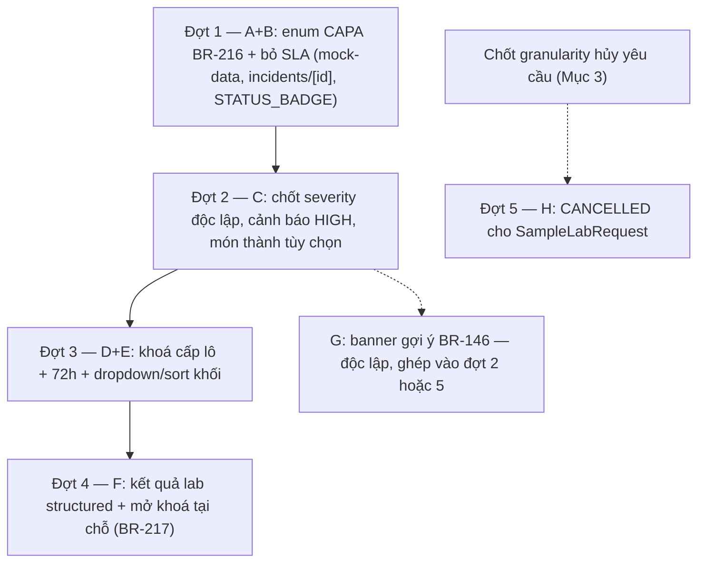

# Kế hoạch & Prompt — Bổ sung màn hình Medical Staff (Web) theo các quyết định đã chốt 20/07/2026

**Mục đích**: tổng hợp toàn bộ quyết định **đã chốt nhưng CHƯA áp code** từ 2 tài liệu nguồn thành 1 kế hoạch thực thi có thứ tự + bộ prompt sẵn dùng cho từng đợt áp dụng, phạm vi actor **Medical Staff** trong `03_Design/08_FrontEnd/Web`.

**Ngày lập**: 21/07/2026.

**Tài liệu nguồn** (căn cứ duy nhất — kế hoạch này KHÔNG thêm quyết định mới):
- `review/medical_staff/review_medicalstaff_incidentmanagement.md` — Mục 14 (CAPA đứt mạch, P0), Mục 15 (đính chính BR-146 + cảnh báo HIGH), Mục 16 (luồng CAPA chốt cuối, BR-216), Mục 17 (cách ly lô, thu hồi mẫu, mở khoá, BR-149 sửa + BR-217).
- `review/medical_staff/review_medicalstaff_to_servicecaterers.md` — bảng "Tổng hợp việc cần làm" #1–#7 (các mục đã chốt hoặc còn treo granularity).

**Trạng thái nguồn đã xác minh**: `business_rules.md` (BR-146/149/152/153/216/217, BR-215), `Report 3.md` UC-005/038/041/168/082, `00_Business_Workflows.md` Workflow 11 — **đã sửa xong tại nguồn 20/07/2026**. Phần còn lại là CODE (Web) và Screen Spec.

---

## 1. Phạm vi

### 1.1. Trong phạm vi (code Web — Medical Staff)

| # | Việc | Nguồn | Ưu tiên |
| --- | --- | --- | --- |
| A | Enum CAPA thống nhất BR-216 (`DRAFT → PENDING_ADMIN_APPROVAL → APPROVED_FOR_IMPLEMENTATION → IN_PROGRESS → SUBMITTED_EVIDENCE → COMPLETED`) — phía Medical Staff: soạn CAPA ở `DRAFT`, gửi duyệt, đánh giá hiệu quả khi `SUBMITTED_EVIDENCE` (đạt → `COMPLETED`; chưa đạt → trả về `IN_PROGRESS` kèm lý do, dùng lại đúng phương án đã duyệt) | Mục 16.3/16.5; to_SC #1 | **P0** |
| B | Bỏ `capaDeadline()`/SLA 12h khỏi code; hiển thị 2 timestamp thô (gửi CAPA / nộp bằng chứng), không cờ cảnh báo | Mục 16.4 (bảng loại); to_SC #7 | **P0** (đi cùng A) |
| C | Tách "Chốt mức độ nghiêm trọng": cảnh báo HIGH (toast + banner Emergency Response) bắn NGAY khi lưu severity, độc lập với chọn món; bỏ `selectedDishes.length > 0` khỏi `assessValid` (chọn món thành tùy chọn hoàn toàn) | Mục 15.2 + đính chính; Mục 17.2.1 | **P0** |
| D | Khoá cách ly ở CẤP LÔ, không theo món: tick món chỉ HIỂN THỊ bảng lô liên quan (mã lô · tên NL · kg còn lại · ngày nhập); Medical Staff tự tick từng lô — khoá tức thì không dialog; NHẢ lô giữ dialog + lý do (bất đối xứng giữ nguyên) | Mục 17.2.2/17.2.3, BR-149 sửa | **P1** |
| E | Danh sách món nghi vấn: gộp về 1 mốc 72h duy nhất (bỏ "mặc định 48h + Mở rộng phạm vi ngày"); sort theo khối lớp; đổi sang dropdown khi danh sách dài | Mục 17.2.4/17.2.5 | **P1** (đi cùng D) |
| F | Kết quả xét nghiệm lab: structured field — **Medical Staff** tải nhiều ảnh/PDF + 1 field kết luận (thay textarea tự do); panel món/lô đang khoá ngay tại màn nhập kết luận + mở khoá tại chỗ, lý do mở khoá TỰ ĐIỀN từ kết luận (BR-217) | Mục 17.2.6/17.2.7; to_SC #5 | **P1** |
| G | Thông báo gợi ý cụm ≥3 học sinh/24h ở tab "Chờ tiếp nhận" (BR-146 bản đính chính: hệ thống TỰ PHÁT HIỆN + gợi ý; gộp RPT/mở INC vẫn thủ công) | Mục 15.1 | **P2** |
| H | Trạng thái `CANCELLED` cho yêu cầu thu hồi mẫu (`SampleLabRequest`) + quy tắc mở khoá lại mẫu — **CHẶN bởi câu hỏi granularity** (xem Mục 3) | to_SC #6 | P2 (chờ chốt) |

### 1.2. Ngoài phạm vi (không làm trong kế hoạch này)

- Code `service-caterers/*` và `school-admin/*` — kể cả 2 file `corrective-actions` còn lại của enum BR-216. **Lưu ý phối hợp quan trọng**: nếu chỉ sửa phía Medical Staff, vòng đời CAPA sẽ LẠI đứt mạch (đúng lỗi P0 Mục 14.1) cho tới khi 2 vai trò kia được cập nhật cùng enum. Kế hoạch xử lý: phía Medical Staff ghi trạng thái mới kèm ghi chú tương thích; đợt review riêng của Service Caterers/School Admin phải áp cùng enum ngay sau đó (prompt số 5, Mục 4).
- Screen Spec (`26_IncidentDetail.md`, `14_RetrieveFoodSampleRecordsDialog.md`, `11/32/33` phía SC) + `class_diagram_description.md` — lượt áp docs riêng theo quy ước các vòng trước.
- Các đề xuất ĐÃ BỊ LOẠI ở Mục 16.4 (state `DISPUTED`, kênh phản hồi 2 bên, SLA cứng, nhiều CAPA/Incident…) — **không đưa lại** dưới bất kỳ hình thức nào.

---

## 2. Phân tích phụ thuộc & thứ tự đợt

Lý do thứ tự: (1) enum CAPA đổi trước vì C/D/F đều đụng `incidents/[id]/page.tsx` — đổi nền trạng thái trước tránh sửa chồng; (2) C trước D vì D thay đổi cấu trúc khối chọn món mà C nới validate của chính khối đó; (3) F sau D vì panel mở khoá tại chỗ (F) đọc danh sách lô do D tạo ra.

Ràng buộc dữ liệu cần chuẩn bị ở Đợt 3 (D): `DISH_BATCHES` hiện chỉ là `Record<dish, batchId[]>` — cần mở rộng mock (kg còn lại, ngày nhập, tên nguyên liệu theo lô — "lấy từ dữ liệu Service Caterers", đã có sẵn một phần trong `BATCH_INFO` của `incidents/[id]/page.tsx` và `SUPPLIER_BATCHES`); `Incident.suspectedDishIds`/`quarantineBatches` giữ nguyên tên field, chỉ đổi cách ghi (lô do người chọn, không suy từ món).

Quy ước nghiệm thu chung cho MỌI đợt (theo tiền lệ các vòng đã áp): `npx tsc --noEmit` sạch; không đổi BR/UC ngoài phạm vi đã chốt; mã BR/UC/QĐ chỉ nằm trong tooltip/comment, không nằm trong nhãn nút/tiêu đề; ghi status note "ĐÃ ÁP CODE + ngày" ngược vào đúng Mục nguồn của file review tương ứng.

---

## 3. Câu hỏi PHẢI chốt trước khi code (không tự quyết)

| # | Câu hỏi | Chặn việc | Nguồn |
| --- | --- | --- | --- |
| 1 | Hủy yêu cầu thu hồi mẫu nhiều món: hủy **toàn bộ yêu cầu** hay **từng dòng mẫu** (giữ các món còn lại)? | H (Đợt 5) | to_SC Mục 6 |
| 2 | Đợt 1 có sửa luôn 2 file `corrective-actions` của Service Caterers/School Admin cho liền mạch enum không, hay giữ đúng phạm vi Medical Staff và chấp nhận đứt mạch tạm thời? (to_SC #1/#3 ghi "có thể code ngay" cả 3 file — nhưng phạm vi các đợt trước luôn là Medical Staff) | A (Đợt 1) | to_SC #1/#3 |
| 3 | Mapping trạng thái Incident khi CAPA đổi enum: `CAPA_PENDING`/`CAPA_APPROVED` của Incident (Mục 7.5) ánh xạ sang mốc nào của enum CAPA mới (đề xuất: `CAPA_PENDING` = có CAPA `PENDING_ADMIN_APPROVAL`; `CAPA_APPROVED` = có CAPA từ `APPROVED_FOR_IMPLEMENTATION` trở đi; Section D mở khi CAPA `COMPLETED`)? Cần xác nhận vì Mục 16.3 không ghi tường minh ánh xạ này | A (Đợt 1) | Mục 16.3 vs 7.5 |

---

## 4. Bộ prompt sẵn dùng (copy nguyên văn cho từng đợt)

Các prompt viết theo đúng công thức đã dùng xuyên suốt dự án; mỗi prompt tự đủ ngữ cảnh — người thực thi phải đọc lại Mục nguồn trước khi sửa.

### Prompt Đợt 1 — Enum CAPA BR-216 + bỏ SLA (A+B)

> Dựa vào `03_Design\08_FrontEnd\Web\review\medical_staff\review_medicalstaff_incidentmanagement.md` **Mục 16** (luồng CAPA chốt cuối, BR-216) và `review_medicalstaff_to_servicecaterers.md` mục tổng hợp #1/#7, bạn hãy áp code phía **Medical Staff** trong `03_Design\08_FrontEnd\Web`:
> 1. `mock-data.ts`: đổi enum `CorrectiveAction.status` sang `DRAFT → PENDING_ADMIN_APPROVAL → APPROVED_FOR_IMPLEMENTATION → IN_PROGRESS → SUBMITTED_EVIDENCE → COMPLETED` (BR-216); cập nhật `STATUS_BADGE`; các giá trị cũ (`ASSIGNED/SUBMITTED/OVERDUE/APPROVED/REJECTED`) đánh dấu deprecated, chỉ giữ đọc dữ liệu cũ; cập nhật seed `CORRECTIVE_ACTIONS`; thêm 2 timestamp `submittedForApprovalAt`/`evidenceSubmittedAt` (hoặc tên tương đương) — KHÔNG có field deadline.
> 2. `medical-staff/incidents/[id]/page.tsx`: `establishMeasures()` tạo CAPA `DRAFT` rồi gửi duyệt (`PENDING_ADMIN_APPROVAL`) — làm rõ 1 hay 2 bước theo Mục 16.3; **bỏ `capaDeadline()`/hạn 12 giờ** và mọi chữ "SLA/hạn" trong nhãn; hiển thị 2 timestamp thô; khối đánh giá hiệu quả (thay validate UC-168 cũ): chỉ khả dụng khi CAPA `SUBMITTED_EVIDENCE`, "Đạt" → `COMPLETED`, "Chưa đạt" → trả về `IN_PROGRESS` kèm lý do bắt buộc (giữ nguyên phương án đã duyệt — dùng lại cơ chế `reworkReason`); gate Section D theo ánh xạ Incident↔CAPA đã chốt ở câu hỏi 3 Mục 3.
> 3. Nhắc lại ràng buộc: 1 Incident = 1 CAPA; KHÔNG thêm `DISPUTED`/kênh phản hồi (Mục 16.4 đã loại). `tsc --noEmit` phải sạch; ghi status note vào Mục 16.5.

### Prompt Đợt 2 — Cảnh báo HIGH độc lập + món tùy chọn (C, ghép G nếu tiện)

> Dựa vào `review_medicalstaff_incidentmanagement.md` **Mục 15.2 (kèm đính chính) và Mục 17.2 điểm 1**, bạn hãy áp code trong `03_Design\08_FrontEnd\Web` cho Medical Staff:
> 1. `incidents/[id]/page.tsx`: thêm bước "Chốt mức độ nghiêm trọng" lưu `severity` NGAY (bắn toast BR-148 + banner Emergency Response khi HIGH), độc lập hoàn toàn với việc chọn món; bỏ `selectedDishes.length > 0` khỏi `assessValid` — chọn món nghi vấn thành tùy chọn; cập nhật checklist "Việc cần hoàn tất" và CTA sticky bar tương ứng.
> 2. (Tuỳ chọn, Mục 15.1 — BR-146 bản đính chính) `incidents/page.tsx` tab "Chờ tiếp nhận": thêm banner tự phát hiện cụm ≥3 học sinh/24 giờ và GỢI Ý gộp — tuyệt đối không tự gộp/tự mở INC thay người dùng.
> 3. Không đảo lại quyết định "4 việc song song hoàn toàn" (đã loại ở Mục 15.2). `tsc --noEmit` sạch; ghi status note vào Mục 15.

### Prompt Đợt 3 — Khoá cấp lô + 72h + dropdown (D+E)

> Dựa vào `review_medicalstaff_incidentmanagement.md` **Mục 17.2 điểm 2–5 và 17.3** (BR-149 sửa), bạn hãy áp code trong `03_Design\08_FrontEnd\Web` cho Medical Staff:
> 1. `mock-data.ts`: mở rộng dữ liệu lô nguyên liệu theo món (mã lô · tên nguyên liệu · khối lượng còn lại · ngày nhập — đối chiếu `SUPPLIER_BATCHES`/`BATCH_INFO` sẵn có, không bịa cấu trúc mới nếu tái dùng được).
> 2. `incidents/[id]/page.tsx` Section B: tick món chỉ HIỂN THỊ bảng lô liên quan — không tự khoá; Medical Staff tick từng lô cụ thể → khoá tức thì (không dialog); NHẢ lô giữ nguyên dialog + lý do bắt buộc + `quarantineReleaseLog`; danh sách món gộp về 1 mốc 72h duy nhất (bỏ state `expandRange` + nút "Mở rộng phạm vi ngày"), sort theo khối lớp, dùng dropdown khi danh sách dài.
> 3. Đối chiếu chuỗi truy xuất ở card "Liên quan" vẫn đúng theo lô đã khoá. `tsc --noEmit` sạch; ghi status note vào Mục 17.4.

### Prompt Đợt 4 — Kết quả lab structured + mở khoá tại chỗ (F)

> Dựa vào `review_medicalstaff_incidentmanagement.md` **Mục 17.2 điểm 6–7, 17.3 bước 6–7** (BR-217) và `review_medicalstaff_to_servicecaterers.md` Mục 5, bạn hãy áp code trong `03_Design\08_FrontEnd\Web` cho Medical Staff:
> 1. `mock-data.ts`: `Incident` thêm field kết quả lab structured — nhiều ảnh/PDF (`UploadedFile[]`, tái dùng type sẵn có) + 1 field kết luận; giữ `investigationLabResult` cũ đọc được cho dữ liệu cũ.
> 2. `incidents/[id]/page.tsx` tab "Nguyên nhân gốc rễ": **Medical Staff** tải file kết quả (không phải Service Caterers — 2 sự kiện bàn giao vs nhận kết quả là khác nhau); ngay tại màn nhập kết luận hiển thị panel món/lô đang khoá + thao tác mở khoá tại chỗ; lý do mở khoá TỰ ĐIỀN từ field kết luận, không bắt gõ lại (BR-217); thông báo Service Caterers khi lô được mở.
> 3. `tsc --noEmit` sạch; ghi status note vào Mục 17.4.

### Prompt Đợt 5 — Hủy yêu cầu thu hồi mẫu (H — CHỈ chạy sau khi chốt granularity)

> (Tiền đề: đã chốt câu hỏi granularity ở `review_medicalstaff_plan.md` Mục 3 #1.) Dựa vào `review_medicalstaff_to_servicecaterers.md` **Mục 6**, bạn hãy áp code trong `03_Design\08_FrontEnd\Web` cho Medical Staff: thêm trạng thái `CANCELLED` cho `SampleLabRequest` + hành động hủy kèm lý do bắt buộc (audit), chỉ khi Service Caterers chưa xác nhận gửi lab; mở khoá lại các mẫu lưu tương ứng theo granularity đã chốt; `tsc --noEmit` sạch; ghi status note vào file review foodsamples/to_servicecaterers.

### Prompt phối hợp (ngoài phạm vi Medical Staff — bàn giao cho vòng review Service Caterers/School Admin)

> Dựa vào `review_medicalstaff_to_servicecaterers.md` (toàn bộ) và `review_medicalstaff_incidentmanagement.md` Mục 16, bạn hãy áp enum CAPA BR-216 cho `service-caterers/corrective-actions/page.tsx` (hiển thị CAPA từ `APPROVED_FOR_IMPLEMENTATION`, hành động "Xem + Accept" → `IN_PROGRESS`, nộp ảnh trực tiếp + ghi chú → `SUBMITTED_EVIDENCE`; KHÔNG có nhánh từ chối) và `school-admin/corrective-actions/page.tsx` (duyệt kế hoạch `PENDING_ADMIN_APPROVAL` → `APPROVED_FOR_IMPLEMENTATION`, từ chối kèm lý do → về `DRAFT`); đồng thời màn xác nhận gửi lab của Service Caterers theo `review_medicalstaff_foodsamples.md` Mục 6.

---

## 5. Rủi ro & lưu ý nhất quán

1. **Đứt mạch CAPA tạm thời** giữa Đợt 1 và prompt phối hợp — hạn chế bằng cách chạy 2 việc này sát nhau; trong thời gian chuyển tiếp, seed mock nên có CAPA ở đủ các trạng thái mới để cả 3 màn kiểm thử được.
2. **`assessValid` được nhiều nơi tham chiếu** (sticky CTA, checklist, nút Section B) — Đợt 2 phải rà cả 3 chỗ, không chỉ hàm validate.
3. **Không hồi sinh cơ chế đã bỏ**: SLA/hạn giờ (Mục 16.4), `DISPUTED`, "Mở rộng phạm vi ngày" (sau Đợt 3), khoá-theo-món (sau Đợt 3). Khi viết code mới, kiểm tra grep các từ khoá này để dọn hết tàn dư.
4. **Tương thích dữ liệu cũ**: mọi đổi enum/field đều giữ nhánh đọc giá trị cũ (tiền lệ `RETRIEVED`, `signedRecordPhoto`) — không migrate phá seed.
5. Sau khi xong Đợt 1–4, cần 1 lượt **áp docs** gom: Screen Spec `26`/`14`, class diagram (enum CAPA), và nợ Screen Spec tích luỹ từ các vòng trước (đã liệt kê trong các file review tương ứng).

---

**Trạng thái file này**: kế hoạch + prompt, KHÔNG phải quyết định mới — mọi xung đột (nếu phát hiện khi thực thi) xử lý theo tài liệu nguồn và hỏi lại người dùng trước khi code (đúng nguyên tắc "ask before assuming" của dự án).
