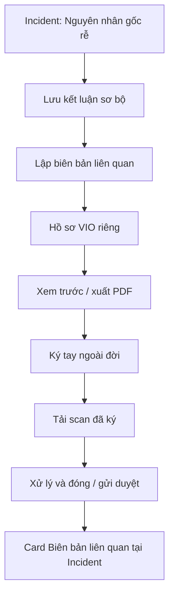

# Review — Thiết kế lại module Quản lý Vi phạm (Violations) theo Master–Detail + Document-centric Workflow — Medical Staff

**Mục đích**: ghi lại các vấn đề đã verify trên code thật của `violations/page.tsx` và các quyết định thiết kế lại đã xác nhận, áp dụng cùng nguyên tắc List (Sổ vi phạm) → Detail (Hồ sơ VIO, sửa/hoàn tất tại chỗ) → Export/Lưu PDF đã dùng cho Incident Management (`review_medicalstaff_design_pattern.md`). Không đổi bất kỳ BR/UC nào — riêng 1 đề xuất đảo ngược BR-183/BR-211 đã được nêu, cân nhắc, và **bị bác bỏ** (xem Mục 4).

**Ngày biên soạn**: 19/07/2026.

**Nguồn đã đọc/tra cứu để biên soạn**:
- `03_Design/08_FrontEnd/Web/src/app/(app)/medical-staff/violations/page.tsx` (đọc toàn bộ, 913 dòng)
- `02_Requirements/00_BusinessRules/business_rules.md` §18 — BR-183, BR-184, BR-185, BR-186, BR-187, BR-188, BR-189, BR-190, BR-211
- `03_Design/05_ScreenSpecifications/Web/MedicalStaff/22_RecordStaffViolation.md`
- `02_Requirements/Violation_Management_Proposal.md` (đề xuất gốc, 01/07/2026)
- `00_Policies/specialreport2173_1.md` (mẫu Biên bản Sự việc — căn cứ field PDF)
- `review/medical_staff/review_medicalstaff_incidentmanagement.md` Mục 11.5.1–11.5.4 (liên kết Incident↔Violation đợt 2), Mục 12.2 (bỏ nút Export mơ hồ — tiền lệ áp dụng lại ở đây)

---

## 1. Bối cảnh

Người dùng đưa ra thiết kế lại module Violations theo cùng triết lý Master–Detail + Document-centric đã dùng cho Incident Management, dựa trên nhận xét: công việc lập biên bản có bước in giấy, ký tay, và quay lại hệ thống sau nhiều giờ/ngày — không phù hợp với chuỗi dialog hiện tại (vốn giả định thao tác liền mạch trong 1 phiên). Toàn bộ vấn đề nêu ra đã được verify trực tiếp trên code trước khi ghi nhận (không nhận diện qua suy luận).

### 1.1. Vấn đề của thiết kế hiện tại (đã verify đúng 100% với code)

| # | Vấn đề | Bằng chứng code |
| --- | --- | --- |
| 1 | Lập biên bản, xem chi tiết, xuất PDF, tải ảnh ký, xử lý đều là `Dialog` — không phù hợp hồ sơ phải quay lại nhiều lần | Dòng 588 (`dialog === "record"`), 717 (`detailTarget`), 811 (`dialog === "resolution"`) |
| 2 | `saveRecord()` sau khi lưu chuyển thẳng sang dialog "Lập xử lý" — sai thời điểm, vì thực tế còn phải xuất/in/ký/tải scan trước | Dòng 315: `setDialog("resolution")` ngay trong `onSuccess` của `saveRecord()` |
| 3 | "Ảnh bằng chứng" và "ảnh biên bản ký" chỉ là counter/boolean giả, chưa phải upload file thật (không preview, không tên file) | Dòng 700 (`setPhotos((p) => p + 1)`), dòng 789-790 (`update.mutate({ signedRecordPhoto: true })`) |
| 4 | Bảng danh sách có 11 cột, "Xử lý" và "Trạng thái" nằm cạnh nhau gây trùng lặp/cuộn ngang | Mảng `columns` dòng 357-438 |
| 5 | Xuất PDF gọi `window.print()` ngay khi mở, không có bước "Xem trước" hay bản PDF lưu lại được | Hàm `exportRecordPdf()` dòng 86-118, `window.onload = () => window.print()` dòng 116 |
| 6 | Tham số `?incident=...` dùng chung cho cả tạo mới và xem — bất kỳ link nào trỏ tới với mục đích "xem" sẽ vô tình mở form tạo mới | Dòng 259-263: `useEffect` chỉ có nhánh `if (incidentParam) openRecordDialog(incidentParam)`, không có nhánh "view" |

### 1.2. Điểm đã xác nhận là đúng hiện trạng (không phải vấn đề mới)

Cơ chế 3 chữ ký (Y tế trường học / Nhà thầu / Người làm chứng) đã đúng BR-211 hiện có: không có field `witnessId`, PDF giữ cột chữ ký thứ 3 để trống tĩnh, hệ thống chỉ yêu cầu upload ít nhất 1 file scan hợp lệ, không kiểm chứng chữ ký — trách nhiệm kiểm tra đủ chữ ký thuộc Medical Staff (người tải lên). Đã đối chiếu và xác nhận khớp `business_rules.md` BR-211 dòng 762 nguyên văn — không có thay đổi nào ở điểm này.

---

## 2. Thiết kế đề xuất

### 2.1. Cấu trúc route

| Route | Vai trò |
| --- | --- |
| `/violations` | Sổ vi phạm — chỉ tìm, lọc, chọn hồ sơ |
| `/violations/new` | Lập biên bản (thay dialog "record" hiện tại) |
| `/violations/[id]` | Hồ sơ biên bản — xem, xuất PDF, tải scan, xử lý, theo dõi duyệt (gộp 3 dialog record-detail/resolution hiện tại) |
| `/violations/reports` | Danh sách/soạn báo cáo định kỳ (thay panel "compose" tại chỗ hiện tại) |

Khi bấm 1 dòng trong Sổ vi phạm → mở trang Hồ sơ `/violations/[id]`, không mở modal. Sửa dứt điểm bug 1.1 mục 6: route tạo (`/violations/new?incidentId=...`) và route xem (`/violations/[id]`) tách biệt hoàn toàn — không còn dùng chung 1 query param cho 2 mục đích khác nhau.

### 2.2. Thanh tiến trình & CTA theo trạng thái

`Đã lập` → `Chờ xuất PDF` → `Chờ ký` → `Đã tải bản ký` → `Chờ xử lý/duyệt` → `Đã đóng`. Chỉ 1 CTA chính hiển thị theo bước hiện tại:

| Trạng thái | CTA chính |
| --- | --- |
| Đã lập | Xem trước & xuất PDF |
| Đã xuất PDF | Tải scan biên bản đã ký |
| Đã tải scan | Nhập xử lý và đóng / Gửi duyệt |
| Chờ School Administration duyệt | Xem tiến độ duyệt |
| Đã đóng | Xem hồ sơ, PDF và scan |

PDF trở thành "tài liệu sinh ra" (version, thời điểm sinh, xem trước, tải lại, in) thay vì field nhập; có bước Xem trước trước khi in, thay vì gọi `window.print()` trực tiếp.

### 2.3. Field — giữ / điều chỉnh / bỏ khỏi UI chính

| Nhóm field | Quyết định |
| --- | --- |
| Địa điểm, thời điểm, đại diện Y tế (tự động), đại diện Nhà thầu | Giữ nguyên — dữ liệu tạo văn bản chính thức |
| Nhân viên liên quan, chức vụ | Giữ dạng progressive disclosure (đã đúng hiện tại) — không đổi thành select vì chưa có entity nhân viên bếp |
| Mức độ nghiêm trọng | Giữ bắt buộc — quyết định luồng đóng/duyệt (BR-186) |
| Loại vi phạm (`violationType`) | Giữ là phân loại phụ có cấu trúc (Select, không phải text tự do); đổi nhãn hiển thị thành "Nhóm hành vi (nếu áp dụng)" để rõ vì sao có thể bỏ trống |
| Liên kết Incident (`relatedIncidentId`) | Giữ, hiển thị read-only khi mở từ ngữ cảnh Incident — không cho nhập lại mã |
| Nội dung biên bản | Giữ 1 field, thêm template gợi ý trong editor ("Diễn biến" / "Hành vi vi phạm" / "Bằng chứng"); rút gọn toolbar rich text — chỉ đậm/nghiêng/gạch chân/list, bỏ bảng/màu chữ/link (an toàn cho văn bản pháp lý, mock hiện tại đã gần đúng hướng này) |
| Ảnh bằng chứng | Đổi thành upload thực: preview, tên file, thời điểm tải, xoá trước khi lưu — thay counter giả hiện tại |
| PDF biên bản | Không là field nhập — là tài liệu sinh ra kèm version/thời điểm/xem trước/tải/in |
| Ảnh/scan biên bản ký | Đổi `signedRecordPhoto` (boolean) thành file/artifact thật, hỗ trợ nhiều ảnh hoặc PDF nhiều trang, có preview |
| Hành động xử lý, hình thức kỷ luật | Giữ nguyên field, nhưng chuyển sang bước "Xử lý & đóng" **sau khi** đã tải bản ký — không mở ngay sau Save như hiện tại (sửa vấn đề 1.1 mục 2) |
| Mã BR/UC/MSG trong label | Bỏ khỏi UI thường ngày (VD cột "Loại (BR-189, tự phân loại)", nút "Save Violation (MSG-086)") — chuyển vào `title` tooltip, đúng quy tắc đã áp cho Incident Management (Mục 12.2/13 Mục 8 của `review_medicalstaff_incidentmanagement.md`/`review_medicalstaff_design_pattern.md`) |
| Cột "Xử lý" + "Trạng thái" | Gộp thành 1 cột "Việc cần làm/Trạng thái hồ sơ" |

### 2.4. Giao diện Sổ vi phạm

Bảng chỉ còn: `Mã`, `Nội dung/đối tượng`, `Mức độ`, `Bước hiện tại`, `Ngày lập`, `Sự cố liên quan`, `Chi tiết` (loại bỏ cuộn ngang so với 11 cột hiện tại). Filter chính: tìm kiếm, mức độ, bước hiện tại, khoảng ngày, sự cố liên quan; "Loại vi phạm" chuyển thành filter mở rộng (không phải cột chính).

**Phạm vi hiển thị (đã xác nhận với người dùng)**: Sổ vi phạm tiếp tục hiển thị **cả 2 loại** vi phạm (quy trình và nhân viên) — không tách riêng, không thu hẹp phạm vi. Bổ sung thêm: mỗi VIO nguồn gốc từ `NonConformanceRecord` (BR-183, phát hiện qua checklist/kiểm thực 3 bước) hiển thị link/tham chiếu ngược tới bản ghi checklist/inspection gốc đã "nâng cấp" thành biên bản đó — cải tiến traceability, không phải thay đổi nghiệp vụ.

### 2.5. Báo cáo định kỳ

Tách hẳn khỏi vòng đời từng biên bản — không phải bước cuối của 1 VIO cụ thể (đúng hiện trạng code, panel "compose" đã tách sẵn, chỉ cần chuyển sang route `/violations/reports`). Báo cáo tổng hợp mọi vi phạm trong kỳ, tách rõ đã đóng/đã duyệt vs đang chờ ký/chờ duyệt, theo mức độ/loại/tái diễn. Không cho sửa tay số liệu tổng hợp hay danh sách nhân viên dedup — chỉ cho sửa phần "Nhận định/khuyến nghị"; số liệu và danh sách VIO phải tự tính kèm snapshot các mã VIO đã đưa vào báo cáo (khác hiện trạng: `composeSummary`/`composeStaff` hiện đang cho sửa tay tự do, dòng 140-141, cần khoá lại phần số liệu core, chỉ mở phần nhận định).

### 2.6. Liên kết Incident ↔ Violation



Tại tab "Nguyên nhân gốc rễ" (Section C của `26_IncidentDetail.md`), thêm 1 block ngay dưới kết luận:
- Chưa có bản ghi: "Chưa có biên bản liên quan" + CTA chính **Lập biên bản liên quan**.
- Có 1 bản ghi: hiện `VIO-xxx · <trạng thái>` + nút **Xem hồ sơ**.
- Có nhiều bản ghi: danh sách ngắn các VIO + trạng thái + **Quản lý biên bản (n)**.
- Luôn giữ nút phụ **+ Lập biên bản khác** (1 sự cố có thể dẫn tới nhiều sai phạm/nhiều nhân viên).

**Quyết định đã xác nhận (không cồng kềnh hoá theo kết luận Root Cause)**: nút "Lập biên bản vi phạm nhân viên" **luôn hiển thị** tại tab Root Cause, không phụ thuộc kết luận hiện tại là quy trình hay nhân viên — không dùng UI để khoá quyền phán đoán nghiệp vụ của Medical Staff. Ràng buộc dữ liệu:
- Nút là CTA phụ, luôn hiện.
- Mở form chỉ tạo `StaffViolationRecord`; không có đường nào từ đây tạo "vi phạm quy trình".
- `relatedIncidentId` tự gắn Incident hiện tại, chỉ đọc.
- Banner ngắn: "Biên bản này ghi nhận hành vi nhân viên liên quan đến INC-xxx; không thay thế CAPA."
- Nếu chưa đủ căn cứ, Medical Staff chỉ đóng form — hệ thống không chặn từ trước.
- Sau khi có bản ghi: Card "Biên bản nhân viên liên quan (n)" hiện mã + trạng thái, CTA chính đổi thành Xem/Quản lý biên bản, vẫn giữ CTA phụ "+ Lập biên bản nhân viên khác".

Route điều hướng khi lập biên bản liên quan:
```
/medical-staff/violations/new
  ?incidentId=INC-2026-016
  &returnTo=/medical-staff/incidents/INC-2026-016?section=C&tab=root-cause
```
Chỉ `incidentId` tự gắn và read-only; địa điểm/thời điểm/nội dung **không copy cứng** từ Incident (có thể sai ngữ cảnh) — chỉ đưa thành gợi ý để Medical Staff tự xác nhận. Sau khi lưu, điều hướng tới `/violations/VIO-xxx` (không nhảy sang "Xử lý sai phạm" ngay — đúng sửa đổi Mục 2.2). "Quay lại điều tra" dùng lại đúng convention anchor `?section=C&tab=root-cause` đã có (Mục 11.5.2 `review_medicalstaff_incidentmanagement.md`). Card liên kết tại Incident chỉ hiển thị tiến độ VIO, không đổi state Incident, không chặn CAPA.

---

## 3. Quyết định đã xác nhận (19/07/2026)

1. Chuyển đổi kiến trúc dialog-chain → Master–Detail (route `/violations`, `/violations/new`, `/violations/[id]`, `/violations/reports`), theo đúng cấu trúc Mục 2.1.
2. Tách bước "Xuất PDF/ký/tải scan" ra khỏi luồng "Lập xử lý" — chỉ mở "Xử lý & đóng" sau khi đã có `signedRecordPhoto` thật (file, không phải boolean).
3. "Ảnh bằng chứng" và "ảnh biên bản ký" chuyển thành upload file thật, có preview — thay thế 2 cơ chế counter/boolean giả hiện tại.
4. Gộp cột "Xử lý" + "Trạng thái" thành 1 cột duy nhất; rút bảng Sổ vi phạm còn 7 cột theo Mục 2.4; mã BR/UC/MSG chuyển vào tooltip, bỏ khỏi label chính.
5. Nút "Lập biên bản vi phạm nhân viên" tại tab Root Cause của Incident **luôn hiển thị**, không ẩn/hiện theo kết luận nguyên nhân gốc rễ hiện tại — theo đúng ràng buộc dữ liệu ở Mục 2.6.
6. Tách route tạo (`/violations/new?incidentId=`) và xem (`/violations/[id]`) — sửa dứt điểm bug dùng chung `?incident=` hiện tại (dòng 259-263).
7. Báo cáo định kỳ: khoá phần số liệu/danh sách tự tính (kèm snapshot mã VIO), chỉ cho sửa tay phần "Nhận định/khuyến nghị".
8. **Không đổi BR-183/184/211**: biên bản/PDF/ký tay 3 bên tiếp tục áp dụng cho **cả 2 loại** vi phạm (quy trình và nhân viên), cơ chế tự phân loại theo `staffName` rỗng/không rỗng giữ nguyên. Một đề xuất đảo ngược (chỉ nhân viên mới cần biên bản) đã được nêu, đối chiếu với `Violation_Management_Proposal.md` gốc (01/07/2026 — UC-178 vốn đã thiết kế riêng cho vi phạm quy trình từ đầu) và với chính BR-183/211 đã chốt 2 lần (06/07, 11/07/2026), sau đó **bị người dùng bác bỏ** — giữ nguyên hiện trạng, chỉ giảm thủ tục UI (Mục 2.1-2.5), không đổi phạm vi áp dụng biên bản.
9. Sổ vi phạm tiếp tục hiển thị cả 2 loại vi phạm (không thu hẹp phạm vi); bổ sung link/tham chiếu ngược tới checklist/kiểm thực 3 bước gốc cho các VIO nguồn gốc quy trình (traceability, không phải thay BR).

---

## 4. Vấn đề đã cân nhắc và bác bỏ (ghi nhận để không bị hỏi lại)

**Đề xuất**: chỉ vi phạm nhân viên (BR-184) mới cần biên bản/PDF/ký tay; vi phạm quy trình (BR-183) đi thẳng qua `CorrectiveActionRequest`/CAPA, không lập VIO, không PDF, không ký tay. Lý do khi đề xuất: vi phạm quy trình đã có nguồn dữ liệu riêng (checklist hàng ngày do Medical Staff tự kiểm tra, báo cáo kiểm thực 3 bước do Service Caterers nộp).

**Đối chiếu**: `Violation_Management_Proposal.md` (đề xuất gốc, 01/07/2026) đã thiết kế UC-178 "Record Process Violation" độc lập ngay từ đầu, đúng với mục đích hình thức hoá biên bản cho vi phạm quy trình — không phải một bổ sung phát sinh sau. BR-183/BR-211 sau đó xác nhận lại 2 lần (06/07: gate PDF+ký cho cả 2 loại; 11/07: gộp UI thành 1 dialog vì mẫu giấy thật không phân biệt 2 loại) với lý do rõ ràng trong `business_rules.md`.

**Kết luận đã chốt với người dùng**: đây là một đảo ngược chính sách thật sự, không phải sửa lỗi thiết kế — và **không được áp dụng**. BR-183/184/211 giữ nguyên như hiện có. Mục 2.1-2.9 (Quyết định đã xác nhận) của file này **không bao gồm** thay đổi phạm vi biên bản theo loại vi phạm.

---

## 5. Checklist thay đổi cần áp dụng theo file

| File / Component | Thay đổi cần áp dụng | Trạng thái |
| --- | --- | --- |
| `22_RecordStaffViolation.md` | Cập nhật Platform Layout Web: mô tả route `/violations/new` thay vì Dialog; toolbar rich text rút gọn (đậm/nghiêng/gạch chân/list); template gợi ý nội dung biên bản | CHƯA áp |
| `27_ViolationRegistry.md` (nếu tồn tại) / mô tả Sổ vi phạm | Bảng còn 7 cột theo Mục 2.4; gộp cột Xử lý+Trạng thái; thêm link ngược checklist/kiểm thực 3 bước cho VIO gốc quy trình | CHƯA áp |
| `24_RecordViolationResolution.md` | Mô tả bước "Xử lý & đóng" chỉ mở sau khi đã tải bản ký thật (không phải boolean); giữ nguyên gate BR-211 | CHƯA áp |
| `17_InvestigationWorkspace.md` / `26_IncidentDetail.md` (tab Root Cause) | Thêm mô tả block "Biên bản liên quan" theo Mục 2.6 (CTA luôn hiện, banner, card trạng thái) | CHƯA áp |
| `violations/page.tsx` | Tách route `/violations`, `/violations/new`, `/violations/[id]`, `/violations/reports`; sửa `saveRecord()` không tự `setDialog("resolution")`; đổi `photos`/`signedRecordPhoto` sang file thật; gộp cột bảng; sửa `useEffect` dòng 259-263 tách nhánh tạo/xem; `exportRecordPdf()` thêm bước xem trước trước khi in; khoá số liệu `composeSummary` core, chỉ mở phần nhận định | CHƯA áp |
| `incidents/[id]/page.tsx` (tab Root Cause) | Thêm nút "Lập biên bản vi phạm nhân viên" luôn hiển thị (CTA phụ) + card "Biên bản nhân viên liên quan (n)" theo Mục 2.6 | CHƯA áp |

**Trạng thái chung**: toàn bộ quyết định ở Mục 3 đã chốt qua trao đổi trực tiếp — ~~chưa áp code~~ → **ĐÃ ÁP CODE 19/07/2026, xem Mục 6**; phần Screen Spec (`22`/`27`/`24`/`17`/`26`) vẫn CHƯA áp, chờ lượt docs riêng.

---

## 6. Trạng thái áp dụng — ĐÃ ÁP CODE 19/07/2026 (`tsc --noEmit` sạch)

| QĐ (Mục 3) | File code | Chi tiết đã áp |
| --- | --- | --- |
| 1 + 6 — Master–Detail 4 route | `violations/page.tsx` (viết lại), `violations/new/page.tsx` (MỚI), `violations/[id]/page.tsx` (MỚI), `violations/reports/page.tsx` (MỚI), `lib/violation-utils.ts` (MỚI) | Sổ vi phạm chỉ tìm/lọc/chọn (click dòng → trang hồ sơ, không modal); route TẠO `/violations/new?incidentId=` tách hẳn route XEM `/violations/[id]` — `?incident=` ở Sổ vi phạm nay chỉ để LỌC, không mở form tạo (sửa dứt điểm bug Mục 1.1 #6); hằng số/PDF builder/`stepOf()` tách ra `lib/violation-utils.ts` dùng chung |
| 2 — tách bước ký khỏi luồng xử lý | `violations/new/page.tsx`, `violations/[id]/page.tsx` | Sau khi lưu biên bản điều hướng tới HỒ SƠ VIO (không mở "Lập xử lý" như `setDialog("resolution")` cũ); khối "Xử lý & đóng" chỉ mở khi đã có bản ký thật, chưa có thì hiện Alert nhắc (gate MSG-095/BR-211 giữ nguyên) |
| 3 — upload file thật | `mock-data.ts`, cả 2 route form/hồ sơ | Thêm `UploadedFile` + `ViolationRecord.evidenceFiles` / `signedRecordFiles` / `pdfGeneratedAt` / `pdfVersion` / `sourceInspectionId`; UI hiện tên tệp, kích thước, thời điểm, xoá được (bản ký hỗ trợ nhiều tệp); `evidencePhotos`/`signedRecordPhoto` giữ lại và vẫn đọc được cho bản ghi cũ (helper `evidenceCount`/`hasSignedScan`) |
| 4 — bảng 7 cột, gộp trạng thái, bỏ mã BR khỏi nhãn | `violations/page.tsx` | Cột: Mã · Nội dung/đối tượng (kèm badge loại + "Tái diễn?") · Mức độ · **Bước hiện tại** (gộp Xử lý + Trạng thái qua `stepOf()`) · Ngày lập · Sự cố liên quan · Chi tiết; "Loại vi phạm" hạ xuống bộ lọc mở rộng; mã BR/UC/MSG chuyển hết vào `title` |
| 5 + Mục 2.6 — block "Biên bản liên quan" | `incidents/[id]/page.tsx` (tab Nguyên nhân gốc rễ) | CTA lập biên bản LUÔN hiển thị (không ẩn theo kết luận root cause); danh sách VIO liên quan kèm trạng thái + nút "Quản lý biên bản (n)" + nút phụ "Lập biên bản nhân viên khác"; link `/violations/new?incidentId=…&returnTo=…?section=C&tab=root-cause`; banner "không thay thế CAPA" hiện ở route tạo |
| 7 — báo cáo định kỳ khoá số liệu | `violations/reports/page.tsx`, `report-center/page.tsx` | Route riêng thay panel "compose" tại chỗ; số liệu theo loại/mức độ/tiến độ + danh sách nhân viên + câu tổng hợp là TỰ TÍNH, hiển thị đọc (bỏ 2 ô sửa tay `composeSummary`/`composeStaff` cũ), chỉ còn ô "Nhận định/khuyến nghị"; snapshot bảng VIO trong kỳ + `violationIds` gửi kèm; card hub Report Center deep-link sang route mới |
| 9 — traceability nguồn gốc | `violations/[id]/page.tsx`, `mock-data.ts` | Card "Nguồn gốc & liên kết" hiện sự cố liên quan + **bản ghi kiểm thực/checklist gốc** (`sourceInspectionId`, seed mẫu `INSP-20260630-L` cho VIO-2026-008) + tổng số tệp bằng chứng/bản ký |
| Mục 2.2 — PDF là tài liệu sinh ra | `violations/[id]/page.tsx`, `lib/violation-utils.ts` | Tách `buildRecordHtml()` (dựng) khỏi `printRecord()` (in): hồ sơ hiển thị bản XEM TRƯỚC ngay trong app, có version + thời điểm tạo, nút "Tạo lại bản PDF" và "In / Lưu PDF" riêng — thay `window.print()` gọi thẳng khi mở cửa sổ |
| Mục 2.2 — thanh tiến trình + 1 CTA | `violations/[id]/page.tsx` | Sticky bar 5 bước (Chờ xuất PDF → Chờ ký & tải bản ký → Chờ nhập xử lý → Chờ School Admin duyệt → Đã đóng) + đúng 1 CTA chính theo bước; bước chờ duyệt hiện ghi chú thay nút |

Ghi chú: BR-183/184/211 **không đổi** — biên bản/PDF/ký 3 bên vẫn áp dụng cho cả 2 loại vi phạm (QĐ 8, đề xuất thu hẹp đã bị bác bỏ ở Mục 4); upload vẫn là mock (chưa có backend lưu tệp thật) — đúng giới hạn giai đoạn prototype đã ghi nhận ở review design pattern Mục 10.3.

---

## 7. Vòng rà soát thứ 2 (19/07/2026, sau khi áp code) — bỏ trùng lặp "Xem trước" trong trang Hồ sơ VIO. **Lỗi do tôi gây ra khi viết Mục 2.2 — đã nhận và sửa.**

### 7.1. Bối cảnh

Người dùng gửi ảnh chụp trang `/violations/[id]` thật (sau khi Mục 6 đã áp code) và chỉ ra: card "Hồ sơ" đầu trang đã hiển thị đủ dữ liệu (địa điểm, đại diện, nội dung, ảnh bằng chứng), nhưng nút "Xem trước" ở khối "Bản in biên bản (PDF)" lại dựng thêm 1 bản HTML **ngay trong cùng trang** (`buildRecordHtml(v)`, dòng 267-272 bản cũ) — lặp lại đúng những dữ liệu đó dưới dạng văn bản có quốc hiệu/chữ ký. "Chỉ cần 1 file PDF thôi", không cần xem 2 lần trên cùng 1 trang.

Đây là lỗi của tôi khi viết Mục 2.2 ("PDF là tài liệu sinh ra... có bước Xem trước trong app") — không lường trước việc render inline sẽ trùng với card hồ sơ đã có sẵn ngay phía trên.

Người dùng làm rõ hướng sửa: **không bỏ hẳn "Xem trước"**, nhưng không hiển thị nguyên khối trùng lặp ngay trong trang — "Xem trước" nên đơn thuần là xem trước **file PDF** trước khi in, tách khỏi luồng đọc dữ liệu của trang Hồ sơ.

### 7.2. Quyết định

Tách "Xem trước" ra khỏi trang, mở ở **tab/cửa sổ riêng** (giữ nguyên `buildRecordHtml()`/CSS in, chỉ đổi nơi hiển thị) — không tự động gọi `window.print()`. "In / Lưu PDF" vẫn là hành động riêng, dùng lại đúng nội dung đó rồi in ngay. Cửa sổ mới đóng vai trò bản xem trước thật (người dùng tự thấy đúng bố cục văn bản trước khi quyết định in), không còn bản sao nằm lẫn trong luồng đọc của trang Hồ sơ.

### 7.3. Áp dụng — ĐÃ ÁP CODE 19/07/2026 (`tsc --noEmit` sạch)

| File | Thay đổi |
| --- | --- |
| `lib/violation-utils.ts` | Tách `openRecordWindow()` dùng chung; thêm `previewRecord()` (mở tab, chỉ xem, không in) — thay cho việc export `buildRecordHtml`/`RECORD_PRINT_CSS` ra ngoài để trang tự render; `printRecord()` giữ nguyên hành vi (mở tab + in) nhưng dùng lại `openRecordWindow()` |
| `violations/[id]/page.tsx` | Bỏ state `previewOpen` và khối `dangerouslySetInnerHTML={{ __html: buildRecordHtml(v) }}` render trong trang; nút "Xem trước" gọi `previewRecord(v)` mở tab mới; bỏ import `buildRecordHtml`/`RECORD_PRINT_CSS` (không còn dùng trực tiếp trong trang) |

**Trạng thái**: đã áp trực tiếp trong review này, không còn chờ lượt riêng.

**Bổ sung ngay sau (cùng ngày)**: đổi nhãn 2 nút cho gọn và song song đúng như người dùng chỉ định — "Xem trước (tab mới)" → **"Xem trước biên bản"**; "In / Lưu PDF" / "In lại (tạo bản mới)" (2 biến thể theo state) → **"In biên bản (PDF)"** cố định, không đổi theo trạng thái (badge "Đã tạo v{n}" bên cạnh đã đủ thể hiện trạng thái, không cần nhãn nút thay đổi theo).

---

## 8. Vòng rà soát thứ 3 (19/07/2026, ngay sau Mục 7) — gộp "Tạo (lại) bản PDF" vào "In / Lưu PDF", còn đúng 2 nút. **Redundancy do chính bản sửa ở Mục 7 gây ra — đã nhận và sửa tiếp.**

### 8.1. Bối cảnh

Ngay sau khi áp Mục 7, người dùng chỉ ra: nút "Tạo (lại) bản PDF" giờ trùng hành vi nhìn thấy với "Xem trước" — cả 2 đều chỉ mở 1 tab hiển thị đúng `buildRecordHtml(v)`, khác biệt duy nhất (bump `pdfVersion`/`pdfGeneratedAt`) là side-effect ngầm, không hiển thị trong chính tài liệu được xem. Vô tình tạo ra đúng kiểu trùng lặp cơ chế mà dự án đã nhất quán tránh xuyên suốt (nguyên tắc "chọn 1 cơ chế", không giữ 2 nút gần giống nhau).

### 8.2. Quyết định

Gộp "Tạo (lại) bản PDF" (chỉ đổi state) và "In / Lưu PDF" (chỉ mở tab + in) thành **1 hành động duy nhất** `exportAndPrint()`: ghi nhận version + thời điểm chính thức, sau đó mở tab in ngay lập tức. Card "Bản in biên bản (PDF)" còn đúng **2 nút**, mỗi nút 1 vai trò phân biệt rõ:
- **Xem trước** — chỉ xem ở tab riêng, không đổi state, dùng bất cứ lúc nào muốn kiểm tra nội dung.
- **In / Lưu PDF** (đổi thành "In lại (tạo bản mới)" khi đã có bản trước) — hành động chính thức: ghi version mới + mở tab in.

Sticky-bar CTA ở bước "Đã lập" (`STEP_CTA.DRAFTED`) cũng gọi đúng hành động gộp này; đổi nhãn từ "Xem trước & xuất PDF" thành **"Xuất & in biên bản (PDF)"** cho khớp hành vi thật (không còn ngụ ý dừng ở bước xem).

### 8.3. Áp dụng — ĐÃ ÁP CODE 19/07/2026 (`tsc --noEmit` sạch)

| File | Thay đổi |
| --- | --- |
| `lib/violation-utils.ts` | `STEP_CTA.DRAFTED` đổi nhãn "Xem trước & xuất PDF" → "Xuất & in biên bản (PDF)" |
| `violations/[id]/page.tsx` | Xoá `generatePdf()`, thay bằng `exportAndPrint()` (bump version/thời điểm rồi gọi `printRecord(v)` ngay trong `onSuccess`); sticky-bar CTA bước DRAFTED và nút trong card PDF đều gọi hàm này; bỏ hẳn nút "Tạo (lại) bản PDF" — card PDF còn đúng 2 nút (Xem trước / In-Lưu PDF) |

**Trạng thái**: đã áp trực tiếp trong review này, không còn chờ lượt riêng.

---

## 9. Vòng rà soát thứ 4 (26/07/2026) — Nguồn: phỏng vấn thực tế Cán bộ Y tế (`Phỏng vấn trải nghiệm UI ngày 25_7.md`, Mục II.8)

**Bối cảnh**: phỏng vấn trực tiếp cán bộ y tế đưa ra 2 phản hồi liên quan đến cơ chế Biên bản Vi phạm — cả 2 đã được người dùng xác nhận ngày 26/07/2026, nhưng có 1 phần **ảnh hưởng dây chuyền chưa được hỏi rõ**, cần nêu tường minh trước khi ghi là "đã chốt toàn bộ".

### 9.1. Bỏ hẳn field "Nhân viên liên quan"/"Chức vụ" — biên bản chỉ lập ở cấp đơn vị Nhà thầu

**Câu hỏi đặt ra**: BR-184 hiện coi `staffName` là **tùy chọn** (để trống = không quy trách nhiệm cá nhân, chỉ ghi nhận lỗi cấp công ty). Phỏng vấn đề xuất mạnh hơn: bỏ hẳn khái niệm này khỏi biên bản — "Nhà trường/Y tế chỉ lập biên bản làm việc/vi phạm đối với Đơn vị Nhà thầu, không lập biên bản cá nhân... việc xử lý/kỷ luật nhân viên là trách nhiệm nội bộ của Nhà thầu."

**Quyết định (người dùng xác nhận)**: bỏ hẳn field `staffName`/`staffPosition` khỏi `22_RecordStaffViolation.md` (dialog hợp nhất) — biên bản chỉ lập ở cấp đơn vị Nhà thầu, không còn tùy chọn nêu tên cá nhân.

**Ảnh hưởng dây chuyền — đã hỏi và xác nhận riêng (26/07/2026)**: field `staffName` không chỉ nằm ở form nhập mà còn là điều kiện của cả chuỗi Business Rule quy trách nhiệm cá nhân. Đã hỏi riêng qua `AskUserQuestion` và người dùng xác nhận: *"Bỏ hết những gì xử phạt liên quan đến nhân viên của bên cateerers tại role medical staff. Bao gồm các BR. Medical staff chỉ lập biên bản đối với đại diện của cateerers."*

**Đã áp trực tiếp vào `business_rules.md` (26/07/2026)**:

| BR | Trước | Sau |
| --- | --- | --- |
| BR-184 | `StaffViolationRecord` — biên bản vi phạm nhân viên, `staffName` tùy chọn | **Deprecated, gộp vào BR-183** — chỉ còn 1 loại biên bản, cấp đơn vị Nhà thầu |
| BR-185 | `disciplinaryLevel` (Nhắc nhở/Cảnh cáo/Đình chỉ/Đề xuất chấm dứt hợp đồng) — kỷ luật **cá nhân** | Đổi thành `unitSanctionLevel` (Nhắc nhở văn bản/Cảnh cáo hợp đồng/Phạt vi phạm hợp đồng/Đề xuất chấm dứt hợp đồng) — áp dụng cho **đơn vị** Nhà thầu |
| BR-186 | Phân cấp phê duyệt theo mức độ (LOW/MEDIUM/HIGH) | Không đổi nguyên tắc — áp dụng cho biên bản cấp đơn vị |
| BR-187 | Cảnh báo tái diễn theo `staffName` trùng khớp trong 90 ngày | Đổi căn cứ đối chiếu sang `caterersRepresentativeId`/đơn vị Nhà thầu |
| BR-189 | Liệt kê "quy trình, nhân viên, đối tác" | Bỏ "nhân viên" khỏi phân loại — chỉ còn quy trình/đối tác (đơn vị) |
| BR-190 | Override abuse → "Biên bản Vi phạm Nhân viên" | Đổi thành "Biên bản Vi phạm" (đơn vị, BR-183) |

Medical Staff không còn theo dõi/đề xuất kỷ luật nhắm cá nhân nhân viên của Nhà thầu dưới bất kỳ hình thức nào trong hệ thống — việc kỷ luật nhân viên cụ thể (nếu có) là trách nhiệm nội bộ của Nhà thầu, ngoài phạm vi SFMS.

### 9.2. Cơ chế ký duyệt: chuyển từ PDF+in+ký tay+chụp ảnh sang 2 nút tích điện tử bắt buộc

**Câu hỏi đặt ra**: cơ chế hiện tại (BR-211, đã áp code 19/07/2026 — xem Mục 6-8) là xuất PDF → in → ký tay → chụp ảnh → tải lên. Phỏng vấn đề xuất 3 nút tích điện tử (Y tế/Nhà thầu/Người làm chứng-BGH) ngay trên giao diện, không cần in/ký tay, tránh chi phí chữ ký số (CA, ~2-2.5 triệu/năm).

**Quyết định (người dùng xác nhận, làm rõ hơn đề xuất gốc của phỏng vấn)**: dùng cơ chế tích điện tử, nhưng chỉ **2 nút là bắt buộc** để khóa biên bản — **Medical Staff** và **đại diện Nhà thầu (Service Caterers)**. Nút thứ 3 (Người làm chứng/BGH) không phải điều kiện bắt buộc — đủ 2 tích chính là biên bản được khóa và có giá trị lưu trữ.

**Nội dung sửa cụ thể (thay thế toàn bộ cơ chế Mục 2.2/8.2 đã áp trước đó)**:
- Bỏ hoàn toàn luồng "Xuất & in biên bản (PDF)" → "Tải scan biên bản đã ký" (Mục 6-8, đã áp code 19/07/2026) — không cần bước in/ký tay/chụp ảnh nữa.
- Thay bằng 2 nút xác nhận điện tử ngay trên trang Hồ sơ biên bản (`/violations/[id]`): **"Y tế xác nhận"** (Medical Staff tick, ghi nhận `confirmedByMedicalStaffAt`/tài khoản tự động) và **"Nhà thầu xác nhận"** (đại diện Service Caterers tick trên tài khoản của họ, ghi `confirmedByCaterersAt`). Đủ cả 2 tick → biên bản chuyển trạng thái **Đã khóa**, không sửa được nội dung.
- Field `signedRecordPhotoUrl`/`signedRecordFiles` (ảnh/scan bản ký) đổi thành **không bắt buộc** — chỉ giữ như đính kèm tùy chọn nếu vẫn muốn lưu thêm bản giấy (một số trường hợp đoàn thanh tra vẫn yêu cầu bản giấy vật lý riêng, ngoài phạm vi hệ thống).
- Nút tích thứ 3 (Người làm chứng/BGH) — **để mở, chưa quyết định có thêm hay không**: hệ thống hiện đã bỏ hẳn khái niệm `witnessId` từ 11/07/2026 (Mục 1.2 file này). Việc phỏng vấn đề xuất khôi phục dưới dạng tick điện tử tùy chọn cần xác nhận riêng — chưa tự thêm.
- Thanh tiến trình (Mục 2.2/sticky-bar) đổi lại: `Đã lập` → `Chờ Y tế xác nhận` → `Chờ Nhà thầu xác nhận` → `Đã khóa` → `Chờ xử lý/duyệt` → `Đã đóng` (bỏ 2 bước "Chờ xuất PDF"/"Chờ ký").
- **Ảnh hưởng tới Kitchen Inspection**: quyết định này đảo ngược luôn phần "tái dùng y nguyên cơ chế BR-211" đã chốt ở `review_medicalstaff_compliance_kitcheninspection.md` Mục 8.2 điểm 3/Mục 8.4 (biên bản sự việc kiểm tra bếp) — xem cập nhật tương ứng tại file đó.

### 9.3. Checklist thay đổi Vòng 4 — CHƯA áp code (đảo ngược Mục 6-8 đã áp 19/07/2026)

| File / Component | Thay đổi cần áp dụng | Trạng thái |
| --- | --- | --- |
| `22_RecordStaffViolation.md` | Bỏ field "Nhân viên liên quan"/"Chức vụ" khỏi form | CHƯA áp (Screen Spec) |
| `business_rules.md` BR-183/184/185/187/189/190/211 | Gộp BR-184 vào BR-183 (cấp đơn vị); BR-185 `disciplinaryLevel`→`unitSanctionLevel`; BR-187 đối chiếu theo `caterersRepresentativeId`; BR-189/190 bỏ "nhân viên"; BR-211 đổi cơ chế ký sang 2-tick | **ĐÃ ÁP 26/07/2026** (văn bản BR) |
| `24_RecordViolationResolution.md` | Đổi mô tả bước khóa biên bản: 2 tick điện tử thay PDF+ký tay+ảnh | CHƯA áp (Screen Spec) |
| `lib/violation-utils.ts` | `STEP_CTA` đổi lại theo tiến trình mới (Mục 9.2); bỏ `exportAndPrint()` là bước bắt buộc, giữ lại chỉ như tùy chọn xuất bản giấy | **ĐÃ ÁP CODE 27/07/2026** |
| `violations/[id]/page.tsx` | Thêm 2 nút tick xác nhận (Y tế/Nhà thầu); đổi gate khóa biên bản từ `signedRecordFiles` sang 2 field xác nhận mới; giữ nút "In / Lưu PDF" như tùy chọn phụ, không bắt buộc | **ĐÃ ÁP CODE 27/07/2026** |
| `mock-data.ts` | `ViolationRecord` thêm `confirmedByMedicalStaffAt`, `confirmedByCaterersAt`(, `confirmedByWitnessAt` — nếu Mục 9.2 điểm thứ 3 được xác nhận sau) | **ĐÃ ÁP CODE 27/07/2026** — chỉ 2 field; `confirmedByWitnessAt` KHÔNG thêm vì điểm thứ 3 vẫn đang để mở (Mục 9.2) |
| `review_medicalstaff_compliance_kitcheninspection.md` §8.2/8.4 | Cập nhật cơ chế biên bản sự việc kiểm tra bếp theo 2-tick thay vì PDF+ký tay+ảnh (xem file đó) | **ĐÃ ÁP CODE 27/07/2026** — file đó Mục 9 + Mục 18 |

**Trạng thái chung**: toàn bộ Mục 9 chốt 26/07/2026 — văn bản `business_rules.md` đã áp trực tiếp; **code front-end ĐÃ ÁP 27/07/2026**, chi tiết Mục 11. Screen Spec vẫn CHƯA áp.

---

## 10. Vòng rà soát thứ 5 (27/07/2026) — Xác nhận qua grep code thật: field nhân viên trải khắp 5 file, không chỉ form tạo — ghi thành đợt chỉnh luồng dữ liệu

> **TRẠNG THÁI: đã chốt qua ảnh chụp + grep xác minh trực tiếp từng dòng code — CHƯA áp code.**

**Nguồn**: ảnh chụp màn "Lập biên bản vi phạm" (27/07/2026) + grep xác minh trực tiếp `staffName`/`staffPosition`/`"Nhân sự"`/`repeatSuspect` trên toàn bộ `medical-staff/violations/*` và `medical-staff/incidents/[id]/page.tsx`.

### 10.1. Xác nhận phạm vi thật — không chỉ form tạo

Ảnh chụp ban đầu chỉ cho thấy field còn tồn tại ở `violations/new/page.tsx` (khớp checklist Mục 9.3, không phải hồi quy). Grep xác nhận thêm: khái niệm "nhân viên liên quan" là **trục dữ liệu xuyên suốt cả 5 file**, không phải 1 field lẻ có thể ẩn/hiện độc lập:

| File | Dòng | Vai trò của `staffName`/liên quan |
| --- | --- | --- |
| `violations/new/page.tsx` | 49-50, 62-71, 102, 109, 111, 120-124, 206-221 | State `staffName`/`staffPosition`; `repeatSuspect` tính theo trùng tên (BR-187); `type` tự phân loại `"Nhân sự"` khi có `staffName` (dòng 109); cả hai field gửi vào payload (120-121) |
| `violations/[id]/page.tsx` | 77, 207, 209, 211-212 | `needsLevel = v.type === "Nhân sự"` quyết định luồng phân cấp phê duyệt (BR-185/186); badge loại; dòng hiển thị "Nhân viên liên quan: {staffName} ({staffPosition})" |
| `violations/page.tsx` | 66, 228 | Badge + tooltip "tự phân loại theo Nhân viên liên quan" (BR-189); option filter `"Nhân sự"` |
| `violations/reports/page.tsx` | 60, 65-67, 131 | `byType.staff` đếm theo `type === "Nhân sự"`; `repeatStaff`/`staffList` gom `staffName`; câu tổng hợp tự sinh liệt kê số "Nhân sự" đưa vào báo cáo gửi School Admin |
| `incidents/[id]/page.tsx` | 1744 | Dòng tóm tắt vi phạm liên quan hiển thị `v.staffName ?? v.subject` — CTA "Lập biên bản vi phạm liên quan" (dòng 1387) **đã đúng tên, không cần đổi nhãn**, chỉ cần sửa dòng 1744 |

**Kết luận đối chiếu**: đây đúng là "đợt chỉnh luồng dữ liệu" như người dùng kết luận — `type` (Nhân sự/Quy trình) hiện **được tính (derive) từ sự tồn tại của `staffName`** (dòng 109 `violations/new/page.tsx`), nên không thể chỉ ẩn field nhập mà giữ nguyên logic suy ra `type`; toàn bộ nhánh phân cấp phê duyệt theo `needsLevel` (BR-185/186, dòng 77 `[id]/page.tsx`) và báo cáo tổng hợp (dòng 60-67 `reports/page.tsx`) đều phụ thuộc trực tiếp field này.

### 10.2. Quyết định — luồng mới, chủ thể duy nhất là Đại diện Nhà thầu

```
Medical Staff lập biên bản
  → chọn Đại diện Nhà thầu/Caterers chịu trách nhiệm (caterersRepresentativeId — đã có, dùng cho biên bản BR-211)
  → ghi hành vi hoặc lỗi quy trình của đơn vị
  → đính kèm bằng chứng
  → xuất / ký / gửi xử lý theo mức độ
```

Không còn khái niệm phân loại "Nhân sự" — `type` (nếu vẫn giữ field để tương thích dữ liệu cũ) không còn suy ra từ `staffName`; tất cả biên bản đều ở cấp đơn vị Nhà thầu, đúng BR-183/184 đã sửa (Mục 9.1).

### 10.3. Checklist thay đổi cần áp dụng theo file — CHƯA áp code (thay thế bảng ở Mục 9.3 dòng `22_RecordStaffViolation.md`)

| File / Component | Thay đổi cụ thể | Trạng thái |
| --- | --- | --- |
| `violations/new/page.tsx` | Bỏ state `staffName`/`staffPosition` (dòng 49-50); bỏ field nhập + khối "Chức vụ" (dòng 206-221); bỏ `repeatSuspect` tính theo tên (62-71) — nếu giữ cảnh báo tái diễn, đổi căn cứ sang `caterersRepresentativeId` (đã quyết Mục 9.1, BR-187); dòng 109 đổi `type: hasStaff ? "Nhân sự" : "Quy trình"` thành hằng số cố định hoặc bỏ hẳn field `type` phân loại theo nhân sự; bỏ `staffName`/`staffPosition`/`repeatSuspect` khỏi payload (120-124) | **ĐÃ ÁP CODE 27/07/2026** |
| `violations/[id]/page.tsx` | Bỏ `needsLevel = v.type === "Nhân sự"` (dòng 77) — BR-185/186 phân cấp phê duyệt theo **mức độ nghiêm trọng**, không theo loại nhân sự/quy trình nữa; bỏ dòng hiển thị "Nhân viên liên quan" (211-212); sửa badge loại (207) nếu `type` bị bỏ hẳn | **ĐÃ ÁP CODE 27/07/2026** |
| `violations/page.tsx` | Bỏ badge/tooltip "tự phân loại theo Nhân viên liên quan" (66); bỏ option filter `"Nhân sự"` (228) | **ĐÃ ÁP CODE 27/07/2026** |
| `violations/reports/page.tsx` | Bỏ `byType.staff`/`repeatStaff`/`staffList` (60, 65-67); bỏ dòng "Nhân sự: X" khỏi `summaryText` tự sinh và khỏi UI (131) — báo cáo gửi School Admin không còn nhắc tới nhân viên dưới bất kỳ hình thức nào | **ĐÃ ÁP CODE 27/07/2026** |
| `incidents/[id]/page.tsx` | Dòng 1744: đổi `v.staffName ?? v.subject` → `v.subject` (CTA "Lập biên bản vi phạm liên quan" ở dòng 1387 giữ nguyên, không cần đổi nhãn) | **ĐÃ ÁP CODE 27/07/2026** |
| `mock-data.ts` (`ViolationRecord`) | Đánh `@deprecated` hoặc xoá `staffName`/`staffPosition` khỏi interface; cân nhắc giữ/bỏ `type: "Quy trình" \| "Nhân sự"` — nếu bỏ hẳn "Nhân sự", `type` có thể không còn cần thiết như 1 trục phân loại độc lập | **ĐÃ ÁP CODE 27/07/2026** — chọn `@deprecated` (giữ field), xem Mục 11.2 |
| `22_RecordStaffViolation.md`, `27_ViolationRegistry.md` | Cập nhật mô tả: bỏ field/khái niệm nhân sự, chủ thể duy nhất là Đại diện Nhà thầu | CHƯA áp (Screen Spec) |

**Git checkpoint**: cùng quy ước các Mục trước — tạo tag trước khi áp code (VD `pre-remove-staffname-270726`), commit riêng trỏ về Mục 10. ⚠️ **CHƯA thực hiện được** — xem Mục 11.4.

**Trạng thái chung**: chốt qua xác nhận trực tiếp + grep verify từng dòng 27/07/2026 — **code ĐÃ ÁP 27/07/2026**, chi tiết Mục 11. Đây là đợt sửa **logic/luồng dữ liệu** (suy ra `type`, phân cấp duyệt theo `needsLevel`, tổng hợp báo cáo), không phải chỉ ẩn field UI.

---

## 11. Trạng thái áp dụng — ĐÃ ÁP CODE Mục 9 + 10 (Web, Medical Staff), 27/07/2026

Hai vòng áp cùng đợt vì chúng đụng chung `violations/[id]/page.tsx` và `mock-data.ts`; tách ra sẽ phải sửa cùng chỗ hai lần.

### 11.1. Mục 9.2 — cơ chế khoá biên bản: 2 tick điện tử

| File | Thay đổi đã áp |
| --- | --- |
| `mock-data.ts` (`ViolationRecord`) | Thêm `confirmedByMedicalStaffAt` / `confirmedByMedicalStaffBy` / `confirmedByCaterersAt`. `pdfExported` giữ tên, đổi vai trò → **tuỳ chọn**. `signedRecordPhoto` đánh `@deprecated` (không còn là gate MSG-095) |
| `lib/violation-utils.ts` | `ViolationStep` đổi từ `DRAFTED\|PDF_EXPORTED\|SIGNED_UPLOADED\|…` sang **`DRAFTED\|AWAITING_CATERERS\|LOCKED\|PENDING_APPROVAL\|CLOSED`**; `stepOf()` suy theo 2 mốc xác nhận; thêm `isRecordLocked()`. `STEP_LABEL`/`STEP_CTA` viết lại theo tiến trình mới. `DISCIPLINARY_LEVELS` giữ nguyên tên hằng + `value` (để không phải sửa đồng loạt điểm gọi) nhưng **đổi nhãn sang cấp đơn vị**: "Nhắc nhở bằng văn bản / Cảnh cáo hợp đồng / Phạt vi phạm hợp đồng / Đề xuất chấm dứt hợp đồng" (BR-185 `unitSanctionLevel`) |
| `violations/[id]/page.tsx` | Khối "Bản ký 3 bên" thay bằng khối **"Xác nhận biên bản"**: 2 ô tick (Y tế tự động theo tài khoản; đại diện Nhà thầu) + badge "Đã khoá — đủ 2 xác nhận"/"Còn thiếu N xác nhận". Gate `saveResolution()` đổi từ `signed` sang `locked`. Xoá `uploadSigned()`/`removeSigned()`; tệp ký cũ chỉ còn hiển thị chỉ-đọc. Khối PDF giữ nguyên nhưng ghi rõ bản giấy là tuỳ chọn |

### 11.2. Mục 10 — bỏ trục dữ liệu "nhân viên liên quan"

| File | Thay đổi đã áp |
| --- | --- |
| `violations/new/page.tsx` | Xoá state + khối nhập "Nhân viên liên quan"/"Chức vụ"; `type` cố định `"Quy trình"` (không còn suy từ `staffName`); `repeatSuspect` đổi căn cứ sang `caterersRepresentative`; payload không còn `staffName`/`staffPosition`; `subject` luôn lấy từ nội dung biên bản |
| `violations/[id]/page.tsx` | `needsLevel` đổi từ `type === "Nhân sự"` sang **`severity === MEDIUM \|\| HIGH`** (BR-186 phân cấp theo mức độ); bỏ dòng "Nhân viên liên quan"; badge loại đổi thành "Vi phạm đơn vị"; nhãn field đổi thành "Mức chế tài với đơn vị Nhà thầu" |
| `violations/page.tsx` | Badge cột chủ thể đổi thành "Vi phạm đơn vị"; bỏ option filter `"Nhân sự"` (giữ `"Quy trình"` vì dữ liệu cũ mang giá trị đó) |
| `violations/reports/page.tsx` | Bỏ `byType.staff`/`repeatStaff`/`staffList`; `summaryText` viết lại (không còn "Nhân sự: X", thêm "Nghi tái diễn: N"); payload bỏ `staffInvolved`; khối UI "Nhân viên liên quan / tái diễn" đổi thành **số lượng** biên bản nghi tái diễn |
| `incidents/[id]/page.tsx` | `v.staffName ?? v.subject` → `v.subject` |
| `mock-data.ts` (`ViolationRecord`) | `staffName`/`staffPosition` đánh `@deprecated`, **KHÔNG xoá** — 2 bản ghi seed và mọi biên bản lập trước 27/07/2026 vẫn mang giá trị; xoá đi là mất dữ liệu lịch sử. `type` giữ union cũ vì cùng lý do; chỉ đảm bảo **không đường nào sinh ra `"Nhân sự"` nữa** |

### 11.3. Điểm cần lưu ý về cách làm

Checklist Mục 10.3 nói đúng bản chất: nếu chỉ ẩn field mà giữ nguyên `type: hasStaff ? "Nhân sự" : "Quy trình"` thì hệ thống vẫn sinh ra biên bản loại "Nhân sự" ở bất kỳ đường dữ liệu nào còn set `staffName`. Vì vậy đã sửa **cả 3 nhánh logic phụ thuộc**, không chỉ UI: (1) `type` không còn derive; (2) `needsLevel` chuyển sang mức độ nghiêm trọng; (3) báo cáo tổng hợp bỏ mọi thống kê theo nhân sự.

### 11.4. Việc CHƯA làm / cần lưu ý

1. **Git tag + commit riêng CHƯA tạo được**: shell của phiên vẫn không khởi động. Cần tạo `pre-remove-staffname-270726` thủ công.
2. **`tsc --noEmit` CHƯA chạy** (cùng lý do). Rà thủ công: `hasSignedScan`/`mockUpload`/`UploadedFile`/`Camera`/`X` gỡ khỏi `violations/[id]`; `staffName` chỉ còn trong chú thích; `STEP_ORDER` khớp `ViolationStep` mới.
3. **Nút tick thứ 3 (Người làm chứng/BGH) KHÔNG thêm** — Mục 9.2 để mở, chưa có xác nhận riêng. Hệ thống đã bỏ `witnessId` từ 11/07/2026, nên không tự khôi phục.
4. **Nút "Nhà thầu xác nhận" tạm đặt cùng màn Y tế** để chạy thử luồng trong bản mock; thực tế đại diện Nhà thầu tick trên tài khoản của họ. Màn phía Service Caterers ghi nhận ở `review_medicalstaff_to_servicecaterers.md`, ngoài phạm vi.
5. **Phụ thuộc chéo nay đã ĐÓNG**: cảnh báo "Sổ vi phạm còn chạy cơ chế ký tay trong khi biên bản kiểm tra bếp đã 2-tick" (ghi ở `review_medicalstaff_compliance_kitcheninspection.md` Mục 12.4/16.3/18.4/20.3) không còn đúng — hai loại biên bản nay dùng chung một cơ chế và chung khuôn tên field.
6. **Screen Spec chưa cập nhật**: `22_RecordStaffViolation.md`, `24_RecordViolationResolution.md`, `27_ViolationRegistry.md`.

---

## 12. Vòng rà soát thứ 6 (27/07/2026) — ĐẢO NGƯỢC Mục 9.2: bỏ cơ chế 2-tick điện tử, quay lại PDF+ký tay+chụp ảnh

**Bối cảnh phát sinh**: ảnh chụp màn "Hồ sơ biên bản VIO-129" (đúng bản đã áp code ở Mục 11.1) cho thấy **cả 2 nút "Y tế xác nhận" và "Nhà thầu xác nhận" cùng nằm trên 1 màn hình** `/medical-staff/violations/[id]`. Người dùng chỉ ra đây là hiểu sai kiến trúc ngay từ khâu thiết kế (Mục 9.2), không phải lỗi code: "1 nút xác nhận ở bên y tế, nút còn lại ở bên màn của cateerers, làm sao 2 nút lại ở trong cùng 1 màn được." Route `/medical-staff/violations/[id]` thuộc layout role Medical Staff — Service Caterers không có quyền truy cập, nên nút "Nhà thầu xác nhận" như đã code chỉ có thể được Medical Staff bấm hộ.

**Phân tích sâu hơn (trước khi chọn hướng sửa)**: kể cả nếu tách đúng — mỗi nút nằm ở route riêng theo từng role — vấn đề vẫn chưa được giải quyết triệt để, vì cơ chế chọn "đại diện Nhà thầu" hiện tại (`caterersRepresentativeId`) là **Medical Staff chọn tên từ dropdown**, không phải đại diện Nhà thầu tự đăng nhập và thao tác trên tài khoản của họ. Tức là "xác nhận điện tử của bên thứ 2" trên thực chất chưa từng là hành động độc lập của Nhà thầu, bất kể đặt nút ở màn nào.

**3 hướng đã cân nhắc**:

| Hướng | Mô tả | Đánh đổi |
| --- | --- | --- |
| A — Tách route + xác thực thật | Tạo màn xác nhận riêng ở phía Service Caterers, đại diện Nhà thầu tự đăng nhập tick | Cần build thêm màn mới + đổi cơ chế gán đại diện (không còn "chọn tài khoản" mà là tài khoản Nhà thầu tự thao tác) — phạm vi mở rộng đáng kể |
| B — Giữ 1 màn, bấm nối tiếp cùng thiết bị | Giữ 2 nút trên 1 màn, giả định 2 bên ngồi cùng nhau lúc lập biên bản (khớp thực tế ký biên bản trực tiếp) | Audit log không phân biệt được ai thực sự bấm — không có giá trị đối chiếu trách nhiệm độc lập |
| **C — Quay lại PDF + ký tay + chụp ảnh (BR-211 nguyên bản)** | Xuất PDF → in → ký tay 2 bên ngoài đời → chụp ảnh/scan → tải lên | Cần thao tác vật lý (in/ký/chụp), nhưng không cần màn mới, không cần đổi cơ chế gán đại diện; chữ ký tay + ảnh là bằng chứng độc lập, không phụ thuộc thiết bị/tài khoản dùng chung |

**Quyết định (người dùng xác nhận): chọn Hướng C.** Lý do tổng hợp:
1. Biên bản Vi phạm có thể dẫn tới `unitSanctionLevel` ở mức phạt hợp đồng/đề xuất chấm dứt hợp đồng (BR-185) — hệ quả pháp lý/hợp đồng đủ lớn để cần bằng chứng ký tay vật lý thay vì một tick điện tử không xác thực độc lập được ai đã bấm.
2. Động cơ ban đầu của Mục 9.2 (tránh chi phí chữ ký số CA ~2-2.5 triệu/năm) **vẫn được giữ nguyên** ở Hướng C — chụp ảnh chữ ký tay không phát sinh chi phí chữ ký số, không mâu thuẫn với lý do gốc.
3. Không cần xây thêm màn hình mới cho Service Caterers, không cần đổi cơ chế `caterersRepresentativeId`.

**Nội dung đảo ngược cụ thể (khôi phục lại đúng cơ chế Mục 6-8, đã áp code 19/07/2026, trước khi bị Mục 9.2 thay thế 26/07/2026)**:
- Khối "Xác nhận biên bản" (2 ô tick Y tế/Nhà thầu + badge "Đã khoá — đủ 2 xác nhận") tại `violations/[id]/page.tsx` **gỡ bỏ**, khôi phục lại khối **"Bản ký 3 bên"** (in biên bản → nút "Tải scan biên bản đã ký" → `uploadSigned()`/`removeSigned()` cho phép nhiều tệp, có preview tên/kích thước/thời điểm).
- `signedRecordPhoto`/`signedRecordFiles` bỏ đánh dấu `@deprecated`, quay lại là field **bắt buộc** (gate khoá biên bản `hasSignedScan`, thay lại cho `locked` dựa trên 2 mốc xác nhận).
- `confirmedByMedicalStaffAt`/`confirmedByMedicalStaffBy`/`confirmedByCaterersAt` (thêm ở Mục 11.1) đánh `@deprecated`, **không xoá** — theo đúng nguyên tắc đã áp dụng nhất quán trong file này (Mục 11.2 với `staffName`): dữ liệu biên bản đã lập trong khoảng 27/07/2026 (thời gian cơ chế 2-tick từng chạy) không bị mất giá trị lịch sử.
- `ViolationStep` quay lại **`DRAFTED | PDF_EXPORTED | SIGNED_UPLOADED | PENDING_APPROVAL | CLOSED`** (đúng enum Mục 6-8 trước khi đổi ở Mục 11.1); `STEP_LABEL`/`STEP_CTA` viết lại theo tiến trình cũ: `Đã lập` → `Đã xuất PDF` → `Đã tải bản ký` → `Chờ xử lý/duyệt` → `Đã đóng`.
- `exportAndPrint()` (Mục 8.2, đã gỡ vai trò bắt buộc ở Mục 9.2) quay lại là **bước bắt buộc** trước khi có thể tải bản ký — không còn là "tùy chọn phụ".
- Gate `saveResolution()` (`24_RecordViolationResolution.md`) quay lại điều kiện `signed` (dựa trên `hasSignedScan`) thay vì `locked`.
- `business_rules.md` BR-211: đã sửa trực tiếp (xem file đó, đoạn "Lịch sử" cập nhật mốc 27/07/2026 đảo ngược).
- `review_medicalstaff_compliance_kitcheninspection.md` §9/§18 (biên bản sự việc kiểm tra bếp — đã đổi theo 2-tick vì "tái dùng y nguyên cơ chế BR-211" ở Mục 9.2 điểm cuối): **cũng cần đảo ngược cùng đợt**, vì lý do đổi theo (BR-211 tự thân đổi) nay không còn — xem ghi chú tương ứng tại file đó.

### 12.1. Checklist đảo ngược — CHƯA áp code

| File | Thay đổi cần áp dụng | Trạng thái |
| --- | --- | --- |
| `business_rules.md` BR-211 | Đảo ngược về in/ký tay/chụp ảnh (bỏ 2-tick) | **ĐÃ ÁP 27/07/2026** (văn bản BR) |
| `mock-data.ts` (`ViolationRecord`) | `confirmedByMedicalStaffAt/By`, `confirmedByCaterersAt` đánh `@deprecated` (giữ field, không xoá); `signedRecordPhoto`/`signedRecordFiles` bỏ `@deprecated`, quay lại bắt buộc | **ĐÃ ÁP CODE 27/07/2026** |
| `lib/violation-utils.ts` | `ViolationStep` quay lại `DRAFTED\|PDF_EXPORTED\|SIGNED_UPLOADED\|PENDING_APPROVAL\|CLOSED`; `stepOf()`/`isRecordLocked()` suy lại theo `hasSignedScan`; `STEP_LABEL`/`STEP_CTA` viết lại theo tiến trình cũ; `exportAndPrint()` quay lại bắt buộc | **ĐÃ ÁP CODE 27/07/2026** |
| `violations/[id]/page.tsx` | Gỡ khối "Xác nhận biên bản" (2 tick); khôi phục khối "Bản ký 3 bên" (`uploadSigned()`/`removeSigned()`, preview tệp); gate đổi lại `signed` | **ĐÃ ÁP CODE 27/07/2026** |
| `24_RecordViolationResolution.md` | Mô tả bước khoá biên bản quay lại PDF+ký tay+ảnh | CHƯA áp (Screen Spec) |
| `review_medicalstaff_compliance_kitcheninspection.md` §9/§18 | Đảo ngược cơ chế biên bản sự việc kiểm tra bếp về PDF+ký tay+ảnh (theo BR-211 đảo ngược) — xem file đó | Xem file đó |
| `review_medicalstaff_to_servicecaterers.md` | **Không bổ sung** mục màn xác nhận riêng cho Service Caterers — không còn cần thiết do quay lại cơ chế ảnh ký, không có màn tick điện tử phía Nhà thầu | N/A — giữ nguyên, không sửa |

**Git checkpoint**: tạo tag trước khi áp code, VD `pre-revert-violation-signing-270726`, do đây là thao tác đảo ngược 1 đợt code đã áp (Mục 11.1) — cần đối chiếu kỹ để không làm hỏng dữ liệu biên bản đã lập trong lúc cơ chế 2-tick còn hiệu lực (giữ `@deprecated`, không xoá, như đã nêu ở trên).

**Trạng thái chung**: quyết định chốt qua thảo luận trực tiếp (đặt 3 hướng A/B/C, người dùng chọn C) 27/07/2026 — văn bản `business_rules.md` đã áp; **code front-end ĐÃ ÁP 27/07/2026**, chi tiết Mục 13.

---

## 13. Trạng thái áp dụng — ĐÃ ÁP CODE Mục 12 (Web, Medical Staff), 27/07/2026

> ⚠️ **Đọc kèm Mục 11**: Mục 11.1 ghi "ĐÃ ÁP CODE" cho cơ chế 2-tick — phần đó nay **đã bị đảo ngược** bởi chính Mục 12. Mục 11.2 (bỏ trục dữ liệu nhân viên) **không bị ảnh hưởng**, vẫn còn hiệu lực nguyên vẹn.

### 13.1. Thay đổi theo file

| File | Thay đổi đã áp |
| --- | --- |
| `lib/violation-utils.ts` | `ViolationStep` quay lại `DRAFTED\|PDF_EXPORTED\|SIGNED_UPLOADED\|PENDING_APPROVAL\|CLOSED`; `stepOf()` suy theo `hasSignedScan`/`pdfExported`; `isRecordLocked()` **giữ tên** nhưng đổi căn cứ thành `hasSignedScan` — để không phải sửa lại điểm gọi lần thứ ba; `STEP_LABEL`/`STEP_CTA` viết lại theo tiến trình cũ |
| `mock-data.ts` (`ViolationRecord`) | 3 field `confirmedBy*` đánh `@deprecated` (**giữ, không xoá** — biên bản lập trong khoảng 26-27/07 khi cơ chế 2-tick còn hiệu lực vẫn giữ giá trị lịch sử); `pdfExported` và `signedRecordPhoto` bỏ `@deprecated`, quay lại vai trò bắt buộc/gate MSG-095 |
| `violations/[id]/page.tsx` | Gỡ khối "Xác nhận biên bản" (2 ô tick) + `confirmByMedicalStaff()`/`confirmByCaterers()`; khôi phục khối **"Bản ký đã tải lên"** với `uploadSigned()`/`removeSigned()`, preview tên/kích thước/thời điểm, nút xoá khi hồ sơ chưa đóng. Sticky-bar CTA quay lại `Xuất & in biên bản (PDF)` → `Tải scan biên bản đã ký` → `Nhập xử lý & đóng hồ sơ`. Gate `saveResolution()` và Alert "Chưa mở bước xử lý" đổi lại theo bản ký. Thêm 1 dòng chỉ-đọc hiện dấu vết xác nhận điện tử nếu hồ sơ có |

### 13.2. Điểm giữ nguyên, không bị đảo ngược

Mục 11.2 (Vòng 5 Mục 10 — bỏ trục dữ liệu "nhân viên liên quan") **không liên quan tới cơ chế ký** nên giữ nguyên: `needsLevel` vẫn theo mức độ nghiêm trọng, badge vẫn là "Vi phạm đơn vị", báo cáo vẫn không nêu tên cá nhân, `staffName`/`staffPosition` vẫn `@deprecated`.

### 13.3. Việc CHƯA làm / cần lưu ý

1. **Git tag CHƯA tạo được**: shell của phiên vẫn không khởi động. Cần tạo `pre-revert-violation-signing-270726` thủ công — đặc biệt đáng làm ở đợt này vì đây là thao tác **đảo ngược một đợt code vừa áp cùng ngày**.
2. **`tsc --noEmit` CHƯA chạy** (cùng lý do). Rà thủ công: `Check` gỡ, `Camera`/`X`/`UploadedFile`/`mockUpload` thêm lại; `signed` là alias của `locked` nên mọi điểm dùng cũ vẫn đúng; `STEP_ORDER` khớp `ViolationStep` mới.
3. **Cascade sang Kiểm tra bếp ĐÃ ÁP cùng đợt** — xem `review_medicalstaff_compliance_kitcheninspection.md` Mục 23. Hai file mô tả cùng một cơ chế nên không thể tách đợt.
4. **Screen Spec chưa cập nhật**: `24_RecordViolationResolution.md`, `22_RecordStaffViolation.md`, `27_ViolationRegistry.md`.
5. **Ghi nhận cho lần sau**: khu vực "cơ chế ký biên bản" đã đổi hướng 2 lần trong 2 ngày (19/07 ký tay → 26/07 2-tick → 27/07 ký tay). Lần tới nếu có đề xuất đổi tiếp, nên kiểm tra trước **ai là người thao tác nút thứ hai và họ đăng nhập bằng tài khoản nào** — đó chính là câu hỏi đã làm lộ ra lỗi của cơ chế 2-tick, và nó trả lời được ngay ở khâu thiết kế chứ không cần đợi tới lúc nhìn ảnh chụp màn.
